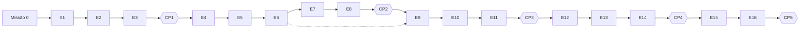

# Roadmap · 16 etapas

A trilha da Academia de Engenharia de IA. A referência é de **16 semanas × 3 horas = 48 horas**, mas as etapas
**não têm prazo**: cada aluno avança no próprio ritmo ([GAMIFICACAO.md](GAMIFICACAO.md#retomada-após-pausas)). As 48 horas
são das 16 etapas; a Missão 0 (cerca de 1h30) e os cinco checkpoints (30 a 45 minutos cada) ficam à parte.

O roadmap **não duplica** o conteúdo dos [módulos](../modulos/) do repositório. Ele define a ordem, os objetivos,
a entrega de cada etapa no [projeto evolutivo](projeto/README.md) e o critério de conclusão, e aponta para os
docs, exemplos e exercícios que já existem. Onde o repositório não cobre o assunto, a etapa lista a **lacuna**
que a lição vai preencher.

Antes da etapa 1: a [Missão 0 · Diagnóstico](licoes/00-missao-0-diagnostico/README.md).

## Visão geral

| Etapa | Fase | Título | Lição | Status |
|---|---|---|---|---|
| 1 | 1 | Tokens, contexto, inferência e limites dos LLMs | [Lição 1](licoes/01-tokens-contexto-inferencia/README.md) | pronta |
| 2 | 1 | APIs, TypeScript, erros e integração com modelos | [Lição 2](licoes/02-apis-erros-e-integracao/README.md) | pronta |
| 3 | 1 | Prompt engineering, saídas estruturadas e testes | — | roteiro |
| 4 | 2 | Ingestão, parsing, chunking e metadados | — | roteiro |
| 5 | 2 | Embeddings, busca vetorial e recuperação | — | roteiro |
| 6 | 2 | RAG com respostas fundamentadas e citações | — | roteiro |
| 7 | 2 | Avaliação da recuperação, fidelidade e abstenção | — | roteiro |
| 8 | 2 | Busca híbrida, reranking e otimização de custos | — | roteiro |
| 9 | 3 | Function calling, schemas e ferramentas | — | roteiro |
| 10 | 3 | Ciclo de execução, estado, memória e limites | — | roteiro |
| 11 | 3 | Segurança, permissões, guardrails e aprovação humana | — | roteiro |
| 12 | 4 | Model Context Protocol (MCP), clientes e servidores | — | roteiro |
| 13 | 4 | Skills, contexto e coding agents | — | roteiro |
| 14 | 4 | Arquitetura, observabilidade, logs, métricas e decisões técnicas | — | roteiro |
| 15 | 5 | Integração, testes end-to-end e execução reproduzível | — | roteiro |
| 16 | 5 | Capstone, demonstração técnica e avaliação final | — | roteiro |

- **pronta**: a lição completa (as 15 seções do [template](templates/licao.md)) está em `licoes/`.
- **roteiro**: o plano da etapa está abaixo; a lição é escrita com o [template](templates/licao.md) quando o aluno chegar lá
  (ou antes, em um PR). Enquanto isso, o material existente do repositório já permite estudar a etapa.

Fases: **1** Fundamentos de LLMs · **2** RAG e recuperação de conhecimento · **3** Agentes · **4** Ecossistema e
arquitetura · **5** Projeto integrador. Cada fase termina em um [checkpoint de domínio](GAMIFICACAO.md#checkpoints-de-domínio).

## Dependências

A ordem é recomendada, não forçada. A única dependência dura é a de **dados**: o projeto evolutivo reaproveita o
código da etapa anterior, então pular uma etapa exige fazer a entrega dela depois.

## Como ler cada etapa

- **Material no repositório**: docs, exemplos e exercícios existentes que cobrem o assunto. Estude-os; não
  reescreva. Cada exemplo e cada solução de exercício dos módulos existe em **JavaScript e em Python** (a versão Python
  fica na subpasta `python/` do exemplo, com a saída real no mesmo README): o aluno escolhe a linguagem. Os
  laboratórios da Academia também podem ser feitos em qualquer linguagem quando o verificador só confere arquivos de
  resultado (como o da Lição 1, que aceita `medir.mjs`, `medir.py`, `medir.ts`...).
- **A criar**: lacunas que as lições da Academia preenchem.
- **Entrega no projeto**: o incremento do [projeto evolutivo](projeto/README.md) que comprova a etapa.
- **Conclusão**: o mínimo para marcar a etapa como `concluida` no relatório de sessão: `E<NN>-quiz` e `E<NN>-lab`
  aprovados (o validador exige). A explicação independente (`E<NN>-explicacao`) é recomendada, e as competências da
  etapa devem ser registradas; as que ficarem abaixo do nível 2 viram **pendência de reforço** no relatório. O nível 2
  de todas as competências da fase é exigido no checkpoint, não na etapa.

---

## Fase 1 · Fundamentos de LLMs

### Etapa 1 · Tokens, contexto, inferência e limites dos LLMs

- **Pergunta-guia:** quanto "cabe" numa chamada, quanto custa e por que a resposta demora?
- **Competências:** C01, C02, C03.
- **Material no repositório:** [M01 · doc 03](../modulos/01-fundamentos-ia-llms/docs/03-llms-e-prompt-engineering.md) ·
  [LLMOps · doc 02](../trilhas-extras/llmops-vllm-openshift/docs/02-fundamentos-de-llm.md) ·
  [LLMOps · exemplo 02 (tokens e sampling)](../trilhas-extras/llmops-vllm-openshift/exemplos/02-tokens-e-sampling/) ·
  [M04 · exemplo 05 (contexto)](../modulos/04-agentes-autonomos/exemplos/05-gerenciamento-de-contexto/) ·
  [M02 · doc 02 (custo)](../modulos/02-apis-ia-generativa/docs/02-consistencia-e-custo.md).
- **A criar:** a [Lição 1](licoes/01-tokens-contexto-inferencia/README.md), com laboratório de medição que roda em
  qualquer endpoint compatível com a API de chat (Ollama local ou provedor).
- **Entrega no projeto:** a linha de base de tokens (`medir.mjs` + `relatorio.json`), reaproveitada no cliente da etapa 2
  (janela e reserva de saída) e no custo por execução da etapa 14.
- **Conclusão:** quiz + laboratório verificado (`verificar.mjs`) + explicação independente.

### Etapa 2 · APIs, TypeScript, erros e integração com modelos

- **Pergunta-guia:** como chamar um modelo de forma robusta e trocar de provedor sem reescrever o código?
- **Competências:** C04, C05.
- **Material no repositório:** [M01 · `lib/llm.js`](../modulos/01-fundamentos-ia-llms/lib/llm.js) ·
  [M01 · exemplo 06 (Ollama e OpenRouter)](../modulos/01-fundamentos-ia-llms/exemplos/06-openrouter-e-ollama/) ·
  [M02 · exemplo 04 (API back-end com LLM)](../modulos/02-apis-ia-generativa/exemplos/04-api-backend-com-llm/) ·
  [M02 · exercício 01 (validação e retry)](../modulos/02-apis-ia-generativa/exercicios/01-chain-com-validacao-e-retry/).
- **A criar:** a [Lição 2](licoes/02-apis-erros-e-integracao/README.md): **TypeScript** (o repositório usa JavaScript): tipar requisição, resposta e erros; taxonomia de falhas
  (rede, timeout, limite de taxa, cota, conteúdo truncado); execução de `.ts` no Node (*type stripping*, reverificado em 2026-10-20); laboratório que
  executa o cliente do aluno, em qualquer linguagem, contra um servidor falso que falha de propósito.
- **Entrega no projeto:** `src/llm/cliente.ts` com timeout, retry com backoff, erros tipados e configuração por ambiente.
- **Conclusão:** quiz + laboratório com testes que simulam falhas (servidor falso) + explicação.

### Etapa 3 · Prompt engineering, saídas estruturadas e testes

- **Pergunta-guia:** como transformar um prompt em algo que se versiona, valida e testa?
- **Competências:** C06, C07.
- **Material no repositório:** [M01 · exemplo 04 (prompt engineering medido)](../modulos/01-fundamentos-ia-llms/exemplos/04-prompt-engineering/) ·
  [M02 · doc 01](../modulos/02-apis-ia-generativa/docs/01-engenharia-de-prompts-avancada.md) ·
  [M02 · exemplo 01 (chaining e templates)](../modulos/02-apis-ia-generativa/exemplos/01-prompt-chaining-e-templates/) ·
  [M02 · `comum/estruturado.js`](../modulos/02-apis-ia-generativa/comum/estruturado.js) ·
  [LLMOps · exemplo 05 (avaliação com pytest)](../trilhas-extras/llmops-vllm-openshift/exemplos/05-avaliacao-com-pytest/).
- **A criar:** conjunto de casos de teste de prompts com gabarito; validação por JSON Schema; reparo/retry guiado pelo erro de schema.
- **Entrega no projeto:** `prompts/` versionados + extração estruturada validada + suíte de testes dos prompts.
- **Conclusão:** quiz + laboratório (≥ 90% dos casos válidos no conjunto de teste) + explicação. **Fecha a fase: CP1.**

## Fase 2 · RAG e recuperação de conhecimento

### Etapa 4 · Ingestão, parsing, chunking e metadados

- **Pergunta-guia:** que informação preciso guardar de cada trecho para poder citá-lo e auditá-lo depois?
- **Competências:** C08, C09.
- **Material no repositório:** [M01 · exemplo 05 (corpus e chunking)](../modulos/01-fundamentos-ia-llms/exemplos/05-primeiro-rag/) ·
  [M01 · exercício 02 (chunking e top-k medidos)](../modulos/01-fundamentos-ia-llms/exercicios/02-rag-chunking-top-k/) ·
  [M02 · exemplo 05 (documentos e OCR)](../modulos/02-apis-ia-generativa/exemplos/05-documentos-ocr-e-visao/).
- **A criar:** parsing de Markdown/HTML/PDF com preservação de estrutura (títulos, tabelas); esquema de metadados
  (fonte, seção, hash, data); chunking por estrutura × janela fixa, comparados.
- **Entrega no projeto:** pipeline `ingerir` que transforma o corpus do projeto em chunks com metadados rastreáveis.
- **Conclusão:** quiz + laboratório (100% dos chunks com fonte e posição) + explicação.

### Etapa 5 · Embeddings, busca vetorial e recuperação

- **Pergunta-guia:** o que significa "parecido" para um vetor, e quando a busca vetorial falha?
- **Competências:** C10.
- **Material no repositório:** [M01 · doc 04](../modulos/01-fundamentos-ia-llms/docs/04-rag-mcp-e-modelos.md) ·
  [M01 · `lib/rag.js`](../modulos/01-fundamentos-ia-llms/lib/rag.js) ·
  [M08 · exemplo 04 (padrões de RAG)](../modulos/08-arquitetura-de-sistemas-com-ia/exemplos/04-padroes-de-rag/) ·
  [infra](../infra/instalacao.md) (Postgres + pgvector).
- **A criar:** limites da similaridade por cosseno (negação, números, nomes próprios); escolha entre armazenamento em memória e pgvector.
- **Entrega no projeto:** `buscar(pergunta, k)` sobre os chunks, com índice persistente.
- **Conclusão:** quiz + laboratório (consulta devolve os trechos esperados em casos de teste) + explicação.

### Etapa 6 · RAG com respostas fundamentadas e citações

- **Pergunta-guia:** como obrigar a resposta a se apoiar nas fontes e mostrar quais foram?
- **Competências:** C11.
- **Material no repositório:** [M01 · exemplo 05](../modulos/01-fundamentos-ia-llms/exemplos/05-primeiro-rag/) ·
  [M02 · exemplo 03 (RAG com LangChain.js: use para **comparar** com a sua versão sem framework)](../modulos/02-apis-ia-generativa/exemplos/03-rag-langchain-observabilidade/) ·
  [M11 · entrega 1 (RAG em CLI)](../modulos/11-capstone-micro-saas/exemplos/01-entrega-1-rag-cli/).
- **A criar:** prompt de resposta fundamentada com formato de citação verificável (a citação aponta um chunk que
  realmente foi recuperado); verificador de citações.
- **Entrega no projeto:** `perguntar` devolve resposta + fontes; citações inválidas são detectadas.
- **Conclusão:** quiz + laboratório (100% das citações apontam para chunks recuperados) + explicação.

### Etapa 7 · Avaliação da recuperação, fidelidade e abstenção

- **Pergunta-guia:** como saber se o RAG melhorou, e como fazê-lo dizer "não sei" quando deve?
- **Competências:** C12, C13.
- **Material no repositório:** [M01 · exercício 02 (hit@k e MRR)](../modulos/01-fundamentos-ia-llms/exercicios/02-rag-chunking-top-k/) ·
  [M11 · exercício 02 (avaliação no CI)](../modulos/11-capstone-micro-saas/exercicios/02-avaliacao-no-ci/) ·
  [M08 · exercício 02 (agentic RAG)](../modulos/08-arquitetura-de-sistemas-com-ia/exercicios/02-agentic-rag/) ·
  [LLMOps · doc 05 (avaliação)](../trilhas-extras/llmops-vllm-openshift/docs/05-avaliacao.md).
- **A criar:** métrica de **fidelidade** (a afirmação está sustentada pelo trecho?), com checagem lexical e LLM como
  juiz, e a limitação de cada uma; política de **abstenção** com limiar medido; conjunto de avaliação com perguntas sem resposta.
- **Extensão prática:** [RAG avançado](extensoes/rag-avancado/README.md) (fluxo corretivo com abstenção testado; CRAG, Self-RAG e GraphRAG explicados).
- **Entrega no projeto:** `avaliar` gera relatório com hit@k, MRR, fidelidade e taxa de abstenção correta (≥ 20 perguntas, ≥ 5 sem resposta).
- **Conclusão:** quiz + laboratório (relatório reproduzível) + explicação.

### Etapa 8 · Busca híbrida, reranking e otimização de custos

- **Pergunta-guia:** quando vale pagar mais por recuperação melhor?
- **Competências:** C14.
- **Material no repositório:** [M08 · exemplo 04 (busca híbrida com RRF)](../modulos/08-arquitetura-de-sistemas-com-ia/exemplos/04-padroes-de-rag/) ·
  [M08 · exemplo 05 (roteador e cache semântico)](../modulos/08-arquitetura-de-sistemas-com-ia/exemplos/05-roteador-e-cache-semantico/) ·
  [M02 · exemplo 02 (custo e cache)](../modulos/02-apis-ia-generativa/exemplos/02-custo-e-cache/) ·
  [M10 · exemplo 05 (custos e orçamento)](../modulos/10-seguranca-e-governanca/exemplos/05-custos-e-orcamento/).
- **A criar:** **reranking** (o repositório não cobre): reranker por LLM ou por modelo dedicado, medido contra o
  baseline da etapa 7; tabela custo × qualidade.
- **Extensão prática:** [RAG avançado](extensoes/rag-avancado/README.md) (quando usar híbrido, reranking e RAG corretivo, e como medir).
- **Entrega no projeto:** recuperação híbrida (lexical + vetorial) com reranking opcional e relatório de custo por pergunta.
- **Conclusão:** quiz + laboratório (a mudança é aceita ou rejeitada **pelos números** da etapa 7) + explicação. **Fecha a fase: CP2.**

## Fase 3 · Agentes

### Etapa 9 · Function calling, schemas e ferramentas

- **Pergunta-guia:** como descrever uma ferramenta para que o modelo a use bem e o código a execute com segurança?
- **Competências:** C15.
- **Material no repositório:** [M04 · doc 02](../modulos/04-agentes-autonomos/docs/02-tools-memoria-e-contexto.md) ·
  [M04 · exemplo 01 (agent loop do zero)](../modulos/04-agentes-autonomos/exemplos/01-agent-loop-do-zero/) ·
  [M04 · exemplo 03 (tools externas)](../modulos/04-agentes-autonomos/exemplos/03-tools-externas/) ·
  [M04 · exercício 01](../modulos/04-agentes-autonomos/exercicios/01-tool-nova-e-orcamento/).
- **A criar:** contrato de ferramenta (nome, descrição, schema de entrada, schema de saída, efeitos colaterais) e
  validação dos argumentos que o modelo gera antes de executar.
- **Entrega no projeto:** ≥ 3 ferramentas (por exemplo `buscar_docs`, `ler_trecho`, `contar_tokens`) expostas ao modelo por function calling.
- **Conclusão:** quiz + laboratório (argumentos inválidos são rejeitados sem executar a ferramenta) + explicação.

### Etapa 10 · Ciclo de execução, estado, memória e limites

- **Pergunta-guia:** como impedir que um agente rode para sempre, gaste demais ou esqueça o que importa?
- **Competências:** C16.
- **Material no repositório:** [M04 · doc 01](../modulos/04-agentes-autonomos/docs/01-arquitetura-e-padroes-de-raciocinio.md) ·
  [M04 · doc 03 (leia só runaway loops e limites; o resto é LangGraph, extensão)](../modulos/04-agentes-autonomos/docs/03-langgraph-observabilidade-e-limites.md) ·
  [M04 · exemplos 02, 04 e 05](../modulos/04-agentes-autonomos/exemplos/) ·
  [M08 · exemplo 02](../modulos/08-arquitetura-de-sistemas-com-ia/exemplos/02-single-agent-simulado/).
- **A criar:** loop de agente com estado explícito e orçamentos (passos, tokens, tempo); condição de parada e
  registro do motivo da parada.
- **Extensão prática:** [memória persistente via MCP](extensoes/memoria-persistente-mcp/README.md) (memória entre sessões, com escopo e sem segredos) e o [time de agentes](extensoes/time-de-agentes/README.md) (orçamentos, escalonamento e auditoria em uso real).
- **Entrega no projeto:** `agente` que usa as ferramentas da etapa 9 com limites configuráveis.
- **Conclusão:** quiz + laboratório (o agente para por orçamento em um caso de loop forçado) + explicação.

### Etapa 11 · Segurança, permissões, guardrails e aprovação humana

- **Pergunta-guia:** o que o agente pode fazer sozinho e o que exige um humano?
- **Competências:** C17, C18.
- **Material no repositório:** [M08 · exemplo 06 (approval gate)](../modulos/08-arquitetura-de-sistemas-com-ia/exemplos/06-hitl-approval-gate/) ·
  [M04 · exemplo 06 (HITL e guardrails com LangGraph: extensão, depois do conceito)](../modulos/04-agentes-autonomos/exemplos/06-langgraph-hitl-guardrails/) ·
  [M10 · exemplos 03 e 04 (prompt injection, PII)](../modulos/10-seguranca-e-governanca/exemplos/) ·
  [M10 · exercício 02](../modulos/10-seguranca-e-governanca/exercicios/02-endurecer-o-prompt/) ·
  [M03 · doc 04 (segurança)](../modulos/03-mcp/docs/04-seguranca-e-governanca.md).
- **A criar:** classificação das ferramentas por risco (leitura, escrita reversível, irreversível), permissões mínimas
  e testes adversariais (injeção em documento recuperado).
- **Extensão prática:** [harness de agentes](extensoes/harness-de-agentes/README.md) (registro de ferramentas com risco, aprovação, timeout e auditoria; estudo de caso de SSRF em `http_get`).
- **Entrega no projeto:** ferramenta de escrita protegida por aprovação humana + suíte de testes de injeção.
- **Conclusão:** quiz + laboratório (os ataques do conjunto de teste são bloqueados) + explicação. **Fecha a fase: CP3.**

## Fase 4 · Ecossistema e arquitetura

### Etapa 12 · Model Context Protocol (MCP), clientes e servidores

- **Pergunta-guia:** quando expor uma capacidade como servidor MCP em vez de uma função interna?
- **Competências:** C19.
- **Material no repositório:** [módulo 03 inteiro](../modulos/03-mcp/) (docs 01–04, exemplos 01–05, exercícios 01–02) ·
  [M11 · entrega 2 (API e MCP)](../modulos/11-capstone-micro-saas/exemplos/02-entrega-2-api-e-mcp/).
- **A criar:** só a ponte com o projeto evolutivo; o conteúdo de MCP já existe.
- **Extensão prática:** [memória persistente via MCP](extensoes/memoria-persistente-mcp/README.md) (servidor de memória de referência e revisão de um servidor real).
- **Entrega no projeto:** as ferramentas de busca do projeto expostas como servidor MCP, testadas com o Inspector ou um cliente próprio.
- **Conclusão:** quiz + laboratório (cliente MCP lista e chama as ferramentas) + explicação.

### Etapa 13 · Skills, contexto e coding agents

- **Pergunta-guia:** como dar a um agente de código o contexto certo, e como revisar o que ele entrega?
- **Competências:** C20.
- **Material no repositório:** [M03 · doc 02 (clients e IDEs)](../modulos/03-mcp/docs/02-mcp-em-javascript.md) ·
  [M05 · doc 02 (agentes e CLI)](../modulos/05-ia-ux-ui/docs/02-agentes-e-cli-no-front-end.md) ·
  [M04 · exemplo 05 (contexto)](../modulos/04-agentes-autonomos/exemplos/05-gerenciamento-de-contexto/).
- **Extensão prática (cobre parte da lacuna):** [harness de agentes](extensoes/harness-de-agentes/README.md) (`AGENTS.md`, personas, skills e avaliadores prontos para adaptar),
  [engenharia reversa](extensoes/engenharia-reversa/README.md) (entender e auditar código herdado com um agente, com evidência) e o
  [time de agentes](extensoes/time-de-agentes/README.md).
- **A criar:** a lição completa desta etapa (quiz, laboratório com verificador e rubrica) sobre arquivos de instrução para agentes,
  *skills*, escopo e permissões de um coding agent e revisão crítica do código gerado. Conteúdo específico de fornecedor, com data de verificação.
- **Entrega no projeto:** arquivo de contexto do projeto + uma skill própria + uma funcionalidade implementada com
  coding agent, com relatório de revisão (o que foi aceito, corrigido e rejeitado).
- **Conclusão:** quiz + laboratório (revisão documentada, testes passando) + explicação.

### Etapa 14 · Arquitetura, observabilidade, logs, métricas e decisões técnicas

- **Pergunta-guia:** como saber o que o sistema fez, quanto custou e por que foi desenhado assim?
- **Competências:** C21, C22.
- **Material no repositório:** [módulo 08](../modulos/08-arquitetura-de-sistemas-com-ia/) ·
  [M04 · doc 03 (leia só observabilidade e auditoria)](../modulos/04-agentes-autonomos/docs/03-langgraph-observabilidade-e-limites.md) ·
  [M02 · `observabilidade.js`](../modulos/02-apis-ia-generativa/exemplos/03-rag-langchain-observabilidade/observabilidade.js) ·
  [LLMOps · doc 04 (métricas)](../trilhas-extras/llmops-vllm-openshift/docs/04-metricas-e-observabilidade.md) ·
  [M11 · doc 04 (ADRs)](../modulos/11-capstone-micro-saas/docs/04-apresentacao-e-defesa.md).
- **A criar:** esquema de log estruturado de uma execução (`run_id`, etapas, tokens, latência, custo estimado, erro).
- **Entrega no projeto:** log JSONL por execução, resumo de métricas e ≥ 3 ADRs. **Fecha a fase: CP4.**
- **Conclusão:** quiz + laboratório (o resumo reconstrói custo e latência a partir dos logs) + explicação.

## Fase 5 · Projeto integrador

### Etapa 15 · Integração, testes end-to-end e preparação para execução reproduzível

- **Pergunta-guia:** outra pessoa consegue rodar o projeto do zero e obter o mesmo resultado?
- **Competências:** C23.
- **Material no repositório:** [M11 · entrega 3 (compose e E2E)](../modulos/11-capstone-micro-saas/exemplos/03-entrega-3-front-e-implantacao/) ·
  [M11 · exercício 02 (avaliação no CI)](../modulos/11-capstone-micro-saas/exercicios/02-avaliacao-no-ci/) ·
  [infra](../infra/instalacao.md).
- **A criar:** teste E2E com LLM simulado (determinístico) e teste de fumaça com LLM real; roteiro de execução do zero.
- **Entrega no projeto:** `README` de execução + testes E2E; **o outro aluno (ou um assistente "limpo") executa o roteiro** e registra o que travou.
- **Conclusão:** quiz + laboratório (roteiro executado por terceiros sem ajuda) + explicação.

### Etapa 16 · Capstone, demonstração técnica e avaliação final

- **Pergunta-guia:** consigo demonstrar e defender cada decisão com evidências?
- **Competências:** C24.
- **Material no repositório:** [M11 · doc 04 (apresentação, ADRs e rubrica)](../modulos/11-capstone-micro-saas/docs/04-apresentacao-e-defesa.md) ·
  [módulo 11](../modulos/11-capstone-micro-saas/) como implementação de referência para comparação.
- **A criar:** roteiro de demonstração e avaliação final com rubrica por competência.
- **Entrega no projeto:** demonstração (gravada ou ao vivo) + relatório final com métricas, limitações e próximos passos.
- **Conclusão:** quiz final + capstone aprovado pela rubrica. **Fecha a fase: CP5.**

---

## Extensões e módulos avançados

Estes assuntos **não fazem parte do núcleo**. Entram como desafios `opcional` ([XP](GAMIFICACAO.md#xp)) depois da
etapa indicada, usando o material que o repositório já tem. Ensine o conceito primeiro; compare implementações só
quando houver valor pedagógico.

| Assunto | Depois da etapa | Material existente |
|---|---|---|
| Modelos locais e Ollama (como ambiente) | Missão 0 | [infra](../infra/instalacao.md) · [M01 · exemplo 06](../modulos/01-fundamentos-ia-llms/exemplos/06-openrouter-e-ollama/) |
| Quantização e serving (vLLM) | 3 | [trilha LLMOps](../trilhas-extras/llmops-vllm-openshift/) |
| Fine-tuning e LoRA | 7 | [módulo 09](../modulos/09-dados-e-fine-tuning/) |
| LangGraph | 10 | [M04 · exemplo 06](../modulos/04-agentes-autonomos/exemplos/06-langgraph-hitl-guardrails/) · [M04 · exercício 02](../modulos/04-agentes-autonomos/exercicios/02-linear-para-langgraph/) |
| Sistemas multiagente | 10 | [M04 · exemplo 07](../modulos/04-agentes-autonomos/exemplos/07-multiagente-supervisor/) · [M08 · exemplo 03](../modulos/08-arquitetura-de-sistemas-com-ia/exemplos/03-multiagente-com-fila/) |
| CRAG, Self-RAG e GraphRAG | 8 | [extensão RAG avançado](extensoes/rag-avancado/README.md) (guia + fluxo corretivo testado; GraphRAG só conceitual, sem laboratório) |
| Memória persistente via MCP | 10 | [extensão](extensoes/memoria-persistente-mcp/README.md) |
| Harness de agentes, personas e skills | 13 | [extensão](extensoes/harness-de-agentes/README.md) |
| Engenharia reversa assistida por IA | 13 | [extensão](extensoes/engenharia-reversa/README.md) |
| Time de agentes que delega, avalia e aprende | 10 | [extensão](extensoes/time-de-agentes/README.md) · [projetos práticos](extensoes/time-de-agentes/projetos-praticos.md) |
| MLOps (tracking, registry, drift) | 14 | [trilha MLOps](../trilhas-extras/mlops/) |
| UX/UI, DevOps, Gestão de Projetos e Carreira com IA | qualquer | módulos [05](../modulos/05-ia-ux-ui/), [06](../modulos/06-ia-devops/), [07](../modulos/07-ia-gestao-de-projetos/), [12](../modulos/12-carreira/) |

O Ollama aparece no núcleo apenas como **ambiente padrão** (sem chave, sem custo): a Academia ensina os conceitos de
modelos locais como extensão.

## Lacunas conhecidas do repositório

Tópicos do roadmap que o repositório ainda não cobre e que as lições da Academia devem criar (o TypeScript, antes aqui, entrou na [Lição 2](licoes/02-apis-erros-e-integracao/README.md)):
parsing de PDF/HTML (etapa 4), métrica de fidelidade e abstenção medida (etapa 7), reranking (etapa 8), skills e
coding agents (etapa 13, parcialmente coberta pelas [extensões](extensoes/README.md)), GraphRAG com laboratório (extensões).
