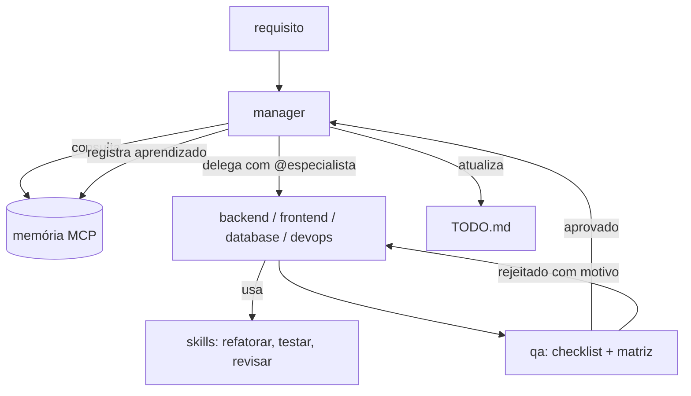

# Extensão · Harness de agentes (personas, skills, regras, ferramentas e memória)

Um modelo sozinho não é um agente. O que o transforma em algo que trabalha com segurança é o **harness**: o conjunto de
código, instruções e controles em volta dele. Esta extensão desmonta o harness, usa o squad de agentes do `jps-agents`
como estudo de caso (o que funciona e o que é frágil) e entrega um registro de ferramentas testado e modelos de
`AGENTS.md`, personas e *skills* prontos para adaptar.

| Item | Valor |
|---|---|
| Entra no roadmap | **etapa 13** (skills, contexto e coding agents — era a principal lacuna), e reforça 9, 10 e 11 — veja o [ROADMAP](../../ROADMAP.md) |
| Competências | [C15, C16, C17, C20, C22](../../competencias.md#catálogo) |
| Pré-requisitos | etapas 9 e 10 (ferramentas e ciclo do agente); [M04 · agent loop do zero](../../../modulos/04-agentes-autonomos/exemplos/01-agent-loop-do-zero/) |
| Duração | 4 horas |
| Revisado em | 2026-10-18 |

## 1. O que é um harness

> **Harness** (neste guia): tudo o que está ao redor do modelo e que o torna um agente utilizável e controlável.

Não confunda com o **harness de avaliação** (como o `lm-evaluation-harness`, citado na [trilha de LLMOps](../../../trilhas-extras/llmops-vllm-openshift/docs/05-avaliacao.md)),
que é o conjunto de testes que mede um modelo. Os dois se encontram na etapa 7 e na 14: o harness de agente
**precisa** de um harness de avaliação para saber se melhorou.

| Componente | Pergunta que responde | Onde está neste repositório |
|---|---|---|
| **Ciclo** | como o agente decide, age, observa e para? | [M04 · ex. 01 e 02](../../../modulos/04-agentes-autonomos/exemplos/01-agent-loop-do-zero/) |
| **Ferramentas** | o que ele pode fazer, com que contrato? | [`referencia/registro-de-ferramentas.mjs`](referencia/registro-de-ferramentas.mjs) |
| **Instruções e contexto** | quem ele é, o que sabe do projeto, o que nunca faz? | [`modelo/`](modelo/) (`AGENTS.md`, personas, skills) |
| **Memória** | o que ele lembra entre sessões? | [extensão de memória](../memoria-persistente-mcp/README.md) |
| **Permissões e aprovação** | o que é livre, o que exige um humano? | registro de ferramentas + [M08 · ex. 06](../../../modulos/08-arquitetura-de-sistemas-com-ia/exemplos/06-hitl-approval-gate/) |
| **Orçamentos e parada** | quando desiste ou para? | [M04 · doc 03](../../../modulos/04-agentes-autonomos/docs/03-langgraph-observabilidade-e-limites.md) |
| **Observabilidade** | o que ele fez, quanto custou? | auditoria do registro; [etapa 14](../../ROADMAP.md) |
| **Avaliação** | como sei se está melhor? | [etapa 7](../../ROADMAP.md) |

## 2. O padrão "squad" do `jps-agents`

O repositório `jps-agents` organiza o trabalho de um coding agent (no Windsurf) assim:



Ingredientes: **regras** do squad (`.windsurfrules`), **personas** (identidade, responsabilidades, checklists), **skills**
(prompts reutilizáveis), **memória** tipada (`task_`, `learning_`, `arch_decision_`...) e um **TODO.md** como estado
compartilhado. É a mesma ideia de `AGENTS.md` + skills de outros ambientes, com nomes diferentes:

| Conceito | No `jps-agents` | Formato aberto/oficial |
|---|---|---|
| Contexto do projeto para agentes | `.windsurfrules` | [`AGENTS.md`](https://agents.md): "um README para agentes", Markdown simples, entendido por vários agentes |
| Capacidade reutilizável carregada sob demanda | `skills/*.md` | [Agent Skills](https://platform.claude.com/docs/en/agents-and-tools/agent-skills/overview): pasta com `SKILL.md` (frontmatter `name` e `description`), com *progressive disclosure*: só nome e descrição ficam sempre no contexto |
| Papéis | `personas/*.md` | mesmo mecanismo: instruções de papel carregadas quando o papel é chamado |

### O que funciona (e vale copiar)

- **Papéis com responsabilidades claras** e um fluxo com *gate* de qualidade (o QA aprova ou rejeita **com motivo**).
- **Matriz de decisão do QA** que pesa entrega, qualidade, tempo, custo **e segurança** (não só "funciona").
- **Protocolo de post-mortem** e memória tipada: cada tarefa deixa um aprendizado consultável.
- **Checklists** curtos e objetivos (por exemplo, "nenhuma chave em arquivo versionado" antes de commit).
- **Registro de ferramentas** com contrato simples (`name`, `description`, `inputSchema`, `execute`): é o formato certo; o
  problema é o que falta nele.

### O que é frágil (e como o harness corrige)

| Fragilidade | Por que importa | Correção |
|---|---|---|
| **Regras só em prompt** ("sempre consulte a memória", "sempre atualize o TODO") | um modelo pode esquecer, errar ou ser induzido; prompt não é garantia | o que precisa ser **garantido** vira código/hook/teste (validar, bloquear commit, exigir aprovação); o prompt só orienta |
| **Tempo medido pelo próprio agente** ("timeout 30s/60s/120s") | um LLM não tem relógio confiável | o **harness** mede o tempo e impõe o timeout (`timeoutMs` no registro) |
| **Credenciais "na memória MCP"** (persona do manager e do configurador) | segredo em texto plano, persistente e legível pelo modelo | cofre ou variável de ambiente; a [memória recusa segredos](../memoria-persistente-mcp/README.md#4-segurança-da-memória) |
| **Afirmações sem evidência** ("reduz entregas ruins em 95%", "6–10x mais rápido") nos "aprendizados" | vira dogma que o próprio squad consulta depois | todo aprendizado cita **dado, comando ou link**; sem evidência, é hipótese |
| **Infraestrutura em arquivos de regras e README** (endereços, usuários, identificadores) | vaza para forks, logs e contexto de modelo, e dá o mapa de ataque | configuração fora do repositório; acesso com usuário sem privilégios |
| **Ferramenta de rede sem limites** (`http_get`) | veja SSRF abaixo | lista de destinos permitidos, bloqueio de redes internas, limite de tamanho |
| **Documentação que descreve o que o código não faz** | confiança falsa | engenharia reversa: teste a afirmação ([extensão de engenharia reversa](../engenharia-reversa/README.md)) |

## 3. Estudo de caso: o servidor de ferramentas do `jps-agents`

Código em [`estudo-de-caso/jps-agents-mcp/`](estudo-de-caso/jps-agents-mcp/) (snapshots; as linhas abaixo são as desses arquivos). A documentação que o código deveria
cumprir está no trecho [`TOOLS_ARCHITECTURE.trecho.md`](estudo-de-caso/jps-agents-mcp/TOOLS_ARCHITECTURE.trecho.md) (aqui o número da linha é o do trecho). Gravidade é uma
estimativa para um agente que usa a ferramenta com texto não confiável: **alta** = abuso direto; **média** = falha provável ou degradação; **baixa** = hardening.

| # | Gravidade | Onde | Achado | Consequência | Correção |
|---|---|---|---|---|---|
| 1 | média | `server-index.js` L33, L56, L70; `tools-http-get.js` L35, L49 | `console.log` em servidor **stdio** | escreve no `stdout`, que é o canal JSON-RPC: corrompe o protocolo ([especificação](https://modelcontextprotocol.io/specification/2025-11-25/basic/transports): o servidor "MUST NOT write anything to its stdout that is not a valid MCP message"; a revisão 2026-07-28 mantém a regra) | `console.error` para logs |
| 2 | média | `tools-index.js` L40; `TOOLS_ARCHITECTURE.trecho.md` L36 ("3. Valida inputSchema") e L71 ("Validar inputs em todas as tools") | a documentação afirma validar o `inputSchema`; o código chama `tool.execute(args)` direto | argumentos do modelo chegam sem validação | `validarEsquema` antes de executar (referência) |
| 3 | média | `server-index.js` L36–L46 | o resultado de falha (`success: false`) é devolvido como texto normal, sem `isError` | o cliente/modelo não distingue erro de sucesso | erro estruturado com código; `isError` no MCP |
| 4 | **alta** | `tools-http-get.js` L31, L37–L40 | `http_get` aceita **qualquer URL** e segue até 5 redirecionamentos | **SSRF**: o modelo (ou um texto injetado) pode alcançar `localhost`, redes internas e o serviço de metadados da nuvem | lista de destinos permitidos; resolver o DNS e bloquear IPs privados/loopback/link-local; não seguir redirecionamentos para fora da lista |
| 5 | média | `tools-http-get.js` L31 e L38 (entrada); L57 (saída) | cabeçalhos arbitrários na entrada e **todos** os cabeçalhos da resposta na saída | enviar credenciais a terceiros; devolver `set-cookie` ao modelo | lista de cabeçalhos permitidos; devolver só o necessário |
| 6 | média | `tools-http-get.js` L37–L40, L48 | sem limite de tamanho da resposta; `data` pode voltar em qualquer tipo e o log calcula `data.length` sem conferir | estouro de memória/contexto; log com "undefined chars" quando não é texto | `maxContentLength`; converter para texto e limitar (`limiteSaida` no registro) |
| 7 | média | `tools-index.js` (todas) | nenhuma noção de risco nem de permissão | uma ferramenta de escrita futura (`file_write`, `shell_exec` no roadmap, `TOOLS_ARCHITECTURE.trecho.md` L61–L63) entra com o mesmo poder da leitura | campo `risco`, permissões e aprovação humana |
| 8 | baixa | `tools-http-get.js` L35 | loga a URL completa (a documentação promete "não expor informações sensíveis em logs", L73) | tokens em query string vão para o log | logar só host e caminho |
| 9 | média | `tools-http-get.js` L22–L24, L31 | o `timeout` vem do modelo, sem teto | o modelo escolhe quanto tempo prender o servidor | teto fixo no harness (`timeoutMs` do registro) |
| 10 | média | `tools-http-get.js` L61–L66 (retorno de erro) | `error.message` e o `status` voltam ao modelo | com SSRF, serve de oráculo para varrer portas e serviços internos (a mensagem muda entre "recusou", "tempo esgotado" e "404") | erros genéricos para o modelo; detalhes só no log do harness |

O roadmap da documentação (`shell_exec`, `file_write`, `email_send`...) é exatamente o ponto em que o
registro precisa de **riscos e aprovação** antes de crescer.

## 4. O registro de ferramentas de referência

[`referencia/registro-de-ferramentas.mjs`](referencia/registro-de-ferramentas.mjs): o mesmo formato do original, endurecido.

```js
import { criarRegistro } from './registro-de-ferramentas.mjs';

const registro = criarRegistro({
  permissoes: ['leitura', 'escrita'],        // 'irreversivel' só com aprovação humana
  aprovar: async ({ ferramenta, resumo, quem }) => perguntarAoHumano(ferramenta, resumo, quem),   // `resumo`: argumentos já mascarados e sem caracteres de controle
  auditoria: (evento) => console.error(JSON.stringify(evento)),   // stderr! (veja o item 1 acima)
  timeoutMs: 10_000, limiteSaida: 20_000,
});

registro.registrar({
  nome: 'buscar_docs',
  descricao: 'Busca trechos na documentação do projeto por palavras-chave. Somente leitura.',
  risco: 'leitura',
  esquema: { type: 'object', properties: { consulta: { type: 'string', minLength: 2, maxLength: 200 } },
             required: ['consulta'], additionalProperties: false },
  executar: async ({ consulta }, { signal }) => buscar(consulta, { signal }),
});

registro.definicoes();                        // vai para o modelo: { name, description, inputSchema } (formato MCP; function calling da OpenAI chama o esquema de `parameters`). Sem risco, sem função
await registro.executar('buscar_docs', { consulta: 'tokens' }, { quem: 'agente-qa' });
// -> { ok: true, resultado: '...', truncado: false }  |  { ok: false, erro: { codigo, mensagem, problemas? } }
```

O que ele garante (cada item tem teste em [`registro-de-ferramentas.test.mjs`](referencia/registro-de-ferramentas.test.mjs) e
[`registro-de-ferramentas.robustez.test.mjs`](referencia/registro-de-ferramentas.robustez.test.mjs)):

- **Cadastro:** contrato validado; o esquema só pode usar o que a validação realmente aplica (`oneOf`, `$ref`, `format`... são **recusados**, em vez de ignorados em silêncio),
  objetos aninhados também fechados, `pattern` exige `maxLength` e recusa o formato clássico de ReDoS. O registro guarda uma **cópia congelada** da ferramenta: mudar o objeto depois
  do cadastro (risco, esquema, função) não muda a política em vigor.
- **Argumentos:** validados **antes** de executar e **antes** de pedir aprovação, sobre uma **cópia** (o que foi validado e aprovado é o que executa); `__proto__`/`constructor` não passam por
  campos; `NaN`, `Infinity`, `BigInt`, `Date` e funções são recusados.
- **Permissões:** por risco; irreversível só com `true` exato do aprovador (erro ou rejeição na função de aprovação = negado); quem decide recebe um `resumo` mascarado e sem caracteres de controle, não os argumentos crus.
- **Execução:** timeout com cancelamento (`AbortSignal`); limite de saída; segredos mascarados no resultado; resultado `undefined`/circular/função vira erro estruturado; erros sem stack e sem segredos.
- **Auditoria:** registra os **nomes** dos argumentos e nunca os valores; para escrita e irreversível há um evento `iniciada` **antes** de executar; se a auditoria falhar, uma ação irreversível **não executa**.

Limite: o timeout é **cooperativo** (a ferramenta recebe um `AbortSignal`); uma ferramenta que o ignore continua rodando em segundo plano. Por isso, enquanto uma ferramenta que estourou o tempo não terminar,
novas chamadas a ela são recusadas (`ferramenta_ocupada`); ferramentas de escrita precisam, de qualquer forma, ser idempotentes ou respeitar o sinal.

## 5. Modelos prontos para adaptar

| Arquivo | Para quê |
|---|---|
| [`modelo/AGENTS.md`](modelo/AGENTS.md) | contexto do projeto para qualquer coding agent: comandos, estilo, segurança, memória, papéis |
| [`modelo/personas/`](modelo/personas/) | 7 executores: `manager`, `backend`, `frontend`, `ux-ui`, `testes`, `diagramas` e `documentos`, com evidência, gates objetivos e sem credenciais na memória |
| [`modelo/avaliadores/`](modelo/avaliadores/) | 3 avaliadores: `qa`, `seguranca` e `editor` (documentos, diagramas e especificações de UX) |
| [`modelo/skills/`](modelo/skills/) | `revisao-de-codigo`, `testes`, `diagramas-mermaid` e `documentacao`, cada uma em `SKILL.md` (`name` e `description` no frontmatter) |

Foram reescritos a partir das ideias do `jps-agents` (nada de infraestrutura, nomes de projetos ou credenciais).
Onde instalar uma skill: no Claude Code, `.claude/skills/<nome>/SKILL.md` (projeto) ou `~/.claude/skills/<nome>/SKILL.md` (pessoal); outros ambientes variam, e `AGENTS.md` é o formato mais portável.
Substitua os trechos entre `<...>` e **apague o que não usa**: contexto sobrando custa tokens em toda chamada.

## 6. Exercícios

1. **Engenharia reversa do harness.** Aplique o [protocolo](../engenharia-reversa/README.md) aos snapshots desta pasta
   e produza o relatório (componentes, fluxo de dados, contratos, riscos). *Critério:* ≥ 8 achados com `arquivo:linha`,
   marcando o que é **fato** (lido no código) e o que é **inferência**.
2. **Porte para o registro.** Reescreva `http_get` como ferramenta do registro com `risco: 'leitura'`, destinos
   permitidos e bloqueio de IPs privados. *Critério:* testes para `http://127.0.0.1`, `http://169.254.169.254`, um
   redirecionamento para rede interna e um destino permitido.
3. **Persona com gate.** Escolha uma persona dos modelos e transforme um critério dela em **verificação executável**
   (por exemplo, o checklist "nenhuma chave no commit" vira um script que falha o commit). *Critério:* o script reprova um
   caso real e aprova um limpo.
4. **Integração (projeto evolutivo, etapa 13).** Adapte `modelo/AGENTS.md` ao seu projeto e use um coding agent para
   implementar uma funcionalidade pequena. Entregue o relatório de revisão: o que o agente fez, o que você aceitou,
   corrigiu ou rejeitou, e por quê.

## 7. Critérios de aceitação e rubrica

| ID | Critério (objetivo) |
|---|---|
| CA1 | `node --test "academia/extensoes/harness-de-agentes/referencia/*.test.mjs"` passa |
| CA2 | Exercício 2: os quatro testes de SSRF existem e passam |
| CA3 | Exercício 3: o script de verificação reprova um caso real |
| CA4 | Nenhuma credencial, IP interno ou nome de projeto privado nos arquivos entregues |

| Critério | 1 | 2 | 3 |
|---|---|---|---|
| **Prompt × código** (C20, C17) | trata regras de prompt como garantia | separa o que o prompt orienta do que o código impõe | move as regras críticas para verificações executáveis e testa |
| **Contrato de ferramenta** (C15) | descreve o nome | esquema fechado, risco declarado | argumentos validados, erros estruturados, auditoria |
| **Revisão crítica** (C22) | lista problemas | liga cada problema a evidência e a uma correção | prioriza por impacto e registra a decisão (ADR) |

## 8. Limites e fontes

- Os modelos de persona/skill são **ponto de partida**: um contexto bom nasce do seu projeto e de medir se o agente
  melhora (etapa 7). Skills e arquivos de contexto de terceiros são código: audite antes de usar (a documentação das
  Agent Skills alerta para isso).
- O formato de skill acima é o das Agent Skills da Anthropic; outros ambientes usam variações. `AGENTS.md` é o formato
  mais portável.
- Fontes (abertas em 2026-10-18): [AGENTS.md](https://agents.md) ·
  [Agent Skills](https://platform.claude.com/docs/en/agents-and-tools/agent-skills/overview) ·
  [MCP · transportes](https://modelcontextprotocol.io/specification/2025-11-25/basic/transports) ·
  [OWASP · LLM01 Prompt Injection](https://genai.owasp.org/llmrisk/llm01-prompt-injection/).
