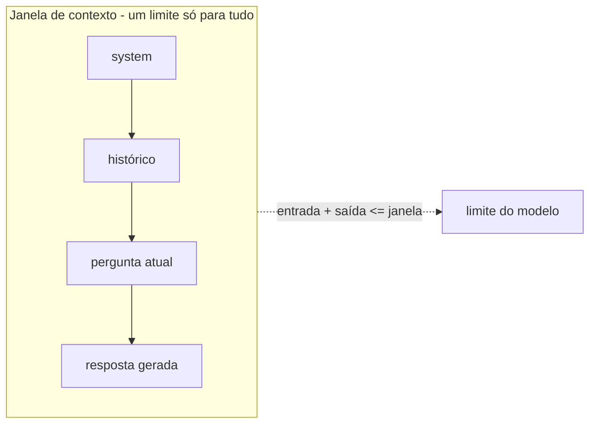
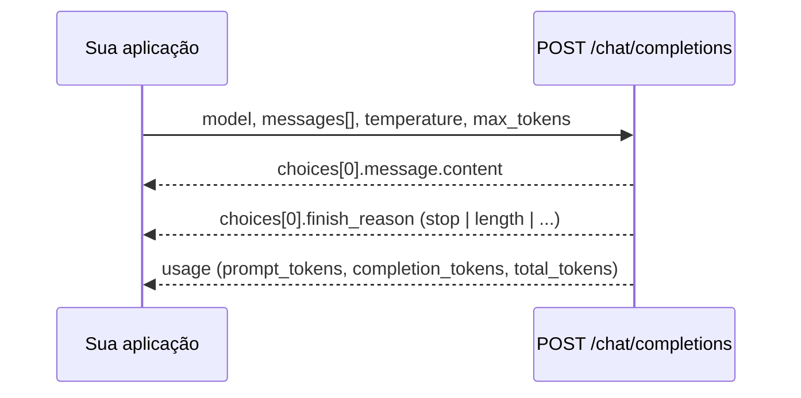

# Lição 1 · Tokens, contexto, inferência e limites dos LLMs

> Antes de começar, tenha feito a [Missão 0](../00-missao-0-diagnostico/README.md). Ao terminar, registre a sessão
> como descrito em [SINCRONIZACAO.md](../../SINCRONIZACAO.md#fim-da-sessão).

## 1. Identificação e pré-requisitos

| Item | Valor |
|---|---|
| Etapa / fase | 1 de 16 · Fase 1 — Fundamentos de LLMs |
| Competências | [C01, C02, C03](../../competencias.md#catálogo) |
| Pré-requisitos de conhecimento | ler JavaScript básico e fazer uma requisição HTTP (a Missão 0 diagnostica isso) |
| Pré-requisitos de ambiente | Missão 0 concluída: Node 22 ou superior e um endpoint de LLM compatível com a API de chat (Ollama local ou provedor) |
| Já existe no repositório | [M01 · doc 03](../../../modulos/01-fundamentos-ia-llms/docs/03-llms-e-prompt-engineering.md) · [LLMOps · doc 02](../../../trilhas-extras/llmops-vllm-openshift/docs/02-fundamentos-de-llm.md) · [LLMOps · exemplo 02](../../../trilhas-extras/llmops-vllm-openshift/exemplos/02-tokens-e-sampling/) · [M04 · exemplo 05](../../../modulos/04-agentes-autonomos/exemplos/05-gerenciamento-de-contexto/) |
| Entrega no [projeto evolutivo](../../projeto/README.md) | o medidor de tokens e de contexto (marco 1) |

Esta lição **não repete** o material acima: ela dá a base para usá-lo e acrescenta um laboratório de medição que
funciona em qualquer provedor.

## 2. Objetivos de aprendizagem

Ao terminar, você consegue:

1. **Explicar** o que é um token e por que o mesmo texto custa tokens diferentes em idiomas e modelos diferentes.
2. **Calcular** o orçamento de contexto de uma chamada e de uma conversa (entrada, saída, histórico reenviado).
3. **Descrever** a inferência em duas fases (prefill e decode) e prever como `max_tokens` e o tamanho do prompt
   afetam a latência.
4. **Fazer** uma chamada HTTP a um LLM e **interpretar** `usage` e `finish_reason`.
5. **Medir** tokens, truncamento, ausência de memória e tempo por token de saída em um endpoint real, e
   **reconhecer os limites** dessas medições.

Mapa: objetivo 1 → Q1, Q2, Q9, CA2, CA3 · 2 → Q3, Q4, Q8, CA4, CA5 · 3 → Q6, Q7, CA6 · 4 → Q5, CA1 · 5 → CA1–CA8 e rubrica.

## 3. Duração estimada

| Parte | Tempo |
|---|---|
| Microlição (seção 4) e exemplos (seção 6) | 45 min |
| Quiz (seção 7) e correção comentada | 20 min |
| Desafio hands-on (seção 8) | 75 min |
| Explicação sem consulta e relatório (seção 12) | 30 min |
| Registro da sessão | 10 min |
| **Total** | **3 h** (referência; faça no seu ritmo) |

## 4. Microlição

### 4.1 Token: a unidade de tudo

Um LLM não lê letras nem palavras. Antes de qualquer cálculo, um **tokenizer** quebra o texto em pedaços de um
vocabulário fixo (de dezenas de milhares a centenas de milhares de entradas) e troca cada pedaço por um número
inteiro. Esses pedaços são os **tokens**. Eles podem ser uma palavra comum, parte de uma palavra, uma palavra
com o espaço que a precede, um símbolo ou um byte.

Analogia: tokens são as peças de um LEGO. Palavras comuns são peças grandes e únicas; palavras raras viram várias
peças pequenas. O modelo só sabe montar com as peças do próprio kit.

Consequências que você vai medir no laboratório:

- **Tokens não são palavras nem caracteres.** Existe uma relação aproximada (a razão varia com o idioma, o
  assunto e o tokenizer), mas ela só vale como estimativa. O número que importa é o `usage` devolvido pela API.
- **Idiomas gastam quantidades diferentes.** Tokenizers costumam ser treinados com mais texto em inglês; o
  português, com acentos e palavras longas, tende a gastar mais tokens para o mesmo conteúdo (o
  [exemplo 02 da trilha LLMOps](../../../trilhas-extras/llmops-vllm-openshift/exemplos/02-tokens-e-sampling/)
  mostra `orquestra` virando 3 tokens). Quanto mais, **mais caro e menos espaço** para o resto.
- **Modelos diferentes, tokenizers diferentes.** A mesma frase pode ter contagens diferentes em modelos
  diferentes. Contar com a biblioteca de um fornecedor não vale para outro.
- **Há custo fixo por chamada.** Cada mensagem é embrulhada em marcadores de papel (`system`, `user`,
  `assistant`) definidos pelo *template de chat* do modelo. Por isso um `"oi"` não custa 1 token. No laboratório
  você vai separar o custo fixo do custo por caractere.

Custo, na maioria dos provedores: `tokens_de_entrada × preço_entrada + tokens_de_saída × preço_saída`, com a
saída normalmente mais cara que a entrada. Tokens são também a unidade dos limites (contexto, taxa por minuto).

### 4.2 Janela de contexto: a mesa de trabalho do modelo

A **janela de contexto** é o máximo de tokens que o modelo consegue considerar numa única chamada. Pense numa mesa
de trabalho: tudo o que o modelo "vê" (instruções, histórico, documentos, definições de ferramentas **e a
resposta que ele está escrevendo**) precisa caber na mesa ao mesmo tempo.



Três ideias que valem para qualquer provedor:

1. **A API não tem memória.** Cada chamada é independente. Para o modelo "lembrar" a pergunta anterior, **a sua
   aplicação reenvia o histórico inteiro** a cada turno. Por isso o custo de uma conversa cresce com o quadrado
   do número de turnos (rode o [exemplo 2](#6-exemplos-práticos)).
2. **Entrada e saída dividem o mesmo limite.** Um prompt de 7.500 tokens numa janela de 8.000 deixa ~500 tokens
   de resposta, mesmo que você peça `max_tokens = 1000`.
3. **Mais contexto não é melhor contexto.** Modelos usam pior a informação no meio de entradas muito longas
   (*Lost in the Middle*, na seção 5) e a documentação de fornecedores fala em degradação de precisão e
   *recall* quando o contexto cresce. Escolher **o que** entra na janela é engenharia: é o assunto das etapas 4 a 8 (RAG) e 10.
4. **A janela do modelo não é, necessariamente, a janela que você tem.** O servidor pode configurar um contexto
   menor que o máximo do modelo: no Ollama, o padrão é 4k de contexto quando a VRAM é menor que 24 GiB (muda-se
   com `OLLAMA_CONTEXT_LENGTH`) e a documentação avisa que a API compatível com a da OpenAI não tem como definir
   o tamanho do contexto. Além disso, a janela e o **teto de saída** por chamada são limites diferentes. A
   documentação do Ollama não diz o que acontece ao exceder o contexto: meça com `prompt_tokens` e
   `finish_reason` em vez de supor.

### 4.3 Uma chamada de LLM por dentro

A maioria dos provedores e servidores de modelos (OpenAI, OpenRouter, vLLM, Ollama...) expõe a mesma forma de
API de chat. Uma chamada é um POST com JSON:



| Campo | O que é |
|---|---|
| `messages` | lista de `{role, content}`: `system` (regras), `user` (pedido), `assistant` (respostas anteriores) |
| `temperature` | quanto sortear na escolha de cada token (0 = sempre o mais provável) |
| `max_tokens` | teto de tokens de **saída** (o nome varia: veja o quadro de fornecedor) |
| `finish_reason` | por que a geração parou: `stop` (terminou), `length` (bateu o teto), `tool_calls` (pediu uma ferramenta)... |
| `usage` | contagem real de tokens que o servidor processou e que será cobrada |

`finish_reason: "length"` é um **sinal de alerta**: a resposta pode estar cortada no meio (um JSON incompleto, por
exemplo). Código de produção sempre checa o `finish_reason`.

### 4.4 Inferência: prefill e decode

A resposta nasce em duas fases:

1. **Prefill**: o modelo processa todo o prompt de uma vez, em paralelo. Define o tempo até o primeiro token (TTFT,
   *time to first token*). Cresce com o tamanho do prompt.
2. **Decode**: gera **um token por vez**, e cada token depende dos anteriores (autorregressivo). O tempo por token
   (ITL, *inter-token latency*) é aproximadamente constante, então a latência dessa fase cresce linearmente com
   o número de tokens de saída. O modelo guarda em memória os resultados do que já processou (o *KV cache*) para
   não recalcular, e esse cache cresce com o contexto.

```
latência total ≈ rede + fila + TTFT (prefill) + (tokens_de_saída − 1) × ITL (decode)
```

Por isso um prompt curto que pede 800 tokens é lento (decode), e um prompt enorme que pede 5 tokens também é lento
(prefill). Streaming não acelera o total; só mostra os tokens à medida que saem (melhora a latência percebida). Em streaming,
o `usage` só vem se você pedir (`stream_options.include_usage`, aceito pelo Ollama); o laboratório não usa streaming.

A cada passo do decode, o modelo produz uma distribuição de probabilidade sobre o vocabulário e uma regra de
**sampling** escolhe o próximo token: `temperature` reescala a distribuição (0 equivale a escolher sempre o mais
provável), `top_p` descarta a cauda improvável. `temperature = 0` **reduz** a variação, mas não é garantia de
saída idêntica entre execuções (lotes de requisições, hardware e versões do modelo mudam a aritmética).

### 4.5 Limites dos LLMs que este curso vai ensinar a contornar

| Limite | Consequência | Onde o curso trata |
|---|---|---|
| Janela de contexto finita | não cabe tudo; custo cresce com o histórico | etapas 4–8 (RAG), 10 (memória) |
| Sem estado entre chamadas | a aplicação gerencia a conversa | etapas 2 e 10 |
| Conhecimento congelado e sem acesso a dados privados | respostas desatualizadas ou inventadas | etapas 5–7 (RAG) |
| Alucinação (texto plausível, não necessariamente verdadeiro) | exige fontes, citações e abstenção | etapas 6–7 |
| Saída probabilística | testes precisam de casos, schemas e métricas | etapa 3 |
| Latência e custo proporcionais a tokens | medir e otimizar | etapas 8 e 14 |

### 4.6 O que é durável e o que é específico de fornecedor

| Durável (vale para qualquer LLM) | Específico de fornecedor ou ferramenta (verificado em 2026-10-17) |
|---|---|
| Tokens, tokenizer e custo fixo de template | contagem exata por modelo; a Anthropic oferece uma [API de contagem de tokens](https://platform.claude.com/docs/en/build-with-claude/token-counting) para estimar antes de enviar |
| Entrada + saída dividem a janela; API sem estado | o que acontece quando passa do limite varia: erro de validação ou geração interrompida com um motivo próprio (a documentação da Anthropic descreve os dois casos); a janela **configurada no servidor** pode ser menor que a do modelo (Ollama) |
| O custo da entrada acumulada cresce com o quadrado dos turnos (sem cache, turnos de tamanho parecido) | *prompt caching* muda o que você paga pelo prefixo repetido, **não** o que ocupa a janela (documentado pela Anthropic); nomes de campos nativos diferem (`stop_reason`, `input_tokens` e `output_tokens` na API da Anthropic) |
| Prefill × decode, TTFT e ITL, KV cache | tamanho da janela de cada modelo e preço por token |
| `temperature`/`top_p`: reduzem, não eliminam, a variação | existência e garantias de `seed` |
| `finish_reason` indica por que parou | nome do teto de saída: `max_tokens` (Ollama aceita só este; vLLM aceita os dois, com `max_tokens` marcado como obsoleto; modelos antigos da OpenAI) × `max_completion_tokens` (OpenAI atual) |
| Modelos de raciocínio gastam tokens "pensando" | `reasoning_effort` e como esses tokens são contados e cobrados; alguns modelos de raciocínio rejeitam `temperature` diferente do padrão (confira no seu provedor: use `TEMPERATURA=omitir` nos exemplos) |

## 5. Material complementar

Leia na ordem; o que está marcado como *opcional* pode esperar. Todos os links foram abertos em 2026-10-17, exceto
onde indicado.

| Material | Por que ler |
|---|---|
| [Hugging Face · LLM Course · Tokenizers](https://huggingface.co/learn/llm-course/chapter2/4) | explicação prática de tokenização por palavra, caractere e subpalavra, com código para codificar e decodificar |
| [Documentação da Anthropic · Context windows](https://platform.claude.com/docs/en/build-with-claude/context-windows) | descreve como entrada e saída ocupam a janela, o acúmulo de turnos e o comportamento ao estourar o limite. É de um fornecedor: use para entender o conceito, não como regra geral |
| [Documentação do Ollama · compatibilidade com a API da OpenAI](https://docs.ollama.com/api/openai-compatibility) | quais campos o servidor local aceita (`max_tokens`, `temperature`, `seed`, `reasoning_effort`...) |
| [Liu et al. · *Lost in the Middle: How Language Models Use Long Contexts* (arXiv:2307.03172)](https://arxiv.org/abs/2307.03172) | evidência de que a posição da informação no contexto muda o desempenho; justifica "mais contexto não é melhor" |
| [Karpathy · *Let's build the GPT Tokenizer* (vídeo)](https://www.youtube.com/watch?v=zduSFxRajkE) | *opcional, longo*: constrói um tokenizer do zero e explica por que tantos comportamentos estranhos de LLMs vêm da tokenização |
| [tiktoken (OpenAI)](https://github.com/openai/tiktoken) | *opcional*: conta tokens offline para as codificações da OpenAI; lembre que isso não vale para outros modelos |
| Referência da API de chat da OpenAI (`https://platform.openai.com/docs/api-reference/chat/create`) | descreve `messages`, `usage`, `finish_reason` e o teto de saída. **Não verificado automaticamente**: o servidor responde 403 a clientes automatizados (2026-10-17); abra no navegador |
| [M01 · doc 03](../../../modulos/01-fundamentos-ia-llms/docs/03-llms-e-prompt-engineering.md) e [LLMOps · doc 02](../../../trilhas-extras/llmops-vllm-openshift/docs/02-fundamentos-de-llm.md) | o mesmo assunto com os exemplos e números deste repositório (prefill, decode, KV cache, sampling) |

## 6. Exemplos práticos

### Exemplo 1 · A menor chamada possível

[`exemplos/chamada-minima.mjs`](exemplos/chamada-minima.mjs) faz um POST com `fetch`, sem SDK, e imprime o texto,
o `finish_reason`, o `usage` e a latência. Subir o Ollama do repositório: `bash infra/subir-ia.sh`
([instalação](../../../infra/instalacao.md)).

```bash
node academia/licoes/01-tokens-contexto-inferencia/exemplos/chamada-minima.mjs
```

Formato esperado (os valores mudam com o modelo e com a máquina; este bloco mostra a forma, não é uma saída
medida. Em CPU, o Ollama do repositório leva da ordem de 10 s ou mais):

```text
texto          : "Olá"
finish_reason  : stop
usage          : { prompt_tokens: 14, completion_tokens: 2, total_tokens: 16 }
latência       : 14000 ms
```

O que observar: o `prompt_tokens` é bem maior que o número de palavras do pedido. Troque o `content` por um
texto maior e veja quanto muda. Para usar outro provedor, troque `OPENAI_BASE_URL`, `OPENAI_API_KEY` e `MODELO_CHAT`
(veja [`infra/.env.example`](../../../infra/.env.example)); se o provedor usar outro nome para o teto de saída ou
rejeitar `temperature`, use `PARAM_MAX_TOKENS` e `TEMPERATURA=omitir`. Provedores diferentes ainda podem exigir
ajustes: leia o erro HTTP que voltar.

### Exemplo 2 · O custo escondido da conversa

[`exemplos/orcamento-conversa.mjs`](exemplos/orcamento-conversa.mjs) calcula, offline, quantos tokens de entrada são
enviados quando cada turno reenvia o histórico. Saída real (10 turnos, pergunta de 100 e resposta de 200 tokens):

```text
turno | entrada enviada | saída | contexto ao fim | cabe na janela?
    1 |             100 |   200 |             300 | sim
    5 |            1300 |   200 |            1500 | sim
   10 |            2800 |   200 |            3000 | sim

conteúdo novo (perguntas + respostas): 3000 tokens
tokens de entrada realmente enviados : 14500 (4.8x o conteúdo novo)
```

(linhas intermediárias omitidas). Rode com `10 100 200` e depois com `40 100 200`: a razão entre o que foi
enviado e o conteúdo novo cresce com o número de turnos. Em qual turno a conversa estoura uma janela de 8.000?

## 7. Quiz de fixação

Responda **de memória, antes de abrir o [gabarito](gabarito.md)**. Registre as respostas (e quão confiante você
estava: baixa, média ou alta) em `academia/alunos/<aluno>/entregas/etapa-01/quiz.md`. O gabarito traz a correção
comentada de cada alternativa.

**Q1.** Qual descrição de *token* é a mais correta?
A) Uma palavra completa do dicionário. B) Um pedaço de texto do vocabulário do tokenizer: pode ser uma palavra,
parte dela, uma palavra com o espaço anterior ou um símbolo. C) Um caractere Unicode. D) Um byte da memória da GPU.

**Q2.** Você enviou a mesma frase a dois modelos e o `prompt_tokens` veio diferente. A explicação mais provável é:
A) Um dos modelos está com defeito. B) Cada família de modelos tem o próprio tokenizer e o próprio template de chat.
C) O segundo modelo é mais caro. D) A `temperature` estava diferente.

**Q3.** Um modelo tem janela de 8.000 tokens. Seu prompt tem 7.500 tokens e você pede `max_tokens = 1000`. Qual
afirmação é a correta?
A) Funciona sempre: a janela só limita a entrada. B) Entrada e saída dividem a janela; só cabem cerca de 500 tokens
de resposta, e o que o provedor faz com o pedido (rejeitar ou cortar a resposta) varia. C) O provedor aumenta a
janela automaticamente. D) O modelo ignora parte do prompt para abrir espaço.

**Q4.** Numa conversa, cada turno tem uma pergunta de 100 tokens e uma resposta de 200 tokens, sem `system`, e a
aplicação reenvia todo o histórico. Quantos tokens de **entrada** foram enviados, no total, nos 5 primeiros turnos?
A) 1.500 B) 2.500 C) 3.500 D) 7.500

**Q5.** O que significa `finish_reason: "length"`?
A) O texto ficou longo para o usuário. B) A geração parou ao atingir o teto de tokens de saída (ou o fim da janela)
e a resposta pode estar incompleta. C) O modelo terminou normalmente. D) A chamada falhou e é igual repetir.

**Q6.** Um prompt curto pede uma resposta de 800 tokens. Qual fase domina o tempo total?
A) *Prefill*, porque processa o prompt. B) *Decode*, que gera um token por vez, em sequência. C) A tokenização.
D) Nenhuma: o tempo é constante.

**Q7.** Verdadeiro ou falso, com uma frase de justificativa: "Com `temperature = 0`, a mesma chamada devolve sempre
exatamente o mesmo texto."

**Q8.** Em 2 ou 3 frases: por que a API de chat "não lembra" da pergunta anterior e o que a sua aplicação precisa
fazer para manter uma conversa?

**Q9.** Dê um exemplo concreto em que colocar **mais** texto no prompt piora o resultado, o custo ou a latência.

## 8. Desafio hands-on

### Medidor de tokens e contexto

Escreva **você mesmo** o script `medir.mjs` (JavaScript, Node 22+, sem dependências) que faz **12 chamadas** a um
endpoint de chat, registra o que o servidor reporta e calcula as métricas abaixo. As chamadas e os textos são
fixos para que os resultados sejam comparáveis; use as constantes de [`kit/textos.mjs`](kit/textos.mjs).
Custo aproximado: cerca de 3 mil tokens de entrada e poucas centenas de saída. Com o Ollama do repositório em CPU
(cerca de 5 tokens por segundo, segundo [infra/instalacao.md](../../../infra/instalacao.md)), a medição inteira leva
alguns minutos; rode **um processo por vez**, porque vários clientes no mesmo Ollama formam fila e distorcem as latências.

| # | Experimento | O que fazer | O que calcular |
|---|---|---|---|
| 1 | `idioma` | 2 chamadas com `TEXTO_PT` e `TEXTO_EN` (`max_tokens = MAX_TOKENS_MEDICAO`) | `razao_tokens_pt_en = prompt_tokens_pt / prompt_tokens_en` |
| 2 | `crescimento` | 4 chamadas (`max_tokens = MAX_TOKENS_MEDICAO`) com `TEXTO_PT` repetido 1, 2, 4 e 8 vezes (`REPETICOES`), separado por `\n\n` | inclinação **marginal** = (tokens da última − tokens da primeira) ÷ (caracteres da última − caracteres da primeira), e custo fixo = tokens da primeira − inclinação × caracteres da primeira |
| 3 | `truncamento` | 1 chamada com `PEDIDO_TRUNCAMENTO` e `max_tokens = MAX_TOKENS_TRUNCAMENTO` | nada: observe o `finish_reason` |
| 4 | `sem_memoria` | 3 chamadas (`max_tokens = MAX_TOKENS_CURTO`): informar o fato, perguntar **sem** histórico, perguntar **com** o histórico reenviado | se o modelo lembrou em cada caso e quantos tokens o histórico custou |
| 5 | `decodificacao` | 2 chamadas com `PEDIDO_LONGO`: `MAX_TOKENS_CURTO` e `MAX_TOKENS_LONGO` | `ms_por_token_saida = Δ latência / Δ tokens de saída` |

Regras: `temperature = 0`; registre `usage` e `finish_reason` **reportados pelo servidor** (não estime); meça a
latência de cada chamada; nunca grave a chave de API. As constantes (`TEXTO_PT`, `TEXTO_EN`, `REPETICOES`, os
`MAX_TOKENS_*` e as mensagens do experimento 4) vêm de [`kit/textos.mjs`](kit/textos.mjs). A partir da pasta da
entrega, o import é
`import { TEXTO_PT /* ... */ } from '../../../../licoes/01-tokens-contexto-inferencia/kit/textos.mjs'`.
Entregue também o seu `medir.mjs` na pasta: o verificador exige o arquivo.

**O que o verificador é (e o que não é).** `verificar.mjs` confere se o relatório é **coerente**: formato, números
derivados recalculados a partir das suas próprias chamadas, parâmetros das chamadas iguais aos do kit e valores
plausíveis. Ele **não** consegue provar que você chamou um modelo de verdade: o sistema de XP é, em última instância, um
acordo de honestidade entre alunos e avaliadores. O que defende o aprendizado de verdade são a explicação sem
consulta, a rubrica e a conversa de checkpoint.

**Onde guardar.** Tudo em `academia/alunos/<aluno>/entregas/etapa-01/` (crie a pasta):

```bash
node academia/alunos/<aluno>/entregas/etapa-01/medir.mjs academia/alunos/<aluno>/entregas/etapa-01
# escreva relatorio.md na mesma pasta (modelo na seção 12)
node academia/licoes/01-tokens-contexto-inferencia/verificar.mjs academia/alunos/<aluno>/entregas/etapa-01
```

`medir.mjs` grava `relatorio.json` com o formato abaixo (valores ilustrativos):

```json
{
  "versao": 1,
  "gerado_em": "2026-10-18T12:00:00.000Z",
  "ambiente": { "base_url": "http://localhost:11434/v1", "modelo": "qwen3.5:4b", "node": "v24.11.1" },
  "chamadas": [
    { "id": "idioma-pt", "experimento": "idioma", "prompt_tokens": 130, "completion_tokens": 8,
      "total_tokens": 138, "finish_reason": "length", "latencia_ms": 900, "max_tokens": 8 }
  ],
  "experimentos": {
    "idioma": { "chamada_pt": "idioma-pt", "chamada_en": "idioma-en", "chars_pt": 388, "chars_en": 355, "razao_tokens_pt_en": 1.3 },
    "crescimento": { "chamadas": ["cresc-1", "cresc-2", "cresc-4", "cresc-8"], "chars": [388, 778, 1558, 3118],
                     "tokens_por_char_marginal": 0.3, "overhead_fixo_tokens": 8.5 },
    "truncamento": { "chamada": "trunc", "max_tokens": 5 },
    "sem_memoria": { "fato": "Zephyrus-42", "sem_historico": "mem-sem", "com_historico": "mem-com",
                     "sem_historico_lembrou": false, "com_historico_lembrou": true, "tokens_extra_do_historico": 25 },
    "decodificacao": { "curta": "dec-curta", "longa": "dec-longa", "ms_por_token_saida": 190 }
  }
}
```

Detalhes do contrato: cada chamada tem `id` único; as chamadas dos experimentos `sem_memoria` registram também a
`resposta` (texto, até 500 caracteres); `chars` de `crescimento` é o tamanho em caracteres do texto enviado em
cada chamada. Os nomes de `id` ficam a seu critério, desde que os experimentos apontem para eles.

**Nota sobre fornecedores.** Se o seu provedor usa `max_completion_tokens` no lugar de `max_tokens`, rejeita
`temperature`, ou se o Ollama devolver o texto vazio (modelo "pensando"), veja o [exemplo 1](exemplos/chamada-minima.mjs):
`PARAM_MAX_TOKENS`, `TEMPERATURA=omitir` e `reasoning_effort` (enviado quando a URL contém `:11434`). Servidores com
*cache de prefixo* podem tratar de forma diferente chamadas que repetem o mesmo prompt (os experimentos 1/2 e 5 repetem
prompts): se `prompt_tokens` ou a latência saírem estranhos, repita a medição e comente em "Surpresas e limites".

**Extensões opcionais** (`opcional`, 20 XP cada, não bloqueiam a etapa; ids `E01-opcional-1` a `E01-opcional-3`):
(a) repetir os experimentos 1 e 2 com um **segundo modelo** e explicar a diferença; (b) medir o efeito de
`temperature = 0` repetindo a mesma chamada 10 vezes e contando respostas distintas; (c) estimar em qual turno uma
conversa de perguntas de 150 e respostas de 300 tokens estoura uma janela de 32.000 tokens e confirmar com o
exemplo 2. Ideia extra (sem XP): corrigir a razão PT/EN descontando o custo fixo estimado no experimento 2.

## 9. Critérios de aceitação

O comando `verificar.mjs` confere os critérios abaixo. Todos precisam passar para o laboratório valer `E01-lab`.

| ID | Critério (objetivo) |
|---|---|
| CA1 | `relatorio.json` válido: `versao` 1, ambiente (URL sem credenciais e modelo), ≥ 12 chamadas, cada uma com `id`, `prompt_tokens` > 0, `completion_tokens`, `total_tokens = prompt + completion`, `finish_reason`, `latencia_ms` e `max_tokens`; e o arquivo `medir.mjs` na pasta da entrega |
| CA2 | `chars_pt`/`chars_en` iguais aos do kit; `razao_tokens_pt_en` confere com o `prompt_tokens` das duas chamadas registradas; as duas chamadas usam `MAX_TOKENS_MEDICAO` |
| CA3 | 4 pontos de crescimento com os `chars` do kit (`REPETICOES`), `prompt_tokens` não decrescente; inclinação marginal (primeiro e último ponto) e custo fixo conferem com os dados; inclinação plausível (entre 0,05 e 1,5 token por caractere) |
| CA4 | Uma chamada com `finish_reason = "length"`, `completion_tokens` entre 1 e `max_tokens`, `max_tokens = MAX_TOKENS_TRUNCAMENTO` |
| CA5 | Chamadas de memória com `MAX_TOKENS_CURTO` e `resposta` registrada; sem histórico o modelo não lembra o fato (o campo confere com a resposta); o histórico reenviado aumenta o `prompt_tokens` e a diferença confere |
| CA6 | As chamadas curta e longa usam `MAX_TOKENS_CURTO` e `MAX_TOKENS_LONGO`; a longa gera mais tokens de saída; `ms_por_token_saida` confere |
| CA7 | Nenhuma chave, token ou segredo em `relatorio.json`, `relatorio.md` ou `medir.mjs` |
| CA8 | `relatorio.md` com as seções Resultados (≥ 120 letras ou números), Explicação (≥ 320) e Surpresas e limites (≥ 120), escritas por você (os comentários do modelo não contam) |

**XP desta lição.**
- `E01-quiz` mede **participação comprovada**, não nota: respostas registradas **antes** do gabarito, com a confiança de
  cada uma, e a correção comentada revisada (anote, para cada erro, o que você pensou e por que estava errado). O
  acerto aparece na **competência**, não no XP.
- `E01-lab`: CA1 a CA8 passando.
- `E01-explicacao`: a seção Explicação do relatório, escrita sem consulta e aprovada pela rubrica (R1 ≥ 2).

## 10. Rubrica de avaliação

A rubrica é aplicada pelo assistente (ou pelo outro aluno, como revisor) sobre `relatorio.md` e o quiz. Escala 0 a 3
(veja [níveis](../../competencias.md#níveis-de-domínio)). **O XP de quiz e de laboratório não depende da rubrica; o de
explicação exige R1 ≥ 2; a competência depende sempre dela.**

| Critério | 0 | 1 | 2 | 3 |
|---|---|---|---|---|
| **R1 · Precisão conceitual** (C01, C03) | ausente, ou sem relação com token, contexto ou inferência | tenta explicar, mas com um erro central (token = palavra; prefill = decode; API "lembra" sozinha) | corretos, com palavras próprias (ex.: "o tokenizer quebra em pedaços do vocabulário; o histórico é reenviado a cada turno") | corretos e antecipa um caso novo (outro idioma, JSON, código) |
| **R2 · Interpretação dos números** (C01, C02) | só copia números | descreve os números sem explicá-los | explica razão PT/EN, custo fixo e custo do histórico **com os próprios dados** | usa os dados para estimar um caso que não mediu |
| **R3 · Honestidade sobre limites** (C03) | afirma conclusões gerais a partir de 1 execução | cita "pode variar" sem especificar | aponta limites concretos (modelo pequeno, latência ruidosa, tokenizer específico) | propõe como reduzir a incerteza e o que repetiria |
| **R4 · Reprodutibilidade** (C02) | não dá para repetir | falta ambiente ou comando | comando, versão e ambiente suficientes | outra pessoa reproduz sem perguntar e a entrega não contém segredos |

## 11. Dicas graduais

Use uma dica por vez, **só depois de uma tentativa registrada** (anote na seção Tentativas do relatório). A
[solução de referência](referencia/medir.mjs) é o último recurso.

<details>
<summary>Dica 1 · Onde fica o número que importa</summary>

O `usage` vem na resposta JSON, ao lado de `choices`. É o servidor dizendo quantos tokens processou. Rode o
[exemplo 1](exemplos/chamada-minima.mjs) e imprima `json.usage` antes de montar qualquer coisa maior.
</details>

<details>
<summary>Dica 2 · Estrutura do script</summary>

Crie uma função `chamar(id, experimento, messages, maxTokens)` que faz o POST, mede o tempo com
`performance.now()` e guarda `{ id, experimento, prompt_tokens, completion_tokens, total_tokens, finish_reason,
latencia_ms, max_tokens, resposta }` num array. Os experimentos só decidem **quais mensagens** enviar; as contas
vêm depois, a partir do array.
</details>

<details>
<summary>Dica 3 · Por que "marginal"</summary>

Se `prompt_tokens / chars` fosse constante, o custo fixo do template não existiria. Compare duas chamadas: o que
acontece com a diferença de tokens e a diferença de caracteres entre elas? Pense em qual das duas contas elimina um
custo que existe em toda chamada. Depois, o custo fixo é o que sobra de uma das chamadas depois de descontar a parte
proporcional ao tamanho. (A mensagem do verificador, no próximo passo, mostra a fórmula esperada.)
</details>

<details>
<summary>Dica 4 · Experimento da memória</summary>

A chamada "com histórico" envia três mensagens: o `user` que informa o fato, um `assistant` com a resposta da
primeira chamada, e o `user` que pergunta. A chamada "sem histórico" envia só a pergunta. `lembrou` é se a resposta
contém o fato (sem diferenciar maiúsculas de minúsculas).
</details>

<details>
<summary>Dica 5 · O verificador reprovou</summary>

Leia a mensagem: ela diz qual número esperava. Causas comuns: estimar tokens em vez de ler `usage`; usar
`prompt_tokens / chars` total em vez da inclinação marginal; `max_tokens` do truncamento acima de 20; esquecer de
registrar a `resposta` nas chamadas da memória; modelo que "pensa" e gasta todo o `max_tokens` (veja o
`reasoning_effort` no exemplo 1).
</details>

## 12. Modelo de relatório do aluno

Use [`templates/entrega-laboratorio.md`](../../templates/entrega-laboratorio.md) como base. O `relatorio.md` desta
lição precisa conter, nesta ordem:

- **Resultados**: ambiente, comando, a tabela dos 5 experimentos com os seus números, o resultado do
  `verificar.mjs` (cole a saída) e uma conta de custo: some os tokens de entrada e de saída do laboratório inteiro e
  estime o custo com o preço por milhão de tokens do seu provedor (se o modelo é local, use um preço **hipotético** e
  diga que é hipotético).
- **Critérios de aceitação**: a tabela `CA1`–`CA8` do [modelo](../../templates/entrega-laboratorio.md).
- **Explicação**, escrita **sem consultar o material**, respondendo: (1) por que o português gastou mais (ou menos)
  tokens que o inglês e quanto foi a razão que você mediu? (2) por que o custo de uma conversa cresce com o
  quadrado dos turnos? (3) o que os seus dados mostram sobre prefill e decode? Use as latências das quatro chamadas de
  `crescimento` para dizer se o prompt maior demorou mais, e o `ms_por_token_saida` para a fase de decode. Depois de
  escrever, confira e anote o que errou.
- **Surpresas e limites**: o que o resultado depende do modelo, do provedor e da sua máquina; o que você
  repetiria para ter mais confiança.
- **Dúvidas e pendências** e **Tentativas**.

## 13. Competências registradas

Registre os níveis na tabela Competências do [relatório de sessão](../../templates/relatorio-sessao.md).

| Competência | Nível 1 | Nível 2 | Nível 3 |
|---|---|---|---|
| **C01** · tokens e tokenização | acertou Q1 ou Q2; relatou a razão PT/EN | acertou Q1 e Q2, CA2 e CA3 aprovados, explica razão e custo fixo com seus dados (R1 e R2 ≥ 2) | prevê a contagem relativa de um texto novo e confirma medindo (revisão ou checkpoint) |
| **C02** · janela e orçamento de contexto | acertou Q3 ou Q4 | acertou Q3, Q4 e Q5, CA4 e CA5 aprovados, calcula o orçamento de uma conversa (R2 e R4 ≥ 2) | dimensiona o orçamento de contexto do projeto (reserva de saída, histórico, documentos) em contexto novo |
| **C03** · inferência e latência | acertou Q6 ou Q7 | acertou Q6 e Q7, CA6 aprovado, explica a medição de ms/token e suas limitações (R1 e R3 ≥ 2) | prevê o efeito de mudar `max_tokens` e prompt sobre TTFT e latência total e confirma (em revisão ou checkpoint: esta lição não mede TTFT) |

IDs de atividade desta lição: `E01-quiz` (10 XP), `E01-lab` (30 XP), `E01-explicacao` (15 XP),
`E01-opcional-1..3` (20 XP). Revisões espaçadas: `R01-1`, `R01-2`...

## 14. Referências e última revisão

**Última revisão:** 2026-10-17. Links da seção 5 abertos nessa data (exceto a referência da OpenAI, que responde
403 a clientes automatizados).

**Fundamentos duráveis:** tokens e tokenizers (Hugging Face), efeito do contexto longo (Liu et al., 2023),
prefill/decode e KV cache ([LLMOps · doc 02](../../../trilhas-extras/llmops-vllm-openshift/docs/02-fundamentos-de-llm.md)).

**Dependem de ferramenta ou fornecedor (reverificar primeiro):**

1. nome e semântica do teto de saída (`max_tokens` × `max_completion_tokens`);
2. comportamento ao exceder a janela (erro × corte) por provedor;
3. `reasoning_effort` e a contagem de tokens de raciocínio;
4. o modelo padrão do repositório (`qwen3.5:4b`) e o suporte do Ollama aos campos usados;
5. tamanhos de janela e preços citados em qualquer material externo.

**Limitação desta versão:** o laboratório e o verificador foram testados contra um servidor falso compatível com a
API de chat (`licao.test.mjs`). Não foram executados contra um LLM real no ambiente em que a lição foi escrita; a
primeira execução real deve registrar o modelo e eventuais ajustes nesta seção.
