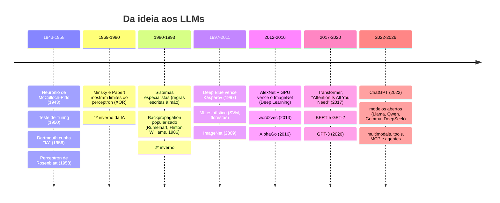

# 01 · História e contexto da IA

## Objetivo

Ao terminar, você sabe contar a linha do tempo da IA, da primeira ideia de "máquina inteligente" até os LLMs
e ferramentas atuais, e explicar **por que** a virada aconteceu agora (dados + GPU + transformer), não em 1960.

## Explicação

### A primeira ideia de "máquina inteligente"

- **Ada Lovelace (1843)**, nas notas sobre a Máquina Analítica de Babbage, já discutia se uma máquina poderia
  "originar" algo; concluiu que não, que ela só faz o que mandamos. Turing chamou isso de "objeção de Lady Lovelace".
- **Alan Turing (1950)**, em *Computing Machinery and Intelligence*, trocou a pergunta "máquinas pensam?" por
  um teste prático, o **jogo da imitação** (Teste de Turing), e já sugeria *máquinas que aprendem* como uma criança.
- **Dartmouth (1955/1956)**: McCarthy, Minsky, Rochester e Shannon cunham o termo *Artificial Intelligence* na
  proposta do workshop de verão. Otimismo: "um avanço significativo em um verão".

### Linha do tempo



Repare no padrão: **ondas de otimismo seguidas de "invernos"** (cortes de verba quando a promessa não veio).
O que mudou depois de 2012 não foi uma ideia nova, mas três coisas juntas:

1. **Dados**: a web gerou bilhões de textos e imagens rotulados ou rotuláveis.
2. **Computação**: GPUs fazem em paralelo exatamente a conta das redes neurais (multiplicação de matrizes).
3. **Arquitetura**: o transformer (2017) paraleliza o treino em texto e escala com mais dados e parâmetros.

### IA, ML, DL e LLM em uma frase cada

| Termo | O que é | Exemplo |
|---|---|---|
| **IA** | qualquer técnica para a máquina fazer algo que pareceria "inteligente" | regras de xadrez, sistema especialista, ChatGPT |
| **ML** (Machine Learning) | IA que **aprende padrões com dados** em vez de regras escritas | filtro de spam, previsão de churn |
| **DL** (Deep Learning) | ML com **redes neurais de várias camadas** que aprendem as próprias features | visão computacional, voz |
| **LLM** | DL (transformer) treinado para prever o próximo token em muito texto | GPT, Gemini, Claude, Qwen |

São conjuntos aninhados: LLM ⊂ DL ⊂ ML ⊂ IA. Detalhes em [02 · ML, DL e redes neurais](02-ml-dl-tensores-e-redes-neurais.md).

### Ferramentas atuais (2026)

Hoje o desenvolvedor usa IA em três camadas: **modelos** (via API ou locais, ver
[04 · RAG, MCP e modelos](04-rag-mcp-e-modelos.md)), **aplicações** que combinam modelo + dados + ferramentas
(RAG, agentes) e **protocolos** que padronizam essa ligação (MCP). Este módulo cobre o básico de cada uma.

## Código mínimo

Um perceptron de 1958 cabe em 10 linhas e já "aprende" o AND lógico ajustando pesos pelo erro:

```js
let w = [0, 0], b = 0;
const dados = [[[0, 0], 0], [[0, 1], 0], [[1, 0], 0], [[1, 1], 1]];
for (let epoca = 0; epoca < 10; epoca++)
  for (const [[x1, x2], y] of dados) {
    const erro = y - (w[0] * x1 + w[1] * x2 + b > 0 ? 1 : 0);
    w = [w[0] + 0.1 * erro * x1, w[1] + 0.1 * erro * x2]; b += 0.1 * erro;
  }
// Com XOR ([[0,1],1], [[1,0],1], [[1,1],0]) ele NUNCA converge: foi o argumento de Minsky e Papert (1969).
```

## Na prática

- O XOR que travou o perceptron é resolvido por uma camada oculta no [exemplo 02](../exemplos/02-primeira-rede-neural/)
  (com um círculo no lugar do XOR) e no [exercício 01](../exercicios/01-rede-neural-espirais/) (o modelo
  linear fica em ~53%, a rede com camada oculta em 100%).

## Armadilhas

- Confundir **IA** com **LLM**: um `if` de regras de negócio também é IA "clássica". Nem todo problema precisa de LLM.
- Achar que o Teste de Turing mede inteligência: ele mede **imitação** de conversa, por isso LLMs o "passam"
  sem que isso diga muito sobre raciocínio.
- Ler a história como progresso linear: houve dois invernos. Hype sem resultado mensurável costuma acabar mal.

## Fontes

- Turing, *Computing Machinery and Intelligence* (Mind, 1950): https://doi.org/10.1093/mind/LIX.236.433
- Proposta de Dartmouth (1955): http://jmc.stanford.edu/articles/dartmouth/dartmouth.pdf
- Rumelhart, Hinton, Williams, *Learning representations by back-propagating errors* (Nature, 1986): https://www.nature.com/articles/323533a0
- Vaswani et al., *Attention Is All You Need* (2017): https://arxiv.org/abs/1706.03762
