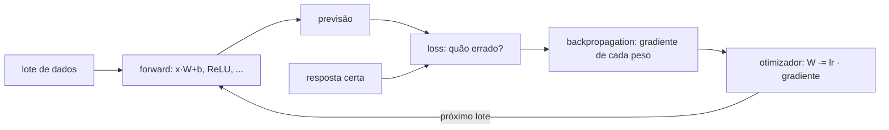

# 02 · Fundamentos de Web ML: ML x DL x IA, tensores, redes neurais e ML no browser

## Objetivo

Ao terminar, você sabe: diferenciar ML, DL e IA com exemplos; manipular tensores em JS e explicar por que
eles são a base de tudo; explicar como uma rede neural aprende (forward, loss, gradiente, otimizador);
rodar o ciclo **dados → treino → validação → inferência**; e usar um modelo de visão pré-treinado no
navegador com vídeo (detecção, tracking, filtro).

## Explicação

### ML x DL x IA (revisão para programadores)

Programação tradicional: **regras + dados → respostas**. Machine Learning inverte: **dados + respostas →
regras** (o modelo). Deep Learning é ML em que as regras são milhões de pesos numa rede neural com várias
camadas, que aprende sozinha as *features* (bordas → formas → "orelha de gato") em vez de você escrevê-las.

| | ML clássico | Deep Learning |
|---|---|---|
| Features | você escolhe (idade, valor, nº de compras) | a rede aprende a partir do dado bruto (pixels, texto) |
| Dados | centenas a milhares de linhas | milhares a bilhões de exemplos |
| Hardware | CPU | GPU/TPU para treinar |
| Exemplo neste repo | scikit-learn em [`trilhas-extras/mlops`](../../../trilhas-extras/mlops/) | exemplos 02 e 03 deste módulo |

### Tensores: por que são a base

Um **tensor** é um array N-dimensional com `shape` (tamanho de cada eixo) e `dtype` (normalmente `float32`).
Tudo vira tensor: uma imagem é `[altura, largura, 3]`, um lote de imagens é `[batch, h, w, 3]`, uma frase é
`[tokens, dimensão do embedding]`. Uma camada densa é **uma** conta: `saída = ativação(entrada · W + b)`.

Analogia: o tensor é a planilha; a rede neural é uma sequência de fórmulas aplicadas à planilha inteira de uma
vez. Como as fórmulas são multiplicações de matrizes, GPU e SIMD as aceleram, e o framework consegue calcular
**automaticamente a derivada** de cada fórmula (autodiff), que é o que permite aprender.

### Como uma rede neural aprende



1. **Forward**: os dados passam pelas camadas e viram previsão.
2. **Loss**: um número que mede o erro (`binaryCrossentropy` para sim/não, `categoricalCrossentropy` para
   várias classes, `meanSquaredError` para valores).
3. **Backpropagation**: regra da cadeia calcula quanto cada peso contribuiu para o erro.
4. **Otimizador** (SGD, Adam): mexe cada peso um pouquinho na direção que reduz a loss. O tamanho do passo é a
   **taxa de aprendizado** (`learning rate`).
5. Repete por **épocas** (passadas completas nos dados).

A **ativação não linear** (ReLU, sigmoid) é o que permite curvas: sem ela, empilhar camadas lineares dá outra
camada linear, e a rede volta a ser o perceptron que não resolve o XOR.

### O ciclo completo: dados → treino → validação → inferência

| Etapa | O que faz | Erro clássico |
|---|---|---|
| **Dados** | gerar/coletar, limpar, embaralhar, dividir treino/validação/teste | não embaralhar dados ordenados por classe |
| **Treino** | `model.fit` ajusta os pesos no conjunto de treino | olhar só a acurácia de treino |
| **Validação** | medir em dados fora do treino a cada época; escolher arquitetura e épocas | escolher o modelo pelo teste (vaza informação) |
| **Teste** | medir **uma vez**, no fim, em dados nunca usados para decidir nada | reusar o teste até "dar bom" |
| **Inferência** | `model.predict` em dados novos, em produção | esquecer o pré-processamento igual ao do treino |

Sempre compare com um **baseline** (ex.: chutar a classe majoritária). Acurácia de 69% parece razoável até
você descobrir que chutar "não" sempre também dá 69% (é o caso do exemplo 02).

### ML na Web

Rodar o modelo **no navegador** (TensorFlow.js, MediaPipe Tasks, Transformers.js, ONNX Runtime Web) dá:
privacidade (o frame da câmera não sai da máquina), latência zero de rede e custo de servidor zero. O preço:
o modelo precisa ser pequeno (MBs, não GBs) e a velocidade depende do dispositivo do usuário (WASM/CPU,
WebGL ou WebGPU).

Visão em vídeo, o caso prático mais comum:

- **Detecção**: caixas + rótulo + confiança por frame (`ObjectDetector`, modelo EfficientDet-Lite treinado no COCO).
- **Tracking**: o detector não tem memória; um tracker associa detecções entre frames (ex.: maior IoU, a
  sobreposição entre caixas) para manter o mesmo ID.
- **Filtros**: com as caixas (ou máscaras de segmentação), o canvas aplica efeitos só no fundo ou só no objeto
  (desfoque de fundo, anonimização, realce).

Isso já é **Deep Learning em cenário real**: você usa uma rede convolucional pré-treinada (transfer de
conhecimento de milhões de imagens) sem treinar nada.

## Código mínimo

```js
import * as tf from '@tensorflow/tfjs';
await tf.setBackend('cpu');
const model = tf.sequential({ layers: [
  tf.layers.dense({ inputShape: [2], units: 16, activation: 'relu' }),
  tf.layers.dense({ units: 1, activation: 'sigmoid' }),
] });
model.compile({ optimizer: tf.train.adam(0.05), loss: 'binaryCrossentropy', metrics: ['accuracy'] });
await model.fit(xTreino, yTreino, { epochs: 60, validationData: [xVal, yVal] });
model.predict(tf.tensor2d([[0.3, 0.3]])).print(); // probabilidade
```

## Na prática

- [Exemplo 01 · Tensores](../exemplos/01-tensores/): shape, broadcasting, `matMul`, gradiente, `tf.tidy`.
- [Exemplo 02 · Primeira rede neural](../exemplos/02-primeira-rede-neural/): o ciclo completo com métricas reais.
- [Exemplo 03 · Visão no browser](../exemplos/03-visao-no-browser/): detecção + tracking + filtro em vídeo, verificado com Playwright headless.
- [Exercício 01 · Espirais](../exercicios/01-rede-neural-espirais/): multiclasse com softmax e escolha de arquitetura pela validação.

## Armadilhas

- **`@tensorflow/tfjs-node` quebra no Node 24** (binário nativo). Use `@tensorflow/tfjs` puro com
  `tf.setBackend('cpu')`; ele imprime um aviso "looks like you are running TensorFlow.js in Node.js" que pode ser ignorado.
- **`file://` não existe** no tfjs puro para `model.save`: isso é do tfjs-node. No browser use `localstorage://` ou `indexeddb://`.
- **Vazamento de memória**: tensores não são coletados pelo GC; use `tf.tidy` ou `.dispose()`.
- **Resultado diferente a cada execução**: `Math.random` sem semente, inicialização de pesos e `shuffle: true`.
  Semeie tudo quando quiser comparar.
- **No browser**: página precisa de HTTP (em `file://` o fetch de `.wasm`/`.tflite` falha) e, se o modelo
  demora a carregar, o evento `loadeddata` do vídeo pode já ter passado (cheque `video.readyState`).

## Fontes

- Tensores e operações (TF.js): https://www.tensorflow.org/js/guide/tensors_operations
- API do TF.js: https://js.tensorflow.org/api/latest/
- MediaPipe Object Detector para Web: https://ai.google.dev/edge/mediapipe/solutions/vision/object_detector/web_js
- `requestVideoFrameCallback` (MDN): https://developer.mozilla.org/en-US/docs/Web/API/HTMLVideoElement/requestVideoFrameCallback
- Transformers.js: https://huggingface.co/docs/transformers.js/index
- Espirais e classificação com redes (CS231n): https://cs231n.github.io/neural-networks-case-study/
