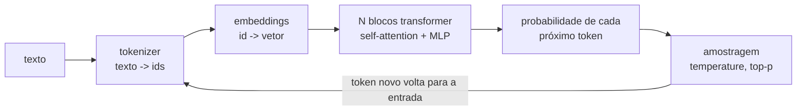

# 03 · Como funcionam os LLMs e prompt engineering na prática

## Objetivo

Ao terminar, você sabe explicar tokens, embeddings, attention e transformer sem misticismo; conhece os
principais LLMs de 2026; e escreve prompts com padrões que funcionam para codar, debugar, documentar e
aprender, **medindo** em vez de achar.

## Explicação

### Um LLM em 5 passos



1. **Tokenização**: o texto vira pedaços (tokens: palavras, sílabas, símbolos), cada um com um id. Em
   português gasta-se mais tokens por palavra que em inglês. Custo e limite de contexto são contados em tokens.
2. **Embeddings**: cada id vira um vetor (milhares de números). Tokens de significado parecido ficam com
   vetores próximos. É a mesma ideia dos embeddings de frase usados no RAG ([doc 04](04-rag-mcp-e-modelos.md)).
3. **Attention**: cada token "olha" para os outros e decide quais importam para ele. Em "o banco do rio
   estava cheio", attention liga "banco" a "rio" e o vetor de "banco" passa a significar margem, não agência.
   Tecnicamente: cada token gera Query, Key e Value; o peso é `softmax(Q·Kᵀ/√d)` e a saída é a soma ponderada dos Values.
4. **Transformer**: dezenas de blocos (attention + rede densa) empilhados. Treinado para uma tarefa simples,
   **prever o próximo token**, em trilhões de tokens. Depois passa por ajuste com instruções e feedback humano
   (é isso que transforma um "completador de texto" num assistente).
5. **Geração**: o modelo devolve probabilidades para o próximo token; um é sorteado (`temperature` 0 = sempre
   o mais provável), anexado, e o ciclo repete. Por isso ele gera **token a token** (o "streaming").

Consequências práticas: o LLM não consulta um banco de fatos, ele gera o texto **plausível**; pode inventar
(alucinar) com confiança; não sabe nada depois da data de corte do treino nem dos seus dados privados (daí o RAG);
e tudo que ele "lembra" na conversa está dentro da **janela de contexto**.

### Exemplos de LLMs (2026)

| Família | Empresa | Acesso | Observação |
|---|---|---|---|
| GPT (ChatGPT) | OpenAI | proprietário, API | popularizou o chat em 2022 |
| Gemini | Google | proprietário, API | multimodal nativo, contexto de 1M+ tokens |
| Claude | Anthropic | proprietário, API | forte em código e textos longos |
| Llama | Meta | pesos abertos (licença própria) | base de muitos modelos derivados |
| Qwen | Alibaba | pesos abertos (Apache 2.0 na maioria) | o `qwen3.5:4b` deste repo |
| Gemma | Google | pesos abertos | versões pequenas para rodar local |
| DeepSeek | DeepSeek | pesos abertos | custo baixo por token |

Nomes e versões mudam a cada poucos meses; o catálogo do OpenRouter lido no [exemplo 06](../exemplos/06-openrouter-e-ollama/)
mostra o estado atual (centenas de modelos, com preço e contexto).

### Prompt engineering: o que funciona

Um bom prompt é uma **especificação**, como uma boa issue:

1. **Papel e contexto** (`system`): quem o modelo é, para quem responde, o que já se sabe.
2. **Tarefa** em verbo no imperativo e **uma** por vez.
3. **Restrições**: o que fazer e o que não fazer, critérios objetivos ("urgente só se houver perda de dinheiro").
4. **Formato de saída** explícito (JSON com campos e valores permitidos, tabela, diff). Formato parseável = testável.
5. **Exemplos** (few-shot) quando o formato ou a fronteira entre categorias for sutil, escolhidos com cuidado.
6. **Saída de emergência**: "se não souber, diga não sei".

### Padrões para o dia a dia de dev

| Uso | Padrão de prompt |
|---|---|
| **Codar** | "Contexto: stack (NestJS 11, TypeScript, Postgres). Tarefa: implementar X. Restrições: sem dependências novas, seguir o padrão do arquivo Y (colado). Saída: só o código do arquivo, depois 3 bullets do que mudou." |
| **Debugar** | "Erro completo + stack trace + código do ponto do erro + o que você já tentou. Tarefa: liste 3 hipóteses de causa raiz em ordem de probabilidade e, para cada uma, um comando para confirmar." |
| **Documentar** | "Público: dev júnior que nunca viu o projeto. Gere README com: objetivo, como rodar, variáveis de ambiente (tabela), armadilhas. Use só informação do código colado; marque [?] o que não dá para saber." |
| **Revisar** | "Revise o diff abaixo procurando bugs de concorrência e SQL injection. Para cada achado: linha, gravidade, correção. Se não houver, diga 'nenhum achado'." |
| **Aprender** | "Explique X para quem sabe Y (ex.: 'explique attention para quem sabe SQL'). Depois faça 3 perguntas para eu testar se entendi, sem dar as respostas." |
| **Testar** | "Gere testes vitest para a função colada cobrindo: caminho feliz, entrada vazia, limite, erro. Não altere a função." |

## Código mínimo

```js
const r = await client.chat.completions.create({
  model: 'qwen3.5:4b', temperature: 0, max_tokens: 40, reasoning_effort: 'none',
  messages: [
    { role: 'system', content: 'Você faz triagem de tickets. Responda APENAS {"tipo":"bug"|"feature"|"duvida","urgente":true|false}. urgente=true só se houver perda de dinheiro, dados ou bloqueio total.' },
    { role: 'user', content: 'O app fecha sozinho quando clico em pagar. Perdi 3 vendas hoje!' },
  ],
});
JSON.parse(r.choices[0].message.content); // {"tipo":"bug","urgente":true}
```

## Na prática

- [Exemplo 04 · Prompt engineering medido](../exemplos/04-prompt-engineering/): prompt vago acerta 0/4;
  instrução clara 4/4; few-shot mal escolhido 3/4 com o dobro de tokens. Medir derruba intuições.

## Armadilhas

- **Thinking ligado em modelo local**: o `qwen3.5` "pensa" antes de responder e consome centenas de tokens a
  ~5 tokens/s em CPU. No Ollama, mande `reasoning_effort: "none"` (o [`lib/llm.js`](../lib/llm.js) já faz).
- **`max_tokens` baixo demais** corta a resposta (`finish_reason: "length"`) e o JSON fica inválido. Alto
  demais deixa um prompt vago gastar tempo. Meça os tokens de saída.
- **Few-shot enviesa**: exemplos ruins pioram o resultado (exemplo 04). Cubra a fronteira entre classes.
- **Avaliar com 3 casos**: 1 erro = 33 pontos. Use dezenas de casos e um gabarito; ver avaliação com pytest em
  [`trilhas-extras/llmops-vllm-openshift`](../../../trilhas-extras/llmops-vllm-openshift/).
- **Confiar no JSON**: modelos às vezes embrulham em ```` ```json ````. Extraia e valide (zod, JSON Schema)
  ou use *structured outputs* quando o provedor suportar.

## Fontes

- Vaswani et al., *Attention Is All You Need*: https://arxiv.org/abs/1706.03762
- The Illustrated Transformer (Jay Alammar): https://jalammar.github.io/illustrated-transformer/
- Guia de prompt engineering da OpenAI: https://platform.openai.com/docs/guides/prompt-engineering
- Guia de prompt engineering da Anthropic: https://docs.claude.com/en/docs/build-with-claude/prompt-engineering/overview
- Gemini API: https://ai.google.dev/gemini-api/docs
- Modelos da OpenAI: https://platform.openai.com/docs/models
- Modelo `qwen3.5` no Ollama: https://ollama.com/library/qwen3.5
