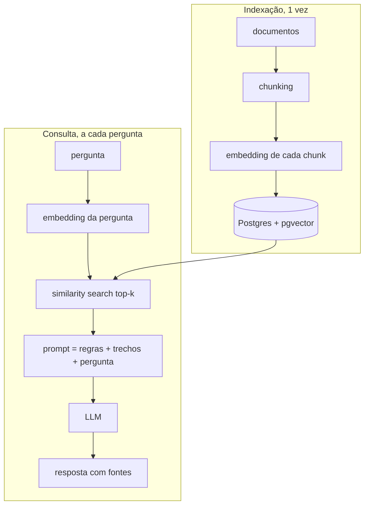
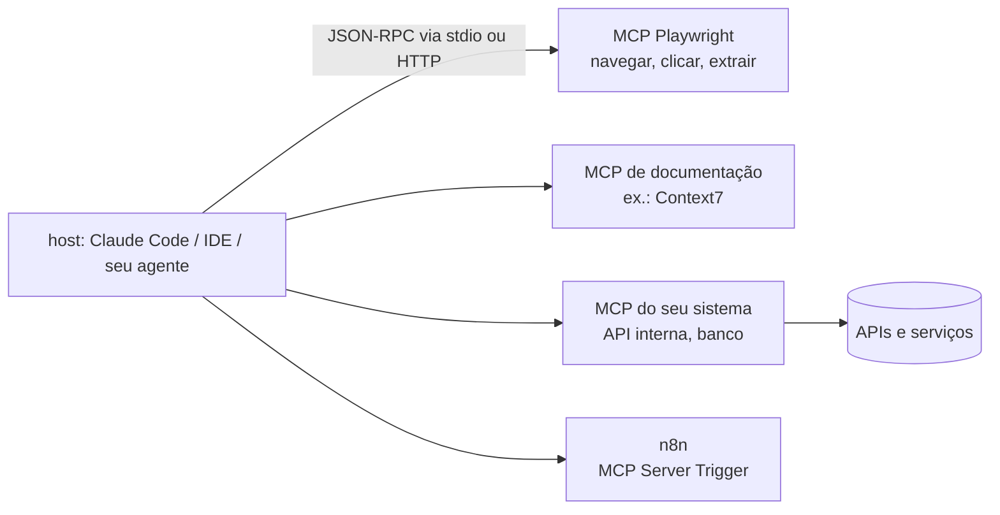

# 04 · RAG, embeddings e busca semântica · MCP para devs · modelos abertos x proprietários

## Objetivo

Ao terminar, você sabe: o que é RAG e por que importa; o que são embeddings, bancos vetoriais e similarity
search; montar um **primeiro RAG com JavaScript e Postgres (pgvector)**; explicar o que é MCP e como ele liga
a IA a APIs, navegador, documentação e automações (n8n); e escolher entre modelos abertos e proprietários,
usando OpenRouter e Ollama.

## Explicação

### RAG: por que importa

O LLM não sabe nada dos **seus** dados (políticas internas, código, tickets) nem do que aconteceu depois do
treino. Retreinar é caro e lento. RAG (*Retrieval-Augmented Generation*) resolve com uma ideia simples: antes
de perguntar ao modelo, **busque** os trechos relevantes e **cole no prompt**. Analogia: prova com consulta.
O aluno (LLM) continua o mesmo; você só entrega as páginas certas do livro.



Ganhos: respostas com dados atuais e privados, **citação de fonte** (auditável), menos alucinação, e atualizar
o conhecimento é só reindexar.

### Embeddings, bancos vetoriais e similarity search

- **Embedding** de texto: um vetor (aqui, 1024 números do `qwen3-embedding:0.6b`) em que textos de significado
  parecido ficam próximos, mesmo com palavras diferentes ("almoço" ≈ "refeição").
- **Similaridade de cosseno**: mede o ângulo entre dois vetores; 1 = mesma direção. No pgvector, `<=>` é a
  **distância** de cosseno (0 = igual), então `similaridade = 1 - (a <=> b)`. Outros operadores: `<->` (L2), `<#>` (produto interno negativo).
- **Banco vetorial**: guarda vetores e responde "os k mais próximos deste" rápido. Pode ser dedicado (Qdrant,
  Pinecone, Weaviate, Milvus) ou uma extensão do banco que você já tem: **pgvector** no Postgres, com a
  vantagem de juntar busca vetorial com `WHERE`, `JOIN`, transações e backup de sempre.
- **Índice ANN**: varrer tudo é exato mas O(n). `HNSW` (grafo) e `IVFFlat` (clusters) são aproximados e
  rápidos. Com poucas linhas o Postgres nem usa o índice; com milhões, é o que viabiliza.
- **Chunking**: documentos são quebrados em pedaços antes do embedding. Pedaço grande dilui o significado e
  gasta contexto; pedaço pequeno perde contexto. O [exercício 02](../exercicios/02-rag-chunking-top-k/)
  mede isso.

### MCP e automação para devs (visão introdutória)

**MCP (Model Context Protocol)** é um protocolo aberto que padroniza como uma aplicação de IA (o *host*:
Claude Code, Cursor, VS Code, seu agente) descobre e chama **ferramentas**, lê **recursos** e usa **prompts**
expostos por *servidores MCP*. Analogia: é o "USB-C" da IA. Em vez de escrever uma integração por par
(modelo × API), cada serviço expõe um servidor MCP e qualquer host compatível passa a usá-lo.



Usos práticos para dev:

| Objetivo | Como, com MCP |
|---|---|
| **Gerar testes automatizados** | o agente usa o MCP do Playwright para abrir o app, navegar, inspecionar a árvore de acessibilidade e escrever o teste e2e a partir do que viu |
| **Consultar documentação atualizada** | um MCP de documentação (ex.: Context7) injeta a doc da versão certa da lib, reduzindo código com API desatualizada |
| **Navegar em sites e extrair informação** | MCP de browser abre a página, lê o conteúdo e devolve dados estruturados |
| **Automações (n8n e similares)** | no n8n, o nó *MCP Server Trigger* expõe um workflow como ferramenta MCP para qualquer host; o nó *MCP Client Tool* deixa um agente do n8n chamar servidores MCP externos. Make e Zapier oferecem integrações parecidas |

Configuração típica num host (formato `mcpServers` usado por Claude Code, Cursor e outros):

```json
{
  "mcpServers": {
    "playwright": { "command": "npx", "args": ["@playwright/mcp@0.0.83"] },
    "context7": { "command": "npx", "args": ["-y", "@upstash/context7-mcp@4.4.2"] }
  }
}
```

Não executado localmente neste módulo (depende do seu host de IA). O **[módulo 03 · MCP](../../03-mcp/README.md)**
aprofunda: servidor MCP em JavaScript, ponte MCP ↔ LLM, transporte HTTP, testes e segurança.

### Modelos open-source x proprietários

| | Pesos abertos (Qwen, Llama, Gemma, DeepSeek...) | Proprietários (GPT, Gemini, Claude...) |
|---|---|---|
| Qualidade de ponta | geralmente alguns meses atrás | estado da arte |
| Privacidade | dados não saem da sua infra (rodando local) | dados vão ao provedor (ver contrato/retensão) |
| Custo | hardware + energia; zero por token | por token, sem investimento inicial |
| Controle | fine-tuning, quantização, versão congelada | modelo pode mudar ou ser descontinuado |
| Operação | você cuida de GPU, escala, latência | o provedor cuida |
| Licença | ler a licença (Apache 2.0, licenças comunitárias com restrição) | termos de uso do provedor |

**OpenRouter**: uma API compatível com a da OpenAI (`https://openrouter.ai/api/v1`) que dá acesso a centenas
de modelos (abertos e proprietários) com uma chave só, preços lado a lado, *fallback* entre modelos
(parâmetro `models`) e roteamento por provedor. Útil para comparar e para não ficar preso a um fornecedor.

**Ollama**: roda modelos abertos localmente (CPU ou GPU) com `ollama pull`/`ollama run` e expõe uma API
compatível com a OpenAI em `http://localhost:11434/v1`. É o que este repo usa. Os modelos vêm quantizados
(ex.: `Q4_K_M` = ~4 bits por peso), por isso um modelo de 4B parâmetros cabe em 3,3 GB.

Como todo código do repo lê `OPENAI_BASE_URL`, `OPENAI_API_KEY` e `MODELO_CHAT`, trocar Ollama ↔ OpenRouter ↔
OpenAI é só mudar o ambiente. Para servir modelos abertos em produção com alta vazão, veja vLLM em
[`trilhas-extras/llmops-vllm-openshift`](../../../trilhas-extras/llmops-vllm-openshift/).

## Código mínimo

```js
// busca semântica no pgvector (pgvector/pg registra o tipo `vector` no driver)
const [v] = await embed([pergunta]);
const { rows } = await db.query(
  `SELECT fonte, conteudo, 1 - (embedding <=> $1) AS similaridade
     FROM m01.chunks ORDER BY embedding <=> $1 LIMIT 3`,
  [pgvector.toSql(v)],
);
```

## Na prática

- [Exemplo 05 · Primeiro RAG com JS e Postgres](../exemplos/05-primeiro-rag/): indexação + busca + resposta com citações; compara com e sem RAG.
- [Exercício 02 · Chunking e top-k](../exercicios/02-rag-chunking-top-k/): hit@k e MRR de 3 estratégias.
- [Exemplo 06 · OpenRouter e Ollama](../exemplos/06-openrouter-e-ollama/): modelos locais, catálogo público do OpenRouter e comparação remota (esta parte não executada localmente: exige chave).

## Armadilhas

- **Dimensão do vetor fixa na tabela**: `vector(1024)` só aceita 1024 posições. Trocou de modelo de embedding?
  Recrie a coluna e **reindexe tudo**: vetores de modelos diferentes não são comparáveis.
- **Mesmo modelo para indexar e perguntar**: embedding da pergunta com outro modelo dá similaridade sem sentido.
- **`<=>` é distância, não similaridade**: `ORDER BY embedding <=> $1` (ascendente) traz os mais parecidos.
- **Esquecer `pgvector.registerTypes`** faz o driver devolver o vetor como string.
- **Chunk sem contexto**: "O limite é de R$ 90" sem o título "Reembolso" vira um vetor ambíguo. Prefixe o título.
- **RAG não impede alucinação**: mande responder só com o contexto, citar fontes e dizer "não sei".
- **MCP é código de terceiros com acesso às suas coisas**: revise o servidor, fixe a versão e dê o mínimo de
  permissão (ver segurança no módulo 03).

## Fontes

- pgvector: https://github.com/pgvector/pgvector
- pgvector-node: https://github.com/pgvector/pgvector-node
- Modelo de embeddings `qwen3-embedding`: https://ollama.com/library/qwen3-embedding
- Ollama, compatibilidade com a API da OpenAI: https://docs.ollama.com/api/openai-compatibility
- OpenRouter, quickstart: https://openrouter.ai/docs/quickstart
- OpenRouter, roteamento e fallback de modelos: https://openrouter.ai/docs/features/model-routing
- Model Context Protocol: https://modelcontextprotocol.io/docs/getting-started/intro
- Playwright MCP: https://github.com/microsoft/playwright-mcp
- Context7 MCP: https://github.com/upstash/context7
- n8n MCP Server Trigger: https://docs.n8n.io/integrations/builtin/core-nodes/n8n-nodes-langchain.mcptrigger/
- n8n MCP Client Tool: https://docs.n8n.io/integrations/builtin/cluster-nodes/sub-nodes/n8n-nodes-langchain.toolmcp/
