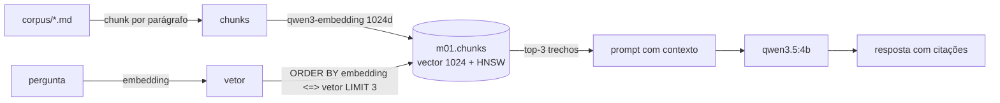

# Exemplo 05 · Primeiro RAG com JavaScript e Postgres (pgvector)

**Conceito novo:** RAG = **R**etrieval (buscar trechos relevantes por similaridade de embeddings) +
**A**ugmented (colocar esses trechos no prompt) + **G**eneration (o LLM responde citando as fontes).

Base de conhecimento: 6 documentos internos de uma empresa fictícia, a Café Byte, em [`corpus/`](corpus/).
O modelo nunca viu esses textos, então sem RAG ele só pode chutar.



**Pré-requisito:** [exemplo 04](../04-prompt-engineering/) (prompts), infra no ar (Ollama + Postgres 18 com
pgvector na porta 5433). O código usa só o schema `m01`. As peças reutilizáveis estão em
[`lib/rag.js`](../../lib/rag.js) (`conectar`, `chunkPorParagrafo`, `indexar`, `buscar`).

## Como rodar

```bash
cd modulos/01-fundamentos-ia-llms
npm run ex05:indexar                      # cria m01.chunks e indexa (idempotente)
npm run ex05                              # pergunta padrão
node exemplos/05-primeiro-rag/perguntar.js "Posso fazer deploy na sexta?" --sem-rag   # compara com/sem RAG
```

## Saída esperada

`npm run ex05:indexar` (saída real):

```text
documentos: 6 | chunks indexados: 17 | tempo: 27.5s
┌─────────┬────────────────┬──────┬────────────────────────────────────────────────────────────────┐
│ (index) │ fonte          │ dims │ inicio                                                         │
├─────────┼────────────────┼──────┼────────────────────────────────────────────────────────────────┤
│ 0       │ '01-ferias.md' │ 1024 │ 'Política de férias da Café Byte: Cada pessoa colaboradora te' │
│ 1       │ '01-ferias.md' │ 1024 │ 'Política de férias da Café Byte: O pedido de férias é feito ' │
│ 2       │ '01-ferias.md' │ 1024 │ 'Política de férias da Café Byte: Durante dezembro a loja onl' │
└─────────┴────────────────┴──────┴────────────────────────────────────────────────────────────────┘
```

`node exemplos/05-primeiro-rag/perguntar.js "Até quando posso pedir reembolso de um almoço de viagem e qual o limite?" --sem-rag` (saída real):

```text
Pergunta: Até quando posso pedir reembolso de um almoço de viagem e qual o limite?

Top-3 trechos (similaridade de cosseno):
  [1] 0.706 03-reembolso.md — Reembolso de despesas: O limite de refeição em viagem é de R$ 90 por dia. Valore...
  [2] 0.606 03-reembolso.md — Reembolso de despesas: O reembolso cai na conta em até 10 dias úteis após a apro...
  [3] 0.480 03-reembolso.md — Reembolso de despesas: Despesas de trabalho (transporte para cliente, refeição e...

Resposta COM RAG (54.7s, 253 tokens de entrada):
Você pode solicitar o reembolso do almoço de viagem até 60 dias após a data da despesa [2], respeitando um limite máximo de R$ 90 por dia [1].

Resposta SEM RAG (o modelo não conhece a Café Byte):
O reembolso para despesas de viagens (incluindo almoços) é geralmente permitido até ao final do exercício fiscal, desde que as despesas tenham sido suportadas dentro desse período. O valor máximo reembolsável depende das políticas específicas da sua empresa ou da legislação local aplicável à sua região.
```

Repare: a pergunta diz "almoço", o texto diz "refeição", e mesmo assim o trecho certo veio em 1º (busca
**semântica**, não por palavra). Sem RAG, a resposta é genérica e errada para esta empresa.

## Experimente

1. Pergunte algo que não está no corpus ("Qual o plano de saúde?") e veja se o modelo obedece o "não sei".
2. Troque `K = 3` por `K = 1` e pergunte algo que precisa de dois parágrafos (prazo **e** limite).
3. Consulte o banco direto: `psql postgres://ia:ia@localhost:5433/ia -c "SELECT fonte, left(conteudo,50) FROM m01.chunks WHERE colecao='paragrafo'"`.

## Versão Python

Mesmo corpus e mesmo chunking, com `psycopg` 3 + `pgvector` (Python) em
[`comum_py/rag.py`](../../comum_py/rag.py). Mesmo schema `m01`, mas tabela própria **`m01.chunks_py`** (índice
`chunks_py_embedding_hnsw`): o JS e o Python podem rodar juntos sem um apagar a coleção do outro.

**Como rodar** (da pasta do módulo, depois de `uv sync`):

```bash
uv run python exemplos/05-primeiro-rag/python/indexar.py
uv run python exemplos/05-primeiro-rag/python/perguntar.py --sem-rag
uv run pytest exemplos/05-primeiro-rag/python   # teste do chunking (sem banco)
```

**Saída esperada (Python)** — saída real:

```text
documentos: 6 | chunks indexados: 17 | tempo: 5.2s
fonte              dims  início
01-ferias.md       1024  Política de férias da Café Byte: Cada pessoa colaboradora te
01-ferias.md       1024  Política de férias da Café Byte: O pedido de férias é feito 
01-ferias.md       1024  Política de férias da Café Byte: Durante dezembro a loja onl
```

```text
Pergunta: Até quando posso pedir reembolso de um almoço de viagem e qual o limite?

Top-3 trechos (similaridade de cosseno):
  [1] 0.706 03-reembolso.md — Reembolso de despesas: O limite de refeição em viagem é de R$ 90 por dia. Valore...
  [2] 0.606 03-reembolso.md — Reembolso de despesas: O reembolso cai na conta em até 10 dias úteis após a apro...
  [3] 0.480 03-reembolso.md — Reembolso de despesas: Despesas de trabalho (transporte para cliente, refeição e...

Resposta COM RAG (11.1s, 253 tokens de entrada):
Você pode solicitar o reembolso do almoço de viagem até 60 dias após a data da despesa [2], respeitando um limite máximo de R$ 90 por dia [1].

Resposta SEM RAG (o modelo não conhece a Café Byte):
O reembolso para despesas de viagens (incluindo almoços) é geralmente permitido até ao final do exercício fiscal, ...
```
