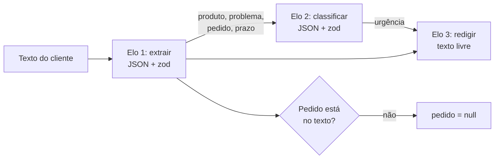

# 01 · Engenharia de prompts avançada

## Objetivo

Ao terminar, você sabe quebrar uma tarefa em uma **corrente de prompts** (prompt chaining), guardar prompts
como **templates versionados** e aplicar estratégias concretas para **reduzir alucinações** — boa parte delas
no código, não no texto do prompt.

## Explicação

### Prompt chaining

Um prompt gigante que "extrai, classifica e responde" é como pedir a um estagiário que faça três coisas de
uma vez: quando sai errado, você não sabe em qual parte. **Chaining** divide o trabalho em elos pequenos,
cada um com entrada e saída bem definidas. O que sai de um elo (de preferência JSON validado) entra no próximo.



Ganhos: prompts curtos (mais baratos), cada elo testável e trocável, e pontos de checagem entre elos onde o
**código** valida o que o modelo produziu. Custo: mais chamadas (latência somada) e o risco de um elo
**não repassar** algo que o próximo precisava — no exemplo 01, a primeira versão perdeu a "viagem na sexta"
e o elo de urgência classificou o caso como `baixa`.

Variações comuns: **sequencial** (o caso acima), **paralela** (vários elos independentes sobre a mesma
entrada, depois um elo que junta) e **com roteamento** (um elo classifica e decide qual corrente seguir — é o
que o bot do [exemplo 06](../exemplos/06-audio-e-bot-multimodal/) faz por modalidade).

### Prompt templates

Prompt é código: precisa de nome, versão, revisão e teste. Um template separa a parte **fixa** (instruções)
das **variáveis** (`{{texto}}`), falha cedo se faltar variável e permite registrar `id@versao` em cada log —
quando uma resposta ruim aparecer em produção, você sabe qual prompt a gerou. No LangChain o equivalente é o
`ChatPromptTemplate` (usado no [exemplo 03](../exemplos/03-rag-langchain-observabilidade/)).

Boas regras para templates:

- Instruções fixas no **system**; dados variáveis no **user**, delimitados (`<<< >>>`, tags XML) para o modelo
  não confundir dado com instrução (isso também reduz injeção de prompt).
- Parte fixa **primeiro**, parte variável **no fim**: aproveita o cache de prefixo (ver [doc 02](02-consistencia-e-custo.md)).
- Versão sobe a cada mudança de comportamento; teste unitário do template (sem LLM) garante que ele renderiza.

### Reduzir alucinações e melhorar precisão

Alucinação é o modelo completar o padrão com algo plausível que não está nos dados. Estratégias, da mais
forte para a mais fraca:

| Estratégia | Como | Onde no módulo |
|---|---|---|
| **Checagem determinística** | O código confere se o dado extraído aparece na fonte (número de pedido, valor) | exemplo 01, exercício 01 |
| **Consistência interna** | Soma dos itens = total? Datas em ordem? | exemplo 05 (`soma_confere`) |
| **Schema estrito** | JSON Schema + zod; campos `nullable` para "não encontrado" | exemplos 01 e 05 |
| **Grounding (RAG)** | Responder só com o contexto recuperado e **citar a fonte** | exemplo 03 |
| **Permissão para não saber** | "Se não estiver no texto, use null / diga 'não sei'" | exemplos 01 e 03 |
| **Tarefas menores** | Chaining: cada elo faz uma coisa | exemplo 01 |
| **Temperatura 0** | Menos variação (não elimina alucinação!) | todos |
| **Decisão no código** | O LLM extrai e redige; a regra de negócio decide | exercício 01 |

A ideia central: **não confie, verifique**. "Por favor, não invente" no prompt ajuda pouco; uma linha de código
que descarta um número inexistente ajuda sempre.

## Código mínimo

```js
// Template com falha rápida
const renderizar = (t, v) => t.replace(/\{\{(\w+)\}\}/g, (_, k) => {
  if (!(k in v)) throw new Error(`Variável ausente: ${k}`);
  return String(v[k]);
});

// Elo 1 → checagem determinística → elo 2
const ext = await extrair(texto);                       // { pedido: "48213", ... }
if (ext.pedido && !texto.includes(ext.pedido)) ext.pedido = null; // inventado? descarta
const cls = await classificar({ ...ext });              // recebe só o que precisa
```

## Na prática

- [exemplos/01-prompt-chaining-e-templates](../exemplos/01-prompt-chaining-e-templates/) — corrente de 3 elos com templates versionados.
- [exercicios/01-chain-com-validacao-e-retry](../exercicios/01-chain-com-validacao-e-retry/) — chain com retry, grounding e decisão no código.

## Armadilhas

- **Elo que não repassa contexto**: o próximo elo decide "às cegas". Liste explicitamente o que cada elo precisa.
- **Erro que se propaga**: um elo errado contamina a corrente inteira. Valide entre elos e pare cedo.
- **Latência somada**: 3 elos = 3 idas ao modelo. Paralelize os independentes; use modelo menor nos elos simples.
- **Template sem versão**: impossível saber qual prompt gerou a resposta ruim de ontem.
- **Dado misturado com instrução**: texto do usuário fora de delimitadores pode "mandar" no modelo (prompt injection).
- **Caracteres de outro idioma**: modelos pequenos multilíngues (como o Qwen) às vezes soltam um caractere
  chinês no fim de um texto truncado. Limite o tamanho no prompt ("até 15 palavras"), não só no `max_tokens`.

## Fontes

- OpenAI — Prompt engineering: https://platform.openai.com/docs/guides/prompt-engineering
- Anthropic — Chain complex prompts: https://docs.claude.com/en/docs/build-with-claude/prompt-engineering/chain-prompts
- Anthropic — Reduce hallucinations: https://docs.claude.com/en/docs/test-and-evaluate/strengthen-guardrails/reduce-hallucinations
- LangChain JS — Prompt templates / Runnables: https://reference.langchain.com/javascript/langchain-core/runnables
