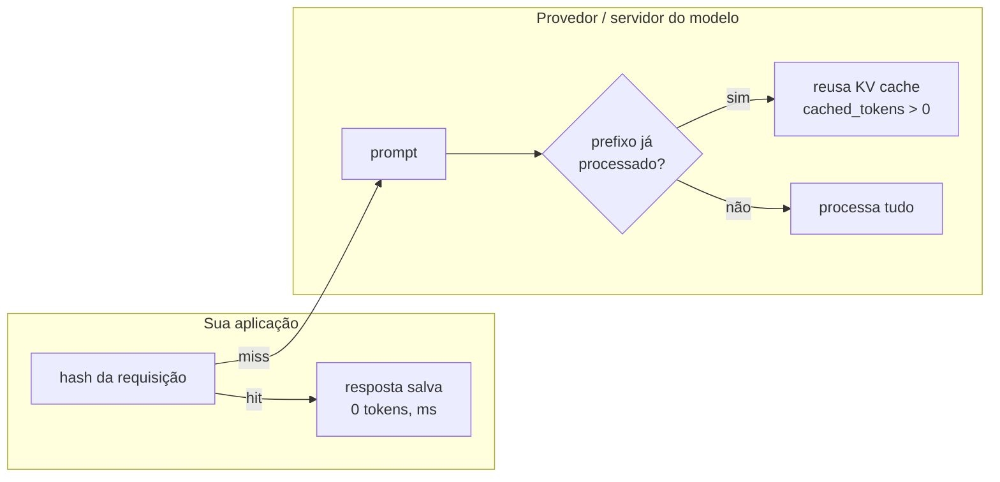

# 02 · Consistência e custo-eficiência

## Objetivo

Ao terminar, você sabe estimar o custo de uma chamada pelos tokens, cortar tokens sem perder qualidade,
aproveitar **cache de prefixo** e **cache de respostas**, e tornar a saída previsível com **structured
outputs** (JSON Schema), `temperature`, `seed` e validação com **zod**.

## Explicação

### Custo = tokens × preço

Provedores cobram por token, com preço diferente para **entrada**, **entrada em cache** (bem mais barata) e
**saída** (a mais cara). A conta de uma chamada é:

```
custo = (entrada − em_cache) × P_entrada + em_cache × P_cache + saída × P_saída
```

O campo `usage` da resposta traz os três números (`prompt_tokens`, `prompt_tokens_details.cached_tokens`,
`completion_tokens`). **Logue sempre** — sem isso, a fatura chega antes do diagnóstico. Os preços mudam:
pegue-os da página do provedor e deixe-os em configuração, não no código. O modelo local custa US$ 0 por
token, mas você paga em hardware, energia e latência (aqui, ~5 tokens/s em CPU).

Para custo por token **em escala** (throughput, batching, capacidade de GPU), veja a trilha
[LLMOps → custo e capacidade](../../../trilhas-extras/llmops-vllm-openshift/docs/08-custo-e-capacidade.md).

### Onde cortar tokens

| Alavanca | Efeito | Observação |
|---|---|---|
| Prompt enxuto | No exemplo 02, 104 → 33 tokens de entrada para a mesma tarefa | Cortesia não melhora a resposta |
| `max_tokens` e "responda em N palavras" | Saída é a parte mais cara | Use os dois: `max_tokens` corta no meio |
| Mandar só o necessário a cada elo | Chaining com contexto mínimo | [doc 01](01-engenharia-de-prompts-avancada.md) |
| RAG em vez de "colar o manual inteiro" | Contexto de 2 trechos, não de 200 páginas | [doc 03](03-rag-backend-e-observabilidade.md) |
| Modelo menor nos elos simples | Classificar não exige o modelo topo de linha | Meça a qualidade antes de trocar |
| Imagem menor | Visão cobra por "pedaços" da imagem | [doc 04](04-multimodal-e-aplicacoes.md) |

### Dois caches diferentes



- **Cache de prefixo (reuso de contexto)** — feito pelo servidor. Se duas requisições começam com o mesmo
  trecho (system prompt, documentos, exemplos few-shot), ele reaproveita o processamento. Na OpenAI é
  automático a partir de 1024 tokens e o trecho em cache sai mais barato; o Ollama também reusa e informa
  `cached_tokens`. Regra prática: **fixo no começo, variável no fim**. Um timestamp no início do system
  prompt invalida o cache de tudo.
- **Cache de respostas** — feito por você. Mesma requisição (modelo + parâmetros + mensagens) → devolve a
  resposta salva, sem chamar o modelo. Ótimo para perguntas repetidas (FAQ) com `temperature: 0`. Precisa
  de **TTL** e de entrar na chave tudo que muda a resposta (inclusive a versão do template).

### Previsibilidade

| Ferramenta | O que garante | O que NÃO garante |
|---|---|---|
| `temperature: 0` | Escolhe sempre o token mais provável | Determinismo total (paralelismo e hardware mudam somas de ponto flutuante) |
| `seed` | Mesmo sorteio de amostragem entre chamadas | Igualdade entre versões de modelo/servidor (a OpenAI chama de "best effort") |
| **Structured outputs** (`response_format: json_schema`) | Saída no formato do schema (o servidor restringe a geração por gramática) | Que os **valores** estejam certos |
| **zod** (`safeParse`) | Validação no seu código, com regras que o JSON Schema não expressa bem | — é a última linha de defesa |

O helper `zodResponseFormat` do SDK `openai` converte o schema zod em JSON Schema e manda no
`response_format`; o mesmo schema valida a resposta depois. Um contrato, dois usos. Quando a validação
falha, devolva o erro ao modelo e tente de novo (normalmente corrige na 2ª tentativa) — com limite de
tentativas e um destino para o caso que não resolve (revisão humana).

## Código mínimo

```js
import { zodResponseFormat } from "openai/helpers/zod";
import { z } from "zod";

const Sentimento = z.object({ sentimento: z.enum(["positivo", "negativo", "neutro"]), motivo: z.string() });
const r = await cliente.chat.completions.create({
  model: MODELO_CHAT, temperature: 0, seed: 42, max_tokens: 80,
  reasoning_effort: "none",                         // qwen3.5: sem "thinking"
  messages: [{ role: "user", content: "Classifique: 'A entrega atrasou 3 dias.'" }],
  response_format: zodResponseFormat(Sentimento, "classificacao"),
});
const ok = Sentimento.safeParse(JSON.parse(r.choices[0].message.content));
console.log(r.usage);  // { prompt_tokens, prompt_tokens_details: { cached_tokens }, completion_tokens, ... }
```

## Na prática

- [exemplos/01-prompt-chaining-e-templates](../exemplos/01-prompt-chaining-e-templates/) e o helper
  [`comum/estruturado.js`](../comum/estruturado.js) — structured output + zod + retry com feedback.
- [exemplos/02-custo-e-cache](../exemplos/02-custo-e-cache/) — tokens reais, cache de prefixo e cache de respostas no Postgres.

## Armadilhas

- **Thinking ligado sem querer**: modelos de raciocínio (qwen3.5, o-series) gastam centenas de tokens
  "pensando" antes de responder. Com `max_tokens` baixo, a resposta sai **vazia**. No Ollama, mande
  `reasoning_effort: "none"`.
- **`max_tokens` corta o JSON no meio** → `JSON.parse` falha. Dimensione o limite para o schema inteiro.
- **Cache de respostas com `temperature` alta**: você congela uma amostra aleatória como "a" resposta.
- **Chave de cache incompleta**: mudou o template e o cache serviu a resposta da versão antiga.
- **`cached_tokens` menor que o esperado**: o servidor guarda o prefixo em blocos e outras requisições
  (de outros usuários) podem despejar o cache — no exemplo 02, só 304 de 816 tokens vieram do cache com
  outros processos usando o mesmo Ollama.
- **Confiar só no schema**: `{"valor": 99}` é JSON válido e errado. Valide o conteúdo também.

## Fontes

- OpenAI — Structured outputs: https://platform.openai.com/docs/guides/structured-outputs
- OpenAI — Prompt caching: https://platform.openai.com/docs/guides/prompt-caching
- OpenAI — Preços: https://platform.openai.com/docs/pricing
- SDK `openai` (Node), helpers de zod no README: https://github.com/openai/openai-node
- Ollama — compatibilidade OpenAI: https://docs.ollama.com/api/openai-compatibility
- Ollama — structured outputs: https://docs.ollama.com/capabilities/structured-outputs
- Zod — JSON Schema: https://zod.dev/json-schema
