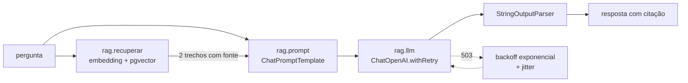
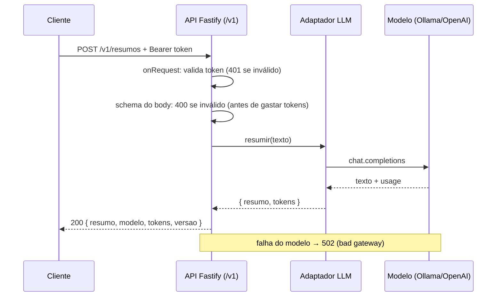

# 03 · RAG na prática, integração com back-end e observabilidade

## Objetivo

Ao terminar, você sabe orquestrar um fluxo de RAG com **LangChain.js** (LCEL), tratar erros com
**retentativas e backoff**, emitir **logs estruturados** que reconstroem cada execução, e integrar um LLM a
uma API **Fastify** com autenticação, rota versionada (`/v1`) e testes com **vitest** (LLM mockado +
integração real contra o Ollama).

## Explicação

### RAG orquestrado com LangChain.js

RAG (Retrieval-Augmented Generation) é "consultar antes de responder": transforma a pergunta em embedding,
busca os trechos mais parecidos (aqui, no **pgvector**, schema `m02`) e entrega esses trechos como contexto.
O LangChain organiza isso como uma **sequência de Runnables** (LCEL): cada passo tem `invoke`, pode ser
nomeado, recebe callbacks e ganha comportamentos como `.withRetry()` sem mudar o passo em si.



Detalhes que fazem o RAG "avançado" (sair do tutorial): **citar a fonte** no contexto e pedir citação na
resposta (auditável), **permitir "não sei"**, limitar `k` (2–5 trechos), logar as similaridades (para ver
quando a busca não achou nada bom) e manter a ingestão **idempotente**. O fundamento de embeddings e busca
vetorial é o mesmo do [módulo 01](../../01-fundamentos-ia-llms/).

### Erros e retentativas

Nem todo erro merece nova tentativa:

| Erro | Tentar de novo? | Por quê |
|---|---|---|
| 429 (rate limit), 500, 502, 503, 504, timeout de rede | Sim, com **backoff exponencial + jitter** | É transitório; o jitter evita que todos os clientes voltem juntos |
| 400, 401, 403, 404, 422 | **Não** — falhe rápido | Repetir a mesma requisição dá o mesmo erro e custa tempo |
| JSON inválido / schema violado | Sim, **com feedback** do erro para o modelo | O modelo costuma se corrigir ([doc 02](02-consistencia-e-custo.md)) |

Cuidado com **retry em dobro**: o SDK `openai` e o `ChatOpenAI` já têm retentativa própria (`maxRetries`).
Se você também usa `.withRetry()`, desligue a de dentro (`maxRetries: 0`), senão 4 × 3 = 12 tentativas.

### Logging, observabilidade e depuração

Um app de IA falha de jeitos novos: resposta "certa" mas sem fonte, latência que triplica por retry
silencioso, custo que dobra porque um elo passou a mandar o documento inteiro. Para enxergar isso, cada
execução precisa de um **trace**: eventos com `run_id`/`parent_run_id`, duração, tokens, tentativa, erro.
No LangChain isso sai de graça por **callbacks** (`handleChainStart`, `handleLLMEnd`, ...). O exemplo 03
escreve uma linha JSON por evento; em produção, a mesma ideia vira LangSmith, Langfuse ou OpenTelemetry
(convenções `gen_ai.*`). Para métricas de servidor (TTFT, filas, Prometheus), veja a trilha
[LLMOps → métricas](../../../trilhas-extras/llmops-vllm-openshift/docs/04-metricas-e-observabilidade.md).

O que logar em toda chamada: `template@versao`, modelo, tokens de entrada/saída/cache, latência,
tentativa, status. O que **não** logar: chaves de API e dados pessoais crus (mascare).

### Integrar um LLM a um back-end existente



Decisões que importam:

- **Adaptador**: a rota conhece `llm.resumir()`, não o SDK. Trocar de provedor ou mockar é trivial.
- **Autenticação** no `onRequest` do escopo `/v1` (o `/health` fica de fora), comparando o token em tempo
  constante (`timingSafeEqual`). Em produção o token vem de um cofre de segredos.
- **Versionamento por prefixo** (`/v1`): uma mudança incompatível no contrato vira `/v2` registrado ao lado;
  `/v1` segue no ar até os clientes migrarem.
- **Validação antes do LLM**: `maxLength` no body é proteção de custo, não só de formato.
- **Mapeamento de erro**: falha do provedor vira **502**, não 500 genérico.
- **Testes em duas camadas**: unitários com o LLM como dublê (`vi.fn()`) via `app.inject()` — milissegundos,
  sem rede, determinísticos; e um teste de **integração** contra o modelo real, opcional (`INTEGRACAO=1`),
  que verifica **propriedades** (tamanho, palavras-chave), nunca a frase exata.

## Código mínimo

```js
const chain = RunnableSequence.from([
  { contexto: recuperar, pergunta: new RunnablePassthrough() },
  prompt,
  llm.withRetry({ stopAfterAttempt: 4, onFailedAttempt: (e) => log(e) }),
  new StringOutputParser(),
]);
await chain.invoke("Ainda posso trocar?", { callbacks: [new LogJson()] });
```

```js
// Teste unitário da API com o LLM mockado
const resumir = vi.fn().mockResolvedValue({ resumo: "ok", tokens: 1 });
const res = await buildApp({ llm: { modelo: "falso", resumir }, token: "t" })
  .inject({ method: "POST", url: "/v1/resumos", headers: { authorization: "Bearer t" }, payload: { texto } });
```

## Na prática

- [exemplos/03-rag-langchain-observabilidade](../exemplos/03-rag-langchain-observabilidade/) — RAG + retry + logs JSON.
- [exemplos/04-api-backend-com-llm](../exemplos/04-api-backend-com-llm/) — Fastify `/v1`, token, 7 testes unitários + 1 de integração.

## Armadilhas

- **Retry em dobro** (SDK + `withRetry`): latência explode sem ninguém ver. Escolha um lugar só.
- **Retentar 4xx**: gasta tempo e cota para o mesmo erro.
- **Retry silencioso**: sem log em `onFailedAttempt`, um provedor instável parece "lentidão normal".
- **Embeddings de modelos diferentes** na ingestão e na consulta: a busca devolve lixo sem erro nenhum.
- **Teste de integração que compara texto exato**: quebra a cada versão do modelo. Teste propriedades.
- **Dois timeouts brigando**: o fetch do Node (undici) corta em 300 s sem headers (`UND_ERR_HEADERS_TIMEOUT`)
  mesmo com `timeout: 600_000` no SDK. Tenha **um** dono do prazo ([`comum/config.js`](../comum/config.js)).
- **`withConfig()` depois de `withRetry()`**: recria o binding e descarta `stopAfterAttempt`/`onFailedAttempt`
  em silêncio (volta ao padrão de 3 tentativas sem log). Nomeie primeiro, depois aplique o retry.
- **Token em query string ou em log**: vaza em proxies e ferramentas de log. Use o header `Authorization`.

## Fontes

- LangChain JS — visão geral: https://docs.langchain.com/oss/javascript/langchain/overview
- LangChain JS — RAG: https://docs.langchain.com/oss/javascript/langchain/rag
- LangChain JS — modelos (ChatOpenAI): https://docs.langchain.com/oss/javascript/langchain/models
- LangChain JS — Runnables (`withRetry`, `withConfig`): https://reference.langchain.com/javascript/langchain-core/runnables
- LangSmith — observabilidade: https://docs.langchain.com/langsmith/observability
- OpenTelemetry — convenções semânticas de GenAI: https://opentelemetry.io/docs/specs/semconv/gen-ai/
- pgvector-node: https://github.com/pgvector/pgvector-node
- Fastify — testes (`inject`): https://fastify.dev/docs/latest/Guides/Testing/
- Fastify — validação: https://fastify.dev/docs/latest/Reference/Validation-and-Serialization/
- Fastify — plugins e prefixo: https://fastify.dev/docs/latest/Reference/Plugins/
- Vitest — mocking: https://vitest.dev/guide/mocking
