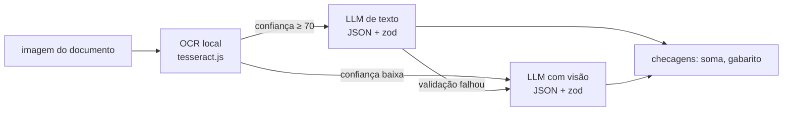

# 04 · Modelos multimodais e aplicações práticas

## Objetivo

Ao terminar, você sabe escolher a modalidade certa (texto, imagem, áudio, vídeo) para cada problema,
conhece o formato de chamada de visão e transcrição nas APIs mais comuns (OpenAI Vision, Whisper, Gemini) e
monta três aplicações: **OCR inteligente** de documentos, **análise de mídia** e um **bot multimodal**.

## Explicação

### Quando usar cada modalidade

Regra de ouro: **converta para a modalidade mais barata que preserva a informação de que você precisa.**

| Entrada | Caminho barato | Quando subir para o caminho caro | Caminho caro |
|---|---|---|---|
| Documento digitado e nítido | OCR local (tesseract) → LLM de **texto** estrutura | OCR com baixa confiança, layout complexo (tabelas, carimbos, manuscrito) | LLM com **visão** lê a imagem |
| Foto/print sem texto relevante | — | sempre | LLM com visão |
| Áudio de fala | Transcrever (Whisper) → LLM de texto | Quando importa **como** foi dito (tom, emoção, quem fala) | Modelo de áudio nativo (ex.: Gemini, gpt-4o-audio) |
| Vídeo | Extrair poucos frames (ffmpeg) + transcrever o áudio | Ações ao longo do tempo, sincronia imagem-som | Modelo de vídeo nativo (ex.: Gemini) |

Nos números deste módulo (CPU, máquina compartilhada): OCR de uma nota fiscal levou **~4 s** com 94% de
confiança; a mesma extração por visão levou **minutos**. Transcrever 5 s de áudio com Whisper base: **~15 s**.

### Visão geral das APIs (sem contas pagas aqui)

O provedor muda; o formato é parecido. Este módulo usa o **formato OpenAI** (Chat Completions) contra o
Ollama, então o código roda igual na OpenAI trocando `OPENAI_BASE_URL`, `OPENAI_API_KEY` e `MODELO_CHAT`.

- **OpenAI Vision** — imagens entram como partes da mensagem: `{ type: "image_url", image_url: { url } }`,
  com `url` http(s) ou data URI base64, e `detail: "low" | "high" | "auto"` controlando quantos "pedaços"
  da imagem viram tokens (custo). Formatos: PNG, JPEG, WEBP, GIF não animado.
- **Whisper / transcrição OpenAI** — `POST /v1/audio/transcriptions` com o arquivo (`model: "whisper-1"` ou
  os modelos `gpt-4o*-transcribe`), `language` opcional e saída em texto, JSON ou legendas (SRT/VTT).
  O Whisper também é **open source**: aqui rodamos o `whisper-base` em ONNX, localmente, com
  `@huggingface/transformers` — nenhum áudio sai da máquina.
- **Gemini multimodal** — um único modelo aceita texto, imagem, áudio, vídeo e PDF na mesma requisição
  (`contents` com partes `inlineData` ou `fileData` via Files API para arquivos grandes); entende vídeo de
  forma nativa, com timestamps. O Gemini também expõe um endpoint compatível com OpenAI.

```js
// Mesmo código, provedores diferentes (só o ambiente muda). Executado aqui contra o Ollama.
const r = await cliente.chat.completions.create({
  model: MODELO_CHAT, max_tokens: 300, temperature: 0,
  messages: [{ role: "user", content: [
    { type: "text", text: "Extraia os campos desta nota fiscal." },
    { type: "image_url", image_url: { url: `data:image/png;base64,${b64}` } },  // Ollama: só base64
  ] }],
});
```

```js
// Transcrição pela API da OpenAI — NÃO executado localmente (exige chave paga).
// O equivalente local, executado, está em exemplos/06-audio-e-bot-multimodal/transcrever.js.
const t = await openai.audio.transcriptions.create({
  file: fs.createReadStream("pergunta.wav"), model: "whisper-1", language: "pt",
});
```

### Aplicações práticas

**OCR inteligente** = OCR + entendimento. O OCR transforma pixels em texto; o LLM transforma texto em
**campos** (JSON validado), normaliza formatos (`25,90` → `25.9`, `14/10/2026` → `2026-10-14`) e o código
confere consistência (soma dos itens = total). Com um gabarito, a extração vira **métrica** (campos certos
/ total), não impressão.



**Análise de mídia (imagem/vídeo)** — para vídeo, a forma barata é amostrar frames e mandar cada um (ou um
mosaico) ao modelo de visão, junto com a transcrição do áudio. Os comandos abaixo foram executados aqui:

```bash
# 1 frame a cada 3 s, redimensionado para 480 px de largura (menos tokens por frame)
ffmpeg -v error -i video.mp4 -vf "fps=1/3,scale=480:-2" frames/%03d.png
# áudio do vídeo em WAV mono 16 kHz, o formato que o Whisper espera
ffmpeg -v error -i video.mp4 -vn -ac 1 -ar 16000 audio.wav
```

Cada frame segue pelo mesmo `image_url` base64 do [exemplo 05](../exemplos/05-documentos-ocr-e-visao/).
Peça saídas estruturadas por frame (objetos, texto visível, evento) e agregue no código.

**Bot multimodal** — um roteador decide o caminho pela modalidade da entrada: texto vai direto, áudio é
transcrito e vira texto, imagem vai para o modelo com visão. A resposta é sempre texto (ou texto → voz, com
TTS, se o canal for de voz).

## Na prática

- [exemplos/05-documentos-ocr-e-visao](../exemplos/05-documentos-ocr-e-visao/) — nota fiscal fictícia: OCR+LLM vs visão, medidos contra o gabarito.
- [exemplos/06-audio-e-bot-multimodal](../exemplos/06-audio-e-bot-multimodal/) — TTS e Whisper locais + bot que aceita texto, imagem e áudio.
- [exercicios/02-extrator-multimodal](../exercicios/02-extrator-multimodal/) — extrator de recibos com fallback OCR → visão.

## Armadilhas

- **Imagem grande em CPU**: o tempo da visão cresce com a resolução. Reduza (480–800 px costuma bastar para documento).
- **URL de imagem no Ollama**: não funciona; só data URI base64. Na OpenAI, URL pública funciona.
- **Whisper com taxa de amostragem errada**: ele espera 16 kHz mono; áudio a 44,1 kHz sem converter vira texto sem sentido.
- **Whisper "alucina" em silêncio ou ruído**: inventa frases (ex.: "Obrigado por assistir"). Corte silêncios e confira a duração.
- **OCR confiante e errado**: confiança média alta não impede um dígito trocado num valor. Faça checagens de consistência.
- **Dinheiro como `number` no schema**: o modelo devolveu `2.59e-15` no lugar de 25,90. Peça a **cópia
  literal** (`"25,90"`) e converta no código; aceite variações previsíveis (`"R$ 225,80"`).
- **Dados pessoais em documentos**: notas e recibos têm CPF/CNPJ. Prefira processar localmente e não logue o conteúdo cru.
- **tesseract.js sem pasta de cache**: se `cachePath` não existe, ele não cria e baixa o idioma (~2,4 MB) a cada execução.

## Fontes

- OpenAI — Images and vision: https://platform.openai.com/docs/guides/images-vision
- OpenAI — Speech to text: https://platform.openai.com/docs/guides/speech-to-text
- Gemini — Image understanding: https://ai.google.dev/gemini-api/docs/vision
- Gemini — Audio understanding: https://ai.google.dev/gemini-api/docs/audio
- Gemini — Video understanding: https://ai.google.dev/gemini-api/docs/video-understanding
- Gemini — Document processing: https://ai.google.dev/gemini-api/docs/document-processing
- Ollama — Vision: https://docs.ollama.com/capabilities/vision
- tesseract.js: https://github.com/naptha/tesseract.js
- Transformers.js: https://huggingface.co/docs/transformers.js/index
- Whisper base (ONNX): https://huggingface.co/onnx-community/whisper-base
- MMS-TTS português (ONNX): https://huggingface.co/Xenova/mms-tts-por
- FFmpeg — filtros (`fps`, `scale`): https://ffmpeg.org/ffmpeg-filters.html
