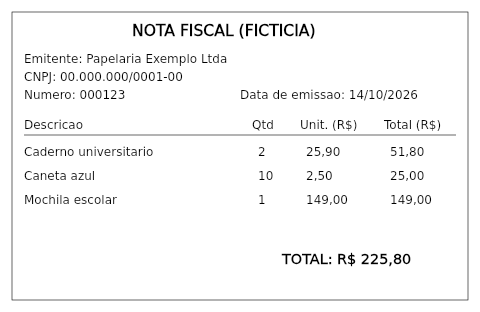

# Exemplo 05 · OCR inteligente: nota fiscal por OCR + LLM e por visão

**Conceito novo:** extrair **campos** de um documento-imagem por dois caminhos — OCR local (tesseract.js)
seguido de um LLM de texto, ou um LLM com **visão** lendo a imagem em base64 — e **medir** cada caminho
contra um gabarito, com checagem de consistência (soma dos itens = total).

**Pré-requisito:** [exemplo 01](../01-prompt-chaining-e-templates/) (`chamarEstruturado`) e o [doc 04](../../docs/04-multimodal-e-aplicacoes.md).

| Arquivo | Papel |
|---|---|
| [`gerar-nota.js`](gerar-nota.js) | desenha a nota fiscal **fictícia** (com `@napi-rs/canvas`) e exporta o `GABARITO` |
| [`nota-fiscal.png`](nota-fiscal.png) · [`nota-fiscal-pequena.png`](nota-fiscal-pequena.png) | 800 px (para o OCR) e 480 px (para a visão: menos tokens e menos tempo em CPU) |
| [`extrair.js`](extrair.js) | schema zod, `ocr()`, `viaOcr()`, `viaVisao()`, `comparar()` |
| [`main.js`](main.js) | roda os dois caminhos e imprime as checagens |



## Como rodar

```bash
cd modulos/02-apis-ia-generativa
npm run ex05:gerar                                         # (opcional) regenera os PNGs
npm run ex05                                               # os dois caminhos (~4 min em CPU)
node exemplos/05-documentos-ocr-e-visao/main.js ocr        # só OCR + LLM
node exemplos/05-documentos-ocr-e-visao/main.js visao      # só visão
```

## Saída esperada

Saída real:

```
[OCR + LLM] nota-fiscal.png (800px)
  · {"etapa":"nota_ocr","tentativa":1,"ms":96530,"tokens":442}
  confiança do OCR: 94% · 272 caracteres
  ocr+llm: 100.6 s · 7/7 checagens ok
   {"emitente":true,"cnpj":true,"numero":true,"data_emissao":true,"total":true,"itens":true,"soma_confere":true}
   {"emitente":"Papelaria Exemplo Ltda","cnpj":"00.000.000/0001-00","numero":"000123","data_emissao":"2026-10-14","itens":[{"descricao":"Caderno universitario","quantidade":2,"valor_unitario":"25,90"},...],"total":"225,80"}
[Visão] nota-fiscal-pequena.png (480px)
  · {"etapa":"nota_visao","tentativa":1,"ms":103932,"tokens":449}
  visao: 103.9 s · 6/7 checagens ok
   {"emitente":false,"cnpj":true,"numero":true,"data_emissao":true,"total":true,"itens":true,"soma_confere":true}
   {"emitente":"Papeleria Exemplo Ltda","cnpj":"00.000.000/0001-00","numero":"000123","data_emissao":"2026-10-14","itens":[...],"total":"R$ 225,80"}
```

O OCR em si leva **~4 s** (o resto do tempo é o LLM estruturando o texto). O caminho de visão errou o
emitente (`Papeleria`): a 480 px, o modelo "leu" uma letra errada. Documento digitado e nítido → OCR + LLM
de texto ganha em custo **e** precisão.

### O que deu errado antes (e virou regra)

- **Dinheiro como número**: na 1ª versão, `valor_unitario` era `z.number()` e o caminho OCR devolveu
  `2.5900000000000003e-15` no lugar de 25,90 — a checagem `soma_confere` pegou (5/7). Agora o modelo
  **copia** o texto (`"25,90"`) e o **código** converte (`paraNumero`). LLM copia bem; converte mal.
- **"R$" junto do valor**: o modelo de visão escreveu `"R$ 225,80"`, a regex recusou e as 2 tentativas
  falharam. O log da falha agora mostra o valor recebido, e o schema aceita o `R$` opcional.
- **`500 llama-server process no longer running`**: o processo do modelo foi morto por falta de memória
  (`signal: killed` no log do Ollama) enquanto outros processos usavam a máquina. Rodar de novo resolveu.
- **`UND_ERR_HEADERS_TIMEOUT` após 300 s**: o fetch do Node desiste antes do `timeout` do SDK. Ver
  [`comum/config.js`](../../comum/config.js) (agente `undici` com `headersTimeout: 0`).

## Experimente

1. Mande a imagem de **800 px** para a visão (troque o arquivo em `main.js`) e compare tempo, tokens e acertos.
2. Apague a linha do total em `gerar-nota.js`, regenere e rode: o schema exige `total`. O modelo inventa um
   valor ou a validação falha? O `soma_confere` pega?
3. Deixe o OCR em inglês (`createWorker("eng")`) e veja a confiança e os acentos mudarem.

## Versão Python

[`python/`](python/): [`ocr.py`](python/ocr.py) (OCR), [`extrair.py`](python/extrair.py) (modelos pydantic,
`via_ocr`, `via_visao`, `comparar`), [`gabarito.py`](python/gabarito.py) e [`main.py`](python/main.py).
Reaproveita os **mesmos PNGs** gerados pelo JS.

**OCR sem tesseract:** o `pytesseract` só chama o executável `tesseract`, que não está instalado (e não há
sudo). A versão Python usa o **RapidOCR** (`rapidocr` 3.10 + `onnxruntime`): modelos PP-OCRv5 em ONNX, 100%
pip, com wheels para Python 3.14, reconhecedor `latin` (acentos do português), ~16 MB de modelos baixados na
1ª execução para `.venv/cache-modelos/rapidocr`. O `easyocr` foi descartado: puxa o PyTorch (centenas de MB)
para a mesma tarefa. A confiança do RapidOCR é **por linha** (0–1); imprimimos a média e a pior linha.

`ex05:gerar` (desenho dos PNGs com canvas) **não foi portado**: os mesmos arquivos servem às duas versões, o
que deixa a comparação JS × Python justa; o gabarito está em `gabarito.py`.

### Como rodar

```bash
cd modulos/02-apis-ia-generativa
uv run python exemplos/05-documentos-ocr-e-visao/python/main.py           # ambos (~3 min em CPU)
uv run python exemplos/05-documentos-ocr-e-visao/python/main.py ocr       # só OCR + LLM
uv run python exemplos/05-documentos-ocr-e-visao/python/main.py visao     # só visão
```

### Saída esperada (Python)

Saída real:

```
[OCR + LLM] nota-fiscal.png (800px)
  · {"etapa": "nota_ocr", "tentativa": 1, "ms": 69674, "tokens": 444}
  confiança do OCR: média 98% · pior linha 57% · 270 caracteres
  ocr+llm: 75.2 s · 7/7 checagens ok
   {"emitente": true, "cnpj": true, "numero": true, "data_emissao": true, "total": true, "itens": true, "soma_confere": true}
   {"emitente":"Papelaria Exemplo Ltda","cnpj":"00.000.000/0001-00","numero":"000123","data_emissao":"2026-10-14","itens":[{"descricao":"Caderno universitario","quantidade":2,"valor_unitario":"25,90"},...],"total":"225,80"}
[Visão] nota-fiscal-pequena.png (480px)
  · {"etapa": "nota_visao", "tentativa": 1, "ms": 100622, "tokens": 449}
  visao: 100.6 s · 6/7 checagens ok
   {"emitente": false, "cnpj": true, "numero": true, "data_emissao": true, "total": true, "itens": true, "soma_confere": true}
   {"emitente":"Papeleria Exemplo Ltda","cnpj":"00.000.000/0001-00","numero":"000123","data_emissao":"2026-10-14","itens":[...],"total":"R$ 225,80"}
```

O OCR em si leva **~3 s** (1ª execução, carregando os modelos; ~1 s depois). A "pior linha 57%" é um risco
da tabela que o OCR leu como `p→ò`: lixo que o LLM ignorou. Visão: mesmo erro do JS (`Papeleria`).
