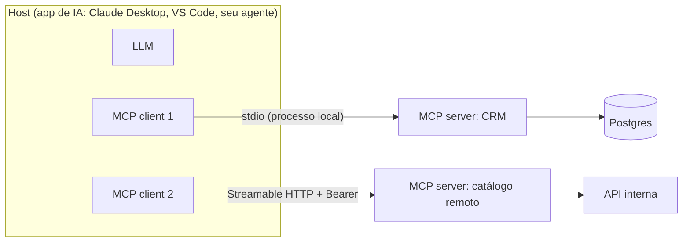

# 01 · Visão geral do MCP e MCP vs. tools tradicionais

## Objetivo

Ao terminar você sabe explicar o que é o Model Context Protocol (MCP), que problema ele resolve, quais são as
peças (host, client, server; tools, resources, prompts; stdio e Streamable HTTP) e quando vale usar MCP em vez
de declarar tools direto na API de um provedor.

## Explicação

### O problema: N modelos × M sistemas

Antes do MCP, cada integração entre um LLM e um sistema era feita sob medida: um plugin para o ChatGPT, outro
formato de function calling para o Claude, outro para o Gemini, outro para o copilot da IDE. Com N aplicações de IA e M sistemas
(CRM, billing, banco, Jira...), você acabava mantendo N × M adaptadores, cada um com seu jeito de descrever
parâmetros, tratar erro e autenticar.

O MCP é um **protocolo aberto** (JSON-RPC 2.0 + um contrato de mensagens) que padroniza esse meio de campo.
Analogia: é o **USB-C das integrações de IA**. O sistema implementa um servidor MCP uma vez, e qualquer
aplicação compatível (Claude Desktop, Claude Code, VS Code/Copilot, Cursor, seus próprios agentes) consegue usá-lo.
O problema vira N + M.

Ele ganhou tração porque: (1) a Anthropic lançou o protocolo aberto com SDKs oficiais em várias linguagens;
(2) os grandes clients (IDEs, assistentes, frameworks de agentes) adotaram rápido; (3) resolve uma dor real,
porque toda empresa quer "ligar o LLM nos sistemas internos"; (4) existe uma especificação versionada
(a atual é a `2025-11-25`) com regras de transporte e autorização.

### Arquitetura



- **Host**: a aplicação que o usuário usa e que conversa com o LLM.
- **Client**: um conector dentro do host. **Um client por servidor** (relação 1:1).
- **Server**: programa que expõe capacidades de um sistema.

O ciclo de vida: `initialize` (negociação de versão e *capabilities*) → `notifications/initialized` → chamadas
(`tools/list`, `tools/call`, `resources/read`, `prompts/get`...) → encerramento.

### As três primitivas do servidor

| Primitiva | Quem controla | Para quê | Exemplo |
|---|---|---|---|
| **Tools** | o **modelo** decide chamar | ações e consultas com parâmetros | `buscar_clientes`, `registrar_pagamento` |
| **Resources** | a **aplicação/usuário** escolhe | dados somente leitura endereçados por URI | `crm://clientes/2` |
| **Prompts** | o **usuário** escolhe (ex.: slash command) | templates de mensagem reutilizáveis | `cobranca_amigavel` |

O client também oferece primitivas ao servidor (*sampling*: o servidor pede uma completion ao LLM do host;
*elicitation*: o servidor pede um dado ao usuário; *roots*: pastas que o servidor pode ver).

### Transportes

- **stdio**: o host sobe o servidor como processo filho e troca JSON-RPC por stdin/stdout. Ideal para ferramentas
  locais (sem rede, sem porta). Regra de ouro: **o stdout é do protocolo**; log vai para o stderr.
- **Streamable HTTP**: um endpoint (ex.: `POST /mcp`) que responde JSON ou abre um stream SSE. É o transporte
  para servidores remotos, com autenticação HTTP (Bearer/OAuth). Pode ser *stateless* (cada POST é independente,
  escala horizontal fácil) ou *stateful* (header `Mcp-Session-Id`).
- HTTP+SSE (o antigo, protocolo `2024-11-05`) está **depreciado**; só para compatibilidade.

### Integração padronizada: entrada, saída e contexto

O que o MCP padroniza, e que antes cada um fazia do seu jeito:

- **Entrada**: toda tool declara `inputSchema` em JSON Schema; o servidor valida os argumentos.
- **Saída**: `content` (texto, imagem, áudio, link para resource) para o modelo ler, `structuredContent` (JSON
  validado contra `outputSchema`) para código consumir, e `isError: true` para erro de negócio que o modelo deve ver.
- **Metadados de comportamento**: `annotations` (`readOnlyHint`, `destructiveHint`, `idempotentHint`,
  `openWorldHint`) que o host usa para pedir confirmação antes de ações perigosas. São *dicas*: o host não deve
  confiar nelas vindas de servidor não confiável.
- **Contexto**: `instructions` do servidor, resources anexáveis e prompts prontos.
- **Descoberta**: o client pergunta `tools/list` em tempo de execução, sem nada fixo no código do host.

### MCP vs. tools tradicionais (function calling / plugins)

| Aspecto | Function calling do provedor | MCP |
|---|---|---|
| Onde a tool é definida | no código da sua aplicação, no formato do provedor (OpenAI, Anthropic, Gemini) | num servidor separado, formato único |
| Quem executa | sua aplicação | o servidor MCP (o client só repassa) |
| Reuso entre apps/IDEs | baixo, copia e adapta | alto: qualquer host compatível |
| Descoberta | estática, no deploy | dinâmica (`tools/list`, `list_changed`) |
| Além de tools | não | resources, prompts, sampling, elicitation |
| Custo | zero infraestrutura extra | mais um processo/serviço para operar e proteger |

Importante: **MCP não substitui function calling, ele fica por cima.** O LLM continua recebendo tools no formato
do provedor; o client MCP só converte `tools/list` para esse formato e executa as chamadas via `tools/call`
(veja o [exemplo 03](../exemplos/03-ponte-mcp-llm/)).

**Use MCP quando**: a mesma capacidade vai ser usada por mais de uma aplicação/IDE/agente; você quer expor
um sistema interno como "produto" para times de IA; quer trocar de provedor de LLM sem reescrever integrações;
quer governança central (auth, rate limit, auditoria) em um ponto só.

**Fique no function calling direto quando**: é uma tool pequena, usada por um único app, sem reuso previsto;
latência mínima importa e o processo extra não se paga; ou a tool é só lógica local (formatar data, calcular).

## Código mínimo

```js
import { McpServer } from '@modelcontextprotocol/sdk/server/mcp.js';
import { StdioServerTransport } from '@modelcontextprotocol/sdk/server/stdio.js';
import { z } from 'zod';

const server = new McpServer({ name: 'ola-mcp', version: '1.0.0' });
server.registerTool('somar', { description: 'Soma dois números', inputSchema: { a: z.number(), b: z.number() } },
  async ({ a, b }) => ({ content: [{ type: 'text', text: String(a + b) }] }));
await server.connect(new StdioServerTransport());
```

## Na prática

- [Exemplo 01 · servidor stdio com tools, resources e prompts](../exemplos/01-servidor-stdio/)
- [Exemplo 03 · ponte MCP → LLM (tools MCP viram tools OpenAI)](../exemplos/03-ponte-mcp-llm/)

## Armadilhas

- Achar que MCP "dá inteligência" ao modelo: ele só padroniza o acesso. Descrição ruim de tool continua gerando
  chamada errada.
- Expor dezenas de tools num servidor: cada tool vai no prompt e consome contexto. Prefira poucas tools com
  descrições boas, ou filtre por usuário (veja o [exercício 02](../exercicios/02-escopos-e-limite-por-token/)).
- Confundir resource com tool: se o modelo precisa *decidir* buscar algo com parâmetros, é tool; se a aplicação
  anexa um documento ao contexto, é resource.
- Usar o transporte HTTP+SSE antigo em projeto novo: está depreciado; use Streamable HTTP.

## Fontes

- Introdução: https://modelcontextprotocol.io/docs/getting-started/intro
- Arquitetura: https://modelcontextprotocol.io/docs/learn/architecture
- Especificação 2025-11-25: https://modelcontextprotocol.io/specification/2025-11-25
- Tools (annotations, structuredContent, isError): https://modelcontextprotocol.io/specification/2025-11-25/server/tools
- Transportes: https://modelcontextprotocol.io/specification/2025-11-25/basic/transports
