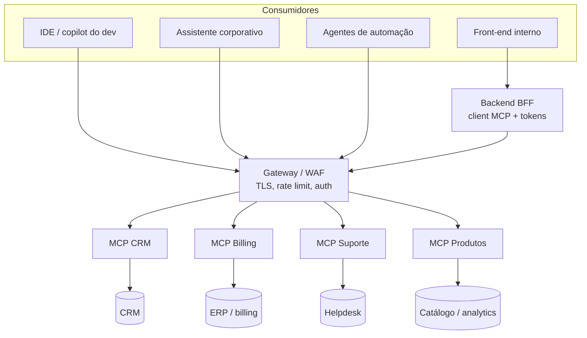

# 03 · Transformando a empresa em um "MCP": camada AI-ready, casos reais e cenários práticos

## Objetivo

Saber desenhar a camada MCP de uma empresa: quais serviços expor (CRM, billing, suporte, dados de produto),
como modelar tools que um LLM usa bem, como ligar front-end e back-end a ela, e reconhecer os casos de uso que
mais aparecem em empresas (legado, automações, copilots internos, assistentes corporativos).

## Explicação

### A camada AI-ready

"Transformar a empresa em um MCP" é criar uma **camada de servidores MCP na frente dos sistemas que já existem**,
do mesmo jeito que uma empresa um dia criou uma camada de APIs REST para o app mobile. O sistema de origem não muda;
o servidor MCP traduz capacidades de negócio em tools bem descritas, com validação, autorização e auditoria.



Princípios de desenho que funcionam com LLMs:

1. **Um servidor por domínio** (CRM, billing, suporte, produtos), dono pelo time do domínio. Facilita escopos,
   deploy e ownership; o host compõe.
2. **Tools de intenção de negócio, não CRUD cru.** `listar_faturas(cliente_id, status)` é melhor que
   `executar_sql(query)`. Menos tools, mais específicas, com descrições que dizem *quando* usar.
3. **Schemas restritivos** (zod): `enum`, `regex`, `min/max`, inteiros positivos. O SDK rejeita argumento ruim
   antes de tocar no banco, e o modelo recebe uma mensagem que permite corrigir a chamada.
4. **Saída dupla**: `content` legível + `structuredContent` tipado (`outputSchema`). Front-ends e agentes usam o JSON;
   o modelo lê o texto.
5. **Erros de negócio como `isError: true`** com mensagem clara ("Fatura 999 não existe"), não exceção genérica.
6. **Leitura separada de escrita**: `annotations` (`readOnlyHint`, `destructiveHint`) e escopos diferentes.
   Regras críticas (limite de desconto, valor máximo) ficam **no servidor**, nunca só no prompt.
7. **Resources para contexto** (ficha do cliente, política de reembolso) e **prompts** para fluxos repetidos
   (cobrança amigável, triagem de ticket).

### Integração com front-end e back-end

O navegador **não** deve falar direto com o servidor MCP carregando service token. O padrão é o **BFF**
(*backend for frontend*): o backend é o client MCP, guarda os tokens, decide quais tools a UI pode chamar e
aplica a sessão do usuário. A UI chama endpoints comuns (`GET /api/tools`, `POST /api/tools/:nome`), ou um
endpoint de chat onde o backend roda o loop LLM + MCP. O [exemplo 05](../exemplos/05-testar-e-compor/)
(`gateway.js`) mostra isso com uma página HTML mínima e uma allowlist que libera só tools somente leitura.

### Casos de uso reais em empresas

| Caso | Como o MCP entra | Cuidado |
|---|---|---|
| **Sistemas legados** (ERP antigo, mainframe, SOAP) | o servidor MCP encapsula a integração feia uma vez; todos os agentes reutilizam | timeouts, idempotência, janelas de manutenção |
| **Automações** (fechamento, conciliação, cobrança) | agente agendado usa tools de billing + e-mail; humano aprova ações destrutivas | auditoria e limites de valor no servidor |
| **Copilots internos de dev** | IDE conectada a MCPs de repositório, CI, observabilidade, docs internas | tokens por desenvolvedor, escopo de leitura |
| **Assistente corporativo** (RH, financeiro, suporte) | um chat que compõe MCPs de vários domínios | permissões por usuário (não por app), dados sensíveis |
| **Atendimento/suporte** | tools de busca de cliente, status de pedido, abertura de ticket | não vazar dado de um cliente para outro |
| **Analytics** | tools de consulta parametrizada a métricas (não SQL livre) | custo de query, limite de linhas |

### Cenários práticos

- **Plugins e agentes consumindo MCPs**: frameworks de agentes (LangChain/LangGraph, SDKs de agentes dos
  provedores) já têm adaptadores que transformam tools MCP em tools do framework. O
  [exemplo 03](../exemplos/03-ponte-mcp-llm/) faz isso na mão, em ~30 linhas, para você ver que não há mágica.
- **Integração com IDEs (copilots customizados)**: registre os servidores em `.vscode/mcp.json` ou `.mcp.json`
  ([doc 02](./02-mcp-em-javascript.md#configurando-em-clients-e-ides-copilots-customizados)) e o agente da IDE
  passa a consultar seu CRM, seus tickets e seu catálogo.
- **Conexões com sistemas corporativos (ERP, CRM, suporte, analytics)**: um servidor por sistema, todos atrás
  do mesmo gateway; o assistente corporativo compõe ([exemplo 05](../exemplos/05-testar-e-compor/)).

### Do zero ao MCP em produção: o roteiro

1. Comece em **stdio** com a fábrica do servidor separada do transporte ([exemplo 01](../exemplos/01-servidor-stdio/)).
2. Ligue no sistema real com schemas e erros de negócio ([exemplo 02](../exemplos/02-empresa-como-mcp/)).
3. Teste com um LLM de verdade e ajuste descrições até ele escolher as tools certas ([exemplo 03](../exemplos/03-ponte-mcp-llm/)).
4. Publique em **Streamable HTTP** com auth, rate limit e auditoria ([exemplo 04](../exemplos/04-mcp-http-producao/)).
5. Teste em CI com o Inspector CLI e componha com outros MCPs ([exemplo 05](../exemplos/05-testar-e-compor/)).
6. Coloque atrás de gateway/WAF, com métricas e alertas ([doc 04](./04-seguranca-e-governanca.md)). Para
   métricas, deploy em Kubernetes/OpenShift e avaliação contínua, veja
   [`trilhas-extras/llmops-vllm-openshift/`](../../../trilhas-extras/llmops-vllm-openshift/).

## Código mínimo

```js
// Fábrica do servidor separada do transporte: a mesma função serve stdio, HTTP e testes.
export function criarServidorCrm(pool) {
  const server = new McpServer({ name: 'crm-billing', version: '1.0.0' },
    { instructions: 'Busque o cliente pelo nome antes de consultar faturas.' });
  server.registerTool('listar_faturas', {
    description: 'Lista as faturas de um cliente pelo id numérico.',
    inputSchema: { cliente_id: z.number().int().positive(), status: z.enum(['aberta', 'paga']).optional() },
    annotations: { readOnlyHint: true },
  }, async ({ cliente_id, status }) => { /* SELECT ... */ });
  return server;
}
```

## Na prática

- [Exemplo 02 · mini-CRM/billing no Postgres exposto via MCP](../exemplos/02-empresa-como-mcp/)
- [Exemplo 05 · composição + BFF com UI](../exemplos/05-testar-e-compor/)
- [Exercício 01 · MCP de um serviço novo (suporte)](../exercicios/01-mcp-de-suporte/)

## Armadilhas

- Expor `executar_sql` "porque é mais flexível": vira injeção de prompt com acesso total ao banco.
- Uma tool que faz tudo (`gerenciar_cliente(acao, ...)`): o modelo erra mais e você não consegue dar escopos diferentes.
- Confiar que o LLM vai respeitar uma regra escrita no prompt ("nunca dê mais de 20% de desconto"): valide no servidor.
- Retornar 5.000 linhas numa tool: estoura o contexto e o custo. Pagine e limite.
- Datas: o driver `pg` converte `DATE` para `Date` na meia-noite local; ao serializar com `toISOString()` o dia pode
  mudar conforme o fuso. No exemplo 02 o tipo `DATE` volta como string.

## Fontes

- Arquitetura e conceitos: https://modelcontextprotocol.io/docs/learn/architecture
- Tools (annotations, outputSchema): https://modelcontextprotocol.io/specification/2025-11-25/server/tools
- Servidores de referência: https://github.com/modelcontextprotocol/servers
- SDK TypeScript (padrões de servidor): https://github.com/modelcontextprotocol/typescript-sdk
