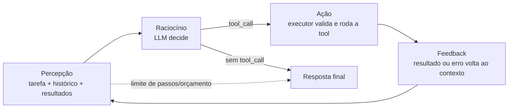
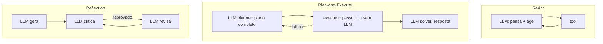

# 01 · Arquitetura de agents e padrões de raciocínio

## Objetivo

Ao terminar você sabe desenhar um agente como um **loop** (percepção → raciocínio → ação → feedback),
separar seus componentes (planner, executor, memory store, toolbox), classificar o tipo de agente que o
problema pede e escolher entre **ReAct**, **Plan-and-Execute** e **Reflection**, com números reais na mão.

## Explicação

### O que é um agente (e o que não é)

Um **workflow** com LLM é um caminho fixo escrito por você: "classifique → resuma → grave". Um **agente** é
um LLM que **decide o próximo passo** dentro de um loop, olhando o resultado do passo anterior, até atingir o
objetivo ou bater num limite. Analogia: o workflow é uma receita de bolo; o agente é o cozinheiro que prova a
massa e decide se põe mais açúcar.

Regra prática (Anthropic, *Building effective agents*): comece pelo mais simples. Se o caminho é previsível,
um workflow é mais barato, rápido e fácil de testar. Agente só quando o número de passos **não dá para saber
antes**.

### O agent loop



1. **Percepção**: montar o que o modelo "enxerga" agora (system prompt, tarefa, histórico, resultados de tools).
2. **Raciocínio**: uma chamada ao LLM. Ou ele pede uma ação (`tool_calls`) ou responde (fim).
3. **Ação**: o **seu código** valida os argumentos e executa. O modelo nunca executa nada.
4. **Feedback**: o resultado (inclusive o **erro**) volta como mensagem `role: "tool"`. Erro bem descrito é
   o que permite ao agente se corrigir no passo seguinte.

O critério de parada vem em dois sabores: **natural** (o modelo respondeu sem pedir tool) e **de segurança**
(máximo de passos, orçamento de tokens, tempo). Sem o segundo, você tem um *runaway loop* (ver doc 03).

### Estrutura interna

| Componente | Papel | No exemplo 01 |
|---|---|---|
| **Planner** | decide o próximo passo (ou o plano inteiro) | a chamada ao LLM com as tools |
| **Executor** | valida e executa ações, devolve observações | o laço `for (const call of msg.tool_calls)` |
| **Memory store** | estado: curto prazo (mensagens), longo prazo (banco) | o array `memoria` |
| **Toolbox** | catálogo de ferramentas: schema JSON + handler | `ferramentas.js` |

**Componentização**: trate cada parte como peça trocável. *Prompts* (papel, regras, formato) ficam em
constantes; *ferramentas* num registro; *contexto* é montado por uma função (doc 02); *feedback loops* são
explícitos (erro de tool, crítica de reflexão, aprovação humana). Assim você troca o modelo, o planner ou o
banco sem reescrever o resto.

### Tipos de agente

| Tipo | Quem dispara | Quando termina | Exemplo |
|---|---|---|---|
| **Task-based** | um pedido pontual | tarefa concluída | "gere o relatório de vendas de ontem" |
| **Interactive** | o usuário, a cada turno | o usuário encerra | copiloto de suporte num chat |
| **Goal-oriented** | um objetivo mensurável | objetivo atingido ou impossível | "deixe o estoque de mouse em 10 unidades" |
| **Autonomous** | eventos/agenda, sem humano no loop | nunca (roda continuamente) | monitor que abre e fecha chamados sozinho |

Quanto mais à direita na autonomia, mais você precisa de guardrails, auditoria e human-in-the-loop (doc 03).

### Padrões de raciocínio e execução

**ReAct** (*Reason + Act*, Yao et al., 2022): o modelo alterna **Pensamento** (um *reasoning trace* em texto),
**Ação** (tool) e **Observação** (resultado), um passo por chamada. É o loop acima com o raciocínio visível.
Flexível: reage ao que descobre. Custo: uma chamada ao LLM por passo, e cada chamada reenvia o contexto todo.

**Plan-and-Execute**: separa quem pensa de quem faz. Um **planner** escreve o plano inteiro de uma vez; um
**executor** roda os passos; um **replanner** (opcional) corrige se algo falhar. Na variante **ReWOO** o plano
já traz referências aos resultados futuros (`#E1`, `#E2`) e o executor é código puro, sem LLM. Menos chamadas,
mais previsível, mas não "muda de ideia" no meio do caminho.

**Reflection** (Reflexion, Shinn et al., 2023): depois de produzir uma resposta, o agente a **avalia**
(crítico com critérios explícitos) e a **corrige**. A lição pode virar memória episódica para a próxima vez
(doc 02). Custa ao menos 2 chamadas extras; vale quando errar sai caro.



### Comparativo prático (números reais do exemplo 02)

Mesma tarefa ("quanto custa repor mouse e monitor até 10 unidades?"), mesmo modelo (`qwen3.5:4b` no CPU):
os números medidos estão no [README do exemplo 02](../exemplos/02-react-vs-plan-execute/). Leitura geral:

| | ReAct | Plan-and-Execute (ReWOO) |
|---|---|---|
| Chamadas ao LLM | 1 por passo (cresce com a tarefa) | 2 fixas (plano + resposta) |
| Tokens | contexto reenviado a cada passo | prompt do planner + evidências |
| Adapta-se a surpresas | sim, a cada observação | só via replanejamento |
| Auditar o plano antes de executar | não | sim (o plano é um JSON) |
| Bom para | exploração, tarefas abertas | tarefas com passos previsíveis |

### Frameworks: LangChain, LangGraph e equivalentes

- **LangChain v1** (`createAgent`): agente ReAct pronto (modelo + tools + system prompt); por baixo é um grafo
  LangGraph. Usado no exemplo 02 com `--langchain`.
- **LangGraph**: você desenha o grafo (nós, arestas condicionais, estado, checkpoint). Plan-and-Execute,
  Reflection e multiagente viram grafos (exemplo 06 e doc 03).
- **Equivalentes**: OpenAI Agents SDK, Claude Agent SDK, Google ADK, CrewAI, AutoGen, LlamaIndex. Todos
  implementam o mesmo loop; mudam a ergonomia, o modelo de estado e a observabilidade embutida. Escrever o
  loop à mão uma vez (exemplo 01) é o que permite avaliar qualquer um deles.

## Código mínimo

```js
for (let passo = 1; passo <= maxPassos; passo++) {          // guardrail de passos
  const { msg } = await chat(memoria, { tools: toolbox });   // raciocínio
  memoria.push(msg);
  if (!msg.tool_calls?.length) return msg.content;           // objetivo atingido
  for (const call of msg.tool_calls) {                       // ação
    const resultado = await executar(call);                  // valida + roda (ou devolve { erro })
    memoria.push({ role: 'tool', tool_call_id: call.id, content: JSON.stringify(resultado) }); // feedback
  }
}
```

## Na prática

- [Exemplo 01 · agent loop do zero](../exemplos/01-agent-loop-do-zero/)
- [Exemplo 02 · ReAct × Plan-and-Execute (+ LangChain)](../exemplos/02-react-vs-plan-execute/)
- [Exemplo 04 · Reflection + memória](../exemplos/04-reflection-e-memoria/)

## Armadilhas

- **Modelo pequeno faz conta "de cabeça"** mesmo com a tool `calcular` disponível (vimos no exemplo 01).
  Para contas que importam, prefira Plan-and-Execute (o executor calcula) ou valide o número no código.
- **Erro de tool que derruba o loop**: capture a exceção e devolva `{ erro }` como observação; é feedback.
- **Planner que inventa ferramenta ou referência inexistente** (`#E5` sem `E5`): valide o plano antes de
  executar e replaneje com a mensagem de erro (exemplo 02 faz isso).
- **`tool_choice` não é suportado pelo Ollama**: não dá para forçar uma tool; instrua no prompt.
- Chamar de "agente" o que é um workflow (ou o contrário) leva a custo e risco errados.

## Fontes

- Anthropic · Building effective agents: https://www.anthropic.com/engineering/building-effective-agents
- ReAct (Yao et al.): https://arxiv.org/abs/2210.03629
- ReWOO (Xu et al.): https://arxiv.org/abs/2305.18323
- Reflexion (Shinn et al.): https://arxiv.org/abs/2303.11366
- LangChain · Planning agents (Plan-and-Execute, ReWOO, LLMCompiler): https://blog.langchain.com/planning-agents/
- LangChain JS v1 · Agents (`createAgent`): https://docs.langchain.com/oss/javascript/langchain/agents
- LangGraph JS · visão geral: https://docs.langchain.com/oss/javascript/langgraph/overview
