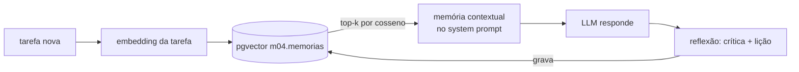
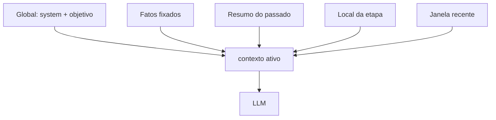

# 02 · Function calling, memória e gerenciamento de contexto

## Objetivo

Ao terminar você sabe escrever schemas JSON de ferramentas que um modelo pequeno acerta, conectar o agente a
API REST, banco e servidor MCP, dar a ele memória curta, longa, episódica e contextual (com pgvector) e manter
o **contexto ativo** dentro de um orçamento de tokens com pruning, sumarização e stitching.

## Explicação

### Function calling e tool use

O modelo recebe uma lista de ferramentas (nome, descrição, `parameters` em JSON Schema) e, quando acha útil,
devolve `tool_calls: [{ id, function: { name, arguments } }]`. Quem executa é o **seu código**; o resultado
volta como `{ role: "tool", tool_call_id, content }`. Princípios:

1. **O modelo pede, o código decide**: valide argumentos, permissões e limites antes de executar.
2. **A descrição é prompt**: diga o que a tool faz e quando usar, em uma linha.
3. **Erros são observações**: devolva `{ erro: "produto deve ser um de: teclado, mouse" }`, não uma exceção.
4. **Poucas tools por vez**: cada schema ocupa tokens em toda chamada (no exemplo 01, ~290 tokens só de
   prompt com 2 tools) e confunde modelos pequenos.

### Design de schemas JSON

```json
{
  "type": "function",
  "function": {
    "name": "atualizar_tarefa",
    "description": "Ajusta prioridade, status e/ou resultado de uma tarefa.",
    "parameters": {
      "type": "object",
      "properties": {
        "id": { "type": "integer" },
        "prioridade": { "type": "string", "enum": ["baixa", "normal", "alta"] },
        "status": { "type": "string", "enum": ["aberta", "concluida"] }
      },
      "required": ["id"],
      "additionalProperties": false
    }
  }
}
```

- **`enum`** sempre que o domínio é fechado: elimina "Mouse", "mouses", "o mouse".
- **`required` mínimo** e campos opcionais para atualização parcial.
- **`additionalProperties: false`** + validação no código (o Ollama não garante o schema; a OpenAI só com
  `strict: true`).
- **Tipos simples** (string, integer, enum) e nomes em `snake_case` com verbo: `consultar_`, `criar_`.
- Uma tool = uma ação. "faz_tudo(acao, payload)" vira adivinhação.

### Conectando o agente ao mundo

| Destino | Como vira tool | No exemplo 03 |
|---|---|---|
| **API REST** | handler faz `fetch` e devolve o JSON | `consultar_cotacao` → `GET /cotacao/USD` |
| **Banco de dados** | handler roda SQL **parametrizado** | `criar_tarefa`, `atualizar_tarefa` (Postgres `m04`) |
| **Automações** | handler dispara job/webhook/fila | `notificar_time` grava a notificação |
| **MCP** | `listTools()` → reembala `inputSchema` → `callTool()` | `notificar_time` vem do servidor MCP |

O ganho do MCP: as tools são descobertas em runtime, com schema pronto, e o mesmo servidor serve a qualquer
cliente (veja o [módulo 03](../../03-mcp/)). Nunca deixe o modelo escrever SQL livre num banco de produção:
exponha operações nomeadas.

### Memória



| Tipo | O que guarda | Onde vive | Duração |
|---|---|---|---|
| **Curta (de trabalho)** | mensagens da execução atual | array de mensagens | uma execução |
| **Longa (semântica)** | fatos e preferências estáveis | banco + embeddings | indefinida |
| **Episódica** | o que aconteceu e a lição aprendida | banco + embeddings | indefinida (com poda) |
| **Contextual** | o recorte relevante para ESTA tarefa | injetado no prompt | uma chamada |

**Armazenar e recuperar via embeddings**: grave `conteudo + embedding(conteudo)`; na hora de usar, gere o
embedding da tarefa e busque os *k* mais próximos (`ORDER BY embedding <=> $1 LIMIT k` no pgvector) com um
**limiar de distância** para não "lembrar" coisas irrelevantes.

**Reflection loops**: gerar → criticar (critérios explícitos + checagens determinísticas) → revisar. A crítica
vira memória episódica; na próxima execução a lição chega pelo retrieval e o agente acerta de primeira
(exemplo 04). Casos de uso:

- **Assistente pessoal**: lembra preferências ("respostas curtas", "uso Postgres") entre sessões.
- **Debugging automatizado**: roda o teste, lê o erro, corrige, roda de novo; episódios de "erro X → correção Y"
  aceleram bugs parecidos.
- **Aprendizado incremental**: cada tarefa revisada acrescenta lições; sem re-treinar o modelo.

### Gerenciamento de contexto

**Contexto ativo** é o que vai, de fato, na próxima chamada. A janela é finita (o `qwen3.5:4b` no Ollama roda
com `context_length` **4096**) e cada token custa tempo e dinheiro. Técnicas:

- **Pruning**: cortar o que envelheceu. Resultados de tool antigos são os primeiros (grandes e já usados);
  depois, janela deslizante das mensagens mais recentes que cabem no orçamento.
- **Sumarização**: o que saiu da janela vira um resumo curto que preserva números, ids e decisões.
- **Stitching (costura)**: montar o contexto final a partir de pedaços de origens diferentes, em ordem fixa:
  global → fatos fixados → resumo → contexto local → janela recente.
- **Contexto compartilhado entre agentes**: um "quadro" (blackboard) com uma parte **global** (cliente,
  objetivo, restrições: todos leem) e partes **locais** (o rascunho de cada agente: só ele lê). Compartilhar
  tudo com todos estoura a janela e vaza informação (o agente de suporte não precisa do limite de crédito).



## Código mínimo

```js
// Recuperação de memória por similaridade (pgvector)
const [e] = await embed([tarefa]);
const { rows } = await pool.query(
  'SELECT conteudo, embedding <=> $1::vector AS d FROM m04.memorias ORDER BY d LIMIT 3', [vetor(e)]);

// Contexto ativo costurado
const msgs = costurar({ global, fatos, resumo: await sumarizar(descartadas), local, recentes: janela(podado, 220) });
```

## Na prática

- [Exemplo 01 · schemas JSON e validação](../exemplos/01-agent-loop-do-zero/)
- [Exemplo 03 · REST + Postgres + MCP: criar, executar e ajustar tarefas](../exemplos/03-tools-externas/)
- [Exemplo 04 · Reflection + memória longa/episódica no pgvector](../exemplos/04-reflection-e-memoria/)
- [Exemplo 05 · pruning, sumarização, stitching, global × local](../exemplos/05-gerenciamento-de-contexto/)
- [Exercício 01 · tool nova + orçamento](../exercicios/01-tool-nova-e-orcamento/)

## Armadilhas

- **Truncamento silencioso**: passou de 4096 tokens no Ollama, o início do prompt (o system!) é descartado sem
  erro. Meça `usage.prompt_tokens` e mantenha orçamento próprio; aumente `num_ctx` só se a RAM aguentar.
- **Mensagem `role: "tool"` sem `tool_call_id`** (ao reaproveitar histórico) é recusada por APIs estritas.
  Converta para texto do assistente ao podar/costurar (exemplo 05).
- **Memória sem limiar** devolve sempre *k* itens, mesmo irrelevantes; o agente "lembra" lixo.
- **Embedding de um modelo, busca com outro**: dimensões ou espaços diferentes; fixe o modelo na tabela
  (`vector(1024)` do `qwen3-embedding:0.6b`).
- **Crítico LLM contando palavras**: modelos pequenos erram contagem; complemente com checagem no código.
- **Resumo que perde ids e números**: peça explicitamente para preservá-los e fixe os fatos críticos.

## Fontes

- OpenAI · Function calling: https://platform.openai.com/docs/guides/function-calling
- JSON Schema · referência: https://json-schema.org/understanding-json-schema/reference
- MCP (módulo 03 deste repositório): [../../03-mcp/](../../03-mcp/)
- pgvector: https://github.com/pgvector/pgvector · pgvector-node: https://github.com/pgvector/pgvector-node
- Reflexion: https://arxiv.org/abs/2303.11366 · Generative Agents (memory stream): https://arxiv.org/abs/2304.03442
- MemGPT (memória hierárquica): https://arxiv.org/abs/2310.08560
- Anthropic · Effective context engineering for AI agents: https://www.anthropic.com/engineering/effective-context-engineering-for-ai-agents
- Ollama · context length: https://docs.ollama.com/context-length
