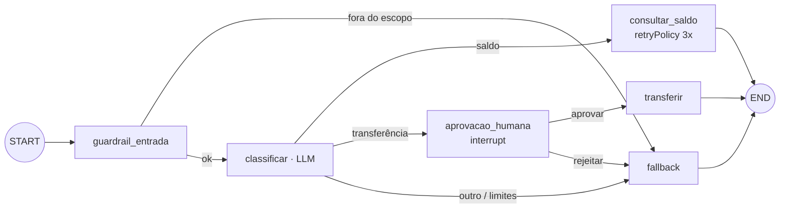
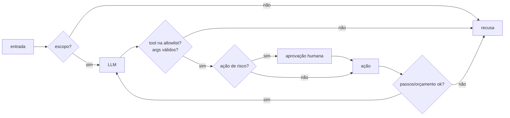

# 03 · LangGraph, workflows complexos, observabilidade e limites de autonomia

## Objetivo

Ao terminar você sabe modelar um agente como **grafo de execução** no LangGraph.js (estado, nós, arestas
condicionais), adicionar **retry**, **fallback**, **checkpoint** e **human-in-the-loop**, monitorar e depurar a
execução, e cercar a autonomia com **guardrails** (escopo, passos, orçamento, allowlist) e **auditoria**.

## Explicação

### Por que um grafo

O loop do exemplo 01 é um grafo implícito de 2 nós (LLM ↔ tools). Quando aparecem desvios ("se for
transferência, peça aprovação", "se a API cair, use a tabela padrão", "se o pedido for fora do escopo, recuse"),
`if`s aninhados dentro do loop viram espaguete. O **LangGraph** torna o fluxo explícito:

- **Estado** (`Annotation.Root`): um objeto tipado que todos os nós leem; cada nó devolve só o que mudou.
  Campos com **reducer** acumulam (ex.: `auditoria: (a, b) => a.concat(b)`).
- **Nós**: funções `async (estado) => atualização`. Podem chamar LLM, tool, humano ou nada.
- **Arestas**: fixas (`addEdge`) ou **condicionais** (`addConditionalEdges(no, roteador, destinos)`), em que o
  roteador é uma função pura do estado.
- **Checkpointer** (`MemorySaver`, ou Postgres/SQLite em produção): salva o estado após cada passo, por
  `thread_id`. É o que permite pausar, retomar, inspecionar o histórico e voltar no tempo.

Analogia: o loop manual é um motorista decidindo cada curva de cabeça; o grafo é o mapa com as rotas
desenhadas, e o checkpoint é o GPS que lembra onde você parou.



### Grafos de execução e dependências

Cada aresta é uma dependência: `transferir` só roda depois de `aprovacao_humana`. Nós sem dependência entre si
podem rodar **em paralelo** no mesmo *super-step* (várias arestas saindo de um nó, ou `Send` para *map-reduce*).
Subgrafos encapsulam etapas inteiras (um "agente" dentro do grafo maior), base dos padrões multiagente
(doc 04).

### Roteamento, fallback e retry

- **Roteamento**: o LLM classifica uma vez; o **código** roteia (`rotaIntencao(estado)`). Roteador
  determinístico é testável e auditável.
- **Retry**: `addNode('x', fn, { retryPolicy: { maxAttempts: 3, initialInterval: 200 } })` reexecuta o nó
  quando ele lança erro (falha transitória: 503, timeout). Use `retryOn` para não repetir erro permanente.
- **Fallback**: um nó para onde vão os casos que não deram certo (dados inválidos, API morta após os retries,
  limite estourado, humano negou). Sempre termine com uma resposta honesta ("encaminhado para humano").

### Human-in-the-loop (HITL)

`interrupt(payload)` dentro de um nó **pausa** o grafo e grava o estado no checkpointer; quem chamou recebe o
payload em `__interrupt__`. Para continuar, invoque de novo a mesma thread com `new Command({ resume: valor })`:
o nó **reexecuta do início** e, dessa vez, `interrupt()` devolve `valor`. Consequência: nada com efeito
colateral antes do `interrupt` no mesmo nó.

Onde colocar HITL: ações irreversíveis ou caras (pagamento, e-mail para cliente, deploy, apagar dados),
baixa confiança do modelo, primeira vez que uma ação acontece.

### Monitoramento e depuração

- **`stream(..., { streamMode: 'updates' })`**: um evento por nó concluído, com o que ele mudou (é o "log ao
  vivo" do exemplo 06). Outros modos: `values` (estado inteiro), `messages` (tokens do LLM), `debug`.
- **`getState(config)`**: estado atual e `next` (qual nó roda a seguir; útil numa pausa).
- **`getStateHistory(config)`**: todos os checkpoints da thread: dá para ver por onde o agente passou e
  retomar de um ponto anterior (*time travel*).
- **LangSmith / OpenTelemetry**: traces com spans por nó e por chamada ao LLM (não usamos aqui: LangSmith
  exige conta; o equivalente local é a tabela de auditoria).

### Observabilidade: métricas e logs de execução

| Métrica | Por quê |
|---|---|
| passos por execução, chamadas ao LLM, chamadas de tool | detectar loop e regressão de prompt |
| tokens de prompt/resposta e custo | orçamento (ver custo por token em [llmops-vllm-openshift](../../../trilhas-extras/llmops-vllm-openshift/)) |
| latência por nó e por chamada | gargalo (no CPU, o LLM é ~100% do tempo) |
| taxa de fallback, de retry e de interrupção | saúde das integrações e confiança do agente |
| taxa de sucesso por tarefa (avaliação) | qualidade (avaliação com pytest em llmops-vllm-openshift) |

Para padronizar, as **convenções semânticas GenAI do OpenTelemetry** definem nomes como
`gen_ai.usage.input_tokens` e spans por operação.

### Auditoria e rastreabilidade de decisões

Cada decisão relevante vira um evento imutável: `{ ts, thread_id, no, decisao, detalhe }` com a **entrada**
(o que o modelo viu), a **saída** (o que ele decidiu) e **quem aprovou**. No exemplo 06 os eventos acumulam no
estado (reducer) e são gravados em `m04.auditoria`. Perguntas que a auditoria deve responder: *por que o agente
fez isso? com qual dado? quem autorizou? quanto custou?*

### Guardrails, escopo e ética



- **Entrada**: escopo do agente (o que ele NÃO faz), detecção de prompt injection, dados sensíveis.
- **Ferramentas**: **allowlist** por agente/tarefa, menor privilégio (credencial só de leitura onde der),
  validação de argumentos, limites por ação (valor máximo de transferência).
- **Saída**: formato validado, sem PII vazando, sem afirmar o que a tool não retornou.
- **Ética e escopo**: o agente se identifica como IA, não decide sozinho sobre crédito/emprego/saúde, explica
  a recusa, e há sempre um caminho para um humano. A OWASP chama o risco de agente com poder demais de
  **Excessive Agency**: funcionalidade, permissão ou autonomia além do necessário.

### Runaway loops e abuso de API

Um agente que repete a mesma tool, ou dois agentes que se devolvem tarefas para sempre, queimam dinheiro e
rate limit. Defesas em camadas:

1. **Máximo de passos** no seu loop e `recursionLimit` no LangGraph (lança `GraphRecursionError`).
2. **Orçamento** de tokens/custo/tempo por execução, checado **antes** de cada chamada (exercício 01).
3. **Detecção de repetição**: mesma tool com os mesmos argumentos N vezes → pare.
4. **Rate limit e timeout** nas tools (ver o token bucket do [módulo 03](../../03-mcp/exemplos/04-mcp-http-producao/)).
5. **Limite de delegação** entre agentes (o supervisor do exemplo 07 replaneja uma vez só).

## Código mínimo

```js
const grafo = new StateGraph(Estado)
  .addNode('classificar', classificar)
  .addNode('consultar_saldo', consultarSaldo, { retryPolicy: { maxAttempts: 3 } })
  .addNode('aprovacao_humana', (s) => ({ decisao: interrupt({ pergunta: 'Aprovar?', ...s.args }) }))
  .addEdge(START, 'classificar')
  .addConditionalEdges('classificar', rotaIntencao, ['consultar_saldo', 'aprovacao_humana', 'fallback'])
  .compile({ checkpointer: new MemorySaver() });

await grafo.invoke({ pedido }, { configurable: { thread_id: 'B' }, recursionLimit: 10 }); // pausa no interrupt
await grafo.invoke(new Command({ resume: 'aprovar' }), { configurable: { thread_id: 'B' } }); // retoma
```

## Na prática

- [Exemplo 06 · grafo com retry, fallback, checkpoint, HITL, guardrails e auditoria](../exemplos/06-langgraph-hitl-guardrails/)
- [Exercício 02 · agente linear → grafo LangGraph com fallback](../exercicios/02-linear-para-langgraph/)
- [Exercício 01 · guardrail de orçamento](../exercicios/01-tool-nova-e-orcamento/)

## Armadilhas

- **Efeito colateral antes do `interrupt`**: o nó reexecuta na retomada e a ação acontece duas vezes.
- **Retomar sem checkpointer ou com outro `thread_id`**: o grafo começa do zero.
- **`MemorySaver` em produção**: estado some quando o processo reinicia; use um checkpointer persistente.
- **Retry em erro permanente** (conta inexistente, 400): só atrasa o fallback; filtre com `retryOn`.
- **Exceção que escapa após os retries derruba a execução inteira**: se quer fallback, capture na última
  tentativa e sinalize no estado (exercício 02).
- **Roteador que depende de texto livre do LLM**: peça JSON com enum e trate o "não entendi" como rota.

## Fontes

- LangGraph JS · visão geral: https://docs.langchain.com/oss/javascript/langgraph/overview
- LangGraph JS · Graph API (estado, reducers, arestas, retry): https://docs.langchain.com/oss/javascript/langgraph/use-graph-api
- LangGraph JS · Interrupts (HITL): https://docs.langchain.com/oss/javascript/langgraph/interrupts
- LangGraph JS · Persistence (checkpointer, histórico): https://docs.langchain.com/oss/javascript/langgraph/persistence
- LangGraph JS · Durable execution: https://docs.langchain.com/oss/javascript/langgraph/durable-execution
- OWASP GenAI · LLM06 Excessive Agency: https://genai.owasp.org/llmrisk/llm062025-excessive-agency/
- OpenTelemetry · GenAI semantic conventions: https://opentelemetry.io/docs/specs/semconv/gen-ai/
- npm `@langchain/langgraph` 1.5.0: https://registry.npmjs.org/@langchain/langgraph/latest
