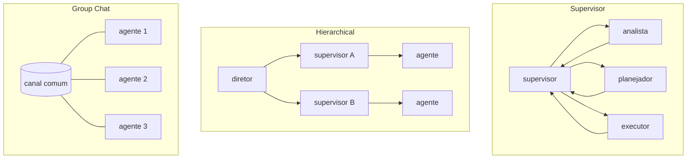
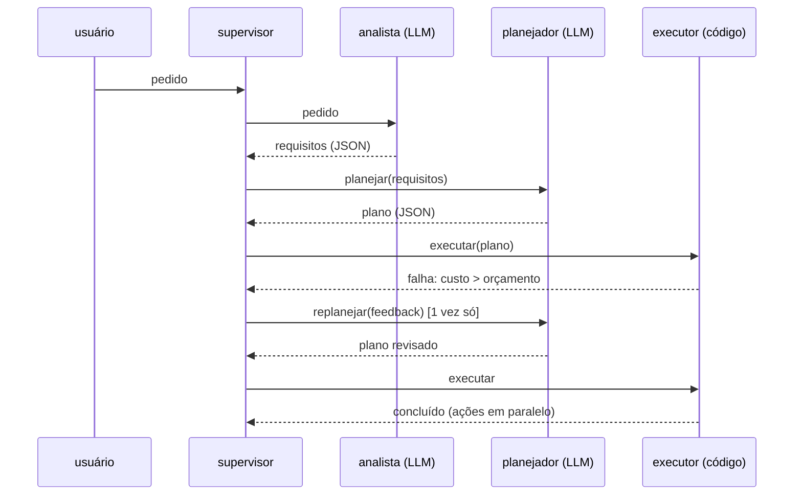

# 04 · Multi-agent systems

## Objetivo

Ao terminar você sabe quando vale dividir o trabalho entre vários agentes, escolher o padrão de coordenação
(Supervisor, Hierarchical, Group Chat, Delegation, Consensus), fazer agentes conversarem por **mensagens
assíncronas** e montar um mini sistema cooperativo **analista → planejador → executor**.

## Explicação

### Por que (e quando não) usar vários agentes

Um agente com 30 tools e um prompt de 3 páginas erra mais: o contexto incha e as instruções competem. Dividir
em especialistas dá **contexto menor e focado por agente**, **paralelismo** e **papéis com permissões
diferentes** (o planejador não tem acesso à tool de pagamento; o executor não conversa com o cliente).

O custo: mais chamadas ao LLM, mais latência, e erros que se propagam entre agentes. A Anthropic relata que
o seu sistema multiagente de pesquisa gasta várias vezes mais tokens que um chat comum; compensa em tarefas
amplas e paralelizáveis, não em tarefas curtas e sequenciais. Regra: comece com um agente; divida quando houver
**especialidades distintas** ou **paralelismo real**.

### Orquestração, coordenação e negociação

- **Orquestração**: alguém (um supervisor ou o grafo) decide a ordem do trabalho.
- **Coordenação**: os agentes compartilham estado sem pisar um no outro (quadro global × rascunho local, doc 02).
- **Negociação**: agentes com objetivos diferentes chegam a um acordo (comprador × vendedor, planejador ×
  executor discutindo orçamento). Precisa de rodadas limitadas e de um critério de desempate.

### Padrões



| Padrão | Como funciona | Bom para | Cuidado |
|---|---|---|---|
| **Supervisor** | um agente central recebe tudo e roteia para especialistas | fluxos com etapas claras | gargalo e ponto único de falha |
| **Hierarchical** | supervisores de supervisores (times dentro de times) | problemas grandes, muitos especialistas | latência e "telefone sem fio" |
| **Group Chat** | todos leem um canal comum; um seletor escolhe quem fala | brainstorm, revisão cruzada | conversa sem fim; precisa de moderador e limite de rodadas |
| **Delegation** (handoff) | um agente passa a tarefa (e o contexto) a outro e sai do caminho | triagem → especialista | perder contexto no repasse |
| **Consensus** | vários agentes respondem independentemente; voto ou juiz decide | decisões críticas, reduzir alucinação | custo multiplicado por N |

### Comunicação assíncrona

Em vez de `await analista(); await planejador();`, cada agente tem uma **caixa de entrada** e reage a mensagens
quando elas chegam. Vantagens: agentes rodam em paralelo, podem morar em processos/máquinas diferentes, e o
histórico de mensagens **é** a trilha de auditoria. Em produção a caixa de entrada é uma fila (Redis Streams,
NATS, SQS, Kafka). Mensagem bem formada: `{ de, para, tipo, conteudo, t }`, com `tipo` fechado
(`requisitos`, `plano`, `falha`, `concluido`, `encerrar`) para o roteamento ser código, não interpretação.

### Mini sistema cooperativo (exemplo 07)



O LLM **analisa e planeja**; quem **age** é código com allowlist e regra de orçamento. O supervisor limita a
negociação planejador × executor a uma rodada extra (anti-runaway).

### Casos reais

- **Claude Code (subagents e agent teams)**: o agente principal delega a subagentes com contexto próprio e
  ferramentas restritas (padrão Supervisor/Delegation); em *agent teams*, várias sessões coordenam por uma lista
  de tarefas compartilhada e mensagens diretas. O sistema de pesquisa da Anthropic usa um líder que dispara
  subagentes em paralelo e consolida os achados.
- **AutoGPT**: popularizou o agente autônomo goal-oriented (objetivo → loop de pensar/agir); também mostrou na
  prática os runaway loops e o custo sem limites. Hoje é uma plataforma de construção de agentes/workflows.
- **CrewAI**: "crews" de agentes com papel, objetivo e backstory; processos *sequential* e *hierarchical*
  (com um manager que delega).
- **AutoGen (Microsoft)**: Group Chat com seletor de quem fala e conversas entre agentes como primitiva.
- **Agentarium**: framework open source para **simulações** povoadas de agentes (ambientes onde agentes agem,
  interagem e evoluem), útil para estudar coordenação e comportamento emergente.
- **LangGraph**: supervisor, hierarchical e handoffs como grafos (subgrafos + `Command` para trocar de agente).

## Código mínimo

```js
// Cada agente: um laço que espera mensagens na própria caixa e publica respostas.
async function planejador(bus) {
  const m = await bus.receber('planejador');
  const plano = extrairJson((await chat([...prompt, { role: 'user', content: JSON.stringify(m.conteudo) }])).msg.content);
  bus.enviar('planejador', 'supervisor', 'plano', plano);
}
await Promise.all([supervisor(bus, pedido), analista(bus), planejador(bus), executor(bus)]); // concorrentes
```

## Na prática

- [Exemplo 07 · supervisor + analista → planejador → executor com mensagens assíncronas](../exemplos/07-multiagente-supervisor/)
- [Exemplo 05 · contexto global × local (quadro compartilhado)](../exemplos/05-gerenciamento-de-contexto/)

## Armadilhas

- **Ping-pong infinito** entre agentes ("refaça" ↔ "refiz"): limite rodadas e defina quem dá a palavra final.
- **Contexto que não atravessa o repasse**: na delegação, mande o resumo + os fatos, não "continue de onde parou".
- **Todos com todas as tools**: some o benefício da especialização e aumenta o risco; allowlist por papel.
- **Mensagem em texto livre**: o destinatário precisa interpretar; prefira JSON com `tipo` fechado.
- **Consenso com o mesmo modelo e o mesmo prompt**: os "votos" erram juntos; varie prompt, temperatura ou modelo.
- **Custo**: N agentes ≈ N vezes as chamadas. No CPU local, cada chamada leva dezenas de segundos.

## Fontes

- Anthropic · How we built our multi-agent research system: https://www.anthropic.com/engineering/multi-agent-research-system
- Claude Code · Subagents: https://code.claude.com/docs/en/sub-agents
- Claude Code · Agent teams: https://code.claude.com/docs/en/agent-teams
- LangChain JS · Multi-agent: https://docs.langchain.com/oss/javascript/langchain/multi-agent
- CrewAI: https://docs.crewai.com
- AutoGen: https://microsoft.github.io/autogen/stable/
- AutoGPT: https://github.com/Significant-Gravitas/AutoGPT
- Agentarium: https://github.com/Thytu/Agentarium
