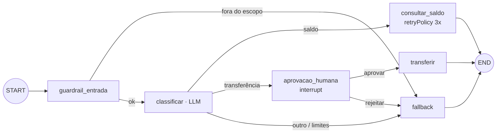

# Exemplo 06 · LangGraph: roteamento, retry, fallback, checkpoint, HITL, guardrails e auditoria

**Conceito novo**: o agente vira um **grafo de execução** explícito (LangGraph.js 1.5.0). Cada desvio que no
loop manual seria um `if` escondido vira nó ou aresta visível, testável e auditável.



| Recurso | Onde em [`grafo.js`](grafo.js) |
|---|---|
| Estado tipado com reducers (`passos`, `tokens` somam; `auditoria` concatena) | `Annotation.Root` |
| Roteamento determinístico | `rotaEntrada`, `rotaIntencao`, `rotaAprovacao` |
| Retry de falha transitória | `retryPolicy: { maxAttempts: 3 }` em `consultar_saldo` (a API falha 2x de propósito) |
| Fallback handler | nó `fallback`, que explica o motivo |
| Checkpoint | `compile({ checkpointer: new MemorySaver() })` + `thread_id` |
| Human-in-the-loop | `interrupt()` em `aprovacao_humana`; retomada com `new Command({ resume: 'aprovar' })` |
| Guardrails | escopo (regex de entrada), `maxPassos`, `orcamentoTokens`, `allowlist` de tools, `recursionLimit` |
| Monitoramento | `stream(..., { streamMode: 'updates' })`, `getState`, `getStateHistory` |
| Auditoria | eventos no estado gravados em `m04.auditoria` |

Teoria: [doc 03](../../docs/03-langgraph-observabilidade-e-limites.md).

**Pré-requisito**: exemplos [01](../01-agent-loop-do-zero/) e [02](../02-react-vs-plan-execute/); Postgres (schema `m04`).

## Como rodar

```bash
cd modulos/04-agentes-autonomos
npm run ex06
```

2 chamadas ao LLM (só o nó `classificar` usa o modelo; o cenário C não gasta nenhuma). ~10 s com o Ollama livre.

## Saída esperada

Saída real:

```
[A] consulta de saldo (API instável: 2 falhas, retryPolicy resolve)
  ✓ guardrail_entrada
  ↻ apiSaldo: 503 (simulado); o retryPolicy vai reexecutar o nó
  ✓ classificar
  ↻ apiSaldo: 503 (simulado); o retryPolicy vai reexecutar o nó
  ✓ consultar_saldo -> Saldo da conta 123: R$ 1500
  passos=3 tokens=100 resposta="Saldo da conta 123: R$ 1500"

[B] transferência (precisa de aprovação humana)
  ✓ guardrail_entrada
  ✓ classificar
  ⏸ interrupt: {"pergunta":"Aprovar transferência?","intencao":"transferencia","conta":"123","destino":"456","valor":200}
  grafo pausado; próximo nó: aprovacao_humana; checkpoints na thread: 4
  operador responde: aprovar
  ✓ aprovacao_humana
  ✓ transferir -> Transferidos R$ 200 de 123 para 456.
  passos=4 tokens=118 resposta="Transferidos R$ 200 de 123 para 456."

[C] pedido fora do escopo (guardrail de entrada, sem gastar LLM)
  ✓ guardrail_entrada
  ✓ fallback -> Não executei: pedido fora do escopo. Encaminhado para atendimento humano.
  passos=2 tokens=0 resposta="Não executei: pedido fora do escopo. Encaminhado para atendimento humano."

Trilha de auditoria (m04.auditoria):
┌─────────┬───────────┬─────────────────────┬──────────────────────────────┐
│ (index) │ thread_id │ no                  │ decisao                      │
├─────────┼───────────┼─────────────────────┼──────────────────────────────┤
│ 0       │ 'A'       │ 'guardrail_entrada' │ 'ok'                         │
│ 1       │ 'A'       │ 'classificar'       │ 'intencao=saldo'             │
│ 2       │ 'A'       │ 'consultar_saldo'   │ 'ok'                         │
│ 3       │ 'B'       │ 'guardrail_entrada' │ 'ok'                         │
│ 4       │ 'B'       │ 'classificar'       │ 'intencao=transferencia'     │
│ 5       │ 'B'       │ 'aprovacao_humana'  │ 'aprovar'                    │
│ 6       │ 'B'       │ 'transferir'        │ 'executado'                  │
│ 7       │ 'C'       │ 'guardrail_entrada' │ 'BLOQUEADO (fora do escopo)' │
│ 8       │ 'C'       │ 'fallback'          │ 'pedido fora do escopo'      │
└─────────┴───────────┴─────────────────────┴──────────────────────────────┘
2 chamadas ao LLM · 171 tokens de prompt · 47 de resposta · 10.2s no modelo
```

### O que observar

- A linha `↻` aparece **antes** de `✓ classificar`: o stream entrega o evento de um nó quando o *super-step*
  termina, e o nó seguinte já começou a rodar. Para correlacionar, use o `ts` da auditoria, não a ordem do console.
- As falhas que o retry absorveu **não aparecem na auditoria**: as atualizações de tentativas que falharam são
  descartadas. Se você precisa auditar retries, registre-os fora do estado (log/métrica).
- Em B, o grafo parou no `interrupt` com 4 checkpoints salvos; a retomada usou a mesma `thread_id` e só então
  `transferir` rodou. Num servidor real, a pausa pode durar dias (checkpointer persistente).

## Experimente

1. Responda `rejeitar` em vez de `aprovar` no cenário B: a rota vai para `fallback` ("operador negou").
2. Mude `LIMITES.orcamentoTokens` para `50`: depois de `classificar` (~100 tokens) o roteador manda para o fallback.
3. Troque `falhasRestantes` para `5`: o retry esgota as 3 tentativas e a exceção derruba a execução. Compare
   com o exercício 02, que captura a última falha e desvia para um fallback.

## Versão Python

Pasta [`python/`](python/): `grafo.py`, `main.py` e `test_grafo.py`, com **LangGraph 1.2.16 (Python)**. Equivalências:

| JS (`@langchain/langgraph` 1.5.0) | Python (`langgraph` 1.2.16) |
|---|---|
| `Annotation.Root({... reducer ...})` | `TypedDict` com `Annotated[int, operator.add]` / `Annotated[list, operator.add]` |
| `retryPolicy: { maxAttempts: 3, initialInterval: 200 }` | `RetryPolicy(max_attempts=3, initial_interval=0.2, jitter=False, retry_on=ErroTransitorio)` (segundos!) |
| `new MemorySaver()` | `InMemorySaver()` (`MemorySaver` é alias) |
| `interrupt(...)` / `new Command({ resume })` | `interrupt(...)` / `Command(resume="aprovar")` |
| `stream(..., { streamMode: 'updates' })`, `getState`, `getStateHistory` | `stream(..., stream_mode="updates")`, `get_state`, `get_state_history` |
| (sem equivalente) | `add_node(..., error_handler=fn)`: `fn(state, error: NodeError)` roda quando o nó esgota o retry |

Duas diferenças que importam:

- **`retry_on` padrão do Python NÃO retenta `ValueError`, `KeyError`, `RuntimeError`, `OSError`...** (só
  `ConnectionError`, HTTP 5xx e exceções "genéricas"). Por isso a falha simulada é uma `ErroTransitorio` e o
  `retry_on` é explícito. No JS qualquer exceção é retentada.
- **A armadilha "tentativas falhas somem da auditoria" tem remédio nativo aqui**: `consultar_saldo` tem um
  `error_handler` (`saldo_falhou`) que grava o evento `FALHOU` com o erro e desvia (`Command(goto="fallback")`).
  As tentativas que falharam e foram superadas pelo retry continuam fora do estado, como no JS
  (`test_grafo.py` verifica os dois casos com um `chat` falso). O nó com `interrupt()` também **reexecuta do
  início** na retomada: nada com efeito colateral antes dele.

Auditoria em **`m04.auditoria_py`** (o `detalhe` vai como `Jsonb(...)` do psycopg).

### Como rodar

```bash
cd modulos/04-agentes-autonomos
uv run python exemplos/06-langgraph-hitl-guardrails/python/main.py
uv run pytest exemplos/06-langgraph-hitl-guardrails     # 4 testes sem LLM (guardrail, retry, error_handler, orçamento)
```

### Saída esperada (Python)

Saída real. Repare que aqui as linhas `↻` saem **depois** de `✓ classificar` (o `stream` síncrono do Python
entrega o update do super-step antes de o próximo nó rodar; no JS o próximo nó já tinha começado):

```

[A] consulta de saldo (API instável: 2 falhas, RetryPolicy resolve)
  ✓ guardrail_entrada
  ✓ classificar
  ↻ api_saldo: 503 (simulado); o RetryPolicy vai reexecutar o nó
  ↻ api_saldo: 503 (simulado); o RetryPolicy vai reexecutar o nó
  ✓ consultar_saldo -> Saldo da conta 123: R$ 1500
  passos=3 tokens=100 resposta="Saldo da conta 123: R$ 1500"

[B] transferência (precisa de aprovação humana)
  ✓ guardrail_entrada
  ✓ classificar
  ⏸ interrupt: {"pergunta":"Aprovar transferência?","intencao":"transferencia","conta":"123","destino":"456","valor":200}
  grafo pausado; próximo nó: ('aprovacao_humana',); checkpoints na thread: 4
  operador responde: aprovar
  ✓ aprovacao_humana
  ✓ transferir -> Transferidos R$ 200 de 123 para 456.
  passos=4 tokens=118 resposta="Transferidos R$ 200 de 123 para 456."

[C] pedido fora do escopo (guardrail de entrada, sem gastar LLM)
  ✓ guardrail_entrada
  ✓ fallback -> Não executei: pedido fora do escopo. Encaminhado para atendimento humano.
  passos=2 tokens=0 resposta="Não executei: pedido fora do escopo. Encaminhado para atendimento humano."

Trilha de auditoria (m04.auditoria_py):
  A  guardrail_entrada  ok
  A  classificar        intencao=saldo
  A  consultar_saldo    ok
  B  guardrail_entrada  ok
  B  classificar        intencao=transferencia
  B  aprovacao_humana   aprovar
  B  transferir         executado
  C  guardrail_entrada  BLOQUEADO (fora do escopo)
  C  fallback           pedido fora do escopo
2 chamadas ao LLM · 171 tokens de prompt · 47 de resposta · 66.7s no modelo
```
