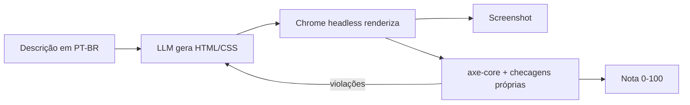

# 01 · A IA no design de interfaces e a geração de UI (Text-to-UI)

## Objetivo

Ao terminar, você sabe: situar as ferramentas de IA em cada etapa do ciclo de UX/UI; gerar wireframes e
componentes a partir de linguagem natural; montar um ciclo **gerar → renderizar → auditar → corrigir** que
não depende de "achismo"; e entender o fluxo Figma → código do Firebase Studio (e o que usar no lugar dele hoje).

## Explicação

### AI-driven UX/UI: o que muda de verdade

Pense na IA como um **estagiário muito rápido e sem memória visual**: produz rascunhos em segundos, mas não
"vê" o que fez nem sabe se ficou acessível. O ganho real não está em pular etapas, e sim em **encurtar o ciclo**
entre ideia e algo testável. Por isso o padrão que atravessa este módulo é: a IA gera, uma ferramenta
**determinística** verifica (navegador, axe-core, testes), e o resultado da verificação volta para a IA ou para o humano.

### Panorama de ferramentas por etapa

| Etapa | O que a IA faz bem | Exemplos de ferramentas (2026) | Onde ver aqui |
|---|---|---|---|
| Pesquisa | Sintetizar entrevistas, agrupar feedback, rascunhar personas e roteiros | LLMs genéricos (ChatGPT, Claude, Gemini), recursos de IA em repositórios de pesquisa | busca semântica no [exemplo 04](../exemplos/04-ia-cliente-vs-servidor/) |
| Ideação | Variações de layout, microcopy, fluxos alternativos | Figma (recursos de IA e Figma Make), FigJam AI, Google Stitch | — |
| Prototipação | Text-to-UI, design → código, protótipos navegáveis | v0, Bolt, Lovable, Google AI Studio, Firebase Studio (em descontinuação), plugin Builder.io para Figma, Figma MCP server | [exemplo 01](../exemplos/01-text-to-ui-acessivel/) |
| Desenvolvimento | Componentes, refatoração, scaffolding, testes | Agentes de código no terminal/IDE: Gemini CLI, Claude Code, Copilot, Cursor | [doc 02](02-agentes-e-cli-no-front-end.md) · [exemplo 02](../exemplos/02-ideia-ao-componente-testavel/) |
| Teste | E2E dirigido por agente, auditoria de acessibilidade, análise de heurísticas | Playwright (+ Playwright MCP), axe-core, MCP da própria aplicação | [doc 03](03-mcp-na-ui-e-testes-e2e.md) · [exemplo 03](../exemplos/03-app-com-mcp-e2e/) |

> Ferramentas de prototipação mudam de nome, de preço e às vezes somem: o Firebase Studio (abaixo) é o exemplo.
> Avalie pelo **formato de saída** (código que você versiona? HTML/React padrão?) e pela **verificabilidade**.

Casos de uso que já se pagam: protótipo para validar fluxo com usuário no mesmo dia; variações A/B de copy;
migração de tela legada para componentes; auditoria de acessibilidade contínua no CI; testes E2E escritos a
partir de um roteiro em português.

### Text-to-UI: do texto ao componente



Três lições que o [exemplo 01](../exemplos/01-text-to-ui-acessivel/) mostra com números reais:

1. **Prompt ingênuo gera UI bonita e inacessível.** Ao pedir "texto cinza claro", o modelo obedece, e o contraste
   reprova. Pedir "faça acessível" ajuda pouco; **feedback concreto** (a lista de violações do axe) ajuda muito.
2. **Truncamento engana.** Com `max_tokens` baixo, um `<style>` enorme no início corta a resposta antes do HTML,
   e um documento vazio "passa" na auditoria. Peça o markup primeiro e confira `finish_reason === 'length'`.
3. **A ferramenta automática não pega tudo.** O axe aceita `placeholder` como nome acessível do campo; a WCAG
   (3.3.2) pede rótulo visível. Complemente com checagens próprias e revisão humana.

### Prototipação visual assistida e validação de usabilidade com IA

- **Wireframe/mockup a partir de texto**: peça HTML sem estilo (wireframe) ou com tokens de design (mockup).
  HTML é o formato mais verificável: renderiza, faz screenshot e testa.
- **Validação de usabilidade com IA**: use a IA como **avaliador de heurísticas** (Nielsen: visibilidade do
  estado, prevenção de erro, consistência...), mandando o screenshot para um modelo com visão
  (o `qwen3.5:4b` aceita imagem, veja o [módulo 02, exemplo 05](../../02-apis-ia-generativa/exemplos/05-documentos-ocr-e-visao/)).
  É triagem, não substituto de teste com gente: "usuários sintéticos" não têm as dores reais do seu público.
- **Validação de fluxo**: escreva o fluxo como roteiro ("adicionar tarefa e concluir") e deixe um agente executar e
  conferir; foi o que o [exemplo 03](../exemplos/03-app-com-mcp-e2e/) fez.

### Mão na massa: Firebase Studio transformando designs do Figma em código (⚠️ não executado localmente)

**Situação conferida em 2026-10-16 na doc oficial:** o Firebase Studio **está em descontinuação**. Desde
**22/06/2026** a criação de workspaces, o cadastro de novos usuários e a **importação de projetos para um workspace
novo** estão desativados; o encerramento é em **22/03/2027**, e projetos não migrados serão apagados. A doc
recomenda migrar para o **Google AI Studio** ou o **Google Antigravity**. Por isso (e porque exige login Google e
conta Figma) este fluxo **não foi executado localmente**.

O fluxo oficial, como documentado (útil se você ainda tem um workspace ou para entender o padrão "design → código"):

1. No Figma, selecione o frame e abra o **plugin Builder.io** (Figma → código). Ele converte o design em código
   reaproveitando tokens, estrutura de componentes e regras de layout.
2. Exporte o resultado para o Firebase Studio ("Import from Figma with Builder.io plugin" na tela *Get started*).
3. No Studio (IDE no navegador, estilo VS Code, com Gemini), peça ao assistente para criar telas adicionais ou
   ligar fluxos; visualize no preview.
4. Para mudanças de design depois: edite no Visual Editor do Builder.io, que abre um **pull request** no GitHub;
   o dev faz checkout do PR, revisa e testa no preview antes do merge.

Migração de um workspace existente (doc oficial): **Move now → Prepare for AI Studio → Move to Google AI Studio**;
ou **Move now → Zip and Download** e abrir no Antigravity (comando do agente `@fbs-to-agy-export`), ou
`npx firebase-tools@latest studio:export PATH`. Apps já publicados no Firebase continuam no ar.

**Alternativas atuais para "Figma → código"**, com o mesmo princípio: o plugin Builder.io exportando para um
repositório seu; ou o **Figma MCP server** (remoto em `https://mcp.figma.com/mcp`, ou local pelo Dev Mode em
`http://127.0.0.1:3845/mcp`, exige assento pago) ligado a um agente de código (Gemini CLI, Claude Code, Copilot),
que lê o contexto do frame selecionado e gera o componente no seu stack. Em qualquer caso, rode o ciclo
"renderizar → auditar → testar" deste módulo sobre o código gerado.

## Código mínimo

```js
// Gerar, renderizar e auditar (trecho do exemplo 01)
const r = await conversar(cliente, [{ role: 'system', content: sistema }, { role: 'user', content: descricao }], { maxTokens: 900 });
const html = extrairCodigo(r.texto, 'html');
const { violacoes, nota } = await auditar(browser, html, { screenshot: 'v1.png' }); // axe-core no Chrome
// Próxima iteração: devolver resumoParaLLM(violacoes) ao modelo
```

## Na prática

- [Exemplo 01 · Text-to-UI acessível](../exemplos/01-text-to-ui-acessivel/)
- [Exercício 01 · Componente até passar na auditoria](../exercicios/01-componente-acessivel/)

## Armadilhas

- **Nota 100 em documento vazio**: resposta cortada por `max_tokens`. Conte os elementos renderizados.
- **`Please use browser.newContext()`** do `@axe-core/playwright`: crie a página a partir de um contexto
  (`browser.newContext()` → `newPage()`), não com `browser.newPage()`.
- **Placeholder no lugar de label** passa no axe, mas reprova na prática (some ao digitar, contraste baixo).
- **Requisitos em conflito** ("cinza claro" x contraste 4,5:1): o modelo tende a obedecer o pedido original. No
  exemplo 01 a v2 manteve `#9e9e9e` "conforme solicitado"; só passou quando o prompt disse qual regra vence.
- **Nota 100 não é "perfeito"**: no exercício 01 o LLM pôs `aria-label` diferente do `<label>` visível (fere a
  WCAG 2.5.3) e o axe não acusou. Revisão humana continua no loop.
- **Confiar no screenshot "bonito"**: beleza não é usabilidade; meça (axe, testes, tarefa com usuário).
- **Ferramenta de prototipação como dona do código**: prefira as que exportam para o seu repositório (o caso
  Firebase Studio mostra o risco de lock-in).

## Fontes

- Firebase Studio (aviso de descontinuação): https://firebase.google.com/docs/studio
- Importar projetos (Figma/Builder.io) e datas: https://firebase.google.com/docs/studio/get-started-import
- Migração do Firebase Studio: https://firebase.google.com/docs/studio/migrating-project
- Builder.io + Firebase Studio: https://firebase.blog/posts/2025/09/firebase-studio-builder-io-design-development
- Figma MCP server: https://help.figma.com/hc/en-us/articles/32132100833559
- axe-core: https://github.com/dequelabs/axe-core · `@axe-core/playwright`: https://github.com/dequelabs/axe-core-npm/tree/develop/packages/playwright
- WCAG 2.1 (3.3.2 Labels or Instructions, 1.4.3 Contrast): https://www.w3.org/TR/WCAG21/
- Heurísticas de Nielsen: https://www.nngroup.com/articles/ten-usability-heuristics/
