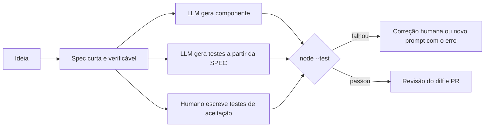

# 02 · Agentes de IA e CLI no front-end (Gemini CLI)

## Objetivo

Ao terminar, você sabe: o que um agente de código faz no seu ambiente (e o que ele não deve fazer sozinho);
configurar o Gemini CLI para um projeto front-end (`GEMINI.md`, `settings.json`, MCP, modos de aprovação);
levar uma ideia até um componente **funcional e testado**; e escrever prompts que geram HTML, CSS e JS/TS utilizáveis.

## Explicação

### Agentes de codificação no ambiente de desenvolvimento

Um agente de código é um LLM com **ferramentas** (ler e escrever arquivos, rodar comandos no shell, buscar na web,
chamar servidores MCP) rodando em loop até cumprir o objetivo; é o padrão ReAct do
[módulo 04](../../04-agentes-autonomos/). No front-end ele brilha em: scaffolding (criar o projeto, configurar
lint e teste), gerar componentes a partir de spec, refatorar (ex.: classe → hooks, CSS → tokens), escrever testes e
explicar código legado.

A analogia útil é **um dev júnior com acesso ao seu terminal**: rápido e incansável, mas você revisa o diff, e ele só
recebe permissão para o que precisa. Por isso todo CLI sério tem **modos de aprovação**, **checkpoints** (desfazer)
e **sandbox**.

### Gemini CLI (⚠️ não executado localmente)

O `gemini` 0.53.0 está instalado nesta máquina, mas **toda chamada ao modelo exige autenticação** (login Google,
`GEMINI_API_KEY` ou Vertex AI), e este repositório não usa contas nem chaves. Só `gemini --version` e
`gemini --help` foram executados; o restante foi conferido na doc oficial em 2026-10-16.

> **Aviso da doc oficial (2026):** para usuários do plano gratuito e do Google One, o Gemini CLI foi
> **substituído pelo Antigravity CLI em 18/06/2026**, e o Gemini CLI não é otimizado para os modelos mais novos.
> Contas pagas, Workspace/Code Assist e Vertex AI seguem usando o Gemini CLI. Os conceitos abaixo
> (arquivo de contexto, MCP, modos de aprovação, modo headless) valem para qualquer agente de terminal.

**Instalação e autenticação**

```bash
npm install -g @google/gemini-cli@latest   # Node >= 20; também: brew install gemini-cli, npx @google/gemini-cli
gemini --version                            # 0.53.0 aqui; última no npm em 2026-10-16: 0.64.0
# Autenticação (escolha UMA; não feita neste repositório):
#  1) `gemini` e escolher "Login with Google"
#  2) export GEMINI_API_KEY=...            (chave do Google AI Studio)
#  3) Vertex AI: GOOGLE_CLOUD_PROJECT + GOOGLE_CLOUD_LOCATION (+ ADC do gcloud, service account ou GOOGLE_API_KEY)
```

**Contexto do projeto: `GEMINI.md`.** Arquivo Markdown com as regras do projeto, concatenado e enviado ao modelo
em **todo** prompt. Hierarquia: `~/.gemini/GEMINI.md` (global) → `GEMINI.md` do workspace e diretórios pais →
`GEMINI.md` encontrados "just-in-time" quando uma ferramenta toca um arquivo. Aceita imports `@./outro.md`.
`/init` gera um `GEMINI.md` analisando o diretório; `/memory show` mostra o que está sendo enviado e
`/memory reload` (ou `refresh`, conforme a versão) relê os arquivos. Exemplo pronto:
[`exemplos/02-.../gemini/GEMINI.md`](../exemplos/02-ideia-ao-componente-testavel/gemini/GEMINI.md).

**Configuração: `settings.json`.** Usuário em `~/.gemini/settings.json`; projeto em `.gemini/settings.json`
(o do projeto sobrepõe o do usuário). Chaves usadas no exemplo
[`gemini/.gemini/settings.json`](../exemplos/02-ideia-ao-componente-testavel/gemini/.gemini/settings.json):
`general.defaultApprovalMode`, `general.checkpointing.enabled`, `context.fileName` (string ou lista, ex.
`["GEMINI.md", "AGENTS.md"]`) e `mcpServers` (com `command`/`args` para stdio, `url` para SSE ou `httpUrl` para
Streamable HTTP, `headers`, `timeout`, `trust`, `includeTools`/`excludeTools`). Também por comando:

```bash
gemini mcp add --transport http --header "Authorization: Bearer tok-e2e-demo" app-tarefas http://127.0.0.1:30510/mcp
gemini mcp list
```

**Modos de uso** (flags conferidas no `gemini --help` local):

| Para quê | Comando |
|---|---|
| Interativo no projeto | `gemini` |
| Headless (scripts/CI) | `gemini -p "gere o componente X seguindo a spec em spec.md" -o json` (saída `{response, stats, error?}`; `-o stream-json` emite eventos JSONL) |
| Só planejar, sem editar | `gemini --approval-mode plan` |
| Aprovar edições, perguntar comandos | `gemini --approval-mode auto_edit` |
| Aprovar tudo (só em sandbox!) | `gemini --sandbox --yolo` |
| Retomar sessão | `gemini --resume latest` |
| Em worktree git separada | `gemini --worktree feature-paginacao` |

Comandos de barra úteis: `/init`, `/memory`, `/mcp`, `/tools`, `/plan`, `/restore` (desfaz edições de uma
ferramenta via checkpoint), `/rewind`, `/stats`, `/compress`. Códigos de saída do headless: `0` sucesso,
`1` erro/API, `42` entrada inválida, `53` limite de turnos.

**Fluxos típicos no front-end**

```bash
# Scaffolding
gemini -p "Crie um projeto Vite + TypeScript com vitest e um componente Button acessível com teste" --approval-mode auto_edit
# Componente a partir de spec (o GEMINI.md já impõe acessibilidade e testes)
gemini -p "Implemente renderPaginacao conforme @spec.md e escreva os testes; rode node --test e corrija até passar"
# Refatoração com rede de segurança: checkpoints ligados + revisar o diff no fim
gemini -p "Troque cores hard-coded de src/**/*.css por variáveis de tokens.css sem mudar o visual"
```

### Da ideia ao componente funcional e testável



Pontos que o [exemplo 02](../exemplos/02-ideia-ao-componente-testavel/) deixa claros:

- **A spec é o prompt.** Numerada, com nomes exatos, estrutura HTML e erros esperados. Ambiguidade vira bug.
- **Testes gerados a partir da spec, não do código.** Se o LLM vê o código, ele escreve testes que confirmam os
  bugs. E os testes do LLM também erram: por isso existe um **portão humano** (testes de aceitação).
- **Rodar de verdade.** "Parece certo" não é critério; `node --test` é.

### Prompt engineering para HTML, CSS e JS/TS

| Técnica | Exemplo de instrução |
|---|---|
| Formato de saída fechado | "Responda só com um bloco \`\`\`html; sem explicações" |
| Restrições de stack | "ES module, sem dependências, `export function renderX`" |
| Ordem que sobrevive a `max_tokens` | "Markup primeiro, `<style>` curto no fim (máx. 12 regras)" |
| Requisitos não funcionais explícitos | "`<label for>` em todo campo, contraste ≥ 4,5:1, foco visível" |
| Tokens de design no contexto | "Use só as variáveis de `tokens.css`: --cor-texto, --espaco-2..." |
| Feedback verificável | colar a saída do axe/teste que falhou e pedir correção |
| Contexto persistente | regras do time no `GEMINI.md`/`AGENTS.md`, não repetidas em todo prompt |
| TypeScript como contrato | "Tipos das props: `type Props = { paginaAtual: number; totalPaginas: number }`" |

## Código mínimo

```js
// Gerar o componente e o teste (trecho do exemplo 02) e rodar de verdade
const comp = await conversar(cliente, [{ role: 'system', content: 'Responda só com um bloco ```js. ES module, sem dependências.' },
                                      { role: 'user', content: `Implemente exatamente esta spec:\n${spec}` }], { maxTokens: 500 });
await writeFile('gerado/paginacao.js', extrairCodigo(comp.texto, 'js'));
spawnSync(process.execPath, ['--test', 'aceitacao.test.js'], { stdio: 'inherit' });
```

## Na prática

- [Exemplo 02 · Da ideia ao componente testável](../exemplos/02-ideia-ao-componente-testavel/) (com `GEMINI.md` e `settings.json` prontos)
- [Exercício 01 · Componente até passar na auditoria](../exercicios/01-componente-acessivel/)

## Armadilhas

- **`--yolo` fora de sandbox**: o agente roda qualquer comando no seu shell. Use `--sandbox` ou `plan`/`auto_edit`.
- **`GEMINI.md` gigante**: vai em todo prompt (custo e contexto). Mantenha curto e use imports `@arquivo.md`.
- **`trust: true` em servidor MCP**: pula as confirmações de todas as tools daquele servidor.
- **Nomes de servidor MCP com `_`**: a doc avisa que o motor de políticas pode interpretar errado; use `-`.
- **Token em `settings.json` versionado**: o exemplo usa um token de demonstração; em projeto real use variável
  de ambiente (`env` aceita `$VAR`) e não versione segredos.
- **Ferramenta "substituída"**: o próprio Gemini CLI mudou de público em 2026. Ancore o processo (spec, testes,
  revisão) e não a ferramenta.

## Fontes

- Documentação do Gemini CLI: https://geminicli.com/docs/
- Instalação: https://geminicli.com/docs/get-started/installation/
- Autenticação: https://geminicli.com/docs/get-started/authentication/
- Modo headless: https://geminicli.com/docs/cli/headless/
- `GEMINI.md`: https://geminicli.com/docs/cli/gemini-md/
- Settings: https://geminicli.com/docs/cli/settings/
- Comandos: https://geminicli.com/docs/reference/commands/
- Servidores MCP: https://geminicli.com/docs/tools/mcp-server/
- Pacote npm: https://www.npmjs.com/package/@google/gemini-cli
- Node test runner: https://nodejs.org/api/test.html
