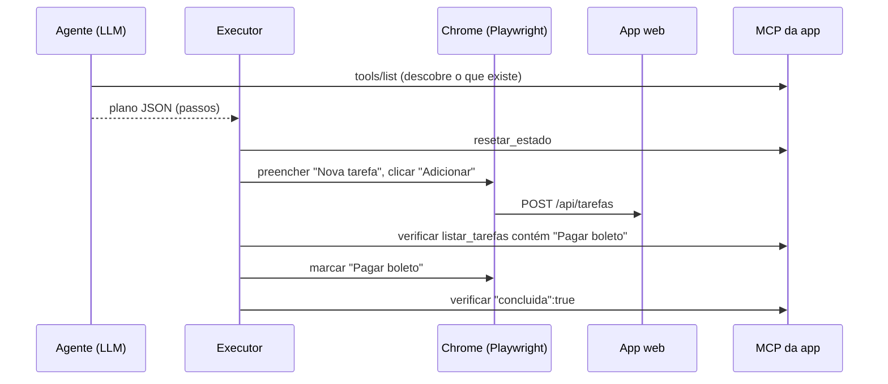

# 03 · Automação e interação inteligente com a UI: MCP, testes E2E por agente e MCP-UI

## Objetivo

Ao terminar, você sabe: expor o estado e as ações da sua aplicação como um servidor MCP; escrever testes E2E em
que um **agente** planeja os passos e um executor determinístico os cumpre (Playwright na UI + MCP para preparar e
conferir o estado); e devolver **UI interativa** pelo MCP com o padrão MCP Apps, usando o SDK do MCP-UI.

## Explicação

### Por que a aplicação deve ter o seu próprio MCP

Um teste E2E clássico só enxerga a tela: para saber se "a tarefa foi salva", ele lê o DOM. Um agente que
**também** fala com o MCP da aplicação consegue: preparar o cenário (`resetar_estado`, `adicionar_tarefa`), agir
como usuário pela interface e **conferir o estado real** (`listar_tarefas`) sem depender de seletores frágeis.
É como um inspetor que testa a máquina pelos botões e depois abre o painel de diagnóstico.



Decisões de projeto do [exemplo 03](../exemplos/03-app-com-mcp-e2e/):

- **UI e MCP compartilham o mesmo estado** (`estado.js`): o que o usuário faz aparece no MCP e vice-versa.
- **Plan-and-execute**: 1 chamada ao LLM gera o plano (saída estruturada com zod), um executor determinístico roda.
  O loop ReAct (uma chamada por passo, observando a tela) é mais flexível, mas em CPU custa minutos por passo;
  veja os padrões no [módulo 04](../../04-agentes-autonomos/).
- **Seletores acessíveis como contrato**: o executor usa `getByLabel`/`getByRole`. Uma UI acessível é,
  de brinde, uma UI "dirigível por agente". Sem rótulo, nem o leitor de tela nem o agente acham o campo.
- **Tools de teste protegidas**: `resetar_estado` é destrutiva (`destructiveHint`), então o endpoint MCP exige
  Bearer token. Em produção, desligue tools de fixture ou exija escopos (OAuth, como no
  [módulo 03, exemplo 04](../../03-mcp/exemplos/04-mcp-http-producao/)).
- **Teste determinístico ao lado do agente**: `e2e.test.js` roda o mesmo fluxo sem LLM, no CI, em segundos.
  O agente serve para explorar e gerar roteiros; o teste fixo serve para regressão.

Alternativa pronta: o **Playwright MCP** (`@playwright/mcp`) dá ao agente ferramentas genéricas de navegador
(snapshot de acessibilidade, clicar, digitar). Combine os dois: Playwright MCP para a tela, MCP da app para o estado.

### MCP-UI e MCP Apps (estado em 2026-10-16)

- **MCP Apps** é a extensão oficial do MCP para UI interativa (especificação `2026-01-26` no repositório
  `modelcontextprotocol/ext-apps`, SDK `@modelcontextprotocol/ext-apps`). Uma tool declara
  `_meta.ui.resourceUri: "ui://..."`; o host busca o recurso com `resources/read` (mimeType
  `text/html;profile=mcp-app`) e o renderiza num **iframe sandbox**. A UI conversa com o host por
  **JSON-RPC sobre `postMessage`** (`tools/call`, `ui/initialize`, `ui/...`), e o host decide o que repassar ao servidor.
- **MCP-UI** (mcpui.dev, `MCP-UI-Org/mcp-ui`) foi o projeto comunitário que inspirou o padrão e hoje oferece SDKs
  **compatíveis com MCP Apps**: `@mcp-ui/server` 6.1.0 (`createUIResource`, constantes `RESOURCE_MIME_TYPE` e
  `RESOURCE_URI_META_KEY`; também Python e Ruby) e `@mcp-ui/client` 7.1.1 (React: `AppRenderer` para MCP Apps e
  `UIResourceRenderer`, legado). O formato antigo (`text/html` puro + ações `{type:'tool', payload}`) ainda é aceito
  por alguns hosts, mas é legado.
- **Hosts com suporte** (doc oficial): Claude e Claude Desktop, VS Code GitHub Copilot, Microsoft 365 Copilot, Goose,
  Postman, MCPJam, entre outros. Host sem suporte simplesmente mostra o texto da tool.

No exemplo, o servidor registra o recurso `ui://tarefas/painel` com `createUIResource` e a tool `mostrar_painel`
aponta para ele. Para testar sem um host de verdade, `cliente-mcp.js` implementa uma **mini-host**: põe o HTML num
`<iframe sandbox="allow-scripts">`, escuta o `postMessage` e repassa o `tools/call` ao MCP. É uma simplificação
(sem o handshake `ui/initialize` nem CSP); para um host real use `AppRenderer` (`@mcp-ui/client`) ou o
`AppBridge` do `@modelcontextprotocol/ext-apps`.

## Código mínimo

```js
import { createUIResource, RESOURCE_MIME_TYPE } from '@mcp-ui/server';
const URI = 'ui://tarefas/painel';
server.registerResource('painel_tarefas', URI, { mimeType: RESOURCE_MIME_TYPE }, async () => ({
  contents: [createUIResource({ uri: URI, content: { type: 'rawHtml', htmlString: htmlPainel(estado.listar()) }, encoding: 'text' }).resource],
}));
server.registerTool('mostrar_painel', { description: 'Mostra o painel', _meta: { ui: { resourceUri: URI } } },
  async () => ({ content: [{ type: 'text', text: '...' }] }));
// Dentro do iframe: window.parent.postMessage({ jsonrpc: '2.0', id: 1, method: 'tools/call', params: { name: 'concluir_tarefa', arguments: { id } } }, '*')
```

## Na prática

- [Exemplo 03 · App com MCP para testes E2E por agente](../exemplos/03-app-com-mcp-e2e/)
- [Exercício 02 · Nova tool MCP + teste E2E](../exercicios/02-tool-mcp-e-teste-e2e/)
- Servidores MCP em JS, HTTP com token e gateway: [módulo 03](../../03-mcp/)

## Armadilhas

- **O `@mcp-ui/server` puxa o Bun (~170 MB)** como dependência opcional do `@modelcontextprotocol/ext-apps`.
  O módulo tem `.npmrc` com `omit=optional`: `node_modules` cai de ~260 MB para ~87 MB.
- **Copiar o README antigo do npm**: o README publicado no npm do `@mcp-ui/server` ainda mostra o formato legado
  (`mimeType: 'text/html'`, `UIResourceRenderer`). O GitHub e o `RESOURCE_MIME_TYPE` da versão 6 usam
  `text/html;profile=mcp-app`.
- **Iframe com `allow-same-origin` + `allow-scripts`**: o conteúdo consegue remover o próprio sandbox. Hosts não
  devem combinar os dois para HTML de terceiros.
- **Repassar qualquer `tools/call` do iframe**: o host deve filtrar quais tools a UI pode chamar e pedir
  consentimento para ações destrutivas.
- **Agente sem fixture**: sem `resetar_estado` (ou banco de teste), o resultado depende da execução anterior.
- **Plano do LLM com rótulo "quase certo"** (`"Nova Tarefa"` x `"Nova tarefa"`): diga ao planejador os rótulos
  reais (ou exponha uma tool que os descreva) e use `exact: true` só quando precisar.

## Fontes

- MCP Apps (visão geral): https://modelcontextprotocol.io/extensions/apps/overview
- Especificação e SDK MCP Apps: https://github.com/modelcontextprotocol/ext-apps · https://apps.extensions.modelcontextprotocol.io
- MCP-UI: https://mcpui.dev · https://github.com/MCP-UI-Org/mcp-ui
- `@mcp-ui/server`: https://www.npmjs.com/package/@mcp-ui/server · `@mcp-ui/client`: https://www.npmjs.com/package/@mcp-ui/client
- SDK TypeScript do MCP: https://github.com/modelcontextprotocol/typescript-sdk
- Playwright (locators acessíveis): https://playwright.dev/docs/locators · Playwright MCP: https://github.com/microsoft/playwright-mcp
- Structured outputs no SDK `openai` (zod): https://github.com/openai/openai-node/blob/master/helpers.md
