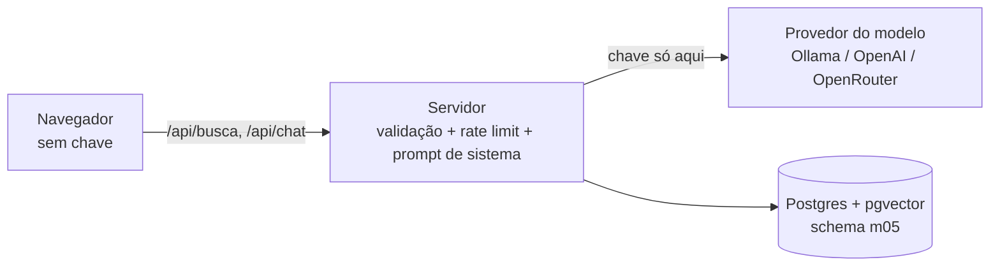

# 04 · Lógica de IA no cliente e no servidor (e Firebase AI Logic)

## Objetivo

Ao terminar, você sabe: por que **não** chamar a API de um modelo direto do navegador com a sua chave; desenhar um
back-end "proxy de IA" com validação e rate limit; quando faz sentido IA no cliente (modelo local no browser ou
SDK com atestação, como o Firebase AI Logic); e implementar busca semântica, chatbot de suporte e personalização
em tempo real com a lógica de IA no servidor.

## Explicação

### O problema da chave no front-end

Tudo que vai para o navegador é público: o bundle JS, as variáveis "de ambiente" do Vite (`import.meta.env.VITE_*`
é embutido no build) e cada requisição (aba Network do DevTools). Uma chave de API no front é como deixar o
cartão de crédito colado na vitrine: qualquer visitante pode

- gastar o seu crédito e estourar sua cota (a fatura é sua);
- trocar o prompt de sistema e usar o modelo para o que quiser;
- acessar tudo o que a chave permite (arquivos, outros projetos da conta).

O SDK `openai` sabe disso: no browser ele **se recusa a rodar** sem `dangerouslyAllowBrowser: true`. O arquivo
[`anti-padrao-chave-no-browser.html`](../exemplos/04-ia-cliente-vs-servidor/anti-padrao-chave-no-browser.html)
mostra o que **não** fazer.

### Arquitetura recomendada: back-end como proxy de IA



O servidor é dono de: **segredo** (variáveis de ambiente), **prompt de sistema** (o usuário não consegue trocá-lo),
**validação** (tamanho e tipo antes de gastar token), **rate limit** por usuário/IP, **escolha do modelo**
(trocar de provedor sem novo deploy do front) e **observabilidade** (logs de custo, latência, abuso). É o mesmo
desenho do [módulo 02, exemplo 04](../../02-apis-ia-generativa/exemplos/04-api-backend-com-llm/), agora visto
do lado da UI.

### Quando a IA pode ir para o cliente

| Opção | Chave no browser? | Quando usar |
|---|---|---|
| Proxy próprio no servidor (este módulo) | Não | Padrão para qualquer app com modelo remoto |
| Modelo **local no browser** (TF.js, MediaPipe, Transformers.js, Chrome Built-in AI) | Não há chave | Privacidade, offline, latência baixa, tarefas pequenas (ver [módulo 01, exemplo 03](../../01-fundamentos-ia-llms/exemplos/03-visao-no-browser/)) |
| **Firebase AI Logic** (SDK cliente + proxy do Google + App Check) | Não (a chave do Gemini fica no proxy) | Apps mobile/web no ecossistema Firebase sem back-end próprio |
| Chave do provedor direto no browser | **Sim** | Nunca em produção |

### Firebase AI Logic (⚠️ não executado localmente)

Exige projeto Firebase, login no console e o provedor Gemini (a Gemini Developer API tem camada gratuita; a Gemini
API via Agent Platform, ex-Vertex AI, exige faturamento). Por isso foi **apenas documentado**, conforme a doc
oficial de 2026-10-16.

- **O que é:** SDKs cliente (Web/JS, Swift, Kotlin/Java, Flutter, Unity) + um **serviço de proxy** do Firebase.
  O app chama o SDK; o proxy guarda a chave do Gemini e encaminha. Assim a chave **não** vai no app.
- **Proteção contra abuso:** **Firebase App Check** atesta que a requisição vem do seu app (reCAPTCHA Enterprise
  na web, Play Integrity, App Attest). Desde julho de 2026 o fluxo guiado do console **ativa o enforcement do App
  Check** para o AI Logic. Também há limite de requisições por usuário, configurável.
- **Server prompt templates:** o prompt e o modelo podem ficar no servidor (templates), trocáveis sem publicar
  nova versão do app.
- **Setup (console):** projeto → *AI Services* → *AI Logic* → fluxo guiado (habilita APIs, registra o app web,
  escolhe o provedor) → `npm install firebase`.

```js
// Doc oficial (web), não executado aqui
import { initializeApp } from 'firebase/app';
import { getAI, getGenerativeModel, GoogleAIBackend } from 'firebase/ai';

const firebaseApp = initializeApp(firebaseConfig);            // config pública do app (não é segredo)
const ai = getAI(firebaseApp, { backend: new GoogleAIBackend() });
const model = getGenerativeModel(ai, { model: 'gemini-3.8-flash' }); // nome do modelo conforme a doc atual
const result = await model.generateContent('Resuma esta avaliação em 1 frase: ...');
console.log(result.response.text());
// Dev local com App Check: self.FIREBASE_APPCHECK_DEBUG_TOKEN = true (registre o token de debug no console; nunca versione).
```

Repare: o `firebaseConfig` é público por design; quem protege o uso é o **App Check** + regras + cotas. Ainda assim,
o prompt montado no cliente pode ser manipulado: lógica sensível (preço, permissão, dados de outros usuários)
continua no servidor.

### Features inteligentes com a lógica no servidor

O [exemplo 04](../exemplos/04-ia-cliente-vs-servidor/) implementa as três:

- **Busca semântica:** embeddings (`qwen3-embedding:0.6b`) + pgvector no schema `m05`; "em quantos dias meu café
  chega?" acha "Qual o prazo de entrega?" sem palavras em comum. A técnica é a do
  [módulo 01, exemplo 05](../../01-fundamentos-ia-llms/exemplos/05-primeiro-rag/).
- **Chatbot de suporte:** RAG curto (2 trechos) + prompt de sistema no servidor + `max_tokens` baixo.
- **Personalização em tempo real:** o front guarda as categorias que o usuário abriu (preferência, não segredo, pode
  ficar no `localStorage`) e as manda como `interesses`; o servidor dá um bônus pequeno no ranking.

## Código mínimo

```js
// Servidor: a chave sai do ambiente do SERVIDOR; o browser só conhece /api/chat
app.post('/api/chat', rateLimit(5), textoValido('pergunta'), async (req, res) => {
  const trechos = await buscar(pool, cliente, req.body.pergunta, { k: 2 });
  const r = await conversar(cliente, [{ role: 'system', content: PROMPT_SUPORTE }, { role: 'user', content: montar(trechos, req.body.pergunta) }], { maxTokens: 120 });
  res.json({ resposta: r.texto, fontes: trechos.map((t) => t.pergunta) });
});
```

## Na prática

- [Exemplo 04 · IA no cliente × no servidor](../exemplos/04-ia-cliente-vs-servidor/)

## Armadilhas

- **`VITE_OPENAI_API_KEY`** (ou `NEXT_PUBLIC_*`): prefixos "públicos" são embutidos no bundle. Segredo nunca leva
  esses prefixos.
- **Proxy aberto**: um `/api/chat` sem rate limit nem validação vira um proxy grátis para o seu modelo. Valide e
  limite **antes** de chamar o modelo.
- **Prompt de sistema no front**: qualquer um edita pelo DevTools. Fica no servidor.
- **HTML vindo do modelo com `innerHTML`**: a resposta do LLM é entrada não confiável (pode trazer ``
  via prompt injection). Use `textContent` ou sanitize.
- **Rate limit em memória com várias réplicas**: cada réplica conta sozinha; use Redis ou o gateway.
- **Firebase AI Logic sem App Check**: a doc recomenda fortemente; sem ele, qualquer cliente que copie a config chama
  o seu modelo.

## Fontes

- Firebase AI Logic: https://firebase.google.com/docs/ai-logic
- Primeiros passos (web): https://firebase.google.com/docs/ai-logic/get-started?platform=web
- App Check: https://firebase.google.com/docs/app-check
- SDK `openai` e `dangerouslyAllowBrowser`: https://github.com/openai/openai-node
- OWASP Top 10 para LLMs (LLM10 Unbounded Consumption, LLM01 Prompt Injection): https://genai.owasp.org/llm-top-10/
- Variáveis de ambiente no Vite (`VITE_` vai para o cliente): https://vite.dev/guide/env-and-mode
- pgvector: https://github.com/pgvector/pgvector
