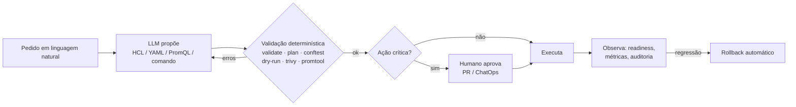

# 01 · Fundamentos de IA generativa para infraestrutura

## Objetivo

Ao terminar, você sabe explicar como um LLM gera código de infraestrutura (e por que ele erra), escolher
entre as APIs (OpenAI, Anthropic Claude, AWS Bedrock) e os frameworks de agentes (LangChain, CrewAI,
AutoGen), aplicar RAG à documentação técnica, escrever prompts de infra e, principalmente, montar o
padrão que atravessa o módulo inteiro: **o LLM propõe, ferramentas determinísticas validam, humanos aprovam**.

## Explicação

### O princípio do módulo

Pense no LLM como um estagiário muito rápido e muito confiante: escreve Terraform em segundos, mas às vezes
inventa um argumento que não existe ou fixa uma versão de provider que nunca foi lançada. Você não demite o
estagiário: você coloca o trabalho dele num pipeline com *linters*, testes e revisão. Em DevOps esse
pipeline já existe (`terraform validate`, `kubectl --dry-run`, OPA, Trivy, `promtool`); a IA só entra antes dele.



Três regras práticas saem dele:

1. **Erro de ferramenta é feedback, não exceção.** O texto de `tofu validate` volta ao LLM e ele corrige
   (loop com limite de tentativas; estourou → escala para um humano).
2. **Problema determinístico se resolve com ferramenta determinística.** Formatação? `tofu fmt`. Não gaste
   token pedindo ao modelo para alinhar `=`.
3. **O LLM preenche formulários, o código renderiza.** Em vez de pedir 400 tokens de YAML livre, peça um
   JSON com 6 campos e renderize o manifest de um template revisado (ver [exemplo 02](../exemplos/02-agente-de-deploy-kind/)).

### Arquitetura de LLMs, do ponto de vista de quem opera infra

Um LLM é um Transformer que prevê o próximo token. Para infra isso significa: ele reproduz o **padrão
estatístico** dos repositórios em que foi treinado, não a documentação da versão que você usa. Consequências:

| Característica | Efeito em infra |
|---|---|
| Corte de conhecimento (data de treino) | sugere versões antigas de provider/chart/API (`extensions/v1beta1` para Ingress) |
| Geração token a token | um arquivo longo tem mais chances de um erro pequeno no meio |
| Temperatura | use `0` para código; criatividade aqui é bug |
| Janela de contexto | `kubectl describe` inteiro + logs + manifest enchem o contexto rápido; filtre antes |
| Custo/latência por token | em CPU, ~5 tokens/s: um YAML de 400 tokens leva ~80 s. Formulário JSON leva ~15 s |

Tokens, sampling, TTFT e custo por token estão detalhados na trilha
[llmops-vllm-openshift · fundamentos](../../../trilhas-extras/llmops-vllm-openshift/docs/02-fundamentos-de-llm.md).

### APIs: OpenAI, Anthropic Claude e AWS Bedrock

| API | Endpoint/SDK | Particularidades para DevOps |
|---|---|---|
| OpenAI (Chat Completions / Responses) | `openai` (npm/PyPI) | padrão de fato; Ollama, vLLM e OpenRouter falam o mesmo formato. É o que este módulo usa |
| Anthropic Claude (Messages API) | `@anthropic-ai/sdk` | `system` separado das mensagens, `tool_use`/`tool_result` como blocos de conteúdo, `max_tokens` obrigatório |
| AWS Bedrock (Converse API) | `@aws-sdk/client-bedrock-runtime` | autenticação IAM (sem chave de API), dados ficam na conta AWS; vários modelos (Claude, Llama, Nova) pela mesma API |

Como o módulo lê `OPENAI_BASE_URL`, `OPENAI_API_KEY` e `MODELO_CHAT` do ambiente
([`comum/llm.js`](../comum/llm.js)), trocar o Ollama local por um provedor real é só mudar variáveis. Para
Anthropic/Bedrock nativos, o formato de mensagens muda (código mínimo abaixo, **não executado localmente**:
exige chave/conta). Comparativo completo de APIs: [módulo 02](../../02-apis-ia-generativa/).

### Frameworks de agentes: LangChain, CrewAI, AutoGen

| Framework | Modelo mental | Quando usar em DevOps |
|---|---|---|
| LangChain / LangGraph | grafo de estados com nós e arestas condicionais, checkpoint e *interrupt* (HITL) | fluxos com aprovação e retomada: deploy com gate, remediação |
| CrewAI | "equipe" de agentes com papéis (SRE, revisor de segurança) e tarefas | protótipos de multiagente com papéis claros |
| AutoGen (Microsoft) | agentes que conversam entre si (group chat) | exploração/pesquisa; menos previsível para ações em produção |
| Loop escrito à mão | `while` + function calling | quando o fluxo é curto e você quer cada passo auditável (é o que os exemplos daqui fazem) |

Implementações de ReAct, LangGraph e HITL estão no [módulo 04](../../04-agentes-autonomos/). Aqui o foco é
**o que** o agente faz em infra, não o framework.

### RAG aplicado à documentação técnica

Runbooks, READMEs, ADRs e post-mortems viram contexto recuperado por similaridade. Particularidades de doc
técnica: *chunk* por seção (cabeçalho Markdown), não por número de caracteres; preserve blocos de código
inteiros; guarde metadados (serviço, data, autor) para filtrar; e **cite a fonte** na resposta. O RAG básico
com pgvector está no [módulo 01 · exemplo 05](../../01-fundamentos-ia-llms/exemplos/05-primeiro-rag/); o RAG
de runbooks que executa passos está no [exercício 02](../exercicios/02-runbook-rag-e-postmortem/).

### Padrões de prompting para infraestrutura

| Padrão | Exemplo |
|---|---|
| Escopo fechado | "Use SOMENTE os providers hashicorp/local e hashicorp/random" |
| Grounding de versões | colar o bloco `required_providers` com as versões reais (o modelo para de inventar `~> 3.0`) |
| Formato rígido | "Responda apenas com o HCL" + JSON mode quando a saída é dado |
| Contexto mínimo e filtrado | só os campos do `describe` que importam, não 120 linhas |
| Catálogo explícito | lista de métricas/labels que existem (NL → PromQL) |
| Feedback de ferramenta | "O pipeline rejeitou: <erro do validate>. Devolva o arquivo completo corrigido" |
| Regras fora do prompt | políticas da casa ficam no OPA; o prompt pode citá-las, mas quem garante é o `conftest` |

### Limitações, alucinações e validação

Alucinações e erros reais observados neste módulo com o `qwen3.5:4b` (todos barrados por uma ferramenta):

| Erro do modelo | Quem pegou | Exemplo |
|---|---|---|
| argumento inexistente (`value_file` num `output`; `min_uppercase` no `random_password`) | `tofu init`/`validate` | [01](../exemplos/01-iac-copilot-terraform/) |
| versão de provider que não existe (`hashicorp/local ~> 3.0`, `3.2.0`; a série atual é 2.x) | `tofu init` | [01](../exemplos/01-iac-copilot-terraform/) |
| tipo errado (`min_special = true`, o schema pede número) | `tofu validate` | [01](../exemplos/01-iac-copilot-terraform/) |
| arquivo com `0644`/`0777` (válido para o Terraform) | política OPA | [01](../exemplos/01-iac-copilot-terraform/) |
| imagem embrulhada em `<...>` e depois em `` | validação do formulário | [02](../exemplos/02-agente-de-deploy-kind/) |
| `readOnlyRootFilesystem` no `securityContext` do pod | `kubectl apply --dry-run=server` (o `--dry-run=client` deixou passar) | [06](../exemplos/06-seguranca-scan-e-ai-fix/) |
| PromQL com `exp(<escalar>)` para um p95 | `promtool` | [04](../exemplos/04-aiops-anomalias-e-promql/) |
| PromQL **válida e errada** (`*100` dentro do denominador) | **ninguém**: precisa de golden set e revisão | [04](../exemplos/04-aiops-anomalias-e-promql/) |
| categoria `Outro` para um CrashLoopBackOff com causa certa | gabarito do teste (acerto medido 2/3) | [03](../exemplos/03-troubleshooting-react/) |
| fato inventado no post-mortem ("nenhum dado perdido", "17 s de indisponibilidade") | revisão humana | [exercício 02](../exercicios/02-runbook-rag-e-postmortem/) |

Duas lições práticas saíram daí: **erro sem contexto não ensina modelo pequeno** (devolver a lista real de
argumentos do schema fez o copilot acertar; só "argumento não esperado" fez ele repetir o erro 3 vezes), e
**few-shot de uma linha** (um exemplo do JSON esperado) resolveu o ``.

Cada camada pega um tipo de erro: **sintaxe** (parser), **schema** (validate/dry-run), **semântica da
plataforma** (OPA), **segurança** (Trivy/Checkov), **comportamento** (readiness, métricas). Nenhuma camada
substitui as outras.

## Código mínimo

O mesmo pedido nas três APIs (só o primeiro roda localmente; os outros dois: **não executado localmente**,
exigem chave/conta):

```js
// OpenAI-compatível (Ollama local, OpenAI, OpenRouter, vLLM)
const r = await openai.chat.completions.create({
  model: process.env.MODELO_CHAT, temperature: 0, max_tokens: 300,
  messages: [{ role: 'system', content: 'Responda só com HCL.' }, { role: 'user', content: pedido }],
});

// Anthropic Messages API (@anthropic-ai/sdk)
const m = await anthropic.messages.create({
  model: 'claude-...', max_tokens: 300, system: 'Responda só com HCL.',
  messages: [{ role: 'user', content: pedido }],
});

// AWS Bedrock Converse (@aws-sdk/client-bedrock-runtime) — autenticação por IAM, não por chave
const out = await bedrock.send(new ConverseCommand({
  modelId: 'anthropic.claude-...', system: [{ text: 'Responda só com HCL.' }],
  messages: [{ role: 'user', content: [{ text: pedido }] }], inferenceConfig: { maxTokens: 300, temperature: 0 },
}));
```

## Na prática

- Loop "LLM propõe → validate/plan/OPA → corrige": [exemplo 01](../exemplos/01-iac-copilot-terraform/).
- "LLM preenche formulário, código renderiza": [exemplo 02](../exemplos/02-agente-de-deploy-kind/).
- Catálogo explícito contra alucinação de métricas: [exemplo 04](../exemplos/04-aiops-anomalias-e-promql/).

## Armadilhas

- **Confiar no "parece certo".** HCL plausível com argumento inexistente passa numa revisão rápida; não passa no `validate`.
- **Pôr as regras de segurança só no prompt.** Modelo pequeno esquece; a política precisa estar no pipeline.
- **Retry automático do SDK com LLM lento.** O SDK reenvia após timeout e a fila do servidor dobra. Aqui: `maxRetries: 0`.
- **Timeout do `fetch` do Node.** O `fetch` nativo corta a espera pelos headers em 300 s; com Ollama em CPU e fila,
  passa disso. Solução em [`comum/llm.js`](../comum/llm.js): `fetch` do pacote `undici` com
  `new Agent({ headersTimeout: 0, bodyTimeout: 0 })` e o timeout do SDK (600 s) como teto.

## Fontes

- OpenAI API (Chat Completions): https://platform.openai.com/docs/api-reference/chat
- Anthropic Messages API: https://docs.anthropic.com/en/api/messages
- AWS Bedrock Converse API: https://docs.aws.amazon.com/bedrock/latest/userguide/conversation-inference.html
- LangGraph.js: https://langchain-ai.github.io/langgraphjs/
- CrewAI: https://docs.crewai.com/
- AutoGen: https://microsoft.github.io/autogen/
- Ollama, compatibilidade OpenAI: https://docs.ollama.com/api/openai-compatibility
- undici `Agent` (headersTimeout/bodyTimeout): https://undici.nodejs.org/#/docs/api/Agent
