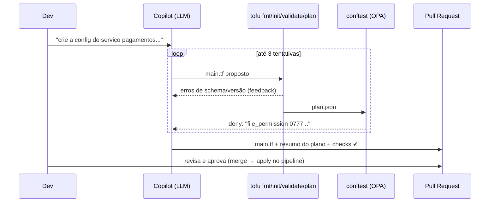

# 02 · IaC Copilot, CI/CD, segurança e FinOps

## Objetivo

Ao terminar, você sabe montar um copilot que transforma linguagem natural em IaC (Terraform/OpenTofu,
Pulumi, Helm) **validada** por `fmt`/`validate`/`plan` e por Policy-as-Code (OPA/Sentinel), entregá-lo num
fluxo PR-first, detectar drift, escanear IaC/containers/segredos (Trivy, Checkov, Snyk) com "AI fix",
gerar pipelines de CI/CD com gates e estimar custo no PR (Infracost) com recomendações de FinOps.

## Explicação

### IaC Copilot: de linguagem natural a IaC validada



Por que a política roda sobre o **plano** (`tofu show -json plan.bin`) e não sobre o texto do `.tf`? Porque o
plano mostra o valor **efetivo**: no exemplo 01, omitir `file_permission` em `local_file` resulta em `"0777"`
(default do provider). Uma regra sobre o texto deixaria passar; sobre o plano, não.

**Terraform × OpenTofu.** OpenTofu é o fork open source (MPL) do Terraform, com CLI e linguagem compatíveis;
o módulo usa `tofu` porque o binário é livre e o registry público dispensa login. Tudo vale para `terraform`.

**Pulumi e Helm.** Pulumi gera IaC em linguagem de programação (TypeScript/Python): o LLM escreve código
"normal" e a validação é `tsc` + `pulumi preview` (o equivalente ao `plan`) + políticas CrossGuard. Helm:
o LLM preenche `values.yaml` (formulário!) e a validação é `helm lint` + `helm template | kubeconform`. Os dois
exigem CLI/conta próprias: **não executados localmente**; o padrão é o mesmo do exemplo 01.

### Policy-as-Code: OPA e Sentinel

| | OPA (Rego) + conftest | Sentinel (HashiCorp) |
|---|---|---|
| Licença | open source (CNCF graduated) | comercial (HCP Terraform/Enterprise) |
| Onde roda | CLI, CI, admission controller (Gatekeeper), API | dentro do HCP Terraform, entre plan e apply |
| Entrada | qualquer JSON/YAML/HCL (plano, manifest, Dockerfile) | plano/estado/config do Terraform |
| Níveis | `deny`/`warn` | advisory, soft-mandatory, hard-mandatory |

Sentinel: **não executado localmente** (exige HCP Terraform). Rego mínimo (do exemplo 01):

```rego
package main
import rego.v1

deny contains msg if {
	some rc in input.resource_changes
	rc.type in {"local_file", "local_sensitive_file"}
	perm := rc.change.after.file_permission
	not endswith(perm, "0")
	msg := sprintf("%s: file_permission %q dá acesso a outros usuários", [rc.address, perm])
}
```

**Explicar política em linguagem natural** é um ótimo uso de LLM (baixo risco: só leitura). Dê o `.rego` e
peça "explique para um dev de produto o que esta regra bloqueia e como corrigir". O [exercício 01](../exercicios/01-politica-opa-nova/)
cria uma política nova com testes (`conftest verify`) e mostra o copilot se adaptando a ela.

### Workflow PR-first com revisão assistida

O copilot **nunca aplica**. Ele abre (ou prepara) um PR com: o código, o resumo do plano (`+ create`,
`~ update`, `- destroy`), o resultado de cada check e quantas tentativas o LLM precisou. Um revisor humano
aprova; o `apply` roda no pipeline após o merge, com as credenciais do pipeline (não as do copilot). Revisão
assistida = um segundo LLM comenta o diff do PR ("este `destroy` em banco é intencional?"), mas a decisão é humana.

### Drift de infraestrutura

Drift é a diferença entre o estado declarado (código) e o real (nuvem), causada por mudança manual no console,
outro pipeline ou automação. Detecção: `tofu plan -detailed-exitcode` agendado (exit 2 = há mudanças) ou
`tofu plan -refresh-only`. Papel da IA: **classificar e explicar** o drift ("alguém abriu a porta 22 no SG
bastion às 03h; reverter?") e abrir PR de reconciliação, nunca "consertar" sozinha no console. Drift de
**dados/modelos** (outra coisa!) está em [trilhas-extras/mlops · drift](../../../trilhas-extras/mlops/docs/03-monitoramento-e-drift.md).

### Segurança e compliance

| Ferramenta | O que escaneia | Licença | Local? |
|---|---|---|---|
| Trivy | misconfig em Terraform, K8s, Dockerfile, Helm; CVEs em imagens/SBOM; segredos | open source | ✅ (exemplo 06) |
| Checkov | misconfig de IaC (Terraform, CFN, K8s, Helm, GitHub Actions) | open source (Python) | mesmo papel do `trivy config` |
| Snyk | dependências, containers, IaC, código; sugere upgrades | SaaS (exige login) | ⚠️ não executado localmente |

**"AI fix"**: o scanner acha (determinístico, com ID estável, ex. `KSV-0017 Privileged`), o LLM explica o risco
em linguagem de negócio e propõe o patch, e **o scanner roda de novo** para provar que (a) os achados caíram
e (b) o fix não introduziu nenhum achado novo. Para CVEs em imagem (`trivy image`), a remediação típica é
subir a base (`node:22-alpine` → patch mais recente) ou a dependência; o LLM resume o changelog, mas a versão
corrigida vem do banco de vulnerabilidades, não do modelo.

**Vazamento de segredos**: `trivy fs --scanners secret` (ou gitleaks) no pre-commit e no CI. Segredo vazado se
**revoga**, não só se apaga do arquivo (continua no histórico do git).

**Relatórios de compliance (SOC 2, ISO 27001, PCI-DSS)**: os scanners mapeiam regras para controles
(`trivy config --compliance` tem specs como `k8s-cis-1.23`, `k8s-nsa-1.0`, `k8s-pss-restricted-0.1`, `aws-cis-1.4`).
O LLM agrega evidências por controle e redige o relatório; o auditor quer a evidência bruta anexada.
Mapeamento formal para SOC 2/ISO/PCI depende de ferramentas comerciais (Vanta, Drata etc.): **não executado
localmente**.

### CI/CD Copilot

Um LLM gera bem pipelines (GitHub Actions, GitLab CI, Jenkinsfile) porque são formatos muito presentes no
treino, mas valide: `actionlint` (Actions), `gitlab-ci-lint` via API (GitLab), `jenkins-linter`. Gates
recomendados, nesta ordem (mais barato primeiro):

| Gate | Ferramenta típica | Falha bloqueia? |
|---|---|---|
| lint + testes | eslint/pytest/vitest | sim |
| SAST (código) | Semgrep, CodeQL | HIGH+ |
| dependency scanning | `trivy fs`, Dependabot, `npm audit` | CRITICAL |
| IaC/policy | `tofu validate` + conftest, `trivy config` | sim |
| build + scan de imagem | `trivy image` | CRITICAL com fix disponível |
| DAST (app rodando) | OWASP ZAP baseline | HIGH+ em homolog |
| deploy canary + análise de métricas | Argo Rollouts/Flagger | rollback automático |

**Impacto em PRs**: o copilot comenta "este PR muda 3 recursos, 1 destrutivo; custo +US$ 42/mês; 2 achados
novos". **Cache e tempo de build**: cache de dependências por hash do lockfile (`actions/cache`,
`cache:key:files` no GitLab), camadas Docker ordenadas do menos ao mais volátil, `--mount=type=cache` no
BuildKit. **Rollback por métricas**: o pipeline não termina no deploy; ele espera a análise (taxa de 5xx,
p95) e reverte se piorar (ver [doc 03](03-kubernetes-troubleshooting-e-aiops.md#rollout-e-rollback)).

```yaml
# GitHub Actions mínimo com os gates de IaC deste módulo (não executado localmente: roda no GitHub)
jobs:
  iac:
    runs-on: ubuntu-latest
    steps:
      - uses: actions/checkout@v5
      - uses: opentofu/setup-opentofu@v1
      - run: tofu fmt -check && tofu init -backend=false && tofu validate
      - run: tofu plan -out plan.bin && tofu show -json plan.bin > plan.json
      - run: conftest test plan.json -p politicas
      - run: trivy config --exit-code 1 --severity HIGH,CRITICAL .
```

### FinOps com IA

| Tema | Como | Papel da IA |
|---|---|---|
| Custo no PR | `infracost breakdown --path .` e `infracost diff` comentando o PR | explicar o delta e sugerir alternativa mais barata |
| Rightsizing de pods | comparar `requests` com uso real (p95 de `container_cpu_usage_seconds_total`, `container_memory_working_set_bytes`); VPA em modo `Off` só recomenda | priorizar por economia × risco |
| Rightsizing de nodes | utilização alocada × real por node pool; Karpenter/cluster-autoscaler | sugerir família de instância |
| Spot e reservadas | spot para stateless tolerante a interrupção; reservas/Savings Plans para a base estável | estimar a base estável a partir do histórico |
| Recursos ociosos | volumes sem dono, IPs não associados, LBs sem target, namespaces sem tráfego | gerar a lista + PR de remoção (com aprovação) |
| Forecasting de custo | mesma técnica do forecast de CPU do [exemplo 04](../exemplos/04-aiops-anomalias-e-promql/) aplicada à fatura diária | alerta "vai estourar o orçamento dia 23" |
| Armazenamento e rede | classes de storage (gp3 × io2), lifecycle para S3 IA/Glacier, tráfego entre AZs e NAT Gateway | apontar os maiores itens de egress |

Infracost exige chave de API (mesmo no plano gratuito) e o Infracost Cloud exige login: **não executado
localmente**. Para custo de inferência de LLM (tokens), veja
[llmops · custo e capacidade](../../../trilhas-extras/llmops-vllm-openshift/docs/08-custo-e-capacidade.md).

## Código mínimo

```bash
# Pipeline determinístico do copilot (o que validar.js executa)
tofu fmt -check || tofu fmt
tofu init -input=false -upgrade
tofu validate -json
tofu plan -input=false -out=plan.bin && tofu show -json plan.bin > plan.json
conftest test plan.json -p politicas -o json

# Scanners
trivy config alvos/
trivy fs --scanners secret .
```

## Na prática

- [Exemplo 01 · IaC copilot com OpenTofu + OPA](../exemplos/01-iac-copilot-terraform/)
- [Exemplo 06 · Trivy + AI fix + re-scan](../exemplos/06-seguranca-scan-e-ai-fix/)
- [Exercício 01 · política OPA nova com testes](../exercicios/01-politica-opa-nova/)

## Armadilhas

- **Default perigoso invisível no texto**: `local_file` sem `file_permission` vira `0777`. Política sobre o plano pega.
- **`references` duplicadas no plano**: `random_password.db` e `random_password.db.result` aparecem juntas; a regra
  precisa filtrar senão a mesma violação sai duas vezes.
- **Lock de provider entre tentativas**: se o LLM muda a restrição de versão, `.terraform.lock.hcl` trava o init.
  Use `init -upgrade` no diretório de rascunho.
- **Segredo no plano**: `local_file` com senha mostra o valor no `plan`; `local_sensitive_file`/variáveis `sensitive` não.
- **AI fix sem re-scan**: o modelo "corrige" e cria outro problema (ex.: remove o `securityContext` inteiro). Sempre re-escaneie.
- **Primeira execução do Trivy baixa o bundle de checks** (e o banco de CVEs para `trivy image`): em CI, faça cache de `~/.cache/trivy`.

## Fontes

- OpenTofu CLI (`validate`, `plan`, `show -json`): https://opentofu.org/docs/cli/commands/
- Formato JSON do plano: https://opentofu.org/docs/internals/json-format/
- Conftest: https://www.conftest.dev/ · Rego: https://www.openpolicyagent.org/docs/policy-language
- Sentinel: https://developer.hashicorp.com/sentinel/docs
- Pulumi CrossGuard: https://www.pulumi.com/docs/iac/using-pulumi/crossguard/
- Helm lint: https://helm.sh/docs/helm/helm_lint/
- Trivy (config, secret, compliance): https://trivy.dev/latest/docs/
- Checkov: https://www.checkov.io/ · Snyk IaC: https://docs.snyk.io/scan-with-snyk/snyk-iac
- Infracost: https://www.infracost.io/docs/
- Vertical Pod Autoscaler: https://github.com/kubernetes/autoscaler/tree/master/vertical-pod-autoscaler
- GitHub Actions: https://docs.github.com/actions · GitLab CI: https://docs.gitlab.com/ci/ · Jenkins Pipeline: https://www.jenkins.io/doc/book/pipeline/
- OWASP ZAP baseline: https://www.zaproxy.org/docs/docker/baseline-scan/
