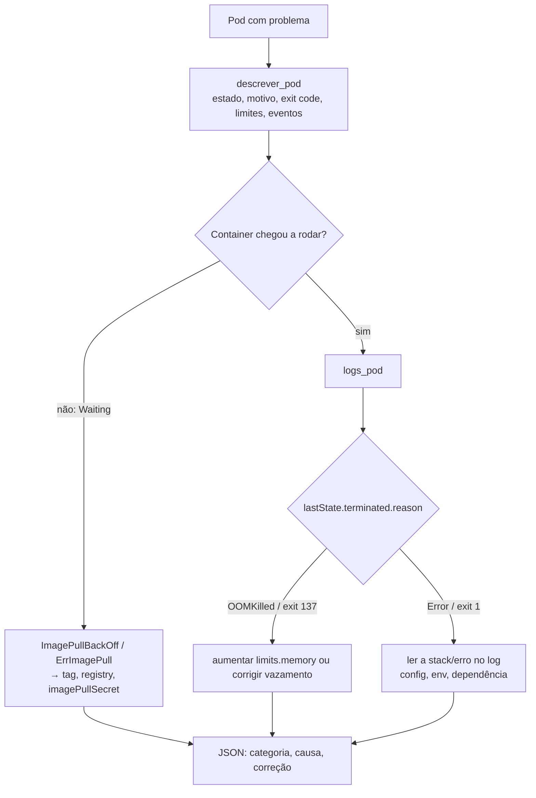

# 03 · Agentes para Kubernetes, troubleshooting assistido e AIOps

## Objetivo

Ao terminar, você sabe: gerar manifests a partir de linguagem natural com segurança; configurar HPA/VPA e
autoscaling por métricas customizadas; expor serviços (Service, Ingress, NetworkPolicy); fazer rollout e
rollback (canary, blue-green, progressive delivery, GitOps); diagnosticar CrashLoopBackOff,
ImagePullBackOff e OOMKilled com um agente ReAct; e aplicar AIOps (NL → PromQL/LogQL, detecção de
anomalias com ML, correlação de sinais, alertas preditivos e forecasting de recursos).

## Explicação

### Manifests a partir de linguagem natural

Dois jeitos, com custos diferentes:

| Estratégia | Saída do LLM | Validação | Quando |
|---|---|---|---|
| YAML livre | ~300–500 tokens de YAML | `kubeconform` / `kubectl apply --dry-run=server` + políticas | objetos raros, exploração |
| **Formulário + template** | JSON com ~6 campos | schema do formulário + dry-run do manifest renderizado | caminho padrão da plataforma (exemplo 02) |

No formulário, as boas práticas ficam **no template** revisado (readinessProbe, requests/limits,
`runAsNonRoot`, `progressDeadlineSeconds`), não na memória do modelo. O LLM só extrai intenção.

`--dry-run=server` passa pelo API server de verdade (admission webhooks, defaults, validação de schema,
quotas) sem persistir. `--dry-run=client` só valida localmente. Offline/CI sem cluster: `kubeconform` com os
schemas JSON da versão alvo do Kubernetes.

### Escalonamento: HPA, VPA e métricas customizadas

| Recurso | Escala | Fonte de métrica | Observação |
|---|---|---|---|
| HPA `autoscaling/v2` | nº de réplicas | `Resource` (CPU/memória via metrics-server), `Pods`/`Object` (custom metrics API), `External` | exige `requests` definidos para calcular % |
| VPA | `requests`/`limits` | histórico de uso | modo `Off` = só recomenda (ótimo para FinOps); não misture com HPA na mesma métrica |
| KEDA | réplicas (inclusive 0) | filas, Kafka, Prometheus, cron… | cria/gerencia o HPA por você |
| prometheus-adapter | — | expõe PromQL como custom/external metrics | p.ex. escalar por req/s ou latência |

No kind deste repositório não há metrics-server: o HPA do exemplo 02 é criado e aceito pelo API server, mas
fica com `cpu: <unknown>/70%`. Para ver escalar de verdade: instalar o metrics-server (com
`--kubelet-insecure-tls` no kind).

### Rede: Service, Ingress e NetworkPolicy

- **Service**: IP estável + DNS (`vitrine.m06-deploy.svc`) para um conjunto de pods (via `selector`). Tipos: ClusterIP, NodePort, LoadBalancer.
- **Ingress** (ou Gateway API, o sucessor): roteamento HTTP L7 por host/path para Services; precisa de um controller (ingress-nginx, Traefik…).
- **NetworkPolicy**: firewall entre pods. Padrão seguro = `default-deny` no namespace + regras explícitas. Só funciona com CNI que implementa (Calico, Cilium; o kindnet do kind não aplica políticas).

Um agente que gera NetworkPolicy deve produzir também o **teste** (pod de curl que deve passar e o que deve
falhar); política de rede gerada e não testada é falsa sensação de segurança.

### Rollout e rollback

| Estratégia | Como | Rollback |
|---|---|---|
| RollingUpdate (nativo) | troca pods aos poucos (`maxSurge`/`maxUnavailable`) | `kubectl rollout undo` (exemplo 02) |
| Blue-green | duas versões completas; o Service troca de `selector` | trocar o selector de volta (instantâneo) |
| Canary | % pequeno do tráfego na versão nova, aumenta por etapas | aborta e volta 100% para a estável |
| Progressive delivery | canary + **análise automática de métricas** a cada etapa | Argo Rollouts (`AnalysisTemplate`) ou Flagger reverte sozinho |

O portão mínimo é a **readiness**: `kubectl rollout status --timeout` só retorna sucesso quando as réplicas
novas passam na `readinessProbe`. Com `progressDeadlineSeconds: 60`, um deploy quebrado vira falha em 1
minuto (o default é 600 s). Progressive delivery acrescenta métricas de negócio (5xx, p95) ao portão.

### GitOps: Argo CD e Flux

No GitOps o agente **não roda `kubectl apply`**: ele abre PR no repositório de configuração e o Argo CD/Flux
sincroniza o cluster com o Git. Vantagens para IA: todo o histórico de mudanças do agente fica no Git
(auditoria grátis), o rollback é `git revert`, e o RBAC do agente se reduz a "pode abrir PR". O drift
(mudança manual no cluster) aparece como `OutOfSync`. Exemplos de Argo CD/Flux exigem instalar o controller
no cluster: **não executados localmente** neste módulo (o padrão PR-first está no exemplo 01).

### Troubleshooting assistido com ReAct

ReAct = o modelo alterna **pensamento → ação (tool) → observação** até concluir (teoria e implementação no
[módulo 04](../../04-agentes-autonomos/docs/01-arquitetura-e-padroes-de-raciocinio.md)). Para Kubernetes:



| Sintoma | Evidência decisiva | Correção típica |
|---|---|---|
| CrashLoopBackOff | `lastState.terminated.exitCode` ≠ 0 + log | config/env ausente, dependência fora, bug na inicialização |
| ImagePullBackOff | `state.waiting.message`: `not found` / `unauthorized` | corrigir tag; `imagePullSecrets`; acesso ao registry |
| OOMKilled | `reason: OOMKilled`, exit 137, `limits.memory` | aumentar limite (com base no uso real) ou corrigir vazamento |
| Pending | evento `FailedScheduling` | recursos insuficientes, taints, PVC não vinculado |
| 5xx/latência sem restart | métricas + traces, não `describe` | ver AIOps abaixo |

Regras do agente: **ferramentas só de leitura** (diagnóstico não muda nada), saídas **filtradas** (o
`describe` cru tem ~120 linhas), **orçamento de passos** e um **baseline por regras** ao lado: se regras simples
resolvem a categoria, o valor do LLM está em explicar e sugerir o fix com o contexto do log.

### Logs, stack traces e traces distribuídos

- **Logs e stack traces**: o LLM é bom em ler uma stack Java/Python e apontar a linha da aplicação (não a do
  framework). Mande só as últimas N linhas e a primeira ocorrência da exceção.
- **Traces (Jaeger, Zipkin, Tempo via OpenTelemetry)**: mostram onde o tempo foi gasto numa requisição. Para
  latência/5xx, a correlação é: alerta de p95 → exemplares (*exemplars*) do histograma → `trace_id` → span
  lento → logs com o mesmo `trace_id`. O agente navega essa cadeia por tools (`buscar_traces(servico, minLatencia)`).
- **Latência, 5xx e degradação**: compare com a linha de base (mesmo horário da semana passada), verifique
  deploys recentes (a causa nº 1) e dependências (banco, fila). Sugira o fix, mas a ação passa pelo ChatOps.

Stack de tracing não roda neste módulo (**não executado localmente**); métricas Prometheus reais estão em
[llmops · métricas](../../../trilhas-extras/llmops-vllm-openshift/docs/04-metricas-e-observabilidade.md).

### AIOps: NL → PromQL e LogQL

O LLM traduz "qual a % de 5xx do checkout?" em PromQL. Duas validações obrigatórias:

1. **sintaxe** com o parser oficial (`promtool check rules`; no exemplo 04 roda pela imagem Docker do Prometheus);
2. **catálogo**: toda métrica e label precisa existir (`/api/v1/metadata`, `/api/v1/labels`). Modelo pequeno
   inventa `http_errors_total` com convicção.

LogQL (Loki) tem a mesma ideia: `{namespace="prod", app="checkout"} |= "ERROR" | json | status >= 500`, e
métricas sobre logs: `sum by (app) (rate({namespace="prod"} |= "ERROR" [5m]))`. Valide com `logcli`
(**não executado localmente**: Loki não está na infra do repo).

### Dashboards Grafana

Dashboards são JSON: o LLM pode gerar painéis (título + PromQL validada + unidade) a partir de uma lista de
perguntas, e você importa via API/provisioning. Mantenha os painéis versionados no Git (grafana-provisioning
ou Grafonnet). O exemplo 04 gera um HTML estático com o mesmo papel (sem subir Grafana).

### Detecção de anomalias com ML

- **Limiar estático** ("latência > X ms") não entende sazonalidade: dispara no pico normal das 14h e não vê um
  pico anômalo às 3h que ainda está abaixo de X.
- **Isolation Forest** (scikit-learn): isola pontos raros com árvores aleatórias; funciona bem com **features
  sazonais** (resíduo em relação à mediana daquele minuto do dia, média móvel do resíduo, derivada).
- **Prophet** (Meta): decompõe tendência + sazonalidades + feriados e dá intervalo de previsão; ponto fora do
  intervalo = anomalia. Dependência pesada (Stan/cmdstanpy); o exemplo usa regressão com termos de Fourier,
  que captura a mesma ideia com scikit-learn.
- **Redução de falsos positivos**: *debounce* (N minutos seguidos), agrupamento de alertas por serviço,
  limiar por horário, e só paginar quando sintoma do usuário (SLO) está em risco.

### Correlação, alertas preditivos e forecasting

Correlação métricas/logs/traces = alinhar pelo tempo e por labels comuns (`service`, `pod`, `trace_id`); o LLM
monta a narrativa ("às 10h20 o p95 subiu; no mesmo minuto o deploy v2.3 entrou; os traces lentos param no
`SELECT` do banco"). **Alerta preditivo**: em vez de "disco 95%", "o disco enche em 6 h" (`predict_linear` no
PromQL ou forecast em Python). **Forecasting de recursos**: tendência + sazonalidade diária, validado com
backtest (MAE nos últimos dias), alimenta capacidade e FinOps.

## Código mínimo

```bash
# Gate de readiness + rollback (exemplo 02)
kubectl apply --dry-run=server -f manifest.yaml && kubectl apply -f manifest.yaml
kubectl -n m06-deploy rollout status deploy/vitrine --timeout=75s || kubectl -n m06-deploy rollout undo deploy/vitrine
```

```python
# Isolation Forest sobre features sazonais (exemplo 04)
iso = IsolationForest(n_estimators=200, contamination=0.015, random_state=0).fit(X)
anomalo = iso.predict(X) == -1
```

## Na prática

- [Exemplo 02 · agente de deploy no kind (dry-run → apply → readiness → rollback)](../exemplos/02-agente-de-deploy-kind/)
- [Exemplo 03 · troubleshooting ReAct com 3 pods quebrados](../exemplos/03-troubleshooting-react/)
- [Exemplo 04 · Isolation Forest, forecast e NL → PromQL validado](../exemplos/04-aiops-anomalias-e-promql/)
- Kubernetes/OpenShift, probes e armadilhas reais: [llmops · Kubernetes](../../../trilhas-extras/llmops-vllm-openshift/docs/06-kubernetes-e-openshift.md)

## Armadilhas

- **`kubectl logs --previous` falha em CrashLoopBackOff "recente"**: `unable to retrieve container logs for containerd://…`.
  O container atual já está `terminated` e é ele que tem o log; o anterior foi coletado. Tente o atual primeiro.
- **Status `Error` × `CrashLoopBackOff`**: a coluna STATUS oscila entre os dois conforme o momento do backoff;
  classifique pelo `lastState.terminated` + `waiting.reason`, não pela coluna.
- **HPA sem `requests`** não calcula utilização; sem metrics-server fica `<unknown>` para sempre.
- **`progressDeadlineSeconds` default de 600 s**: o rollout quebrado demora 10 min para "falhar".
- **`imagePullPolicy: Always` no kind sem internet** derruba até as imagens que já estão no nó.
- **NetworkPolicy no kind**: o kindnet não aplica; a política "funciona" no teste e não protege nada.

## Fontes

- `kubectl apply --dry-run`: https://kubernetes.io/docs/reference/kubectl/generated/kubectl_apply/
- Deployments, rollout e `progressDeadlineSeconds`: https://kubernetes.io/docs/concepts/workloads/controllers/deployment/
- HPA: https://kubernetes.io/docs/tasks/run-application/horizontal-pod-autoscale/
- VPA: https://github.com/kubernetes/autoscaler/tree/master/vertical-pod-autoscaler · KEDA: https://keda.sh/docs/
- NetworkPolicy: https://kubernetes.io/docs/concepts/services-networking/network-policies/
- Ingress / Gateway API: https://kubernetes.io/docs/concepts/services-networking/ingress/ · https://gateway-api.sigs.k8s.io/
- Debug de pods: https://kubernetes.io/docs/tasks/debug/debug-application/debug-pods/
- Argo Rollouts: https://argoproj.github.io/argo-rollouts/ · Flagger: https://docs.flagger.app/
- Argo CD: https://argo-cd.readthedocs.io/ · Flux: https://fluxcd.io/flux/
- kubeconform: https://github.com/yannh/kubeconform
- PromQL: https://prometheus.io/docs/prometheus/latest/querying/basics/ · promtool: https://prometheus.io/docs/prometheus/latest/command-line/promtool/
- LogQL: https://grafana.com/docs/loki/latest/query/
- Grafana provisioning: https://grafana.com/docs/grafana/latest/administration/provisioning/
- IsolationForest: https://scikit-learn.org/stable/modules/generated/sklearn.ensemble.IsolationForest.html
- Prophet: https://facebook.github.io/prophet/
- OpenTelemetry: https://opentelemetry.io/docs/ · Jaeger: https://www.jaegertracing.io/docs/ · Zipkin: https://zipkin.io/
