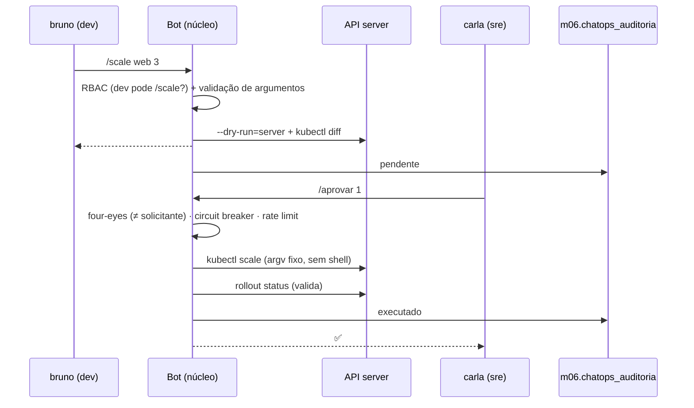
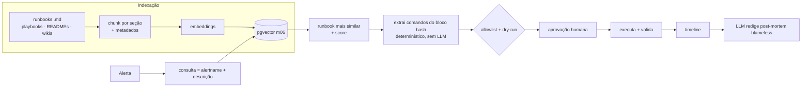

# 04 · ChatOps com aprovação, RAG de runbooks, auto-remediação e projeto integrador

## Objetivo

Ao terminar, você sabe construir um bot de ChatOps com comandos seguros (`/deploy`, `/scale`, `/rollback`,
`/investigar`), RBAC, aprovação humana, diff de impacto, circuit breaker e auditoria; montar RAG sobre
runbooks e post-mortems com execução guiada (dry-run + aprovação); escrever post-mortems blameless a partir
de uma timeline; desenhar auto-remediação com guardrails; e juntar tudo num projeto integrador com ROI.

## Explicação

### ChatOps com aprovação humana

ChatOps leva a operação para o canal onde o time já conversa (Slack, Discord, Teams): o comando, o diff, a
aprovação e o resultado ficam visíveis para todos. O bot tem um **núcleo independente de plataforma** e
adaptadores finos:



Guardrails que o [exemplo 05](../exemplos/05-chatops-com-aprovacao/) implementa:

| Guardrail | Para quê |
|---|---|
| Comandos fechados + parser determinístico | o LLM não monta comando de shell; `argv` em array (`execFile`), sem injeção |
| Validação de argumentos | réplicas 0..6, imagem com tag explícita (sem `:latest`), nome DNS-1123 |
| RBAC por papel | viewer só investiga; dev pede; só SRE aprova e faz rollback |
| Four-eyes | quem pede não aprova |
| Diff e dry-run antes de aprovar | o aprovador vê o impacto real, não a intenção |
| Validação pós-execução + desfazer | deploy só é sucesso se o rollout ficar pronto; senão `rollout undo` |
| Circuit breaker | N falhas seguidas suspendem mutações até alguém investigar |
| Rate limit | evita rajadas (humanas ou de agente em loop) |
| Auditoria append-only | quem, papel, comando, decisão, detalhe, quando (Postgres) |

Onde entra o LLM? Em `/investigar` (resumir evidências), em traduzir texto livre ("aumenta o web pra 3") para
um comando **da lista fechada** (que passa pelo mesmo RBAC/aprovação), e em resumir o diff para o aprovador.
Nunca na decisão de aprovar.

**Adaptadores** (não executados localmente: exigem workspace/bot token e login):

```js
// Slack (Bolt for JavaScript): slash command → núcleo do bot
app.command('/scale', async ({ command, ack, respond }) => {
  await ack();
  await respond(await bot.receber(command.user_name, `/scale ${command.text}`));
});
// Discord (discord.js): interaction.commandName + interaction.options → bot.receber(...)
// Teams (Bot Framework / Teams AI library): activity.text → bot.receber(...) ; aprovação via Adaptive Card
```

Em produção, mapeie o usuário do chat para uma identidade corporativa (SSO/grupos) para o RBAC, e prefira
botões (Block Kit / Adaptive Cards) para aprovar, com expiração do pedido.

### Segurança das ações: RBAC no Kubernetes também

O RBAC do bot não substitui o do cluster: a ServiceAccount do bot só deve ter `patch` em `deployments/scale`
e `deployments` no namespace dele. Defesa em profundidade: se o bot for enganado, o API server ainda recusa.
Veja o approval gate e o audit trail do [módulo 08](../../08-arquitetura-de-sistemas-com-ia/exemplos/06-hitl-approval-gate/).

### RAG de runbooks e post-mortem

Arquitetura para docs internas:



- **Indexação**: chunk por cabeçalho (cada runbook tem "Sintoma", "Diagnóstico", "Mitigação"), metadados
  (serviço, dono, última revisão). Wikis (Confluence/Notion) entram por API/export.
- **Agente que consulta e executa**: recupera, mostra a fonte e o score, **extrai os comandos do Markdown**
  (não pede ao LLM para "lembrar" o comando), substitui só variáveis conhecidas, valida contra allowlist,
  roda dry-run, pede aprovação e valida o efeito. Score baixo = não executa nada, escala.
- **Timeline de incidente**: cada passo (alerta, diagnóstico, aprovação, mitigação, validação) com horário — o
  próprio log do agente vira a timeline.
- **Post-mortem blameless**: foco em sistemas e processos ("o limite de memória não acompanhou o crescimento
  do relatório"), nunca em pessoas ("fulano errou"). Seções: resumo, impacto, timeline, causa raiz,
  o que funcionou, o que não funcionou, ações (com dono e prazo), lições aprendidas.
- **Lessons learned** voltam para o índice: o post-mortem vira documento recuperável no próximo incidente.

Tudo isso roda no [exercício 02](../exercicios/02-runbook-rag-e-postmortem/).

### Auto-remediação com guardrails

Playbooks por alerta, sempre no ciclo **alerta → verificação → mitigação → validação**:

| Etapa | Pergunta | Exemplo (OOMKilled) |
|---|---|---|
| Alerta | o que disparou? | `KubePodOOMKilled` em `relatorios` |
| Verificação | o sintoma é real e é este? | `lastState.terminated.reason == OOMKilled` |
| Mitigação | qual a menor ação reversível? | `limits.memory` 32Mi → 128Mi (dry-run antes) |
| Validação | resolveu sem efeito colateral? | rollout pronto e 0 restarts em 30 s |

Guardrails:

- **Dry-run sempre** antes; ação que não tem dry-run não entra em automação total.
- **Canary com rollback**: aplicar a mitigação em 1 réplica/1 cluster primeiro; métrica piorou → reverter.
- **Circuit breakers e rate limiting**: no máximo N remediações por hora por serviço; se a mesma remediação
  roda 3 vezes, o problema não é transitório: pare e chame um humano.
- **Human-in-the-loop** graduado por risco: ações reversíveis e de baixo impacto (reiniciar pod, escalar
  dentro de limites) podem ser automáticas; mudar limites, rollback de versão, qualquer coisa em banco ou
  rede: aprovação. Comece tudo com aprovação e "promova" para automático com histórico de acertos.
- **Escopo**: a automação só toca o namespace/serviço do alerta, com credencial mínima.

### Projeto integrador: o copilot de plataforma

Um agente completo junta as peças do módulo:

| Camada | Peça | Onde está |
|---|---|---|
| IaC | NL → OpenTofu → validate/plan/OPA → PR | exemplo 01, exercício 01 |
| Kubernetes | NL → formulário → manifest → dry-run → apply → readiness → rollback | exemplo 02 |
| Diagnóstico | ReAct read-only com baseline por regras | exemplo 03 |
| Observabilidade | NL → PromQL validado, anomalias, forecast | exemplo 04 |
| Operação | ChatOps com RBAC, aprovação, circuit breaker, auditoria | exemplo 05 |
| Segurança | scan + AI fix + re-scan | exemplo 06 |
| Conhecimento | RAG de runbooks + post-mortem | exercício 02 |

**Testes e simulação**: cenários com causa raiz conhecida (como os pods quebrados do exemplo 03 e as anomalias
injetadas do exemplo 04) viram uma suíte de regressão do agente; meça acerto de categoria, nº de passos,
tokens e tempo a cada mudança de prompt/modelo (avaliação com pytest em
[llmops · avaliação](../../../trilhas-extras/llmops-vllm-openshift/docs/05-avaliacao.md)). Para ações, use
*chaos engineering* em ambiente de teste (Chaos Mesh, LitmusChaos) e verifique se o agente detecta e mitiga.

**ROI** (conta simples, ajuste aos seus números):

```
economia/mês = incidentes/mês × (MTTR antes − MTTR depois) × pessoas no incidente × custo/hora
             + horas de toil automatizado/mês × custo/hora
custo/mês    = tokens (chamadas × tokens × preço) + infra do agente + manutenção (horas × custo/hora)
ROI          = (economia − custo) / custo
```

Exemplo: 12 incidentes/mês, MTTR de 90 → 50 min, 3 pessoas, R$ 150/h → 12 × (40/60) × 3 × 150 = R$ 3.600;
+ 20 h de toil × 150 = R$ 3.000; custo R$ 1.500 (tokens + manutenção) → ROI = (6.600 − 1.500)/1.500 ≈ 3,4×.
O número que mais importa no começo é o **acerto medido** do agente: ROI com diagnóstico errado é negativo.

## Código mínimo

```js
// Núcleo do guardrail de aprovação (exemplo 05)
if (!PAPEIS[papel].aprova) return '⛔ papel não aprova';
if (pedido.solicitante === usuario) return '⛔ four-eyes: quem pede não aprova';
if (Date.now() < cb.abertoAte) return '🔌 circuit breaker aberto';
const r = await executar(pedido);           // argv fixo + validação pós-execução
cb.falhas = r.ok ? 0 : cb.falhas + 1;       // N falhas seguidas abrem o circuito
await auditar({ usuario, papel, comando, decisao: r.ok ? 'executado' : 'falhou' });
```

## Na prática

- [Exemplo 05 · ChatOps com RBAC, four-eyes, circuit breaker e auditoria](../exemplos/05-chatops-com-aprovacao/)
- [Exercício 02 · RAG de runbooks, remediação com dry-run e aprovação, post-mortem blameless](../exercicios/02-runbook-rag-e-postmortem/)
- Approval gate e trilha de auditoria (arquitetura): [módulo 08](../../08-arquitetura-de-sistemas-com-ia/)
- LangGraph com `interrupt` para HITL: [módulo 04 · exemplo 06](../../04-agentes-autonomos/exemplos/06-langgraph-hitl-guardrails/)

## Armadilhas

- **Aprovação de "intenção"**: aprovar "/deploy web v2" sem ver o diff. Mostre sempre o dry-run/diff.
- **`kubectl diff` devolve exit 1 quando HÁ diferença** (não é erro); exit > 1 é erro de verdade.
- **Autoaprovação**: sem a regra four-eyes, o mesmo SRE pede e aprova; o RBAC "funciona" e não protege.
- **Circuit breaker que fecha sozinho rápido demais** volta a repetir a ação quebrada; exija investigação.
- **Runbook desatualizado executado com confiança**: guarde a data de revisão e mostre ao aprovador.
- **Post-mortem com culpados**: o LLM copia o tom da timeline; escreva a timeline em termos de sistema.

## Fontes

- Slack Bolt (JS): https://docs.slack.dev/tools/bolt-js/ · discord.js: https://discord.js.org/docs · Teams AI library: https://learn.microsoft.com/microsoftteams/platform/bots/how-to/teams-conversational-ai/teams-conversation-ai-overview
- Kubernetes RBAC: https://kubernetes.io/docs/reference/access-authn-authz/rbac/
- `kubectl diff`: https://kubernetes.io/docs/reference/kubectl/generated/kubectl_diff/
- Google SRE Book · Postmortem Culture: https://sre.google/sre-book/postmortem-culture/
- PagerDuty Incident Response (post-mortem): https://response.pagerduty.com/after/post_mortem_process/
- Circuit Breaker (Martin Fowler): https://martinfowler.com/bliki/CircuitBreaker.html
- pgvector: https://github.com/pgvector/pgvector
- Chaos Mesh: https://chaos-mesh.org/docs/ · LitmusChaos: https://docs.litmuschaos.io/
