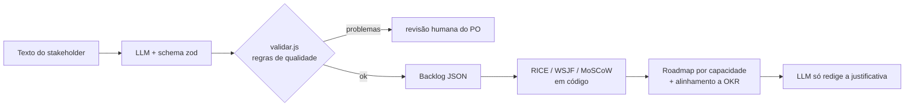

# 01 · Requisitos, priorização de backlog e OKRs com IA

## Objetivo

Ao terminar você sabe: (1) transformar texto livre de stakeholder em épicos, histórias de usuário,
critérios de aceite e requisitos de mudança num JSON **validado**; (2) priorizar um backlog com RICE,
WSJF e MoSCoW **calculados em código**, usando o LLM só para justificar; (3) medir o alinhamento do
backlog aos OKRs do portfólio e simular "e se" antes de propor o roadmap.

## Explicação

### O princípio do módulo: o LLM extrai/propõe, o código calcula

Pense no LLM como um **estagiário muito rápido que lê tudo**: ótimo para transformar uma conversa
bagunçada em itens organizados, péssimo para fazer conta e ainda pior para decidir sozinho.
Por isso todo o módulo segue a mesma divisão:

| Tarefa | Quem faz | Por quê |
|---|---|---|
| Ler texto livre e propor histórias, critérios, dúvidas | LLM | linguagem natural é o forte dele |
| Garantir o formato (campos, tipos, enums) | schema zod + structured output | o servidor restringe a geração e o SDK valida na volta |
| Score RICE/WSJF, MoSCoW, roadmap, alinhamento a OKR | código JS determinístico | precisa ser reproduzível, auditável e testável |
| Redigir a justificativa para o comitê | LLM, recebendo os números prontos | texto bom, sem poder mudar a conta |



### U1 · Requirements Copilot

- **Épico** = um objetivo grande ("segunda via no portal"). **História de usuário** = "Como
  <persona>, quero <ação>, para <benefício>". **Critério de aceite** no formato Gherkin
  (Dado/Quando/Então), que já vira roteiro de teste. **Requisito de mudança** (change request) =
  alteração de escopo que aponta para as histórias afetadas (rastreabilidade).
- **Structured output**: o SDK `openai` converte o schema zod em JSON Schema
  (`zodResponseFormat`) e o Ollama/OpenAI restringem os tokens gerados a esse formato. O resultado
  chega em `message.parsed`, já validado pelo zod.
- O schema garante **forma**, não **qualidade**. Por isso há uma segunda camada de regras
  determinísticas (o "lint" do backlog): mínimo de 2 critérios, formato Dado/Quando/Então,
  decomposição em tarefas, IDs únicos, mudança apontando para história que existe.
- Peça também uma lista de **dúvidas para o PO**: ambiguidade descoberta cedo custa menos.

### U2 · Priorização inteligente

| Método | Fórmula / regra | Bom para |
|---|---|---|
| **RICE** (Intercom) | (Reach × Impact × Confidence) / Effort | comparar features de produto com dados de uso |
| **WSJF** (SAFe) | Cost of Delay / Job Size, com CoD = valor de negócio + criticidade no tempo + redução de risco | fluxo contínuo; favorece itens pequenos e urgentes |
| **MoSCoW** (DSDM) | Must / Should / Could / Won't | negociação de escopo com stakeholders |

O papel da IA aqui **não** é inventar o score: é (a) sugerir valores de entrada a partir de dados
(ex.: Reach a partir de analytics, Confidence a partir de quantas evidências existem), (b) explicar o
ranking em linguagem de negócio e (c) rodar **simulações** ("e se a confiança do chatbot subir para
0.9 depois de um protótipo?"). No exemplo, MoSCoW também é **regra explícita** (regulatório = Must e
propaga Must para as dependências; sem OKR = Won't), para que o comitê consiga contestar a regra e
não um "feeling" do modelo.

**Roadmap** = encaixar os itens nas sprints em ordem (MoSCoW, depois WSJF), respeitando
capacidade (`jobSize` por sprint) e dependências (a dependência termina numa sprint anterior).

### U10 · Portfólio e OKRs

- **OKR** = Objetivo qualitativo + Key Results mensuráveis (outcome, não output: "cair 30% os chamados
  de segunda via" e não "entregar a tela de segunda via").
- Ligue cada item do backlog a um KR. Daí saem três métricas de portfólio simples e poderosas:
  **% do esforço por KR**, **KRs sem nenhuma iniciativa** (objetivo que ninguém está perseguindo) e
  **itens sem KR** (trabalho que não move nenhum objetivo: candidato a Won't).
- Para avaliar impacto depois da entrega, compare o KR antes/depois (é a mesma ideia de métrica de
  outcome da trilha de [MLOps](../../../trilhas-extras/mlops/), aplicada a projeto).

## Código mínimo

```js
import { z } from 'zod';
import { zodResponseFormat } from 'openai/helpers/zod';

const Historia = z.object({ id: z.string(), como: z.string(), quero: z.string(), para: z.string(),
  criterios: z.array(z.string()) });
const resp = await client.chat.completions.parse({
  model: 'qwen3.5:4b', temperature: 0, reasoning_effort: 'none',
  response_format: zodResponseFormat(z.object({ historias: z.array(Historia) }), 'backlog'),
  messages: [{ role: 'user', content: textoDoStakeholder }],
});
const backlog = resp.choices[0].message.parsed; // já validado pelo zod

// Score é código, nunca LLM:
const rice = (i) => (i.reach * i.impact * i.confidence) / i.effort;
const wsjf = (i) => (i.businessValue + i.timeCriticality + i.riskReduction) / i.jobSize;
```

## Na prática

- [Exemplo 01 · Requirements Copilot](../exemplos/01-requirements-copilot/) — texto livre → épicos,
  histórias, critérios, mudanças e dúvidas; auditoria determinística acusa o que o LLM errou.
- [Exemplo 02 · Priorização RICE + WSJF + MoSCoW](../exemplos/02-priorizacao-rice-wsjf/) — scores,
  roadmap por capacidade, alinhamento a OKR, what-if e justificativa do LLM.

## Armadilhas

- **Schema válido ≠ requisito bom.** No exemplo 01 o modelo gerou dois critérios contraditórios
  ("anterior a 60 dias" nos dois) e uma mudança apontando para `EP-01` em vez de histórias. O zod
  aceitou; só a auditoria de regras e a revisão humana pegam.
- **Deixar o LLM calcular ou comparar números.** No exemplo 02 a justificativa afirmou que o RICE da
  HU-06 era "significativamente superior" ao da HU-03, quando é menor (1867 × 2100). Mostre sempre a
  tabela calculada ao lado do texto e trate a tabela como fonte da verdade.
- **Falsa precisão**: RICE com Reach = 4000 e Confidence = 0.8 parece exato, mas as entradas são
  estimativas. Use os scores para ordenar e discutir, não como verdade absoluta.
- **Esquecer `reasoning_effort: "none"`** no qwen3.5: o modelo "pensa" centenas de tokens antes de
  responder e estoura `max_tokens` (resposta cortada → o SDK lança erro de parse).
- **Pedir demais de uma vez** num modelo de 4B em CPU: limite o número de épicos/histórias no prompt;
  a 5 tokens/s, 1200 tokens são 4 minutos.

## Fontes

- OpenAI Structured Outputs: https://platform.openai.com/docs/guides/structured-outputs
- SDK openai-node (helper `zodResponseFormat`): https://github.com/openai/openai-node
- Ollama structured outputs: https://docs.ollama.com/capabilities/structured-outputs
- Ollama compatibilidade OpenAI: https://docs.ollama.com/api/openai-compatibility
- Zod → JSON Schema: https://zod.dev/json-schema
- Histórias de usuário (Atlassian): https://www.atlassian.com/agile/project-management/user-stories
- RICE (Intercom): https://www.intercom.com/blog/rice-simple-prioritization-for-product-managers/
- WSJF (SAFe): https://framework.scaledagile.com/wsjf
- MoSCoW (DSDM / Agile Business Consortium): https://www.agilebusiness.org/dsdm-project-framework/moscow-prioririsation.html
- OKRs (What Matters): https://www.whatmatters.com/faqs/okr-meaning-definition-example
