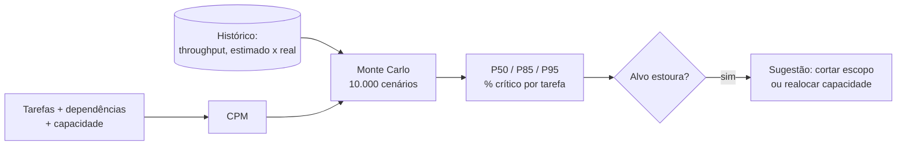

# 02 · Cronograma, capacidade, estimativas probabilísticas e riscos

## Objetivo

Ao terminar você sabe: (1) montar um cronograma dinâmico a partir de dependências e achar o caminho
crítico (CPM); (2) converter esforço em calendário pela capacidade de cada pessoa e testar cenários
what-if; (3) prever prazo com **Monte Carlo** (P50/P85/P95), tanto por estimativa de três pontos quanto
por throughput histórico; (4) detectar riscos de escopo, cronograma e recursos por anomalia nos dados
do projeto e sugerir mitigação a partir de heurísticas (AIOps de projeto).

## Explicação

### Por que aqui a "IA" é estatística, não LLM

Previsão de prazo e caminho crítico são problemas **numéricos**: há algoritmo exato (CPM) e método
estatístico consagrado (Monte Carlo). Um LLM só adiciona risco de alucinação. O lugar do LLM é nas
pontas: extrair tarefas/dependências de um texto (como no doc 01) e explicar o resultado para pessoas.

### U3 · Cronograma, dependências e capacidade

- **CPM (Critical Path Method)**: ordena as tarefas topologicamente, calcula na ida o início/fim mais
  cedo (ES/EF) e na volta o início/fim mais tarde (LS/LF). **Folga** = LS − ES. Tarefas com folga zero
  formam o **caminho crítico**: atrasou uma delas, atrasou o projeto.
- **Ciclo de dependência** (A depende de B que depende de A) é erro de planejamento: o código recusa.
- **Capacidade**: estimativa é em dias de *esforço*; quem está em meio período (0.5) leva o dobro em
  dias de *calendário*. Ignorar isso é a origem de muito cronograma otimista.
- **What-if**: muda uma premissa (tirar uma dependência, colocar alguém em tempo integral) e roda tudo
  de novo. Se a tarefa mexida não está no caminho crítico, o prazo não muda; é a resposta honesta para
  "e se colocarmos mais gente?".

### U4 · Estimativas e previsões com Monte Carlo

Analogia: em vez de perguntar "quando fica pronto?" uma vez, você **joga o projeto 10.000 vezes** com
durações sorteadas e olha a distribuição das datas de fim.

1. **Por tarefa (três pontos)**: cada tarefa tem otimista/provável/pessimista; sorteia de uma
   distribuição triangular, roda o CPM, guarda o fim. Também conta em quantos cenários cada tarefa foi
   crítica (uma tarefa com folga 1 dia pode ser crítica em 1/3 dos cenários!).
2. **Por throughput histórico (#NoEstimates)**: sorteia semanas do histórico real de itens entregues
   até zerar o backlog. Não precisa estimar item por item, só contar o que o time já entregou.

**Percentis**: P50 = metade dos cenários termina até essa data (é uma moeda: **não** prometa o P50).
P85 = compromisso razoável. P95 = data conservadora. **Ajuste automático por previsão de carga**: se o
P85 estoura a data-alvo, o código sugere quanto escopo cabe (média × semanas × margem).

Para custo: custo ≈ dias × custo diário do time, então o mesmo Monte Carlo dá P50/P85 de custo.
**Dados históricos melhoram a acurácia**: guarde estimado × real por tarefa e calibre o pessimista
(se o real costuma ser 1,4× o provável, o triangular está otimista demais).



### U5 · Riscos e mitigações (AIOps de projeto)

AIOps de projeto = tratar métricas da sprint (entregue, escopo adicionado, horas extras, bugs, dias
bloqueados) como métricas de um sistema em produção e alertar quando saem do normal:

- **Anomalia pontual**: z-score **robusto** (mediana e MAD) da última sprint contra o histórico;
  |z| ≥ 3,5 é o corte clássico (Iglewicz e Hoaglin). Robusto porque um sprint desastroso antigo não
  infla a régua como faria a média/desvio-padrão.
- **Tendência**: inclinação da reta da taxa de entrega nas últimas N sprints (queda contínua sem
  nenhuma sprint "anômala" sozinha).
- **Regras de negócio**: escopo adicionado > 20% do planejado = scope creep.
- **Mitigação a partir de histórico e heurísticas**: cada tipo de risco aponta para uma ação da base
  de lições aprendidas do PMO. Um LLM pode redigir o e-mail com os riscos, mas quem decide que existe
  risco é a regra.

## Código mínimo

```js
// Monte Carlo por throughput: quantas semanas para zerar 28 itens?
const semanas = [];
for (let i = 0; i < 10_000; i++) {
  let falta = 28, s = 0;
  while (falta > 0) { falta -= historico[Math.floor(rand() * historico.length)]; s++; }
  semanas.push(s);
}
semanas.sort((a, b) => a - b);
const p85 = semanas[Math.ceil(0.85 * semanas.length) - 1];
```

## Na prática

- [Exemplo 03 · Cronograma + Monte Carlo](../exemplos/03-cronograma-monte-carlo/) — CPM, capacidade,
  P50/P85/P95, % de cenários críticos, what-if e ajuste de escopo.
- [Exercício 01 · Detector de risco de cronograma](../exercicios/01-detector-risco-cronograma/) —
  anomalia robusta + tendência + regras → riscos com mitigação.

## Armadilhas

- **Somar estimativas "prováveis"** e chamar de prazo: no exemplo 03 o CPM determinístico dá 12 dias,
  mas o P50 do Monte Carlo dá 14,6 e o P85 16,5. Caminhos que se juntam (T6 espera T3, T4 e T5) só
  terminam quando o **mais lento** termina: o atraso se acumula (merge bias).
- **Ignorar capacidade parcial**: a T5 da Carla (meio período) parecia ter 5 dias de folga; com a
  capacidade correta tem 1 dia e é crítica em 33% dos cenários.
- **Monte Carlo sem semente** dá número diferente a cada execução e confunde quem lê o relatório. Use
  um PRNG com semente (o exemplo usa `mulberry32`).
- **Histórico de outro time/contexto**: throughput só prevê bem se o processo for parecido (mesmo
  time, mesmo tipo de item). Refaça a previsão a cada sprint com dados novos.
- **z-score clássico em amostra pequena com outlier**: o desvio-padrão explode e esconde a anomalia
  atual. Use mediana/MAD.

## Fontes

- Critical Path Method: https://en.wikipedia.org/wiki/Critical_path_method
- Estimativa de três pontos (PERT/triangular): https://en.wikipedia.org/wiki/Three-point_estimation
- NIST, detecção de outliers (z-score modificado, Iglewicz e Hoaglin): https://www.itl.nist.gov/div898/handbook/eda/section3/eda35h.htm
- Earned Value Management (CPI): https://en.wikipedia.org/wiki/Earned_value_management
- node:test (testes nativos do Node): https://nodejs.org/api/test.html
