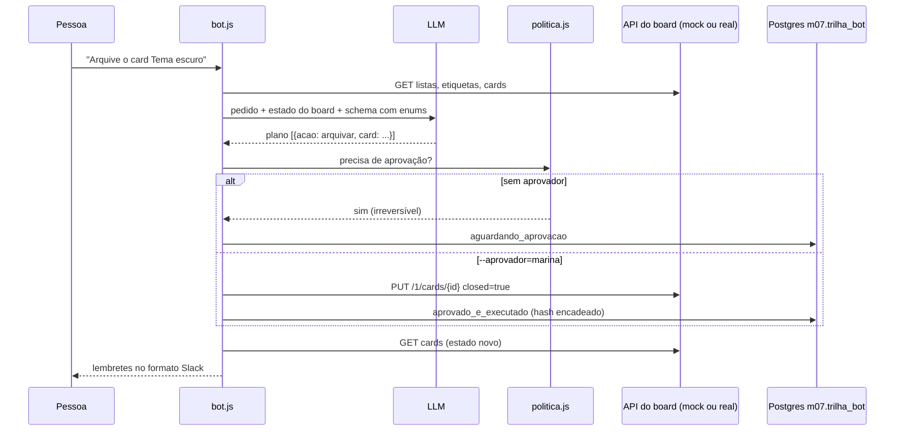

# 04 · Automação em Jira/Trello/Asana/Notion/Slack e governança

## Objetivo

Ao terminar você sabe: (1) escrever um bot em JavaScript que transforma um pedido em linguagem natural
em operações de cards (criar, mover, priorizar, arquivar); (2) aplicar regras determinísticas de
aprovação, lembrete e notificação; (3) registrar toda decisão numa trilha de auditoria à prova de
adulteração no Postgres; (4) automatizar um checklist de governança (conformidade, rastreabilidade,
versões) que roda como etapa de CI; (5) apontar o mesmo código para Trello, Jira, Asana, Notion e Slack
reais.

## Explicação

### U9 · Linguagem natural → workflow, com o humano no circuito



Peças, todas no [exemplo 05](../exemplos/05-bot-cards-aprovacao/):

- **Mock da API** (Express em memória) com os mesmos caminhos do Trello (`/1/boards/{id}/lists`,
  `POST /1/cards`, `PUT /1/cards/{id}`, `key`/`token` na query). Trocar `TRELLO_BASE_URL` para
  `https://api.trello.com/1` usa o Trello de verdade sem mudar o bot.
- **Plano estruturado**: o schema é gerado do estado atual do board (`lista` é `z.enum` das listas
  existentes). O LLM propõe, o código executa.
- **Política em código**: arquivar (irreversível) e prioridade alta (fura a fila) exigem aprovador.
  **Lembretes**: card vencendo em 48h sem responsável, card vencido fora de "Feito". A notificação sai
  no formato Block Kit do Slack.
- **Automações nativas** (Jira Automation, Asana Rules, Butler no Trello) resolvem regra simples
  ("quando mover para Feito, avise no canal") sem código. Bot próprio vale quando a entrada é
  linguagem natural, a regra cruza ferramentas ou precisa de trilha de auditoria sua.

### U8 · Governança, compliance e qualidade

- **Trilha de decisão**: cada operação vira uma linha com quem pediu, o pedido original, a operação,
  o status e o motivo. Cada linha guarda `hash = sha256(hash_anterior + conteúdo)`: editar uma linha
  antiga quebra a cadeia, e `auditar-trilha.js` aponta onde.
- **Checklist automatizado** ([exercício 02](../exercicios/02-checklist-governanca/)): README e
  CHANGELOG presentes, versão do `package.json` registrada no CHANGELOG, dependências com versão exata,
  ADRs (Architecture Decision Records) com Status/Data/Decisores, todo requisito `HU-xx` citado em algum
  teste (rastreabilidade requisito → teste), nenhum segredo fixo no código, tag git da versão. Sai com
  código 1 em caso de falha: vira um passo de CI que **bloqueia** o merge.
- **Documentação de qualidade**: ADR para decisões, Keep a Changelog + SemVer para versões, matriz de
  rastreabilidade (requisito → história → teste). O LLM ajuda a **redigir** ADR e changelog a partir do
  diff, mas a verificação de que existem e estão completos é código.
- Para avaliação contínua de qualidade de saída de LLM (testes com pytest, métricas), veja
  [LLMOps](../../../trilhas-extras/llmops-vllm-openshift/).

### Integrações reais (código pronto, não executado localmente)

`exemplos/05-bot-cards-aprovacao/integracoes-reais.js` tem uma função por ferramenta, lendo o token do
ambiente:

| Ferramenta | Endpoint | Autenticação | Detalhe que pega |
|---|---|---|---|
| Trello | `POST/PUT https://api.trello.com/1/cards` | `key` + `token` (ou OAuth 2.0) | etiquetas por `idLabels` |
| Jira Cloud | `POST {site}/rest/api/3/issue` | Basic com e-mail + API token | `description` em ADF, não texto puro |
| Slack | `POST https://slack.com/api/chat.postMessage` | Bearer `xoxb-...` | responde HTTP 200 com `ok:false` em erro |
| Asana | `POST https://app.asana.com/api/1.0/tasks` | Bearer (PAT) | corpo embrulhado em `{ data: ... }` |
| Notion | `POST https://api.notion.com/v1/pages` | Bearer + `Notion-Version: 2026-03-11` | desde 2025-09-03 o parent é `data_source_id` |

## Código mínimo

```js
// Política é código: o LLM nunca decide se algo está aprovado.
export function precisaAprovacao(op) {
  if (op.acao === 'arquivar') return 'arquivar card é irreversível para o time';
  if (['criar', 'priorizar'].includes(op.acao) && op.prioridade === 'alta') return 'prioridade alta fura a fila';
  return null;
}
```

## Na prática

- [Exemplo 05 · Bot de cards com aprovação e trilha](../exemplos/05-bot-cards-aprovacao/).
- [Exercício 02 · Checklist de governança](../exercicios/02-checklist-governanca/).

## Armadilhas

- **Modelo pequeno troca a intenção**: na primeira versão, "arquive o card" virou `mover` com
  prioridade alta, e "mova para Feito" foi para "Fazendo". Correção: tabela verbo → ação e um exemplo
  no prompt, enums para listas, e a política barrando o que é perigoso mesmo que o LLM erre.
- **Exemplo no prompt enviesa**: o exemplo com `"prioridade":"manter"` fez o modelo ignorar "prioridade
  média" do pedido. Foi preciso uma instrução explícita para o campo.
- **Hash de JSON vindo do jsonb**: o Postgres não preserva a ordem das chaves de um `jsonb`. Hash de
  `JSON.stringify` do objeto lido pode divergir do gravado sem ninguém ter adulterado. Use JSON
  canônico (chaves ordenadas).
- **Token no código ou no log**: leia do ambiente e nunca imprima. O checklist do exercício 02 procura
  segredos fixos.
- **Bot sem idempotência**: rodar o mesmo pedido duas vezes cria dois cards. Em produção, guarde uma
  chave do pedido na trilha e recuse duplicata.

## Fontes

- Trello REST, cards: https://developer.atlassian.com/cloud/trello/rest/api-group-cards/
- Trello, autorização: https://developer.atlassian.com/cloud/trello/guides/rest-api/authorization/
- Jira Cloud REST v3, issues: https://developer.atlassian.com/cloud/jira/platform/rest/v3/api-group-issues/
- Jira Automation: https://www.atlassian.com/software/jira/guides/automation/overview
- Slack chat.postMessage: https://docs.slack.dev/reference/methods/chat.postMessage
- Slack Block Kit: https://docs.slack.dev/block-kit/
- Asana, criar tarefa: https://developers.asana.com/reference/createtask
- Asana Rules: https://developers.asana.com/docs/rules
- Notion, criar página: https://developers.notion.com/reference/post-page
- Notion, versionamento: https://developers.notion.com/reference/versioning
- Express 5: https://expressjs.com/en/5x/api.html
- node-postgres: https://node-postgres.com/
- ADR: https://adr.github.io/
- Keep a Changelog: https://keepachangelog.com/pt-BR/1.1.0/
- SemVer: https://semver.org/lang/pt-BR/
