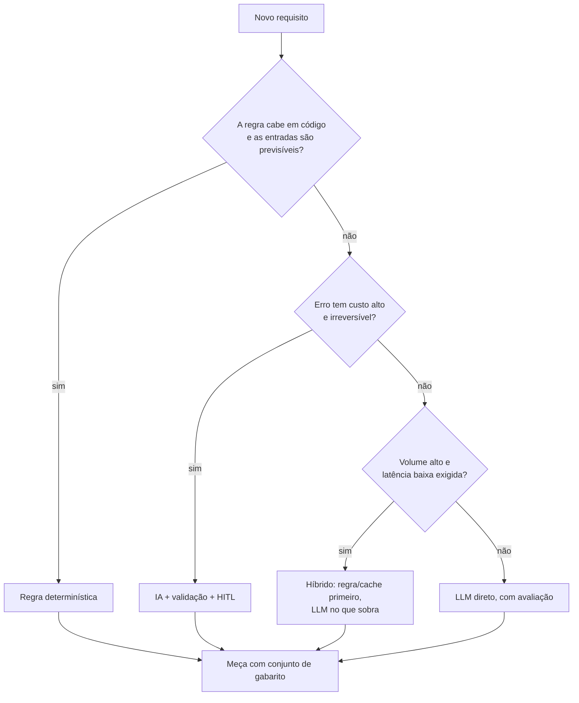

# 01 · Fundamentos de arquitetura AI-first

## Objetivo

Ao terminar, você sabe explicar o que muda de uma arquitetura tradicional para uma AI-driven, nomear os cinco
padrões de design de sistemas inteligentes, decidir com critério (e números) entre IA e regra determinística e
raciocinar sobre o trade-off latência × precisão × custo × performance.

## Explicação

### Tradicional × AI-driven

| Aspecto | Arquitetura tradicional | Arquitetura AI-driven |
|---|---|---|
| Comportamento | Determinístico: mesma entrada, mesma saída | Probabilístico: mesma entrada pode variar; erra "com confiança" |
| Contrato | Tipos e schemas garantem a saída | Saída precisa ser **validada** (schema, regex, citação, juiz) |
| Teste | Testes unitários com `assert` exato | **Avaliação** com conjunto de gabarito e métricas (acerto, recall@k) |
| Custo | Por servidor/hora, quase fixo | Por **token**, proporcional ao uso e ao tamanho do prompt |
| Latência | Milissegundos | Centenas de ms a minutos; o TTFT (1º token) importa |
| Mudança | Deploy de código | Prompt, modelo ou dados mudam o comportamento **sem** deploy |
| Falha | Exceção, timeout | Também alucinação, recusa, saída fora do formato, prompt injection |

**AI-first** não é "colocar LLM em tudo": é desenhar o sistema assumindo que um componente é probabilístico, caro e
lento, e cercá-lo de partes determinísticas (validação, cache, roteamento, aprovação humana, auditoria).

Analogia: o LLM é um especialista brilhante, caro e às vezes distraído. Você não o põe para carimbar papel (regra
faz isso), não deixa ele assinar cheque sozinho (HITL), confere as fontes dele (validação) e não pergunta a mesma
coisa duas vezes (cache).

### Os cinco padrões de design em sistemas inteligentes

| Padrão | Pergunta que responde | Exemplos de técnica | Onde está no módulo |
|---|---|---|---|
| **Prompting** | Como instruir o modelo de forma estável e versionada? | prompt de sistema, few-shot, saída estruturada, versão do prompt na chave do cache | [ex. 01](../exemplos/01-decision-framework/), [ex. 05](../exemplos/05-roteador-e-cache-semantico/) |
| **Responsible AI** | Como evitar dano, viés, vazamento e decisões sem dono? | guardrails, HITL, audit trail, não logar prompt com dado pessoal | [ex. 06](../exemplos/06-hitl-approval-gate/), [ex. 07](../exemplos/07-gateway-de-ia/) |
| **UX** | Como a IA aparece para o usuário sem frustrar? | streaming (TTFT), mostrar fontes, permitir correção, degradação graciosa | [ex. 05](../exemplos/05-roteador-e-cache-semantico/), [ex. 03](../exemplos/03-multiagente-com-fila/) |
| **AI-Ops** | Como operar em produção? | tracing, métricas de tokens/custo, avaliação contínua, rollback de prompt | [ex. 07](../exemplos/07-gateway-de-ia/), [trilha LLMOps](../../../trilhas-extras/llmops-vllm-openshift/README.md) |
| **Optimization** | Como gastar menos e responder mais rápido? | Model Router, Model Tiering, Semantic Cache, Prompt Cache, batch | [ex. 05](../exemplos/05-roteador-e-cache-semantico/), [exercício 01](../exercicios/01-tier-e-orcamento/) |

### Decision framework: IA ou regra determinística?



Critérios práticos:

1. **Use regra** quando a lógica é estável e enumerável (CPF válido, cálculo de juros, limites de alçada). É grátis,
   instantânea, auditável e testável.
2. **Use IA** quando a entrada é linguagem natural variada, a regra seria uma lista infinita de exceções, ou o valor
   está em entender/gerar texto.
3. **Use híbrido** (o caso mais comum em produção): regra resolve o que sabe com certeza e **admite quando não sabe**;
   só o resto vai ao LLM.
4. **Decida com números**: declare um SLA (acerto mínimo, latência máxima, custo por mil pedidos), meça as rotas no
   mesmo conjunto e escolha a mais barata que cumpre. É exatamente o que o [exemplo 01](../exemplos/01-decision-framework/) faz:
   regra 50% de cobertura em 0,1 ms; LLM 100% em ~21 s; híbrido 100% pela metade do custo e da latência.

### Trade-offs: latência × precisão × custo × performance

- **Modelo maior** → mais precisão, mais latência, mais custo. **Modelo menor** → o contrário (e alucina mais: no
  [exemplo 05](../exemplos/05-roteador-e-cache-semantico/) o tier barato inventou "isenção até 201%").
- **Mais contexto (RAG, histórico)** → mais precisão até certo ponto, mais tokens de entrada (custo e TTFT).
- **Cache** → latência e custo despencam, mas há risco de resposta velha ou de falso hit.
- **Throughput (performance)** → batch e paralelismo aumentam pedidos/s, mas pioram a latência individual.

Não existe ponto ótimo universal: existe o ponto que cumpre o SLA do caso de uso pelo menor custo.

## Código mínimo

```js
// Híbrido: regra primeiro, LLM só quando a regra admite não saber.
const hits = Object.entries(REGRAS).filter(([, re]) => re.test(texto)).map(([r]) => r);
const rotulo = hits.length === 1 ? hits[0] : await classificarComLLM(texto);

// SLA declarado escolhe a rota pelos números medidos.
const aprovadas = rotas.filter((r) => r.acerto >= 0.85 && r.latenciaMs <= SLA_MS && r.usdPor1k <= 0.05);
```

## Na prática

- [Exemplo 01 · decision framework executável](../exemplos/01-decision-framework/)

## Armadilhas

- **Escolher IA "porque dá"**: se uma regex resolve 95% com 0 custo, o LLM é dívida, não feature.
- **Avaliar com 3 exemplos no olho**: o mesmo modelo classificou "quero bloquear meu cartão" como `outro` até a regra
  "perda de cartão = cartao" entrar no prompt. Sem conjunto de gabarito você não vê a regressão.
- **Confiar que o modelo respeita a lista de rótulos**: normalize e trate saída fora do contrato.
- **Comparar latência de LLM local em CPU com SLA de API**: meça no ambiente de produção-alvo.

## Fontes

- Google Cloud · Guidelines for developing high-quality, predictive ML solutions / Responsible AI: https://cloud.google.com/architecture/ml-on-gcp-best-practices
- Microsoft · Azure Well-Architected Framework, AI workloads: https://learn.microsoft.com/en-us/azure/well-architected/ai/
- AWS · Well-Architected Generative AI Lens: https://docs.aws.amazon.com/wellarchitected/latest/generative-ai-lens/generative-ai-lens.html
- Google PAIR · People + AI Guidebook (UX de IA): https://pair.withgoogle.com/guidebook/
- OpenAI · Chat Completions API: https://platform.openai.com/docs/api-reference/chat
