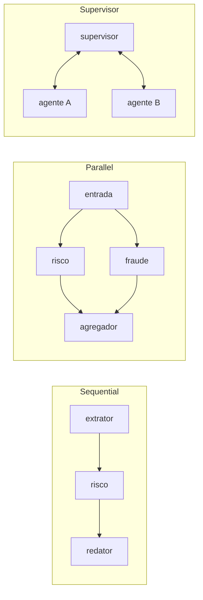

# 02 · Arquiteturas single-agent e multi-agent

## Objetivo

Ao terminar, você sabe escolher entre um agente único e um sistema multi-agente, nomear os padrões de cada lado
(Reactive, Memory-Enhanced, Tool-Using, ReAct, Self-Reflection; Sequential, Parallel, Supervisor, Hierarchical,
Group Chat, Handoff) e tratar os problemas de sistema distribuído que aparecem quando agentes conversam: falha de
nó, coordenação, estado e sincronização.

> O "como construir" um agente (loop, function calling, LangGraph) está no
> [módulo 04](../../04-agentes-autonomos/README.md). Aqui o foco é **arquitetura**: quando usar cada forma e o que ela custa.

## Explicação

### Padrões de single-agent

Um agente único num **fluxo linear** (entrada → raciocínio → ação → saída) é a arquitetura certa na maioria dos casos:
menos chamadas, menos latência, menos pontos de falha, fácil de depurar.

| Padrão | Como funciona | Custo/latência | Quando usar |
|---|---|---|---|
| **Reactive** | estímulo → resposta, sem estado | 1 chamada | FAQ, classificação, extração |
| **Memory-Enhanced** | injeta memória (fatos, resumo, vetores) no prompt | 1 chamada + leitura de memória | atendimento contínuo, personalização |
| **Tool-Using** | o modelo chama funções (APIs, banco, busca) | 2+ chamadas por ferramenta | quando a resposta depende de dado externo |
| **ReAct** | alterna pensamento → ação → observação até concluir | N chamadas (limite obrigatório) | tarefas com passos que dependem do resultado anterior |
| **Self-Reflection** | gera, critica e reescreve | ~2–3× as chamadas | qualidade importa mais que latência (relatório, código) |

**Contextos ideais para single-agent:** tarefas curtas, orçamento limitado, baixa latência, um domínio só.
Regra prática: comece com single-agent e só divida quando um agente único **comprovadamente** falha (contexto
estourando, ferramentas demais confundindo o modelo, permissões que precisam ser separadas).

**Simular o usuário** (roteiro fixo de falas) transforma conversa em teste reproduzível: no
[exemplo 02](../exemplos/02-single-agent-simulado/), o Reactive esqueceu o nome da cliente no 3º turno e o
Memory-Enhanced lembrou, com ~15% a mais de tokens.

### Padrões multi-agent



| Padrão | Ideia | Prós | Contras |
|---|---|---|---|
| **Sequential** (pipeline) | saída de um é entrada do próximo | simples, cada etapa testável | latência soma; uma etapa travada para tudo |
| **Parallel** (fan-out/fan-in) | análises independentes ao mesmo tempo | latência = a mais lenta | precisa agregar resultados parciais |
| **Supervisor** | um coordenador escolhe o próximo agente | flexível, pula etapas inúteis | supervisor vira gargalo e ponto único de falha |
| **Hierarchical** | supervisores de supervisores (times) | escala para domínios grandes | profundidade = latência e custo |
| **Group Chat** | agentes conversam num canal comum, com moderador | bom para debate/brainstorm | difícil de convergir; custo explode com o nº de turnos |
| **Handoff** | um agente transfere a conversa inteira a outro (inclusive humano) | especialização clara | perda de contexto na transferência |

### Desafios de sistema distribuído

Agentes conversando são um **sistema distribuído** e herdam os mesmos problemas:

- **Falha de nó**: um agente cai ou trava. Use **timeout por chamada**, **retry com backoff exponencial** e limite de
  tentativas; depois, **DLQ** (dead-letter queue) para inspeção humana.
- **Coordenação**: quem decide o próximo passo? Supervisor explícito ou coreografia por tópicos de fila (cada agente
  só conhece o tópico de saída: Loose Coupling).
- **Estado**: passe um estado explícito e imutável entre agentes (objeto versionado), não "memória implícita" de cada um.
- **Sincronização**: entrega **at-least-once** (a fila reentrega) exige handlers **idempotentes**. Para vários
  consumidores no Postgres, `FOR UPDATE SKIP LOCKED` evita processar a mesma mensagem duas vezes.
- **Degradação graciosa**: com `Promise.allSettled`, uma análise que falha vira "indisponível" e o fluxo segue.

### Comunicação em JS: filas e chamadas assíncronas

| Mecanismo | Durável? | Quando |
|---|---|---|
| `EventEmitter` / chamadas `async` | não | protótipo, um processo só |
| Postgres `LISTEN/NOTIFY` + tabela | sim (a tabela) | já tem Postgres, volume moderado |
| Redis Streams, RabbitMQ, Kafka, SQS | sim | volume alto, vários serviços, replay |

`NOTIFY` sozinho **não é fila**: se ninguém estiver ouvindo, o aviso se perde. Por isso o
[exemplo 03](../exemplos/03-multiagente-com-fila/) grava a mensagem numa tabela e usa o `NOTIFY` só para acordar o consumidor.

### Casos corporativos

- **Análise de crédito/recebíveis**: extrator de documentos → risco ∥ fraude → redator de parecer → aprovação humana.
- **Atendimento**: triagem (Reactive) → especialista por assunto (Handoff) → humano quando a confiança é baixa.
- **Due diligence / auditoria**: supervisor distribui contratos para agentes por tipo de cláusula e consolida.
- **Engenharia**: planejador → implementador → revisor (Self-Reflection entre agentes).

## Código mínimo

```js
// Timeout + retry com backoff: o mínimo para chamar um agente que pode travar.
for (let i = 1; i <= tentativas; i++) {
  try { return await Promise.race([agente(estado), timeout(ms)]); }
  catch (e) { if (i === tentativas) throw e; await dormir(10 * 2 ** i); }
}

// Fila durável: grava e avisa na mesma transação; consumidor pega com SKIP LOCKED.
await pool.query(`WITH m AS (INSERT INTO m08.mensagens (topico, payload) VALUES ($1,$2) RETURNING id)
                  SELECT pg_notify($1, id::text) FROM m`, [topico, payload]);
```

## Na prática

- [Exemplo 02 · Reactive × Memory-Enhanced com usuário simulado](../exemplos/02-single-agent-simulado/)
- [Exemplo 03 · Sequential, Parallel, Supervisor com fila, falha e DLQ](../exemplos/03-multiagente-com-fila/)
- [Exercício 02 · Agentic RAG (Tool-Using/ReAct)](../exercicios/02-agentic-rag/)
- Loop de agente, ReAct, Reflection e LangGraph: [módulo 04](../../04-agentes-autonomos/README.md)

## Armadilhas

- **Multi-agente por estética**: cada agente a mais é latência, custo e um ponto de falha. Meça contra um single-agent.
- **Sem limite de passos** no ReAct/Supervisor: um modelo confuso entra em loop e queima orçamento.
- **Handler não idempotente** com fila at-least-once: o mesmo desconto é concedido duas vezes.
- **`LISTEN/NOTIFY` como fila**: perde mensagens com consumidor fora do ar; use tabela + notify.
- **Group Chat sem moderador e sem critério de parada**: conversa infinita e cara.

## Fontes

- Anthropic · Building effective agents: https://www.anthropic.com/engineering/building-effective-agents
- LangGraph.js · Multi-agent systems: https://langchain-ai.github.io/langgraphjs/concepts/multi_agent/
- Microsoft · AI agent orchestration patterns: https://learn.microsoft.com/en-us/azure/architecture/ai-ml/guide/ai-agent-design-patterns
- OpenAI Agents SDK · Handoffs: https://openai.github.io/openai-agents-js/guides/handoffs/
- PostgreSQL 18 · NOTIFY: https://www.postgresql.org/docs/18/sql-notify.html
- PostgreSQL 18 · SELECT ... FOR UPDATE SKIP LOCKED: https://www.postgresql.org/docs/18/sql-select.html#SQL-FOR-UPDATE-SHARE
- ReAct (Yao et al., 2022): https://arxiv.org/abs/2210.03629
