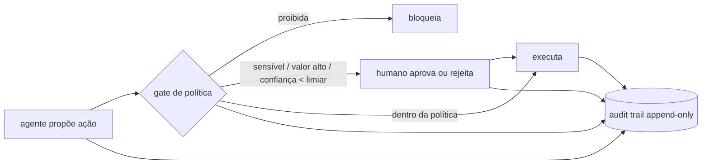

# 03 · Padrões de design específicos de IA

## Objetivo

Ao terminar, você sabe escolher e medir padrões de recuperação (RAG Basic, Hybrid Search, Multi-Index, Agentic RAG),
de roteamento (Model Router, Intent-Based Routing), de cache (Semantic Cache, Prompt Cache, Response Streaming) e de
Human-in-the-Loop (Approval Gates, Confidence Thresholds, Audit Trails).

## Explicação

### RAG: Basic, Hybrid, Multi-Index e Agentic

```mermaid
flowchart LR
    Q[pergunta] --> E[embedding]
    Q --> T[tsquery]
    E --> V[(pgvector)]
    T --> F[(tsvector GIN)]
    V --> R[RRF: soma 1/(60+pos)]
    F --> R
    R --> C[top-k no prompt] --> L[LLM]
```

| Padrão | O que faz | Bom em | Ruim em |
|---|---|---|---|
| **Basic** | top-k por similaridade de embedding | paráfrase, sinônimo | códigos e termos exatos (`POL-SEC-14` × `POL-SEC-15`) |
| **Hybrid Search** | vetorial + full-text, fundidos por **RRF** | códigos, nomes próprios, siglas | pode puxar documento que só compartilha palavras |
| **Multi-Index** | índices separados (por domínio, permissão, formato) | isolamento, configuração por índice | **roteado**: roteador vira ponto único de falha; **federado**: custa 1 busca por índice |
| **Agentic RAG** | a busca é uma ferramenta; o modelo decide se/como/quantas vezes buscar | economiza busca em pergunta que não precisa; reformula a consulta | modelo pequeno decide mal (pode não buscar e inventar) |

**RRF (Reciprocal Rank Fusion)** usa só a posição em cada lista (`1/(k+pos)`, com k = 60), então dispensa normalizar
escalas incompatíveis (cosseno × `ts_rank`). Cuidado com **empates**: "1º numa lista e 2º na outra" empata com o
inverso; defina um desempate explícito.

Números reais do [exemplo 04](../exemplos/04-padroes-de-rag/) (10 perguntas): basic 9/10, hybrid 9/10 (erros
**diferentes**), multi-index federado 9/10 a 3× a latência, multi-index roteado 8/10. Moral: meça no **seu** corpus.

### Roteamento inteligente

- **Model Router**: escolhe o modelo por pedido. O roteador tem de custar muito menos que a diferença de preço entre
  os modelos; por isso costuma ser regra, classificador pequeno ou embedding, não um LLM grande.
- **Intent-Based Routing**: a intenção (definir × comparar/analisar × executar ação) decide o tier, a ferramenta ou o agente.
- **Model Tiering**: tiers (barato, médio, caro) com preço, limite de saída e política de quem pode usar cada um.
  Junto com uma **política de orçamento**, degrade um degrau perto do teto em vez de recusar
  ([exercício 01](../exercicios/01-tier-e-orcamento/): de US$ 48,60 "tudo no caro" para US$ 4,73 dentro do teto de US$ 5).

### Caching: Semantic Cache, Prompt Cache e Streaming

| Técnica | O que reaproveita | Ganho | Risco |
|---|---|---|---|
| **Semantic Cache** | a **resposta** de uma pergunta parecida (similaridade de embedding ≥ limiar) | custo zero de LLM, ~0,5 s × 13–64 s no exemplo | falso hit (CDI × CDB com similaridade 0,79); resposta velha |
| **Prompt Cache** | o **prefixo** do prompt já processado pelo provedor (KV cache) | menos custo de entrada e TTFT menor | só funciona se o prefixo for idêntico: coloque o estável (sistema, ferramentas, documentos) **antes** do variável |
| **Response Streaming** | nada (não economiza tokens) | latência **percebida**: o usuário lê no TTFT | métricas e validação só no fim do stream |

No semantic cache, coloque na chave a **versão do prompt** e o tier/modelo, e use TTL para dado que muda.
O `usage.prompt_tokens_details.cached_tokens` da API mostra quanto do prompt veio do prompt cache.

### Human-in-the-Loop



- **Approval Gates**: ponto do fluxo onde a ação para até uma decisão. A política (versionada) define quem passa.
- **Confidence Thresholds**: abaixo do limiar, vai para humano. A confiança deve vir de algo calibrado (classificador,
  concordância entre modelos, logprobs), **não** de o LLM dizer "tenho 95% de certeza". E confiança alta nunca libera
  sozinha ação sensível ou de valor alto: a ordem é proibição → sensibilidade → valor → confiança.
- **Audit Trails**: registro append-only de proposta, decisão do gate, decisão humana e execução, com a versão da
  política. Com encadeamento de hash, adulteração vira detectável ([exemplo 06](../exemplos/06-hitl-approval-gate/)).
- Calibre o limiar com o **custo humano**: cada ponto de limiar a mais vira X revisões por dia.

## Código mínimo

```sql
-- Hybrid Search com RRF numa query só (pgvector + full-text em português)
WITH vet AS (SELECT id, row_number() OVER (ORDER BY emb <=> $1::vector) pos FROM m08.rag_docs ORDER BY emb <=> $1::vector LIMIT 20),
     txt AS (SELECT id, row_number() OVER (ORDER BY ts_rank_cd(tsv, q) DESC) pos
             FROM m08.rag_docs, to_tsquery('portuguese', $2) q WHERE tsv @@ q LIMIT 20)
SELECT id, sum(1.0 / (60 + pos)) rrf FROM (SELECT * FROM vet UNION ALL SELECT * FROM txt) u
GROUP BY id ORDER BY rrf DESC LIMIT 3;
```

```js
// Semantic cache: hit só acima do limiar e na mesma versão de prompt.
const { rows } = await pool.query(`SELECT resposta, 1 - (emb <=> $1::vector) sim FROM m08.cache_semantico
  WHERE versao_prompt = $2 ORDER BY emb <=> $1::vector LIMIT 1`, [emb, 'v1']);
if (rows[0]?.sim >= 0.9) return rows[0].resposta;
```

## Na prática

- [Exemplo 04 · Basic × Hybrid × Multi-Index com recall@k](../exemplos/04-padroes-de-rag/)
- [Exemplo 05 · Model Router, Tiering, Semantic Cache e Streaming](../exemplos/05-roteador-e-cache-semantico/)
- [Exemplo 06 · Approval Gate, limiar e Audit Trail](../exemplos/06-hitl-approval-gate/)
- [Exercício 01 · tier extra + orçamento](../exercicios/01-tier-e-orcamento/) · [Exercício 02 · Agentic RAG](../exercicios/02-agentic-rag/)

## Armadilhas

- **Embedding sem a instrução de consulta**: o `qwen3-embedding` espera `Instruct: ...\nQuery: ...` na pergunta (não no documento).
- **`websearch_to_tsquery` com pergunta em linguagem natural**: faz AND de todas as palavras e quase nada casa; use OR dos lexemas.
- **Limiar de cache frouxo**: "O que é CDB?" teve 0,791 de similaridade com "O que é CDI?"; com limiar 0,75 o cache serviria a resposta errada.
- **Cache compartilhado entre tiers**: uma pergunta "difícil" pode receber a resposta curta do tier barato.
- **Agentic RAG com modelo pequeno**: na 1ª versão do exercício 02 o modelo não buscou "CCB-78" e inventou o prazo.
  Torne a busca obrigatória por regra onde a regra é confiável e valide as citações.
- **Hash de JSON vindo do `jsonb`**: o Postgres reordena as chaves; serialize de forma canônica (chaves ordenadas).

## Fontes

- pgvector (operadores, HNSW, busca híbrida): https://github.com/pgvector/pgvector
- PostgreSQL 18 · Full Text Search: https://www.postgresql.org/docs/18/textsearch.html
- Cormack et al. · Reciprocal Rank Fusion (SIGIR 2009): https://plg.uwaterloo.ca/~gvcormac/cormacksigir09-rrf.pdf
- Qwen3 Embedding (uso de instrução na consulta): https://huggingface.co/Qwen/Qwen3-Embedding-0.6B
- OpenAI · Prompt caching: https://platform.openai.com/docs/guides/prompt-caching
- OpenAI · Streaming responses: https://platform.openai.com/docs/guides/streaming-responses
- Ollama · OpenAI compatibility: https://docs.ollama.com/api/openai-compatibility
- Anthropic · Building effective agents (routing, evaluator, human checkpoints): https://www.anthropic.com/engineering/building-effective-agents
