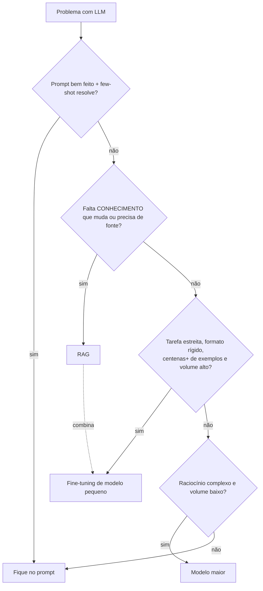

# 01 · Quando fazer fine-tuning (decision framework)

## Objetivo

Decidir, com critério e conta de custo, entre **prompt**, **RAG**, **fine-tuning** e **modelo maior** — e
justificar a escolha para alguém de produto ou de finanças.

## Explicação

Pense num funcionário novo. **Prompt** é a instrução que você dá no primeiro dia. **RAG** é entregar a pasta
de documentos para ele consultar. **Fine-tuning** é o treinamento de semanas até ele fazer aquela tarefa de
olhos fechados, sempre no mesmo formato. **Modelo maior** é contratar alguém mais sênior (e mais caro).

Regra prática que a própria OpenAI e o Google repetem: **RAG para conhecimento, fine-tuning para
comportamento**. Fine-tuning ensina *forma* (formato, tom, tarefa estreita, rótulos), não ensina fatos que
mudam — esses ficam congelados nos pesos e envelhecem.



| Critério | Prompt | RAG | Fine-tuning | Modelo maior |
|---|---|---|---|---|
| Dados necessários | 0–20 exemplos | documentos | 50 a milhares de exemplos **rotulados e limpos** | 0–20 exemplos |
| Custo inicial | ~0 | indexação + infra de busca | preparo do dataset + treino | ~0 |
| Custo por chamada | médio (prompt longo) | alto (contexto grande) | **baixo** (prompt curto, modelo pequeno) | alto |
| Latência | média | maior (busca + contexto) | **menor** | maior |
| Atualizar | editar texto | reindexar | **treinar de novo** | trocar modelo |
| Manutenção | baixa | média (índice, permissões) | alta (dataset, versões, reavaliação, deprecação do base) | baixa |
| Bom para | quase tudo, primeiro passo | fatos, documentos, citações | classificação, extração, formato, tom, destilação | raciocínio difícil, baixo volume |

**Conta de custo** (exemplo 02, com os preços oficiais de 2026-10-16): classificar 100 mil tickets/mês com
um `gpt-4.1-nano` fine-tunado e prompt curto (~59 tokens) sai ~US$ 1,43/mês; o mesmo modelo genérico com 20
exemplos few-shot (~552 tokens) sai ~US$ 5,64/mês. O treino custou ~US$ 0,05. Mas o cache de prompt
(input em cache custa 1/4) encurta essa diferença, e o fine-tuning traz manutenção: pese os dois.

**Mercado em 2026:** a OpenAI anunciou que está **encerrando a plataforma de fine-tuning** (sem acesso para
novos usuários; quem já usa cria jobs "pelos próximos meses"; modelos ajustados seguem servindo até o base ser
descontinuado). O Vertex AI segue com SFT para Gemini (2.5 Flash/Pro/Flash-Lite, 3.1 Flash-Lite, 3.5 Flash).
Isso reforça o argumento a favor de **LoRA em modelo aberto** (doc 04): o adapter é seu e não some com o
fornecedor.

## Código mínimo

```js
// regra 1 do framework (exercício 02): conhecimento que muda -> RAG, não fine-tuning
if (caso.conhecimentoMuda || caso.precisaCitarFonte) return 'RAG';
if (caso.tarefaEstreita && caso.formatoRigido && caso.exemplosRotulados >= 100 && caso.chamadasMes >= 50_000) return 'fine-tuning';
```

## Na prática

- [Exemplo 02](../exemplos/02-fine-tuning-openai-api/) — estimativa de custo de treino e de inferência.
- [Exercício 02](../exercicios/02-decision-framework/) — o framework aplicado a 3 casos (jurídico, suporte, financeiro).
- Pergunta de entrevista "RAG × fine-tuning": [módulo 12, doc 04](../../12-carreira/docs/04-entrevistas-tecnicas-de-ia.md).
- Custo por token e structured outputs (às vezes resolvem o "formato" sem treino): [módulo 02, doc 02](../../02-apis-ia-generativa/docs/02-consistencia-e-custo.md).

## Armadilhas

- **Treinar para ensinar fatos**: o modelo "aprende" o tom das respostas, não a base; e alucina com confiança.
- **Pular o baseline**: sem medir o prompt bem feito antes, você não sabe se o fine-tuning ganhou algo.
- **Esquecer o custo de manutenção**: cada mudança de política exige novo dataset, novo treino, nova avaliação.
- **Dependência do fornecedor**: modelo ajustado na API morre quando o base é descontinuado (e a plataforma pode fechar).

## Fontes

- OpenAI · Model optimization: https://developers.openai.com/api/docs/guides/model-optimization
- OpenAI · Pricing (fine-tuning): https://developers.openai.com/api/docs/pricing
- OpenAI · Optimizing LLM accuracy: https://platform.openai.com/docs/guides/optimizing-llm-accuracy
- Google Cloud · About supervised fine-tuning for Gemini: https://docs.cloud.google.com/vertex-ai/generative-ai/docs/models/gemini-supervised-tuning
