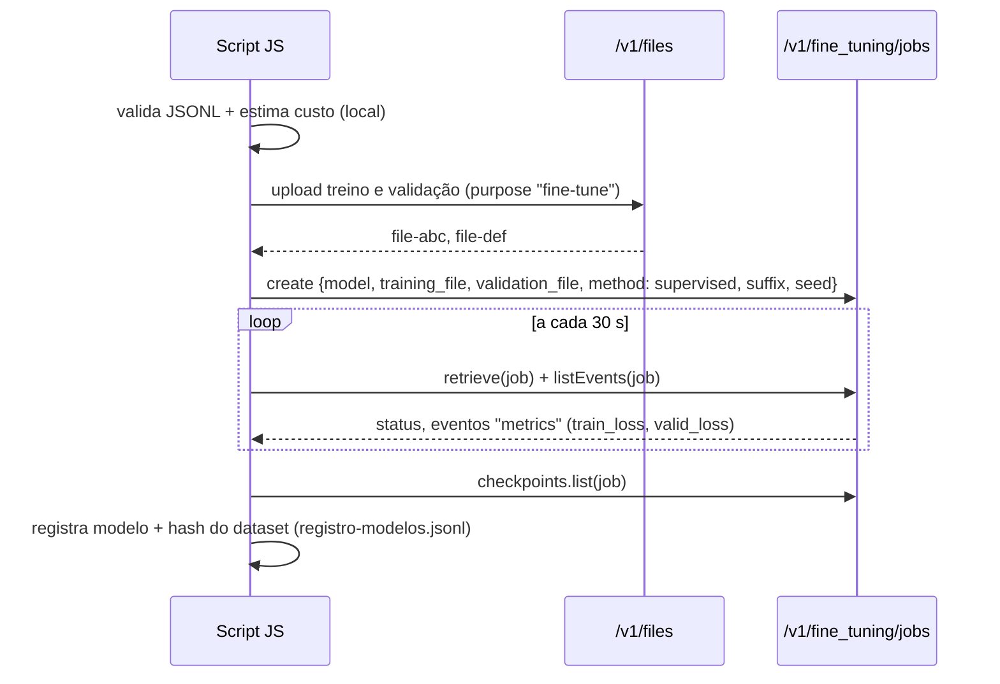

# 03 · Fine-tuning em APIs comerciais (OpenAI e Gemini)

## Objetivo

Automatizar em JavaScript o ciclo de fine-tuning numa API comercial — upload, criação do job,
hiperparâmetros, monitoramento, checkpoints — e versionar/documentar o modelo resultante.

## Explicação

Nas APIs comerciais você não toca em GPU: manda o arquivo, escolhe o modelo base e alguns hiperparâmetros, e
recebe um **nome de modelo novo** (ex.: `ft:gpt-4.1-nano-2025-04-14:org:suporte-676666:abc123`) que se usa
igual a qualquer outro em `chat.completions.create`.



**OpenAI (SDK `openai` 7.34.0):**

- `client.files.create({ file, purpose: 'fine-tune' })` → id do arquivo.
- `client.fineTuning.jobs.create({ model, training_file, validation_file, suffix, seed, metadata, method })`.
  `method: { type: 'supervised', supervised: { hyperparameters: { n_epochs, batch_size, learning_rate_multiplier } } }`
  (o campo `hyperparameters` no topo está **deprecated**). Também há `type: 'dpo'` (preferências) e
  `'reinforcement'` (RFT, só modelos de raciocínio).
- Status: `validating_files` → `queued` → `running` → `succeeded` | `failed` | `cancelled`.
- `jobs.listEvents(id)` traz mensagens e eventos `metrics`; `jobs.checkpoints.list(id)` traz os checkpoints das
  **últimas 3 épocas** com `full_valid_loss` e `full_valid_mean_token_accuracy`. Dá para usar um checkpoint como modelo.
- Modelos de SFT hoje: `gpt-4.1-2025-04-14`, `gpt-4.1-mini-2025-04-14`, `gpt-4.1-nano-2025-04-14`.
- Antes do deploy, o modelo passa por checagens de segurança (13 categorias); se reprovar, não é implantado.
- **Status da plataforma (out/2026):** a OpenAI está encerrando o fine-tuning — sem acesso para novos usuários.

**Hiperparâmetros básicos:** `n_epochs` (passadas pelo dataset; poucas = underfitting, muitas = overfitting),
`batch_size` (exemplos por atualização), `learning_rate_multiplier` (escala da taxa de aprendizado). Comece em
`auto`, olhe `train_loss` × `valid_loss` e só depois fixe valores. Se `valid_loss` sobe enquanto `train_loss`
cai, é overfitting: reduza épocas ou escolha um checkpoint anterior.

**Gemini (Vertex AI):** SFT para Gemini 2.5 Flash/Pro/Flash-Lite, 3.1 Flash-Lite e 3.5 Flash. Dataset JSONL
no Cloud Storage em formato `contents` (`role` `user`/`model` + `parts`) e `systemInstruction`;
hiperparâmetros `epochCount`, `learningRateMultiplier` e `adapterSize` (o Vertex treina um **adapter**, a mesma
ideia do LoRA do doc 04). A doc recomenda thinking budget 0/MINIMAL no modelo ajustado. Não executado aqui
(exige projeto GCP com faturamento).

**Versionamento e documentação:** registre por modelo — nome, base, job, **hash do dataset**, ids dos arquivos,
hiperparâmetros, `trained_tokens`, checkpoints e métricas. O exemplo 02 grava isso em
`dados/registro-modelos.jsonl`; para registry de verdade, use o MLflow da [trilha MLOps](../../../trilhas-extras/mlops/).

## Código mínimo

```js
const file = await client.files.create({ file: fs.createReadStream('dados/treino.jsonl'), purpose: 'fine-tune' });
const job = await client.fineTuning.jobs.create({
  model: 'gpt-4.1-nano-2025-04-14', training_file: file.id, suffix: 'suporte', seed: 42,
  method: { type: 'supervised', supervised: { hyperparameters: { n_epochs: 3 } } },
});
```

## Na prática

- [Exemplo 02](../exemplos/02-fine-tuning-openai-api/) — dry-run e estimativa executados; upload real
  **não executado localmente** (sem conta OpenAI); fluxo completo exercitado contra um mock local.

## Armadilhas

- **Base URL herdada**: o `.env` do repo aponta `OPENAI_BASE_URL` para o Ollama; para treinar na OpenAI, troque.
- **`hyperparameters` no topo do payload**: funciona, mas está deprecated — use `method.supervised.hyperparameters`.
- **Escolher o último checkpoint por padrão**: compare `full_valid_loss` dos 3 últimos.
- **Custo**: cobra-se `tokens do treino × épocas`; estime antes (exemplo 02).
- **Modelo base descontinuado** leva junto o seu modelo ajustado: guarde o dataset para retreinar em outro base.

## Fontes

- OpenAI · Supervised fine-tuning: https://developers.openai.com/api/docs/guides/supervised-fine-tuning
- OpenAI · Model optimization (SFT, DPO, RFT): https://developers.openai.com/api/docs/guides/model-optimization
- OpenAI · Pricing: https://developers.openai.com/api/docs/pricing
- SDK openai-node: https://github.com/openai/openai-node
- Google Cloud · Gemini supervised tuning: https://docs.cloud.google.com/vertex-ai/generative-ai/docs/models/gemini-supervised-tuning
