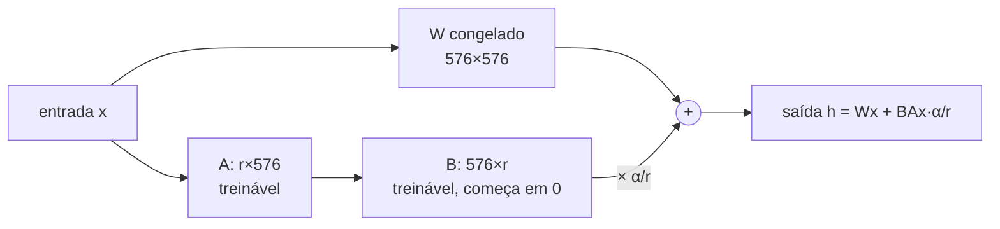

# 04 · LoRA/PEFT, avaliação de modelos ajustados e integração

## Objetivo

Entender e rodar um fine-tuning leve (LoRA) de verdade em CPU, comparar com full fine-tuning, avaliar o
modelo customizado contra o genérico (A/B, métricas, generalização) e integrá-lo num fluxo de atendimento.

## Explicação

### LoRA e PEFT

**Full fine-tuning** atualiza todos os pesos: com 135 milhões de parâmetros em fp32, pesos + gradientes +
estados do Adam já passam de 1,6 GB; num modelo de 7B, dezenas de GB e GPU obrigatória. Cada versão salva é
uma cópia inteira do modelo.

**PEFT** (Parameter-Efficient Fine-Tuning) congela o modelo e treina poucos parâmetros extras. O método mais
usado é **LoRA**: em vez de mudar a matriz W (d×d), aprende uma correção de **posto baixo** `ΔW = B·A`, com
A (r×d) e B (d×r), r pequeno (4–16). Na inferência, `W' = W + (α/r)·B·A`. Analogia: em vez de reescrever o
livro, você cola post-its nas páginas certas. O livro continua lá; trocar de post-its é trocar de "especialidade".



| | Full fine-tuning | LoRA (r=8, atenção) — medido no exemplo 03 |
|---|---|---|
| Parâmetros treinados | 134.515.008 (100%) | 921.600 (**0,69%**) |
| Artefato salvo | modelo inteiro (~269 MB em bf16) | adapter de **3,7 MB** |
| Memória de treino | pesos + gradientes + Adam de tudo | gradientes/Adam só do adapter |
| Qualidade | teto mais alto em mudanças grandes | quase igual em tarefas estreitas |
| Servir várias versões | um modelo por versão | um base + N adapters (vLLM `--enable-lora`) |
| Risco de esquecer o geral | alto | menor, mas existe (ver abaixo) |

Trade-offs: r maior = mais capacidade e mais memória; incluir as MLPs (`gate/up/down_proj`) além da atenção
aumenta a capacidade; QLoRA quantiza o base em 4 bits para caber em GPUs menores (precisa de GPU/bitsandbytes).

**"Demos em JavaScript com camadas adaptativas":** o ecossistema de treino LoRA é Python (PyTorch + PEFT); não
há treino LoRA maduro em JS. O padrão real é **treinar em Python e consumir pela API em JS** — exatamente o que
o módulo faz: o adapter é servido por um servidor compatível com OpenAI e o JS usa o SDK `openai`.

**Ollama + adapter:** o Modelfile tinha a instrução `ADAPTER` (base `FROM` + adapter safetensors/GGUF). Desde a
PR [ollama#14969](https://github.com/ollama/ollama/pull/14969) (set/2026), o `ollama create` responde
*"LoRA adapters are no longer supported"* e a seção sumiu da doc. Caminho atual: fundir o adapter no base
(`modelo.merge_and_unload()` + `save_pretrained`) e importar o modelo inteiro (`FROM ./diretorio-safetensors`
para arquiteturas suportadas, ou converter para GGUF com as ferramentas do llama.cpp e usar `FROM ./x.gguf`).
Não executado aqui (o Ollama é compartilhado e a RAM estava no limite).

### Avaliação de modelos ajustados

- **Quantitativas**: acurácia/exact match no conjunto de validação, recall por classe (a média esconde a classe
  fraca), loss de validação. Para geração livre: LLM-as-judge com rubrica, similaridade com referência.
- **Adequação/formato**: a saída é um rótulo válido? (o base: 0%; o LoRA: 100%).
- **Consistência**: mesma entrada → mesma saída (com decodificação gulosa, ambos 100%).
- **Qualitativas**: ler exemplos lado a lado; o exemplo 04 imprime base × LoRA.
- **Teste A/B**: mesmos dados, mesmas métricas, só o modelo muda; em produção, dividir tráfego e medir a métrica
  de negócio (taxa de reabertura do ticket, tempo de resolução).
- **Overfitting e perda de generalização**: `valid_loss` subindo enquanto `train_loss` cai; e o
  **esquecimento catastrófico** — no exemplo 04, sem o system prompt, o LoRA responde "Qual é a capital da
  França?" com `cacapella` e uma saudação com `defeita`: ele virou um classificador. Mitigações: misturar
  exemplos gerais no treino, r menor, menos épocas, e **rotear** só o que é do domínio para o modelo ajustado.

### Integração (projeto final)

O modelo ajustado é uma peça do fluxo, não o fluxo: triagem com o LoRA (barato, rápido, formato garantido) →
guardrail (saída inválida vai para humano) → resposta com um LLM genérico e a política da categoria no prompt →
registro no Postgres. No teste, um ticket de pix com frase fora dos templates foi triado como `defeito` e o
erro **propagou** para a resposta: dataset sintético e pouco diverso (TTR 0,13) generaliza mal. Por isso o
log dos atendimentos é a matéria-prima do próximo dataset.

## Código mínimo

```python
from peft import LoraConfig, get_peft_model
config = LoraConfig(r=8, lora_alpha=16, lora_dropout=0.05, task_type="CAUSAL_LM",
                    target_modules=["q_proj", "k_proj", "v_proj", "o_proj"])
modelo = get_peft_model(modelo, config)   # congela o base; só A e B treinam
modelo.save_pretrained("adapter/")         # salva só o adapter (MBs)
```

## Na prática

- [Exemplo 03](../exemplos/03-lora-peft-cpu/) — LoRA real em CPU (loss 4,74 → 0,09; adapter 3,7 MB).
- [Exemplo 04](../exemplos/04-avaliacao-ab/) — servidor OpenAI-compatível + A/B em JS (0% → 67,4%).
- [Exemplo 05](../exemplos/05-projeto-final-triagem/) — agente de atendimento com o modelo customizado.
- [Exercício 01](../exercicios/01-melhorar-dataset/) — efeito da qualidade dos dados na acurácia.
- Registro e serving de modelos: [trilha MLOps](../../../trilhas-extras/mlops/).

## Armadilhas

- **Loss no prompt inteiro**: sem mascarar o prompt (`labels = -100`), o modelo gasta capacidade copiando o enunciado.
- **Esquecer o EOS** no alvo: o modelo não aprende a parar e continua gerando depois da categoria.
- **Chat template diferente** no treino e na inferência: use `apply_chat_template` nos dois.
- **Adapter com base diferente**: o adapter só vale para o base exato (fixe a `revision`).
- **Avaliar só a acurácia média**: olhe recall por classe e perguntas fora do domínio.
- **RAM**: em máquina compartilhada, limite threads (`torch.set_num_threads`) e use modelo pequeno.

## Fontes

- LoRA (Hu et al., 2021): https://arxiv.org/abs/2106.09685
- PEFT · LoRA conceptual guide: https://huggingface.co/docs/peft/main/en/conceptual_guides/lora
- PEFT (PyPI 0.21.2): https://pypi.org/project/peft/
- Transformers · chat templates: https://huggingface.co/docs/transformers/main/en/chat_templating
- SmolLM2-135M-Instruct (Apache-2.0): https://huggingface.co/HuggingFaceTB/SmolLM2-135M-Instruct
- PyTorch · instalação (índice de CPU): https://pytorch.org/get-started/locally/
- vLLM · LoRA adapters: https://docs.vllm.ai/en/latest/features/lora.html
- Ollama · import (atual): https://github.com/ollama/ollama/blob/main/docs/import.mdx · PR que removeu adapters: https://github.com/ollama/ollama/pull/14969
