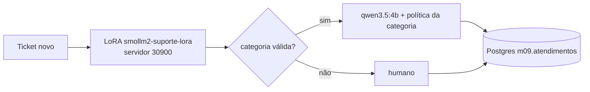

# Exemplo 05 · Projeto final: agente de atendimento com modelo customizado

**Conceito novo:** integrar o modelo fine-tunado num fluxo de verdade — dados (ex. 01) → ajuste (ex. 03) →
avaliação (ex. 04) → **agente** em JS: triagem com o LoRA, guardrail, resposta com o LLM genérico seguindo a
política da categoria e registro de cada atendimento no Postgres (schema `m09`, tabela `atendimentos`).



**Pré-requisito:** exemplos 03 e 04 (adapter + servidor no ar), infra do repo (Ollama e Postgres).

## Como rodar

```bash
cd modulos/09-dados-e-fine-tuning
uv run python exemplos/04-avaliacao-ab/servidor_openai.py &   # anote o PID
node exemplos/05-projeto-final-triagem/agente.js               # ou --sem-resposta para pular o LLM
kill <PID>
```

## Saída esperada

Saída real (CPU disputada com outros processos: a resposta do `qwen3.5:4b` levou 3–5 min cada):

```text
ticket: Oi! Fiz o pagamento por pix ontem e o site ainda diz que estou devendo.
  triagem (LoRA): defeito em 6241 ms
  resposta (qwen3.5:4b, 192 s): Olá! Entendemos sua preocupação e faremos a troca ou o reembolso assim que verificarmos seu pagamento no sistema. Por favor, envie uma foto do seu comprovante de Pix para que possamos agilizar o processo imediatamente.

ticket: O liquidificador que comprei veio com a jarra rachada.
  triagem (LoRA): defeito em 4037 ms
  resposta (qwen3.5:4b, 318 s): Lamento muito pelo ocorrido com a jarra do seu liquidificador; podemos realizar a troca imediata ou o reembolso para você. Por favor, envie uma foto da unidade defeituosa para que possamos processar sua solicitação assim que possível.

atendimentos registrados em m09.atendimentos: [ { categoria: 'defeito', n: 2 } ]
```

**O erro é a lição:** o 1º ticket é `cobranca`, mas foi escrito de um jeito que não existe nos templates
sintéticos — o LoRA errou e a política errada ("troca ou reembolso") **propagou** para a resposta. Com 67% de
acurácia na validação, o próximo passo é: guardar os atendimentos (já estão no Postgres), corrigir os rótulos
errados, enriquecer o dataset com frases reais e retreinar. Um limiar de confiança (probabilidade do token da
categoria) mandaria casos duvidosos para humano.

## Experimente

1. `--sem-resposta` para medir só a triagem (segundos, sem o LLM grande).
2. Troque a triagem por `MODELO_CHAT` com few-shot e compare tempo e acerto nos mesmos tickets.
3. `psql postgres://ia:ia@localhost:5433/ia -c "select categoria, ms_triagem, ms_resposta from m09.atendimentos"`.

## Versão Python

[`python/agente.py`](python/agente.py): mesmo fluxo com o SDK `openai` Python (`reasoning_effort` vai em `extra_body`)
e `psycopg` 3 (`autocommit=True`), gravando em **`m09.atendimentos_py`** (sufixo `_py` para não misturar com a
tabela do JS).

**Como rodar** (da pasta do módulo):

```bash
PORTA=30950 uv run python exemplos/04-avaliacao-ab/servidor_openai.py &   # anote o PID
LORA_BASE_URL=http://localhost:30950/v1 uv run python exemplos/05-projeto-final-triagem/python/agente.py   # ou --sem-resposta
kill <PID>
```

**Saída esperada (Python)** — saída real (Ollama recém-reiniciado e ocioso: 13–15 s por resposta):

```text
ticket: Oi! Fiz o pagamento por pix ontem e o site ainda diz que estou devendo.
  triagem (LoRA): defeito em 4187 ms
  resposta (qwen3.5:4b, 15 s): Olá! Entendemos sua preocupação e faremos a troca ou o reembolso assim que verificarmos seu pagamento no sistema. Por favor, envie uma foto do seu comprovante de Pix para que possamos agilizar o processo imediatamente.

ticket: O liquidificador que comprei veio com a jarra rachada.
  triagem (LoRA): defeito em 681 ms
  resposta (qwen3.5:4b, 13 s): Lamento muito pelo ocorrido com a jarra do seu liquidificador; podemos realizar a troca imediata ou o reembolso para você. Por favor, envie uma foto da unidade defeituosa para que possamos processar sua solicitação assim que possível.

atendimentos registrados em m09.atendimentos_py: [{'categoria': 'defeito', 'n': 2}]
```

Mesmas categorias e mesmas respostas do JS (`temperature=0`): o erro do 1º ticket se repete, como esperado.
