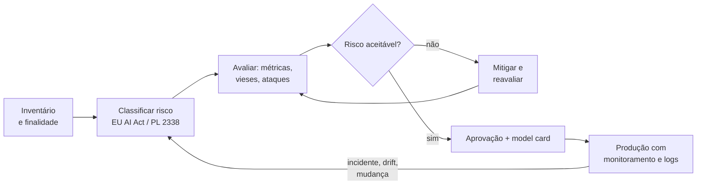

# 01 · Governança em IA e o cenário regulatório

## Objetivo

Saber o que é governança em IA, situar os principais frameworks (NIST AI RMF, ISO/IEC 42001, EU AI Act,
LGPD/ANPD e PL 2338/2023) **com o status atual conferido em fonte oficial**, e aplicar um checklist e uma
matriz de risco a um sistema real.

## Explicação

### O que é governança em IA

Governança é o conjunto de **papéis, processos e evidências** que garantem que um sistema de IA faz o que
deveria, dentro da lei, com riscos conhecidos e alguém responsável por eles. Analogia: é o "habite-se" de um
prédio. Não basta o engenheiro dizer que está seguro; há projeto aprovado, vistoria, responsável técnico e
registro de cada mudança.

Na prática, governança responde a 5 perguntas para cada sistema:

1. **O quê e para quê?** Inventário de sistemas de IA, finalidade e uso fora do escopo.
2. **Quem responde?** Dono do produto, dono do risco, quem aprova a ida para produção.
3. **Quais riscos?** Matriz probabilidade x impacto, revisada a cada mudança relevante.
4. **Como sabemos que funciona?** Métricas, testes (inclusive de equidade e de ataque), monitoramento.
5. **Como provamos?** Documentação (model card, registro de decisões, logs de auditoria).



### Frameworks e status (conferidos em 2026-10-16)

| Framework | O que é | Status atual (fonte oficial) |
|---|---|---|
| **NIST AI RMF** (EUA) | Guia **voluntário** de gestão de risco de IA. Quatro funções: **Govern, Map, Measure, Manage**. Perfil para IA generativa: NIST AI 600-1. | Versão 1.0, publicada em 26/01/2023; a página oficial diz que está **sendo revisada** no âmbito do *White House AI Action Plan* (sem data). AI 600-1 publicado em 26/07/2024. Em 07/04/2026 saiu uma *concept note* de perfil para infraestrutura crítica. |
| **ISO/IEC 42001** | Norma **certificável** de *sistema de gestão* de IA (AIMS), no estilo da ISO 27001: políticas, papéis, avaliação de risco e de impacto, melhoria contínua. | ISO/IEC 42001:2023, 1ª edição, publicada em 12/2023 e vigente (catálogos de organismos nacionais; a página da ISO bloqueou a leitura automática). Nenhuma emenda encontrada. |
| **EU AI Act** (Regulamento UE 2024/1689) | **Lei** da União Europeia baseada em risco: práticas proibidas, alto risco (Anexos I e III), transparência e modelos de propósito geral (GPAI). Vale para quem oferta IA no mercado europeu, inclusive empresa brasileira. | Em vigor desde 01/08/2024. Proibições e letramento em IA: 02/02/2025. GPAI e governança: 02/08/2025. Aplicação geral: 02/08/2026. O **AI Omnibus** (em vigor desde 27/07/2026) adiou o alto risco: Anexo III (biometria, educação, emprego...) para **02/12/2027** e Anexo I (produtos regulados) para **02/08/2028**. Página da Comissão atualizada em 03/08/2026. |
| **LGPD** (Lei 13.709/2018) | Lei brasileira de proteção de dados, já em vigor. Para IA, os pontos quentes: base legal do tratamento (art. 7º), dado sensível (art. 5º II e art. 11, ex.: saúde), pseudonimização (art. 13 §4º), **direito de revisão de decisão automatizada** (art. 20). | Em vigor. Fiscalizada pela **ANPD**, cuja página oficial se identifica hoje como *Agência Nacional de Proteção de Dados* e mantém um **sandbox regulatório em IA** (2º relatório parcial de monitoramento publicado) e uma tomada de subsídios da agenda regulatória com IA entre os temas. |
| **PL 2338/2023** (marco da IA no Brasil) | Projeto de lei baseado em risco (inspirado no EU AI Act): IA de risco excessivo (proibida), alto risco, avaliação de impacto algorítmico e direitos das pessoas afetadas. | **Ainda não é lei.** Aprovado no Plenário do Senado (pareceres de 10/12/2024) e remetido à Câmara em 17/03/2025. Na Câmara: **"Aguardando Parecer do(a) Relator(a) na Comissão Especial"**; última movimentação em 02/09/2026 (apensações). Confira a ficha de tramitação antes de citar. |

> Regra de ouro: status regulatório muda. Sempre cite a **data da consulta** e a **fonte oficial**
> (Diário Oficial, EUR-Lex, página da Câmara/Senado), nunca um blog.

### Aspectos legais e regulatórios: o que muda no dia a dia

- **Classificar o caso de uso** antes de construir: triagem de currículos e crédito são **alto risco** no
  EU AI Act (Anexo III) e no texto do PL 2338. Um chatbot de FAQ não é, mas tem dever de **transparência**
  ("você está falando com uma IA").
- **Dado pessoal no prompt é tratamento de dado** (LGPD): precisa de base legal, minimização e contrato com
  o provedor de LLM (operador), além de atenção à **transferência internacional** se a API está fora do Brasil.
- **Decisão automatizada que afeta a pessoa** (crédito, vaga, preço): a LGPD (art. 20) garante pedir revisão
  e receber informação sobre os critérios. Isso exige **explicabilidade** ([doc 02](02-explicabilidade-e-vieses.md)).
- **Propriedade intelectual e termos de uso**: verifique licença do modelo (pesos abertos têm licenças
  diferentes) e dos dados de treino/RAG; registre a origem.
- **Responsabilidade**: o fornecedor do modelo não assume o risco do seu caso de uso. O contrato e a sua
  documentação é que mostram diligência.

### Checklist de governança (para cada sistema de IA)

| # | Item | Evidência |
|---|---|---|
| 1 | Finalidade, usuários e uso fora do escopo descritos | model card |
| 2 | Classificação de risco (EU AI Act / PL 2338) e base legal LGPD | registro no inventário |
| 3 | Dono do sistema e dono de cada risco nomeados | matriz de risco |
| 4 | Métricas de qualidade com limiar justificado | relatório de avaliação |
| 5 | Equidade medida por grupo (ou registrado por que não é possível) | [exemplo 02](../exemplos/02-vieses-e-equidade/) |
| 6 | Explicação global e local disponíveis para quem decide | [exemplo 01](../exemplos/01-explicabilidade/) |
| 7 | Testes de ataque (prompt injection, vazamento) no CI | [exemplo 03](../exemplos/03-prompt-injection/) |
| 8 | PII minimizada e mascarada em prompts e logs | [exemplo 04](../exemplos/04-pii-e-mascaramento/) |
| 9 | Humano no circuito onde o impacto é alto; canal de contestação | fluxo documentado |
| 10 | Monitoramento (drift, custo, incidentes) e plano de rollback | [trilha MLOps](../../../trilhas-extras/mlops/docs/03-monitoramento-e-drift.md) · [exemplo 05](../exemplos/05-custos-e-orcamento/) |
| 11 | Orçamento e cotas definidos | [exemplo 05](../exemplos/05-custos-e-orcamento/) |
| 12 | Revisão periódica com data marcada | ata/registro |

### Matriz de risco

Probabilidade (1–5) x impacto (1–5); nível = produto. **≥ 15 alto** (não vai para produção sem mitigação
aprovada), **8–14 médio** (mitigar e monitorar), **< 8 baixo** (aceitar e registrar).

| Impacto → / Probabilidade ↓ | 1 | 2 | 3 | 4 | 5 |
|---|---|---|---|---|---|
| **5** | 5 | 10 | 15 | 20 | 25 |
| **4** | 4 | 8 | 12 | 16 | 20 |
| **3** | 3 | 6 | 9 | 12 | 15 |
| **2** | 2 | 4 | 6 | 8 | 10 |
| **1** | 1 | 2 | 3 | 4 | 5 |

Cada linha da matriz tem: risco, probabilidade, impacto, nível, mitigação, **dono** e data de revisão.
O [exercício 01](../exercicios/01-model-card-e-matriz-de-risco/) gera uma matriz assim a partir do código.

## Código mínimo

```python
riscos = [("Falso negativo em triagem", 3, 5, "limiar + revisão humana", "resp. clínico")]
for risco, prob, impacto, mitigacao, dono in riscos:
    nivel = prob * impacto
    classe = "ALTO" if nivel >= 15 else "MÉDIO" if nivel >= 8 else "BAIXO"
    print(f"{classe:5} {nivel:2} {risco} -> {mitigacao} ({dono})")
```

## Na prática

- [Exercício 01 · model card + matriz de risco](../exercicios/01-model-card-e-matriz-de-risco/)
- Governança de acesso a ferramentas (auth, escopos, auditoria) em MCP: [módulo 03, doc 04](../../03-mcp/docs/04-seguranca-e-governanca.md)

## Armadilhas

- **Governança só no papel**: documento escrito uma vez e nunca atualizado. Gere o model card a partir do
  código e do pipeline (como no exercício 01), para que os números não envelheçam.
- **Citar status de lei de memória**: o EU AI Act teve prazos alterados em 2026 e o PL 2338 ainda tramita.
  Consulte a fonte oficial e date a consulta.
- **Achar que "não usamos o atributo sensível" encerra o assunto**: proxies trazem o viés de volta
  ([exemplo 02](../exemplos/02-vieses-e-equidade/)).
- **Confundir ISO 42001 com lei**: é norma voluntária e certificável; ajuda a demonstrar diligência, não
  substitui obrigação legal.

## Fontes

- NIST AI RMF: https://www.nist.gov/itl/ai-risk-management-framework (consultado em 2026-10-16) ·
  NIST AI 600-1: https://doi.org/10.6028/NIST.AI.600-1
- ISO/IEC 42001:2023: https://www.iso.org/standard/42001 (catálogo AFNOR com status vigente:
  https://www.boutique.afnor.org/en-gb/standard/iso-iec-420012023/information-technology-artificial-intelligence-management-system/xs142381/355348)
- EU AI Act, prazos e AI Omnibus: https://digital-strategy.ec.europa.eu/en/policies/regulatory-framework-ai
  (atualizada em 03/08/2026) · texto: https://eur-lex.europa.eu/eli/reg/2024/1689/oj
- LGPD: https://www.planalto.gov.br/ccivil_03/_ato2015-2018/2018/lei/l13709.htm
- ANPD: https://www.gov.br/anpd/pt-br · sandbox de IA:
  https://www.gov.br/anpd/pt-br/assuntos/noticias/anpd-publica-2o-relatorio-parcial-de-monitoramento-do-sandbox-regulatorio-em-inteligencia-artificial
- PL 2338/2023 no Senado: https://www25.senado.leg.br/web/atividade/materias/-/materia/157233 ·
  na Câmara: https://www.camara.leg.br/proposicoesWeb/fichadetramitacao?idProposicao=2487262
