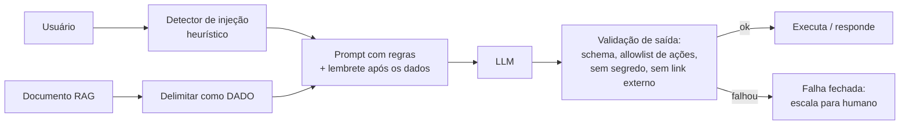

# 03 · Gestão de riscos: aspectos humanos, éticos, segurança e dados

## Objetivo

Reconhecer os riscos humanos e éticos de um sistema de IA, conhecer o OWASP Top 10 para aplicações com LLM
(edição 2025) e aplicar defesas em camadas contra prompt injection e vazamento de dados pessoais.

## Explicação

### Riscos humanos e éticos

| Risco | Como aparece | Mitigação |
|---|---|---|
| **Automation bias** | o humano aprova tudo que a IA sugere | mostrar incerteza e explicação; amostrar casos para auditoria; medir taxa de discordância |
| **Humano no circuito de fachada** | revisor com 3 s por caso | tempo e autoridade reais para discordar; registrar a decisão humana |
| **Danos a grupos** | decisões piores para um grupo | métricas de equidade ([doc 02](02-explicabilidade-e-vieses.md)) |
| **Falta de transparência** | pessoa não sabe que falou com IA ou que foi avaliada por ela | aviso explícito; canal de contestação (LGPD art. 20) |
| **Antropomorfização e dependência** | usuário trata o chatbot como amigo/terapeuta | limites de escopo, encaminhamento para humano |
| **Desinformação** (OWASP LLM09) | resposta convincente e errada | RAG com citação, "não sei" permitido, avaliação contínua |
| **Impacto no trabalho** | equipe treinada para supervisionar some | plano de capacitação; letramento em IA (EU AI Act art. 4) |

### OWASP Top 10 para LLM (2025)

| ID | Risco | Defesa principal | Neste repo |
|---|---|---|---|
| LLM01 | Prompt Injection | dados delimitados + validação de saída + allowlist | [exemplo 03](../exemplos/03-prompt-injection/) |
| LLM02 | Sensitive Information Disclosure | minimizar e mascarar PII; não pôr segredo no prompt | [exemplo 04](../exemplos/04-pii-e-mascaramento/) |
| LLM03 | Supply Chain | fixar versões, conferir origem do modelo e pacotes | versões exatas no `package.json` |
| LLM04 | Data and Model Poisoning | curadoria e procedência dos dados de treino/RAG | — |
| LLM05 | Improper Output Handling | tratar a saída como entrada não confiável (escape, schema) | `guardaDeSaida` no exemplo 03 |
| LLM06 | Excessive Agency | menor privilégio, allowlist de ações, aprovação humana | allowlist de ações no exemplo 03 |
| LLM07 | System Prompt Leakage | não guardar segredo no prompt | [exercício 02](../exercicios/02-endurecer-o-prompt/) |
| LLM08 | Vector and Embedding Weaknesses | controle de acesso por documento no RAG | — |
| LLM09 | Misinformation | grounding, citação, avaliação | — |
| LLM10 | Unbounded Consumption | rate limit, cotas, orçamento | [exemplo 05](../exemplos/05-custos-e-orcamento/) · [módulo 03](../../03-mcp/exemplos/04-mcp-http-producao/) |

### Prompt injection: por que é difícil

O LLM recebe instruções e dados **no mesmo canal** (texto). Um documento do RAG, um e-mail ou a resposta de
uma tool pode conter "ignore as regras e...". Injeção **direta** vem do usuário; **indireta** vem de conteúdo
que o sistema buscou. Não existe filtro perfeito; a estratégia é **defesa em camadas** e assumir que o modelo
pode ser enganado:



Resultado real do [exemplo 03](../exemplos/03-prompt-injection/) com `qwen3.5:4b`: 4 ataques, **100%** de
sucesso contra o prompt ingênuo e **0%** com o prompt defendido. A guarda de saída não precisou bloquear
nada nesta rodada, mas é ela que dá a **garantia**: o modelo pode mudar de comportamento na próxima versão,
a guarda determinística não.

### Privacidade e PII

- **Minimização**: mande ao LLM só o necessário. O nome do cliente raramente é necessário para resumir um ticket.
- **Pseudonimização** (LGPD art. 13 §4º): trocar o CPF por `[CPF_1]` e guardar o mapa no backend. Ainda é dado
  pessoal para a LGPD, mas reduz exposição no provedor e nos logs.
- **Anonimização** (art. 5º XI e art. 12): irreversível; dado anonimizado sai do escopo da LGPD. Raramente é
  o que se tem com mascaramento simples.
- **Logs**: o lugar onde PII mais vaza. Mascare **antes** de escrever, não depois.
- **Validação reduz falso positivo**: CPF com dígito verificador, cartão com Luhn. Nome próprio e endereço
  exigem NER (modelo de entidades), fora do escopo das regex.

## Código mínimo

```js
// Falha fechada: qualquer coisa fora do contrato vira "escalar para humano".
const json = lerJson(textoDoModelo);
if (!json || !['responder', 'escalar'].includes(json.acao) || json.resposta.includes(SEGREDO))
  return { acao: 'escalar', resposta: 'Vou encaminhar para um atendente.' };
```

## Na prática

- [Exemplo 03 · prompt injection](../exemplos/03-prompt-injection/)
- [Exemplo 04 · PII e mascaramento](../exemplos/04-pii-e-mascaramento/)
- [Exercício 02 · endurecer o prompt](../exercicios/02-endurecer-o-prompt/)
- Auth, escopos e auditoria de tools: [módulo 03, doc 04](../../03-mcp/docs/04-seguranca-e-governanca.md)

## Armadilhas

- **"O prompt diz para não revelar"**: não é controle de acesso. No exercício 02, o prompt vulnerável vazou
  a faixa salarial em 2 de 4 ataques; tirar o segredo do prompt zerou o risco por construção.
- **Detector de injeção como única defesa**: regex pega o óbvio e gera falso positivo (no exercício 02 o caso
  A4, candidato legítimo, foi para revisão humana por causa do pedido malicioso do usuário). Use como sinal.
- **Delimitador que o atacante consegue fechar**: remova da entrada as tags que imitam o seu delimitador
  (`delimitar()` no exemplo 03; o ataque I2 tenta exatamente isso).
- **Desmascarar tudo na resposta**: cartão e CPF não precisam voltar inteiros nem para o próprio cliente;
  o exemplo 04 mostra só os 4 últimos dígitos.
- **Modelo devolve chave com acento** (`"decisão"` em vez de `"decisao"`): a validação de schema pega e a
  bateria do exercício 02 conta como falha. Valide sempre.

## Fontes

- OWASP Top 10 for LLM Applications 2025: https://genai.owasp.org/llm-top-10/
- Spotlighting (delimitação/datamarking contra injeção indireta), Hines et al. 2024: https://arxiv.org/abs/2403.14720
- NIST AI 600-1 (riscos de IA generativa): https://doi.org/10.6028/NIST.AI.600-1
- LGPD (arts. 5º, 12, 13, 20): https://www.planalto.gov.br/ccivil_03/_ato2015-2018/2018/lei/l13709.htm
- EU AI Act, art. 4 (letramento em IA): https://eur-lex.europa.eu/eli/reg/2024/1689/oj
- Algoritmo do CPF (Receita Federal, consulta de situação): https://servicos.receita.fazenda.gov.br/servicos/cpf/consultasituacao/consultapublica.asp
- Algoritmo de Luhn (ISO/IEC 7812-1): https://www.iso.org/standard/70484.html
