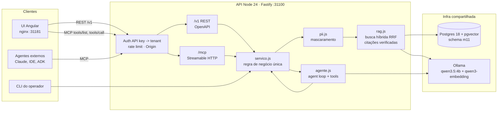

# 01 · Ideação e arquitetura do Micro-SaaS

## Objetivo

Sair de "quero fazer algo com IA" para um Micro-SaaS com **problema, público, proposta de valor,
arquitetura, stack, backlog e milestones** definidos, pequeno o bastante para uma pessoa construir e
operar. É a Unidade 1 do capstone; as unidades seguintes implementam o que está desenhado aqui.

## Explicação

### O problema

Em empresas de 5 a 50 pessoas, as políticas internas (férias, reembolso, home office, segurança,
uniforme, turnos) vivem em PDFs e Markdown espalhados. Todo mundo pergunta para o RH ou para o dono:
"posso dividir as férias?", "quanto é o limite de alimentação na viagem?". Ninguém lê o documento e,
quando lê, interpreta errado. Um chatbot genérico **inventa** regras (alucinação) — e regra inventada
de RH vira processo trabalhista.

**Políticas com Fonte**: um assistente que responde dúvidas sobre as políticas **daquela empresa**,
sempre **citando o documento de origem**, e que diz "não encontrei" em vez de inventar.

### Viabilidade (Lean Canvas resumido)

| Bloco | Conteúdo |
|---|---|
| Problema | Dúvidas repetidas sobre políticas consomem RH/dono; respostas inconsistentes; chatbot genérico alucina |
| Segmento | PMEs de 5–50 pessoas sem RH dedicado (agências, padarias, clínicas, escritórios contábeis) |
| Early adopters | Agências de software (já usam ferramentas SaaS) e franquias pequenas (mesmas regras em várias lojas) |
| Proposta de valor | "Respostas sobre as SUAS políticas em segundos, sempre com a fonte, sem inventar" |
| Solução | RAG por empresa + citações verificadas + API/MCP para plugar no Slack/Teams/agentes |
| Canais | Contadores e consultorias de RH (revendem), marketplace de apps do Slack/Teams, conteúdo |
| Receita | Free (20 perguntas/dia, 1 usuário admin) · Pro R$ 99/mês (200/dia, API e MCP) |
| Custos | LLM por pergunta (~390 tokens medidos: ver [doc 04](04-apresentacao-e-defesa.md#resultados)), Postgres, hospedagem |
| Métricas | Perguntas respondidas com citação verificada, taxa de "não encontrei", hit@3 do golden set, churn |
| Vantagem | Corpus e golden set de cada cliente + confiança (citação verificada) — difícil de copiar com prompt |

Conta de padaria da viabilidade: uma pergunta usa ~390 tokens. Num modelo pago de entrada
(ordem de US$ 0,15 / 1M tokens de entrada), 200 perguntas/dia × 30 dias ≈ 2,3M tokens ≈ menos de US$ 1
por cliente/mês. Mesmo com 10× de margem de erro, o plano Pro de R$ 99 cobre. Com o Ollama local, o custo
marginal é só a máquina — e a latência (minutos em CPU) é o problema real; ver as ADRs no [doc 04](04-apresentacao-e-defesa.md#adrs-architecture-decision-records).
A metodologia de custo está no [módulo 10, doc 04](../../10-seguranca-e-governanca/docs/04-custos-financeiros.md).

### Escopo do MVP

| Dentro | Fora (por enquanto) |
|---|---|
| Multi-tenant por API key (cada empresa só vê o seu) | Login de usuário final (SSO), papéis |
| Upload de política em Markdown via API | PDF/DOCX/OCR (o [módulo 02](../../02-apis-ia-generativa/) mostra OCR) |
| Resposta com citações verificadas + "não encontrei" | Workflow de aprovação de políticas |
| Modo agente para perguntas compostas | Memória de conversa longa |
| API REST documentada + servidor MCP + UI Angular | App mobile, integrações prontas Slack/Teams |
| Cache semântico, PII mascarada, auditoria | Billing real (Stripe) |

### Arquitetura



A peça central é o `servico.js`: **CLI, REST, MCP e os agentes ADK passam pela mesma fachada**. Isolamento
por tenant, PII, cache e auditoria são implementados uma vez e valem em todos os canais (é o padrão
"camada AI-ready" do [módulo 03, doc 03](../../03-mcp/docs/03-empresa-como-mcp-e-casos-de-uso.md)).

| Componente | Tecnologia | Reaproveitado de |
|---|---|---|
| RAG (chunking, pgvector, HNSW) | `pg` 8.23.1 + `pgvector` 0.3.0 | [módulo 01, `lib/rag.js`](../../01-fundamentos-ia-llms/lib/rag.js) |
| Busca híbrida (vetor + full-text, RRF) e cache semântico | SQL no Postgres | [módulo 08, exemplos 04 e 05](../../08-arquitetura-de-sistemas-com-ia/exemplos/04-padroes-de-rag/) |
| API com auth, validação, 502 do provedor, testes com dublês | Fastify 5.12.7 + vitest 5.0.5 | [módulo 02, exemplo 04](../../02-apis-ia-generativa/exemplos/04-api-backend-com-llm/) |
| Cliente LLM sem timeout de 300 s do undici | `openai` 7.36.0 + `undici` 8.12.2 | [módulo 02, `comum/config.js`](../../02-apis-ia-generativa/comum/config.js) |
| Servidor MCP HTTP stateless com token e rate limit | `@modelcontextprotocol/sdk` 1.32.1 | [módulo 03, exemplo 04](../../03-mcp/exemplos/04-mcp-http-producao/) |
| Agent loop com tools e limite de passos | Chat Completions + tools | [módulo 04, exemplo 01](../../04-agentes-autonomos/exemplos/01-agent-loop-do-zero/) |
| Delimitação de dado não confiável, PII | regex + dígito verificador | [módulo 10, exemplos 03 e 04](../../10-seguranca-e-governanca/exemplos/04-pii-e-mascaramento/) |
| Orquestração multiagente | `@google/adk` 2.3.0 | novo neste módulo |
| UI | Angular 22.2.3 (standalone, signals, zoneless) | novo neste módulo |

### Planejamento: milestones e backlog

| Milestone | Entrega | Critério de pronto | Onde |
|---|---|---|---|
| M1 | Protótipo de RAG em CLI | busca isolada por tenant, resposta com citação verificada, modo agente | [entrega 1](../exemplos/01-entrega-1-rag-cli/) |
| M2 | API documentada + MCP | OpenAPI 3.1, testes de contrato verdes, Inspector CLI listando e chamando tools | [entrega 2](../exemplos/02-entrega-2-api-e-mcp/) |
| M3 | Front + implantação | UI Angular no compose, e2e no Chrome headless, agente externo via MCP, CI local verde | [entrega 3](../exemplos/03-entrega-3-front-e-implantacao/) |
| M3+ | Orquestração ADK | 2 agentes LLM + nó de código num Workflow do ADK rodando no LLM local | [exemplo 04](../exemplos/04-orquestracao-adk/) |
| M4 | Demo e defesa | roteiro de demo, ADRs, métricas | [doc 04](04-apresentacao-e-defesa.md) |

Backlog inicial (histórias priorizadas por MoSCoW):

| # | História | Prioridade | Milestone |
|---|---|---|---|
| 1 | Como colaborador, pergunto sobre uma política e recebo a resposta com o documento citado | Must | M1 |
| 2 | Como dono, quero que a empresa vizinha nunca veja minhas políticas | Must | M1 |
| 3 | Como colaborador, se a política não existe, quero "não encontrei" e não uma invenção | Must | M1 |
| 4 | Como dono, envio/removo políticas pela API | Must | M2 |
| 5 | Como integrador, leio um contrato OpenAPI para gerar meu cliente | Must | M2 |
| 6 | Como agente (Claude, IDE), uso o serviço via MCP com a API key da empresa | Must | M2 |
| 7 | Como colaborador, uso uma tela web simples | Must | M3 |
| 8 | Como operador, subo tudo com um comando e tenho CI barrando regressões | Should | M3 |
| 9 | Como dono do produto, limito o plano free a N perguntas/dia | Should | [exercício 01](../exercicios/01-cota-por-cliente/) |
| 10 | Como time, o CI reprova se a qualidade da busca cair | Should | [exercício 02](../exercicios/02-avaliacao-no-ci/) |
| 11 | Como colaborador, faço perguntas compostas ("3 dias de viagem, quanto gasto?") | Could | M1 (modo agente) |
| 12 | Upload de PDF com OCR, SSO, billing | Won't (agora) | — |

## Código mínimo

O contrato de toda a aplicação é a fachada; o resto são adaptadores (CLI, REST, MCP, ADK):

```js
const servico = criarServico({ pool, llm });
await servico.buscar(tenant, 'auxílio home office', { k: 3 });       // só recuperação
await servico.perguntar(tenant, 'Posso dividir as férias?');          // RAG + citações verificadas
await servico.perguntar(tenant, '3 dias de viagem...', { modo: 'agente' });
```

## Na prática

- Corpus de demonstração: [`app/dados/acme/`](../app/dados/acme/) (agência de software) e
  [`app/dados/padaria/`](../app/dados/padaria/) (padaria) — duas empresas com regras diferentes para o
  mesmo tema (férias), o que torna o teste de isolamento significativo.
- Fachada: [`app/src/servico.js`](../app/src/servico.js).

## Armadilhas

- **Escopo inflado**: SSO, billing, PDF e Slack no MVP matam o capstone. O backlog acima diz "Won't" com orgulho.
- **Proposta de valor genérica** ("chatbot com IA") não vende. "Sempre com a fonte, nunca inventa" é verificável — e virou código (`verificarResposta`).
- **Multi-tenant como detalhe**: se o isolamento não estiver na primeira milestone, ele nunca fica bom. Aqui ele é a história nº 2 e tem teste de integração.
- **Custo só de token**: em CPU local o gargalo é latência (minutos), não dinheiro. Por isso existem cache semântico e o "não encontrei" sem LLM.

## Fontes

- Lean Canvas: https://leanstack.com/lean-canvas
- MoSCoW: https://en.wikipedia.org/wiki/MoSCoW_method
- Mermaid flowchart: https://mermaid.js.org/syntax/flowchart.html
- Model Context Protocol: https://modelcontextprotocol.io/
- pgvector: https://github.com/pgvector/pgvector
