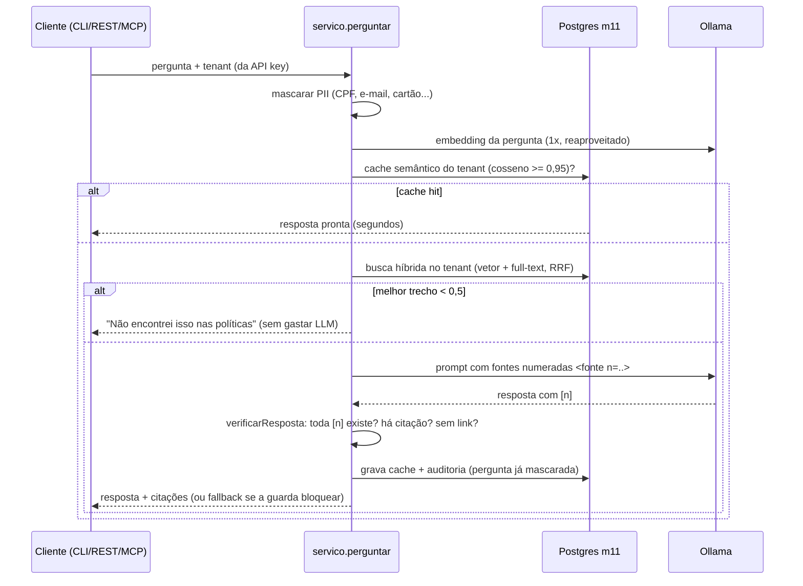
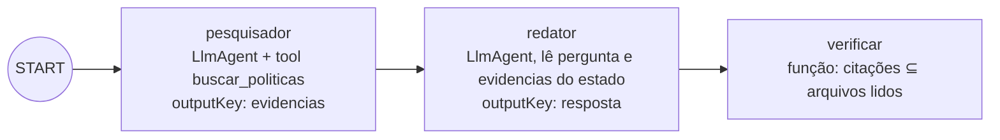

# 02 · Núcleo de RAG, agente principal, MCP e orquestração com o ADK

## Objetivo

Construir o "cérebro" do Micro-SaaS e as portas para agentes: o **núcleo de RAG** (com a escolha e a
configuração do banco vetorial), o **agente principal** que usa o RAG em perguntas complexas, a **ponte
IA-UI via MCP** e a **orquestração multiagente com o Google ADK** rodando no LLM local. Cobre a Unidade 2
(Entrega 1) e a parte de IA da Unidade 3 (Entrega 2).

## Explicação

### Núcleo de RAG

Pense numa bibliotecária que só pode responder com o livro aberto na mesa: ela **busca** (recuperação),
**lê os trechos** (contexto) e **responde citando a página** (geração com citação). Se nenhum livro fala
do assunto, ela diz "não encontrei" — e não inventa.



Decisões do núcleo (código em [`app/src/rag.js`](../app/src/rag.js) e [`app/src/servico.js`](../app/src/servico.js)):

| Peça | Escolha | Por quê |
|---|---|---|
| Chunking | 1 parágrafo por chunk, com o título do documento como prefixo | Políticas são listas de regras curtas; "O limite é R$ 90" sem o título perde o contexto ([módulo 01](../../01-fundamentos-ia-llms/docs/04-rag-mcp-e-modelos.md)) |
| Embeddings | `qwen3-embedding:0.6b` (1024 dim), com instrução **só na consulta** | O modelo foi treinado assim: `Instruct: ...\nQuery: <pergunta>` melhora o recall |
| Busca | Híbrida: vetor (HNSW cosseno) + full-text `portuguese`, fundidas por RRF | Vetor acha paráfrases ("comida" ~ "alimentação"); full-text acha termo exato ("VPN", "2FA"). RRF usa só a posição, sem normalizar escalas ([módulo 08](../../08-arquitetura-de-sistemas-com-ia/docs/03-padroes-de-design-de-ia.md)) |
| Corte de relevância | Se o MELHOR trecho tem cosseno < 0,5, responde "não encontrei" sem chamar o LLM | Medido no corpus: fora do tema fica em ~0,33–0,41; dentro, acima de 0,55 |
| Prompt | Fontes numeradas dentro de `<fonte n=.. arquivo=..>`, com tags imitadoras removidas | O documento do cliente é **dado**, nunca instrução ([módulo 10](../../10-seguranca-e-governanca/docs/03-riscos-humanos-eticos-e-de-seguranca.md)) |
| Guarda de saída | `verificarResposta`: exige ≥1 citação, toda `[n]` existente, nenhum link; senão fallback | Falha **fechado**: melhor "não encontrei" do que regra inventada |
| Cache | Semântico, **por tenant** e por versão do prompt, TTL de 1 dia; invalidado ao indexar/remover | A mesma pergunta em outra empresa tem outra resposta |
| PII | Mascarada antes de embeddings, LLM e auditoria | LGPD: o provedor de IA não precisa do CPF de ninguém |

### Seleção e configuração do banco vetorial

| Opção | Prós | Contras | Veredito |
|---|---|---|---|
| **Postgres + pgvector** | Já existe na infra; SQL, transações, `JOIN` com tenants; full-text nativo para a busca híbrida; HNSW | Escala vertical; tuning de HNSW é com você | **Escolhido** (ADR-001) |
| Qdrant / Weaviate | Filtros por payload rápidos, híbrido nativo, escala horizontal | Mais um serviço para operar e fazer backup; dado do tenant em 2 lugares | Quando passar de milhões de chunks |
| Pinecone / gerenciados | Zero operação | Custo, dado fora, lock-in; precisa de conta | Fora (sem serviços pagos) |
| Em memória (array) | Didático | Não persiste, não escala, sem multi-tenant | Só em testes |

Configuração aplicada ([`app/src/db.js`](../app/src/db.js)): tabela única `m11.chunks` com `tenant_id`
(multi-tenant "pool", ADR-002), `vector(1024)` com índice `hnsw (emb vector_cosine_ops)`, coluna
`tsvector` **gerada** (`GENERATED ALWAYS AS (to_tsvector('portuguese', conteudo)) STORED`) com índice
GIN, e índice em `tenant_id`. Toda consulta tem `WHERE tenant_id = $n` — o teste de integração prova que
uma empresa nunca recebe trecho da outra.

### Agente principal

Perguntas compostas ("vou viajar 3 dias: quanto gasto com comida no total e posso pegar táxi do hotel
ao cliente?") pedem mais de uma busca e uma conta. O modo `agente` usa o **agent loop** do
[módulo 04](../../04-agentes-autonomos/docs/01-arquitetura-e-padroes-de-raciocinio.md): o LLM decide
chamar `buscar_politicas` (o RAG vira **ferramenta**) ou `listar_documentos`, recebe os trechos como
feedback e responde citando `[arquivo.md]`. Limites: 4 passos, e no último as tools são retiradas para
forçar a resposta. A guarda confere se os arquivos citados foram mesmo lidos naquela execução
([`app/src/agente.js`](../app/src/agente.js)). Saída real: R$ 270,00 (3 × R$ 90) com `[reembolso.md]`, na
[entrega 1](../exemplos/01-entrega-1-rag-cli/).

### Ponte IA-UI: o serviço como servidor MCP

O endpoint `/mcp` (Streamable HTTP **stateless**, um `McpServer` por requisição) mora no mesmo processo
da API REST e passa pela **mesma autenticação**: a API key do cliente vira o tenant, e as tools só
enxergam aquele tenant. Tools ([`app/src/mcp.js`](../app/src/mcp.js)):

| Tool | O que faz | Custo |
|---|---|---|
| `listar_documentos` | documentos indexados do tenant | ms |
| `buscar_politicas` `{consulta, k}` | busca híbrida, devolve trechos + arquivo (`structuredContent`) | ~1 s (embedding) |
| `perguntar` `{pergunta}` | resposta pronta com citações verificadas | minutos em CPU (LLM) |

Quem consome: a **UI Angular** (que é cliente MCP no navegador: descobre as tools e chama as de leitura),
o **MCP Inspector** no CI e **agentes externos** (Claude, IDEs, o agente da entrega 3). Proteções do
[módulo 03](../../03-mcp/docs/04-seguranca-e-governanca.md): Bearer obrigatório, rate limit por tenant,
`Origin` validada contra allowlist (anti DNS rebinding, exigência da spec) e `GET`/`DELETE` → 405
(sem sessão, não há stream de notificações).

### Orquestração multiagente com o Google ADK

O **ADK (Agent Development Kit)** do Google para TypeScript (`@google/adk` 2.3.0) traz agentes
(`LlmAgent`), ferramentas (`FunctionTool` com zod, `MCPToolset`), estado de sessão, `Runner` e, desde a
2.x, `Workflow` (grafo de nós). **Fato verificado na documentação e no pacote**: os conectores
**LiteLLM e Ollama do ADK existem só no ADK Python**; o ADK TypeScript traz `Gemini`, `ApigeeLlm` e o
modelo do Chrome. Duas saídas:

1. usar Gemini/Vertex (precisa de chave Google: **não executado localmente**, fora das regras do repo);
2. **estender `BaseLlm`** e traduzir o formato do Gemini para Chat Completions — foi o que fizemos
   ([`exemplos/04-orquestracao-adk/ollama-llm.js`](../exemplos/04-orquestracao-adk/ollama-llm.js)), e o
   ADK roda inteiro no Ollama local.



Cada agente recebe o **próprio modelo** (`MODELO_PESQUISADOR`, `MODELO_REDATOR`): dá para usar um modelo
pequeno e barato para pesquisar e um maior para redigir — é a "orquestração de múltiplos LLMs". O nó
final é **código**, não LLM: barato, determinístico e auditável.

Observações da versão 2.3.0: `SequentialAgent` emite aviso de **deprecated** (substituto: `Workflow`) e
`Workflow` emite aviso de **experimental**. Usamos `Workflow`, e o aviso fica registrado no README do
exemplo.

## Código mínimo

```js
// Adaptador: o ADK fala "Gemini", o Ollama fala "OpenAI". BaseLlm é o ponto de extensão.
class OllamaLlm extends BaseLlm {
  static supportedModels = [/^ollama\//];
  async *generateContentAsync(req) {
    const { messages, tools } = paraOpenAI(req);              // Content/parts -> messages; Schema -> JSON Schema
    const r = await openai.chat.completions.create({ model: 'qwen3.5:4b', messages, tools, temperature: 0 });
    yield paraLlmResponse(r.choices[0], r.usage);             // tool_calls -> functionCall
  }
  async connect() { throw new Error('sem modo live'); }
}
const pesquisador = new LlmAgent({ name: 'pesquisador', model: new OllamaLlm(), tools: [buscar], outputKey: 'evidencias', instruction: '...' });
const fluxo = new Workflow({ name: 'politicas_adk', edges: [['START', pesquisador, redator, verificar]] });
```

## Na prática

- [Entrega 1 · RAG em CLI](../exemplos/01-entrega-1-rag-cli/) — busca, pergunta, isolamento, PII, cache e modo agente.
- [Entrega 2 · API e MCP](../exemplos/02-entrega-2-api-e-mcp/) — OpenAPI, curl e MCP Inspector CLI.
- [Exemplo 04 · Orquestração com ADK](../exemplos/04-orquestracao-adk/) — Workflow com 2 agentes LLM + nó de código.

## Armadilhas

- **Limiar de relevância por palpite**: medimos no corpus (fora do tema ~0,33–0,41) antes de fixar 0,5. Com outro modelo de embedding, meça de novo.
- **Cache semântico global**: sem `tenant_id` na chave, a padaria receberia a resposta da Acme. O cache aqui é por tenant e invalidado ao mudar documento.
- **Invalidar cache demais**: a primeira versão de `remover` apagava o cache do tenant mesmo quando o `DELETE` era de um arquivo inexistente (404) — o demo da entrega 2 zerava o cache da Acme a cada execução. Agora só invalida se `rowCount > 0` (teste em `app/test/integracao.test.js`).
- **Confiar que o modelo cita**: o qwen3.5:4b às vezes responde sem `[n]`. A guarda transforma isso em fallback em vez de entregar resposta sem fonte.
- **`tool_choice` no Ollama**: não é suportado; para forçar a resposta final do agente, retiramos as tools no último passo.
- **ADK + modelo local**: `model: 'qwen3.5:4b'` (string) faz o `LLMRegistry` procurar um Gemini e falhar; passe a **instância** `new OllamaLlm()` (ou registre a classe com `LLMRegistry.register`).
- **Schema do Gemini em MAIÚSCULAS** (`type: 'OBJECT'`): mandar isso como JSON Schema para o Ollama gera tools inválidas; o adaptador converte para minúsculas.
- **Workflow passa só a saída do nó anterior**: o redator não vê a pergunta original; por isso ela vai no **estado da sessão** (`{pergunta}`).

## Fontes

- pgvector (HNSW, operadores): https://github.com/pgvector/pgvector
- Full-text search no Postgres: https://www.postgresql.org/docs/current/textsearch.html
- Reciprocal Rank Fusion (Cormack et al., 2009): https://plg.uwaterloo.ca/~gvcormac/cormacksigir09-rrf.pdf
- Qwen3-Embedding (instrução na consulta): https://huggingface.co/Qwen/Qwen3-Embedding-0.6B
- MCP, transporte Streamable HTTP (2025-11-25): https://modelcontextprotocol.io/specification/2025-11-25/basic/transports
- SDK TypeScript do MCP: https://github.com/modelcontextprotocol/typescript-sdk
- ADK docs: https://google.github.io/adk-docs/ · modelos: https://google.github.io/adk-docs/agents/models/
- ADK LiteLLM (só Python): https://google.github.io/adk-docs/agents/models/litellm/
- ADK Workflows: https://google.github.io/adk-docs/workflows/
- ADK para TypeScript (código): https://github.com/google/adk-js · npm: https://www.npmjs.com/package/@google/adk
