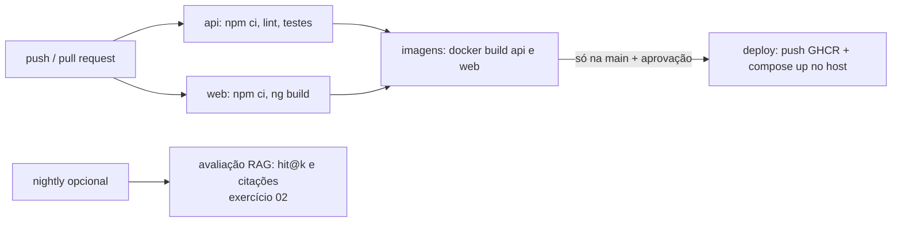
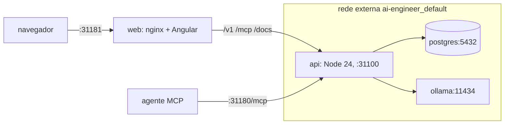

# 03 · Front-end Angular, CI/CD e implantação

## Objetivo

Entregar a interface do Micro-SaaS **em Angular, já estruturada com o MCP**, integrar front ↔ API,
validar o MCP com ferramentas, montar o **pipeline de CI/CD** e "implantar" tudo localmente com
`docker compose`, demonstrando um agente externo usando a aplicação via MCP. Cobre a Unidade 4 e a
Entrega 2 (API documentada + front com MCP) e a Entrega 3.

## Explicação

### A UI em Angular

Versão estudada: **Angular 22.2.3** (`@angular/cli` 22.2.3, conferido no npm em 2026-10-17). O app foi
gerado com o CLI oficial e enxugado:

```bash
npx @angular/cli@22.2.3 new web --defaults --style=css --ssr=false --skip-git --skip-tests --ai-config=none
```

O que o Angular moderno muda em relação ao "Angular de 2020": componentes **standalone** (sem
`NgModule`), **signals** para estado (`signal()`, `.set()`), **sem zone.js** por padrão (a tela atualiza
quando um signal muda) e o novo controle de fluxo no template (`@if`, `@for`).

A UI tem **dois canais** para o back-end, de propósito:

| Canal | Usado para | Por quê |
|---|---|---|
| REST `/v1` ([`api.service.ts`](../app/web/src/app/api.service.ts)) | identificar o tenant (`/v1/me`) e perguntar (`/v1/perguntas`, com modo rag/agente) | contrato estável, documentado em OpenAPI, fácil de cachear e versionar |
| MCP `/mcp` ([`mcp.service.ts`](../app/web/src/app/mcp.service.ts)) | descobrir as tools (`tools/list`), listar documentos e buscar trechos | a UI enxerga **a mesma superfície que um agente**; uma tool nova aparece na tela sem mudar a API REST |

O cliente MCP no navegador é o **SDK oficial** (`Client` + `StreamableHTTPClientTransport`). Em produção o
nginx serve a UI e faz proxy de `/v1`, `/mcp` e `/docs` para a API (mesma origem: sem CORS); em
desenvolvimento, `npm start` usa o `proxy.conf.json` do `ng serve`.

**Node e Angular CLI 22**: o CLI 22 exige Node `^22.22.3 || ^24.15.0 || >=26` e a máquina tem
**Node 24.11**. Em vez de trocar o Node do sistema, o build roda no container oficial
`node:24.22.0-alpine` (o mesmo do `Dockerfile` e do CI): [`build-web.sh`](../exemplos/03-entrega-3-front-e-implantacao/build-web.sh).

### Validação do MCP com ferramentas

| Ferramenta | O que valida | Onde |
|---|---|---|
| MCP Inspector **CLI** 2.11.0 | `tools/list`, `tools/call`, erro de validação (exit ≠ 0), 401 sem chave, isolamento entre chaves | [`inspector.sh`](../exemplos/02-entrega-2-api-e-mcp/inspector.sh) |
| Cliente do SDK nos testes (vitest) | contrato das tools com dublê do serviço, Origin bloqueada, chave inválida | [`app/test/api.test.js`](../app/test/api.test.js) |
| A própria UI (Playwright) | o navegador lista e chama tools pelo MCP | [`ui.e2e.js`](../exemplos/03-entrega-3-front-e-implantacao/ui.e2e.js) |
| Um agente LLM externo | o modelo descobre e usa as tools sozinho | [`agente-mcp.js`](../exemplos/03-entrega-3-front-e-implantacao/agente-mcp.js) |

### Pipeline de CI/CD



O workflow está em [`ci.yml`](../exemplos/03-entrega-3-front-e-implantacao/ci.yml) (num repositório
próprio ele vai para `.github/workflows/ci.yml`). Os testes do CI usam **dublês** do LLM e do banco:
rodam em segundos, sem GPU e sem chave. A avaliação com embeddings/LLM reais é um job separado
(nightly), porque precisa do Ollama com modelos (~4 GB) — ver [exercício 02](../exercicios/02-avaliacao-no-ci/).
Os mesmos passos rodam localmente com [`ci-local.sh`](../exemplos/03-entrega-3-front-e-implantacao/ci-local.sh).
O job `deploy` é **não executado localmente** (precisa de registry e servidor reais) e fica atrás de um
*environment* com aprovação manual — o gate humano do [módulo 08](../../08-arquitetura-de-sistemas-com-ia/docs/04-arquitetura-enterprise.md).
Mais sobre pipelines e Kubernetes/OpenShift: [trilha LLMOps](../../../trilhas-extras/llmops-vllm-openshift/) e
[trilha MLOps](../../../trilhas-extras/mlops/).

### Implantação local com docker compose



O [`compose.yaml`](../exemplos/03-entrega-3-front-e-implantacao/compose.yaml) do módulo **não sobe**
Postgres nem Ollama: entra na rede da infra compartilhada como `external` e acessa `postgres:5432` e
`ollama:11434` pelo nome. O `web` fica só na rede própria do projeto (o front nunca enxerga o banco). A
API tem `HEALTHCHECK` e o `web` só sobe depois dela saudável (`depends_on: condition: service_healthy`).
Portas publicadas só em `127.0.0.1`.

## Código mínimo

```ts
// mcp.service.ts — a UI como cliente MCP
const client = new Client({ name: 'politicas-web', version: '1.0.0' });
await client.connect(new StreamableHTTPClientTransport(new URL('/mcp', location.origin),
  { requestInit: { headers: { authorization: `Bearer ${chave}` } } }));
const { tools } = await client.listTools();
const r = await client.callTool({ name: 'buscar_politicas', arguments: { consulta, k: 3 } });
```

```yaml
# compose.yaml — reaproveitando a infra sem tocar nela
networks:
  infra: { external: true, name: ai-engineer_default }
```

## Na prática

- [Entrega 2 · API e MCP](../exemplos/02-entrega-2-api-e-mcp/) — OpenAPI + Inspector CLI.
- [Entrega 3 · front e implantação](../exemplos/03-entrega-3-front-e-implantacao/) — build Angular, compose, Playwright, agente via MCP e CI local.

## Armadilhas

- **Angular CLI 22 no Node 24.11**: o CLI recusa Node < 24.15. Build em container com Node 24.22 resolve sem mexer no sistema.
- **405 no console do navegador**: o SDK MCP tenta abrir um stream SSE com `GET /mcp`; o servidor stateless responde 405 e o cliente segue sem stream — é o comportamento previsto, não um bug.
- **CommonJS no bundle**: o SDK MCP puxa `ajv`, `ajv-formats` e `content-type` (CommonJS) e o build avisa; declaramos em `allowedCommonJsDependencies` no `angular.json`. O bundle inicial ficou em ~492 kB (o orçamento padrão avisa em 500 kB).
- **Corrida na troca de tenant**: publicar o tenant novo antes de carregar os documentos mostrou "Padaria" com os documentos da Acme por alguns ms (o Playwright pegou). Solução: carregar tudo e publicar os signals de uma vez.
- **Timeouts em cadeia**: nginx (`proxy_read_timeout 900s`), SDK (`timeout`) e undici (`headersTimeout: 0`) precisam concordar; senão, a pergunta lenta morre no proxy com 504.
- **`docker compose down` no lugar errado**: aqui ele derruba só `api` e `web`; a infra está em outro projeto (`external`).
- **`npm ci` passa no host e quebra no `docker build`** com `Missing: @grpc/grpc-js@1.14.6 from lock file`: o lock foi gerado pelo npm 11.6 (Node 24.11 do host), que não registra esse peer opcional (vem do `@a2a-js/sdk`, dependência do ADK); o npm 11.19 da imagem `node:24.22.0-alpine` exige. Correção: gerar o lock com o mesmo npm do CI (`docker run ... node:24.22.0-alpine npm install --package-lock-only`).
- **CI que chama LLM de verdade** fica lento, caro e instável: testes de contrato com dublês no PR; avaliação real no nightly.

## Fontes

- Angular — versões e compatibilidade de Node: https://angular.dev/reference/versions
- Angular signals: https://angular.dev/guide/signals · proxy do `ng serve`: https://angular.dev/tools/cli/serve#proxying-to-a-backend-server
- Angular — dependências CommonJS: https://angular.dev/tools/cli/build#configuring-commonjs-dependencies
- @fastify/swagger (OpenAPI): https://github.com/fastify/fastify-swagger
- MCP Inspector: https://github.com/modelcontextprotocol/inspector
- GitHub Actions: https://docs.github.com/en/actions · actions/checkout: https://github.com/actions/checkout · actions/setup-node: https://github.com/actions/setup-node
- Docker Compose (redes externas): https://docs.docker.com/compose/how-tos/networking/
- Playwright `launch({ channel: 'chrome' })`: https://playwright.dev/docs/api/class-browsertype
