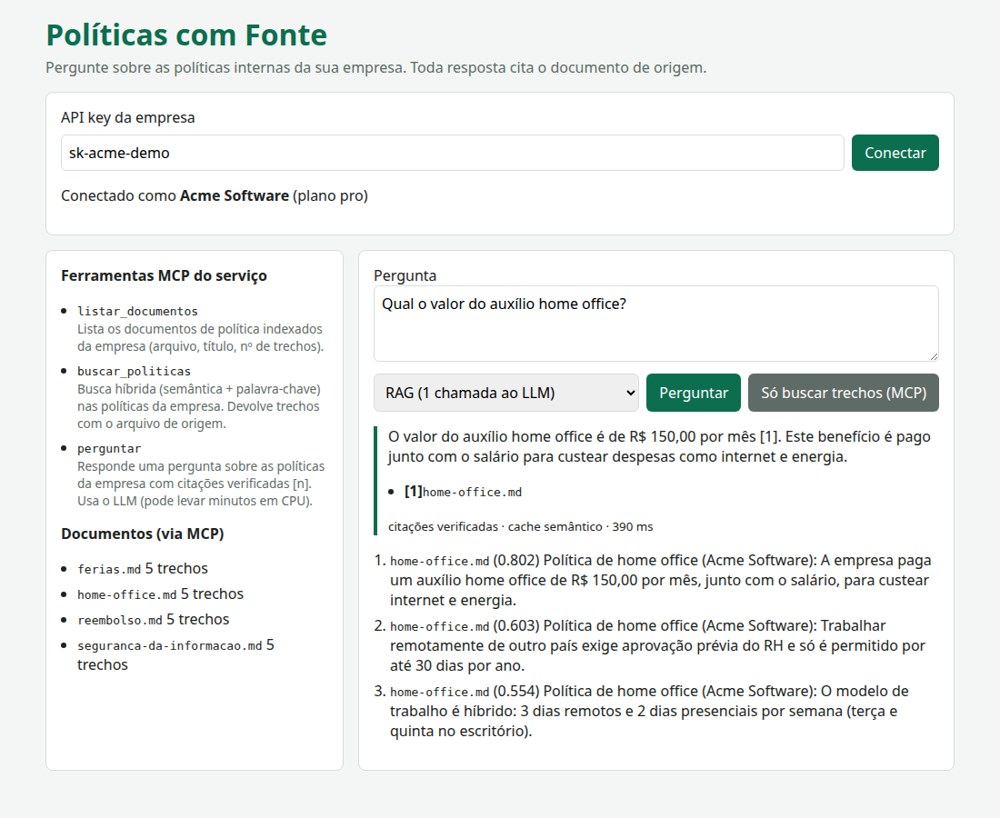

# Entrega 3 · Front Angular com MCP, CI/CD e solução "implantada" localmente

**Conceito novo**: fechar o ciclo de produto — **UI em Angular** que é cliente REST *e* cliente MCP,
**imagens Docker** da API e do front, **docker compose** usando a infra existente, **teste e2e no
navegador**, **pipeline de CI/CD** e um **agente externo** operando a aplicação só via MCP.
Teoria no [doc 03](../../docs/03-front-ci-cd-e-implantacao.md).

Arquivos: UI em [`app/web/`](../../app/web/) (Angular 22.2.3), [`app/Dockerfile`](../../app/Dockerfile),
[`app/web/Dockerfile`](../../app/web/Dockerfile) + [`nginx.conf`](../../app/web/nginx.conf),
[`compose.yaml`](compose.yaml), [`build-web.sh`](build-web.sh), [`ui.e2e.js`](ui.e2e.js),
[`agente-mcp.js`](agente-mcp.js), [`ci.yml`](ci.yml) e [`ci-local.sh`](ci-local.sh).

**Pré-requisito**: [entrega 2](../02-entrega-2-api-e-mcp/), Docker, Google Chrome instalado (o Playwright
usa o Chrome do sistema via `channel: 'chrome'`; nada de baixar browsers).

## Como rodar

```bash
cd modulos/11-capstone-micro-saas
npm run seed            # se ainda não rodou (o compose usa o mesmo banco)
npm run e3:subir        # build das imagens + compose up --wait (API :31180, UI :31181)
npm run e3:ui           # Playwright headless no Chrome: UI -> nginx -> API (REST e MCP)
npm run e3:agente       # agente LLM externo usando a aplicação só via MCP (lento: 2 chamadas ao LLM)
npm run e3:descer       # derruba SÓ api e web deste módulo (a infra continua no ar)
npm run e3:ci           # os passos do CI localmente: npm ci, lint, testes, build do front e das imagens
```

UI no navegador: http://localhost:31181 (chaves `sk-acme-demo` e `sk-padaria-demo`). Swagger: http://localhost:31180/docs.

## Saída esperada

`npm run e3:subir` (trecho final):

```
 Container m11-capstone-api-1 Healthy
 Container m11-capstone-web-1 Started
 Container m11-capstone-web-1 Healthy
```

`npm run e3:ui` (a pergunta já estava no cache semântico; sem cache ela leva minutos e o teste espera até 15 min):

```
Tenant acme
  ok  API key identifica o tenant (REST /v1/me)
  ok  UI descobriu as tools via MCP: listar_documentos, buscar_politicas, perguntar
  ok  documentos via MCP: ferias.md, home-office.md, reembolso.md, seguranca-da-informacao.md
  ok  resposta: "O valor do auxílio home office é de R$ 150,00 por mês [1]. Este benefício é pago junto com..."
  ok  citação mostrada: [1]home-office.md
  ..  citações verificadas · cache semântico · 3234 ms
  ok  busca de trechos pela tool MCP buscar_politicas
Tenant padaria (isolamento na UI)
  ok  padaria vê só os seus: ferias.md, turnos-e-faltas.md, uniforme-e-higiene.md
Chave inválida
  [console] Failed to load resource: the server responded with a status of 401 (Unauthorized)
  ok  erro exibido: Falha ao conectar: API key ausente ou inválida

UI ok · screenshot em 11-capstone-micro-saas/exemplos/03-entrega-3-front-e-implantacao/ui.png
```



`npm run e3:agente` (o modelo escolheu a tool e a consulta sozinho):

```
MCP em http://127.0.0.1:31180/mcp · tools descobertas: listar_documentos, buscar_politicas, perguntar
tools entregues ao LLM: listar_documentos, buscar_politicas
Pergunta: Vou faltar amanhã no turno da madrugada por doença: até quando aviso a gerência e o que preciso entregar depois?

[passo 1, 325.7s] agente chamou buscar_politicas({"consulta":"falta de trabalho doença aviso gerência entrega tarefas","k":3})
  resultado: [{"fonte":"turnos-e-faltas.md","trecho":"Política de turnos e faltas (Padaria Pão Quente): Atestado médico deve ser entregue em até 48 horas; sem atestado, a fa...

[passo 2, 352.2s] resposta final:
Deve comunicar a sua falta à gerência por telefone até 2 horas antes do início do turno e entregar o atestado médico em até 48 horas, conforme a política de faltas. Além disso, como está doente, deve avisar imediatamente para não manipular alimentos, seguindo as regras de higiene.
```

Repare: a resposta está correta, mas o modelo **não citou o arquivo entre colchetes** como pedido. Num
cliente MCP externo, a guarda de citações não roda (ela está no `perguntar` do servidor) — é o argumento
para expor também a tool `perguntar` a clientes que querem garantia de citação.

`npm run e3:ci`:

```
==== 1/5 npm ci
added 445 packages in 31s

==== 2/5 lint (eslint)
lint ok

==== 3/5 testes (vitest)
 Test Files  3 passed | 1 skipped (4)
      Tests  21 passed | 4 skipped (25)

==== 4/5 build do front
                    | Initial total | 492.38 kB |               128.95 kB
Application bundle generation complete. [12.863 seconds] - 2026-10-17T11:40:25.785Z

==== 5/5 build das imagens
sha256:bfa09163d5a4...
sha256:c0f48db59a85...
m11-politicas-api:ci 380MB
m11-politicas-web:ci 103MB

CI local: tudo verde
```

O deploy (job `deploy` do [`ci.yml`](ci.yml): push para o GHCR e `compose up` no servidor via SSH) é
**não executado localmente**: precisa de registry, servidor e segredos reais.

## Experimente

1. Abra http://localhost:31181, escolha o modo **Agente** e pergunte algo composto ("Quantos dias de férias tenho e posso vender parte delas?"). Acompanhe as chamadas em outro terminal: `docker compose -f exemplos/03-entrega-3-front-e-implantacao/compose.yaml logs -f api` e a auditoria em `m11.auditoria`.
2. Adicione uma tool nova em `app/src/mcp.js` (ex.: `ler_documento {fonte}`), rode `npm run e3:subir` de novo: ela aparece na lista da UI **sem mudar uma linha do Angular** — é o ganho de a UI descobrir capacidades via MCP.
3. Quebre um teste de propósito (ex.: troque `401` por `403` em `app/src/api.js`) e rode `npm run e3:ci`: o pipeline para no passo 3, antes de construir imagem.

## Versão Python

**A UI Angular não se porta** (Versão Python: não se aplica — é código que roda no navegador). Em vez disso,
a entrega prova a **compatibilidade do contrato**: a MESMA imagem Angular (`app/web`, sem mudar uma linha) roda
na frente da API Python, e o MESMO teste e2e [`ui.e2e.js`](ui.e2e.js) passa apontando para ela só pela
variável `URL_UI`.

Arquivos em [`python/`](python/):

- [`compose.yaml`](python/compose.yaml) — compose alternativo (`m11-capstone-py`): imagem da API Python
  ([`app_py/Dockerfile`](../../app_py/Dockerfile), Python 3.14 slim + uv, `uv sync --frozen --no-dev`) + a imagem
  web de sempre. Portas próprias: **API 31190, UI 31191** (convive com o compose JS). Nenhum proxy extra: o
  nginx da UI faz `proxy_pass http://api:31100` e a API Python escuta na 31100 dentro do container; só muda
  `ORIGENS_PERMITIDAS` (`http://localhost:31191`) por causa da porta nova da UI.
- [`ui_e2e.py`](python/ui_e2e.py) — o mesmo e2e em Playwright Python (`channel="chrome"`); screenshot em [`python/ui.png`](python/ui.png).
- [`agente_mcp.py`](python/agente_mcp.py) — o agente externo via MCP com o client do SDK `mcp` 2.3.0.
- [`ci-local.sh`](python/ci-local.sh) — os passos do novo job `api-python` do [`ci.yml`](ci.yml) (uv sync, ruff, pytest) + build da imagem Python.

### Como rodar

```bash
cd modulos/11-capstone-micro-saas
uv sync
uv run python -m app_py.seed                                                     # tabelas _py (se ainda não rodou)
docker compose -f exemplos/03-entrega-3-front-e-implantacao/python/compose.yaml up -d --build --wait
URL_UI=http://localhost:31191 npm run e3:ui                                       # o e2e JS, sem mudança, contra a API Python
uv run python exemplos/03-entrega-3-front-e-implantacao/python/ui_e2e.py          # o mesmo e2e em Playwright Python
uv run python exemplos/03-entrega-3-front-e-implantacao/python/agente_mcp.py      # agente externo via MCP (porta 31190)
bash exemplos/03-entrega-3-front-e-implantacao/python/ci-local.sh                 # CI local da versão Python
docker compose -f exemplos/03-entrega-3-front-e-implantacao/python/compose.yaml down
```

O `npm run e3:ui` regrava o `ui.png` desta pasta (o print da versão JS); para não perdê-lo, copie antes e
restaure depois, ou use o `ui_e2e.py`, que grava em `python/ui.png`.

### Saída esperada (Python)

`docker compose ... python/compose.yaml up -d --build --wait` (trecho final):

```
 Container m11-capstone-py-web-1 Healthy
 Container m11-capstone-py-api-1 Healthy
```

`URL_UI=http://localhost:31191 npm run e3:ui` — o teste JS **inalterado**, com a resposta gerada na hora pela API Python:

```
Tenant acme
  ok  API key identifica o tenant (REST /v1/me)
  ok  UI descobriu as tools via MCP: listar_documentos, buscar_politicas, perguntar
  ok  documentos via MCP: ferias.md, home-office.md, reembolso.md, seguranca-da-informacao.md
  ok  resposta: "O valor do auxílio home office é de R$ 150,00 por mês [1]. Este benefício é pago junto com..."
  ok  citação mostrada: [1]home-office.md
  ..  citações verificadas · gerada agora · 7233 ms
  ok  busca de trechos pela tool MCP buscar_politicas
Tenant padaria (isolamento na UI)
  ok  padaria vê só os seus: ferias.md, turnos-e-faltas.md, uniforme-e-higiene.md
Chave inválida
  [console] Failed to load resource: the server responded with a status of 401 (Unauthorized)
  ok  erro exibido: Falha ao conectar: API key ausente ou inválida

UI ok · screenshot em 11-capstone-micro-saas/exemplos/03-entrega-3-front-e-implantacao/ui.png
```

`python/ui_e2e.py` imprime as mesmas linhas (a pergunta, agora, sai do cache semântico):

```
  ..  citações verificadas · cache semântico · 182 ms
...
UI ok · screenshot em 11-capstone-micro-saas/exemplos/03-entrega-3-front-e-implantacao/python/ui.png
```


`python/agente_mcp.py` (mesma escolha de tool e mesma resposta da versão JS):

```
MCP em http://127.0.0.1:31190/mcp · tools descobertas: listar_documentos, buscar_politicas, perguntar
tools entregues ao LLM: listar_documentos, buscar_politicas
Pergunta: Vou faltar amanhã no turno da madrugada por doença: até quando aviso a gerência e o que preciso entregar depois?

[passo 1, 26.6s] agente chamou buscar_politicas({"consulta":"falta de trabalho doença aviso gerência entrega tarefas","k":3})
  resultado: [{"fonte":"turnos-e-faltas.md","trecho":"Política de turnos e faltas (Padaria Pão Quente): Atestado médico deve ser entregue em até 48 horas; sem atestado, a fa...

[passo 2, 22.9s] resposta final:
Deve comunicar a sua falta à gerência por telefone até 2 horas antes do início do turno e entregar o atestado médico em até 48 horas, conforme a política de faltas. Além disso, como está doente, deve avisar imediatamente para não manipular alimentos, seguindo as regras de higiene.
```

`python/ci-local.sh`:

```
==== 1/4 uv sync --frozen
Checked 101 packages in 0.69ms

==== 2/4 lint (ruff)
All checks passed!
lint ok

==== 3/4 testes (pytest)
23 passed, 5 skipped in 1.25s

==== 4/4 build da imagem Python
sha256:3d03c2a411af...
m11-politicas-api-py:ci 450MB

CI local (Python): tudo verde
```

O job `api-python` no GitHub Actions (`astral-sh/setup-uv@v10.3.0`) é **não executado localmente** (precisa de
runner); os mesmos comandos rodaram na máquina pelo `ci-local.sh`.
