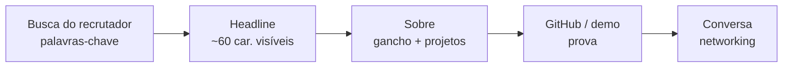

# 01 · Presença profissional: LinkedIn, networking, marca pessoal e portfólio

## Objetivo

Ao terminar, você sabe montar um perfil que aparece nas buscas de recrutadores de IA, transformar o que estuda
em conteúdo constante, manter um portfólio no GitHub que se defende sozinho em 30 segundos e escolher técnicas
de diferenciação (demo, case, open source) que provam o que o currículo só afirma.

## Explicação

Pense no seu perfil como um **funil**: busca → clique → leitura → conversa. Cada etapa tem um "filtro" diferente.



### LinkedIn para recrutadores

- **Palavras-chave**: recrutador busca por termos (RAG, LLMOps, MCP, LangGraph, vLLM, pgvector, avaliação de
  LLMs, Kubernetes) e por cargo ("AI Engineer", "Engenheiro de IA"). Use os termos **exatos** das vagas que você
  mira, na headline, no Sobre, nas experiências e nas skills — mas só o que você fez de verdade.
- **Headline**: cargo-alvo + especialidade + prova. Ex.: "Engenheiro de IA Aplicada | RAG, agentes e MCP em
  produção | LLMOps com vLLM". Guias de terceiros citam limite de 220 caracteres, com só ~60–70 visíveis em
  buscas e convites ([authoredup](https://authoredup.com/blog/linkedin-character-limit), acessado em
  2026-10-16; o LinkedIn não publica a especificação: confira o contador do formulário). O cargo vai no começo.
- **Sobre**: comece pelo resultado (o gancho aparece antes do "ver mais"), liste 3–4 projetos com número e link,
  conte em uma linha a sua trajetória anterior como vantagem (back-end → "penso em filas e custo antes do
  prompt") e termine com chamada para ação. Mesma fonte: limite de ~2.600 caracteres.
- **SSI (Social Selling Index)**: nota de 0 a 100 do LinkedIn em quatro pilares — marca profissional, encontrar as
  pessoas certas, engajar com insights e construir relacionamentos. Atenção: é uma métrica **de vendas** (Sales
  Navigator), e a própria página do LinkedIn diz que ela "já não reflete com precisão" o ambiente atual. Use os
  quatro pilares como checklist de hábitos, não como meta a perseguir.

### Networking estratégico

- **Com quem**: recrutadores técnicos das empresas-alvo **e** tech leads/engenheiros que fazem a entrevista. O
  segundo grupo é o que indica.
- **Como**: convite com contexto (uma linha: o que você leu/usou do trabalho da pessoa), nunca "posso pedir uma
  vaga?" na primeira mensagem. Comente com conteúdo técnico em posts deles (um dado, um contraponto, um link).
- **Comunidades de IA**: meetups locais, Discords/Slacks de projetos open source que você usa (vLLM,
  LangChain, MCP), issues e discussões no GitHub. Ajudar alguém numa issue é networking com prova.
- **Consistência > intensidade**: 3 comentários técnicos por semana durante 6 meses valem mais que 30 num dia.

### Marca pessoal e posicionamento

Escolha um posicionamento estreito o bastante para ser lembrado: "IA aplicada com custo e qualidade medidos",
"agentes em sistemas legados", "RAG para dados regulados". Depois **publique o que você aprende enquanto
aprende**: um post curto com um aprendizado e um trecho de código, um case "problema → decisão → número", um
artigo técnico, uma demo em GIF. O [exemplo 02](../exemplos/02-perfil-linkedin/) gera um calendário assim a
partir dos seus aprendizados. Escrever obriga a entender: é estudo, não só vitrine.

### Portfólio GitHub profissional

Um portfólio forte tem **2–3 projetos profundos**, não 30 tutoriais. Para cada um:

| Item | Por quê |
|---|---|
| README com propósito, como rodar, saída real, **números medidos**, diagrama e limitações | É o que é lido; o código só é aberto se o README convencer |
| Demo acessível (link, GIF de 20 s ou UI local) | Prova que roda; recrutador não clona repositório |
| Testes/avaliação automatizada | Mostra que você sabe que LLM regride |
| Código limpo: estrutura clara, sem segredo commitado, versões fixadas | Tech lead abre 2 arquivos e decide |
| Profile README (repositório com o seu nome de usuário) fixando os projetos | Página inicial do seu GitHub |

Este repositório é um bom exemplo do que mostrar e do que ainda falta: o
[portão de promoção LLMOps](../../../trilhas-extras/llmops-vllm-openshift/projeto-final/) tem avaliação,
SLO e saída real; o [MCP de produção](../../03-mcp/exemplos/04-mcp-http-producao/) tem auth, rate limit e
auditoria; os [agentes com LangGraph](../../04-agentes-autonomos/) têm human-in-the-loop e guardrails. O
[exemplo 01](../exemplos/01-auditoria-de-readme/) audita esses READMEs e mostra por que README de estudo não é
README de portfólio.

### Técnicas de diferenciação

- **Demo ao vivo** na entrevista (2 min, com plano B gravado): ver funcionando muda a conversa.
- **Case study** com antes/depois: "custo por pergunta de US$ X para US$ Y mantendo a avaliação" (com números seus).
- **Open source**: um PR aceito num projeto que a empresa usa vale mais que um projeto pessoal a mais. Comece por
  docs, testes e issues "good first issue".
- **Presença técnica**: palestra em meetup, artigo com benchmark reproduzível, respostas em issues.

## Código mínimo

```js
// Cobertura de palavras-chave da vaga no seu perfil (exemplo 02)
const pedidos = Object.entries(TERMOS).filter(([, re]) => re.test(vaga));
const presentes = pedidos.filter(([, re]) => re.test(perfil));
console.log(`${Math.round((presentes.length / pedidos.length) * 100)}% dos termos da vaga`);
```

## Na prática

- [Exemplo 01 · auditoria de README](../exemplos/01-auditoria-de-readme/) · [exercício 01](../exercicios/01-readme-que-passa/)
- [Exemplo 02 · perfil do LinkedIn contra uma vaga](../exemplos/02-perfil-linkedin/)

## Armadilhas

- Encher o perfil de termos que você não domina: a entrevista técnica cobra cada um.
- Headline genérica ("apaixonado por tecnologia, buscando desafios"): não aparece em busca nenhuma.
- Portfólio de clones de tutorial sem número medido nem limitação: parece cópia, porque é.
- README sem "como rodar" testado do zero: o primeiro comando falha na máquina do avaliador.
- Networking só quando precisa de emprego: relação começa antes.
- Perseguir SSI como meta: métrica de vendas, de valor declinante segundo o próprio LinkedIn.

## Fontes

- LinkedIn · Social Selling Index: https://business.linkedin.com/sales-solutions/social-selling/the-social-selling-index-ssi (acessado em 2026-10-16) · painel: https://www.linkedin.com/sales/ssi
- Limites de caracteres do LinkedIn (fonte de terceiros): https://authoredup.com/blog/linkedin-character-limit (acessado em 2026-10-16)
- GitHub Docs · About READMEs: https://docs.github.com/en/repositories/managing-your-repositorys-settings-and-features/customizing-your-repository/about-readmes
- GitHub Docs · Profile README: https://docs.github.com/en/account-and-profile/setting-up-and-managing-your-github-profile/customizing-your-profile/managing-your-profile-readme
- GitHub ReadME guides: https://github.com/readme/guides
- Mermaid (diagramas no README): https://mermaid.js.org/syntax/flowchart.html
