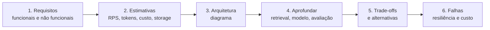

# 04 · Entrevistas técnicas de IA: live coding, system design, decisões e perguntas de IA

## Objetivo

Ao terminar, você sabe conduzir um live coding pensando em voz alta, desenhar um sistema de IA completo com
estimativa de capacidade e custo, explicar decisões técnicas no formato de um ADR e responder às perguntas
clássicas de IA aplicada (RAG × fine-tuning, quando usar agentes, custo, falhas, avaliação, segurança).

## Explicação

### Live coding e problem solving

O entrevistador avalia **como você pensa**, não só se o código roda. Roteiro:

1. **Esclareça** (2–3 min): entradas, saídas, tamanho, erros esperados. Repita o problema com suas palavras.
2. **Exemplos e casos de borda** antes de codar: vazio, um elemento, duplicados, erro não transitório, timeout.
3. **Solução simples primeiro**, dita em voz alta com a complexidade; depois otimize se pedirem.
4. **Code narrando** o porquê ("uso um Map para busca O(1)").
5. **Teste** com os exemplos do passo 2, inclusive o caminho de erro.
6. **Otimização e trade-offs**: o que mudaria com 100× mais dados?

Em vagas de IA aplicada, o live coding costuma ser prático: retry com backoff, parser de saída do LLM,
chunker, cálculo de similaridade de cosseno, um endpoint com streaming. Treine com o banco do
[exemplo 04](../exemplos/04-simulador-de-entrevista/) (pergunta `live-coding-retry`).

### System design para sistemas de IA

Mesma estrutura de system design clássico, com peças novas (modelo, contexto, avaliação, custo por token):



- **Requisitos**: quem usa, quanto, qual latência, que dados (sensíveis? mudam?), qual orçamento.
- **Estimativas**: requisições/dia → RPS médio e de pico; concorrência pela Lei de Little (taxa × latência);
  tokens de entrada e saída por chamada → tokens/mês → custo; tokens/s de saída no pico (decide self-host);
  vetores × dimensões × 4 bytes → armazenamento. O [exemplo 05](../exemplos/05-system-design-rag/) faz essa
  conta em código para um assistente RAG de 10 mil usuários.
- **Escala**: em IA o gargalo raramente é RPS do back-end; é throughput de tokens, rate limit do provedor e custo.
- **Custo**: tokens de entrada dominam em RAG; alavancas: menos contexto, cache de prompt, roteamento para modelo
  menor, batch. Self-host só fecha com utilização alta (ver
  [custo e capacidade na trilha LLMOps](../../../trilhas-extras/llmops-vllm-openshift/docs/08-custo-e-capacidade.md)).
- **Resiliência**: timeout, retry com backoff e jitter, fallback de modelo, circuit breaker, fila, degradação
  honesta, avaliação como portão no CI.

### Explicar decisões técnicas

Use a estrutura de um **ADR** (Architecture Decision Record), mesmo falando:

| Parte | Pergunta que responde |
|---|---|
| Contexto | Qual problema e quais restrições (prazo, time, dados, custo)? |
| Opções | Quais alternativas você considerou de verdade? |
| Critério | Por qual critério comparou (custo, latência, risco, o que o time sabe operar)? |
| Decisão | O que escolheu? |
| Consequências | O que você aceitou perder e **o que faria você revisitar** a decisão? |

"Escolhi pgvector porque é bom" não é explicação; "escolhi pgvector porque já operamos Postgres, temos 400 mil
vetores e o p95 da busca ficou abaixo do SLO; revisitaria acima de dezenas de milhões de vetores" é.

### Perguntas técnicas específicas de IA

O [banco de perguntas](../exemplos/04-simulador-de-entrevista/perguntas.json) tem resposta-modelo, pontos-chave e
armadilhas para cada uma. Resumo:

| Pergunta | Núcleo da boa resposta |
|---|---|
| RAG × fine-tuning | RAG para **conhecimento** (muda, precisa de fonte e permissão); fine-tuning para **comportamento** (formato, tom, tarefa estreita). Comece por prompt + RAG e meça; podem combinar |
| Quando usar agentes | Workflow quando os passos são conhecidos (mais barato e testável); agente quando o caminho depende do que se descobre, com limite de passos/custo e humano no loop para ações irreversíveis |
| Otimização de custos | Medir tokens por rota → avaliação fixa → cache → menos contexto → `max_tokens` → modelo menor nas tarefas fáceis |
| Tratamento de falhas | Timeout, retry só em transitórios com backoff+jitter, fallback, circuit breaker, idempotência, alertas por SLO |
| Avaliação | Conjunto versionado, verificações determinísticas + LLM-as-judge calibrado, portão no CI, validação online |
| Segurança | Prompt injection não tem filtro perfeito: menor privilégio, ACL no retrieval, confirmação humana, saída validada, red team |

Ligações no repo: avaliação em [LLMOps · avaliação](../../../trilhas-extras/llmops-vllm-openshift/docs/05-avaliacao.md),
agentes e guardrails no [módulo 04](../../04-agentes-autonomos/), segurança de tools no [módulo 03](../../03-mcp/docs/04-seguranca-e-governanca.md).

## Código mínimo

```js
// Lei de Little + custo por token: o coração de uma estimativa de system design de IA (exemplo 05)
const rpsPico = (reqDia / (horasUteis * 3600)) * fatorPico;
const concorrencia = rpsPico * latenciaS;
const custoMes = (tokensEntradaMes / 1e6) * preco.entrada + (tokensSaidaMes / 1e6) * preco.saida;
```

## Na prática

- [Exemplo 04 · simulador de entrevista](../exemplos/04-simulador-de-entrevista/)
- [Exemplo 05 · system design RAG](../exemplos/05-system-design-rag/) · [exercício 02](../exercicios/02-system-design-com-custo/)

## Armadilhas

- Desenhar caixinhas antes de perguntar requisitos e volume.
- Estimar custo só com tokens de saída (em RAG, a entrada é a maior parte).
- Propor agente/multiagente para um fluxo de passos conhecidos.
- Live coding calado, ou sem testar o caminho de erro.
- Confiar na **nota** de um LLM-as-judge pequeno: no exemplo 04 o modelo deu nota 5 listando três lacunas na
  mesma frase. Use rubrica, checklist determinístico e calibração com notas humanas.
- Dizer preço de token "de cabeça": preços mudam; diga a premissa e a data.

## Fontes

- System Design Primer: https://github.com/donnemartin/system-design-primer
- Chip Huyen · Machine Learning Systems Design: https://github.com/chiphuyen/machine-learning-systems-design · Building LLM applications for production: https://huyenchip.com/2023/04/11/llm-engineering.html
- Anthropic · Building effective agents (workflows × agentes): https://www.anthropic.com/engineering/building-effective-agents
- OpenAI · Optimizing LLM accuracy (prompt, RAG, fine-tuning): https://platform.openai.com/docs/guides/optimizing-llm-accuracy
- OWASP Top 10 for LLM Applications: https://owasp.org/www-project-top-10-for-large-language-model-applications/
- Architecture Decision Records: https://adr.github.io/
- Tech Interview Handbook · Coding interview prep: https://www.techinterviewhandbook.org/coding-interview-prep/
