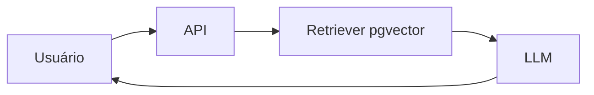

# <nome-do-projeto>

<Uma frase com o problema e para quem: "Assistente que responde dúvidas de RH sobre 300 políticas internas,
citando a fonte, para 2 mil funcionários.">

<Uma frase com o resultado principal medido: "Acerta 87% das 60 perguntas do conjunto de avaliação, p95 de 2,1 s,
US$ 0,004 por pergunta (preços de AAAA-MM-DD).">

## Demo

<GIF de 15–30 s mostrando o fluxo principal, link para a demo pública ou "UI local em http://localhost:PORTA".>

## Arquitetura



<2–4 linhas explicando as decisões: por que RAG e não fine-tuning, por que este modelo, por que este banco.>

## Pré-requisitos

- <runtime e versão exata, ex.: Node 24.11>
- <serviços: Postgres 18 + pgvector 0.8.7, Ollama com o modelo X>
- <variáveis de ambiente, com os defaults>

## Como rodar

```bash
<comando 1: instalar>
<comando 2: subir dependências>
<comando 3: rodar>
```

## Saída esperada

```text
<saída REAL colada da execução, encurtada com ...>
```

## Resultados medidos

| Métrica | Valor | Como medi |
|---|---|---|
| <acurácia no conjunto de avaliação> | <%> | <script/arquivo de casos> |
| <latência p95> | <ms> | <N requisições, concorrência C> |
| <custo por requisição> | <US$> | <tokens médios × preço da data> |

## Testes e avaliação

```bash
<comando de teste: npm test / pytest>
```

## Limitações e próximos passos

- <o que não funciona bem e por quê>
- <o que não foi executado e por quê (ex.: precisa de GPU)>
- <o próximo passo que você faria com mais tempo>

## Stack

<lista curta com versões exatas>
