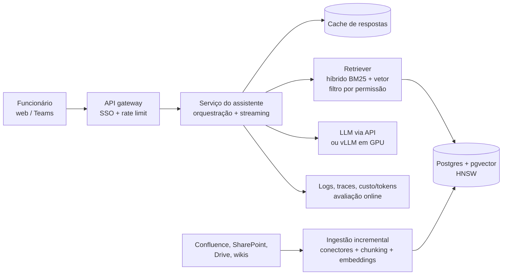

# Exemplo 05 · System design de IA: assistente RAG corporativo para 10 mil usuários

**Conceito novo:** em entrevista de system design de IA, a conta de capacidade e de custo **em código**, com
premissas explícitas, é o que separa "desenhei caixinhas" de "projetei um sistema". Este exemplo é o roteiro
completo: requisitos → estimativas → arquitetura → trade-offs → falhas.

**Pré-requisito:** nenhum além do Node. Preços de tokens são **ilustrativos** (`PRECOS_ILUSTRATIVOS` em
`capacidade.js`): troque pelos do provedor escolhido, com a data.

## 1. Requisitos (pergunte antes de desenhar)

| Tipo | Requisito (premissa combinada com o "entrevistador") |
|---|---|
| Funcional | Funcionários perguntam sobre políticas, processos e sistemas internos; a resposta **cita a fonte** |
| Funcional | Cada pessoa só vê documentos que já poderia ver (permissões do sistema de origem) |
| Escala | 10 mil funcionários, 30% ativos por dia, 8 perguntas por ativo, janela de 10 h, pico 3× a média |
| Desempenho | p95 de 6 s ponta a ponta, com streaming (primeiro token rápido) |
| Base | 50 mil documentos, ~8 trechos por documento, reindexação incremental diária |
| Custo | orçamento mensal conhecido; custo por pergunta reportado no painel |

## 2. Estimativas (calculadas em `main.js`)

As premissas acima viram `PREMISSAS` em `main.js`; as fórmulas ficam em `capacidade.js` (funções puras, testadas).

### Como rodar

```bash
cd modulos/12-carreira
npm run ex05
node --test exemplos/05-system-design-rag/
```

### Saída esperada

Saída real (2026-10-16):

```text
== Volume e capacidade ==
requisições/dia: 24.000 · RPS médio 0,67 · RPS pico 2,00
concorrência no pico (Little): 12,0 requisições simultâneas
geração no pico: 500 tokens/s de saída
tokens/mês: 1.188 M de entrada · 132 M de saída

== Custo via API (preços ILUSTRATIVOS, US$/1M tokens: {"entrada":0.4,"entradaEmCache":0.1,"saida":1.6,"embedding":0.02}) ==
LLM: US$ 633 /mês · US$ 0,0012 por pergunta
indexação completa (400.000 trechos): US$ 2,40

== Armazenamento vetorial ==
400.000 vetores de 1024 dims: 1,64 GB (float32) + 0,60 GB de texto, antes do índice HNSW

== Sensibilidade (o que mais mexe no custo?) ==
base                             US$    633 /mês · pico   500 tok/s
cache de prompt 50%              US$    508 /mês · pico   500 tok/s
3 trechos em vez de 5            US$    520 /mês · pico   500 tok/s
agente com 4 chamadas/pergunta   US$  2.532 /mês · pico 2.000 tok/s
adoção dobra (60% ativos)        US$  1.266 /mês · pico 1.000 tok/s

== Self-host: quantas réplicas do servidor medido neste repo? ==
no pico: 500 tok/s ÷ 29.5 tok/s (vLLM CPU, modelo 0,5B) = 17 réplicas
-> CPU não fecha a conta e um modelo de 0,5B não tem a qualidade necessária: API ou GPU (meça o tok/s da sua GPU).
```

Leituras para falar em voz alta: (1) 2 req/s de pico é **pouco** para a API e para o banco: o gargalo é
custo e qualidade, não escala; (2) tokens de **entrada** são 90% do volume, então contexto (nº de trechos,
cache de prompt) é a alavanca de custo; (3) trocar RAG simples por agente multiplica custo e throughput pelo
número de chamadas; (4) 1,6 GB de vetores cabe com folga num Postgres com pgvector. Os 29,5 tok/s vêm da
execução real do [projeto final da trilha LLMOps](../../../../trilhas-extras/llmops-vllm-openshift/projeto-final/).

## 3. Arquitetura



## 4. Trade-offs (o que você escolheu e o que descartou)

| Decisão | Escolha | Alternativa descartada e por quê |
|---|---|---|
| Conhecimento | RAG com citação | Fine-tuning: a base muda todo dia e precisa de fonte e permissão por usuário |
| Banco vetorial | pgvector no Postgres | Banco vetorial gerenciado: 400 mil vetores não justificam outra peça para operar |
| Busca | Híbrida (palavra-chave + vetor) | Só vetor: erra siglas, códigos de sistema e nomes próprios |
| Permissões | Filtro no retrieval (ACL do documento) | Filtrar a resposta depois: o LLM já viu o que não devia |
| Modelo | API com fallback para um segundo provedor | Self-host desde o dia 1: 2 req/s não pagam GPU ociosa 24 h (refaça com o seu preço) |
| Fluxo | Workflow fixo (1 chamada) | Agente: 4× o custo sem necessidade para perguntas de política |

## 5. Falhas e resiliência

- **LLM fora/lento**: timeout + retry com backoff só para 429/5xx + fallback de provedor + mensagem honesta.
- **Retriever não acha nada**: responder "não encontrei nas fontes" em vez de deixar o modelo inventar.
- **Documento apagado/permissão revogada**: ingestão incremental propaga deleções; o filtro de ACL é na consulta.
- **Regressão de qualidade**: conjunto de avaliação no CI (portão) + amostragem com feedback do usuário.
- **Custo descontrolado**: orçamento por usuário/dia, alerta de custo, `max_tokens` fixo.

## Experimente

1. Mude `latenciaS` para 12 e veja a concorrência dobrar: o que isso exige do pool de conexões?
2. Troque `PRECOS_ILUSTRATIVOS` pelos preços atuais de um provedor real (anote a data) e recalcule.
3. Adicione um cenário "re-ranking com 20 candidatos" (mais uma chamada pequena) e compare o custo.

## Versão Python

`python/capacidade.py` (as mesmas fórmulas, com as premissas num `dataclass`), `python/main.py` e
`python/test_capacidade.py` (pytest).

### Como rodar

```bash
cd modulos/12-carreira
uv run python exemplos/05-system-design-rag/python/main.py
uv run pytest exemplos/05-system-design-rag/
```

### Saída esperada (Python)

Saída real (2026-10-17), idêntica à do JS (`diff` vazio). Os floats brutos (custo, RPS, concorrência
em 6 cenários) também são iguais bit a bit:

```text
== Volume e capacidade ==
requisições/dia: 24.000 · RPS médio 0,67 · RPS pico 2,00
concorrência no pico (Little): 12,0 requisições simultâneas
geração no pico: 500 tokens/s de saída
tokens/mês: 1.188 M de entrada · 132 M de saída

== Custo via API (preços ILUSTRATIVOS, US$/1M tokens: {"entrada":0.4,"entradaEmCache":0.1,"saida":1.6,"embedding":0.02}) ==
LLM: US$ 633 /mês · US$ 0,0012 por pergunta
indexação completa (400.000 trechos): US$ 2,40

== Armazenamento vetorial ==
400.000 vetores de 1024 dims: 1,64 GB (float32) + 0,60 GB de texto, antes do índice HNSW

== Sensibilidade (o que mais mexe no custo?) ==
base                             US$    633 /mês · pico   500 tok/s
cache de prompt 50%              US$    508 /mês · pico   500 tok/s
3 trechos em vez de 5            US$    520 /mês · pico   500 tok/s
agente com 4 chamadas/pergunta   US$  2.532 /mês · pico 2.000 tok/s
adoção dobra (60% ativos)        US$  1.266 /mês · pico 1.000 tok/s

== Self-host: quantas réplicas do servidor medido neste repo? ==
no pico: 500 tok/s ÷ 29.5 tok/s (vLLM CPU, modelo 0,5B) = 17 réplicas
-> CPU não fecha a conta e um modelo de 0,5B não tem a qualidade necessária: API ou GPU (meça o tok/s da sua GPU).
```

Para os números baterem: (1) `toLocaleString('pt-BR')` virou `comum_py.formato.fmt` (milhar com ponto,
vírgula decimal, arredondamento meio para longe do zero sobre o `repr` do float, como o ICU); um
`f"{x:,.0f}"` usaria vírgula de milhar e arredondaria empates para o par; (2) a soma do custo mantém a
mesma ordem de operações do JS.
