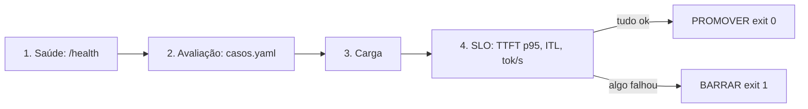

# llm-gate · portão de promoção para LLMs

Toda versão nova de modelo, prompt ou parâmetro só chega à produção se passar, sozinha e sem opinião humana,
por quatro etapas: saúde, avaliação, carga e SLO. É o CI/CD de LLMOps em ~200 linhas de Python.

Resultado da última execução (2026-10-13, CPU de 8 núcleos, sem GPU): 4 de 4 casos de avaliação passaram,
TTFT p95 <= 750 ms, ITL médio de 119 ms e 29.5 tokens/s com o Qwen2.5-0.5B-Instruct no vLLM 0.31.0.

## Arquitetura



Decisões: o contrato de desempenho mora num `slo.yaml` versionado (quem muda o limite deixa rastro no Git);
o portão lê as métricas do próprio servidor (`/metrics` do vLLM via Prometheus) em vez de cronometrar no
cliente, para medir o que o servidor de fato entrega; o código de saída (0/1) é a interface com qualquer CI.

## Demo

UI do Prometheus em http://localhost:9090 com a consulta `rate(vllm:generation_tokens_total[1m])` durante a carga.

## Pré-requisitos

- Docker 29 com Compose, ~6 GB de RAM livres (o vLLM em CPU).
- Python 3.14 + uv.

## Como rodar

```bash
docker compose up -d                    # ~3 min até o vLLM ficar "healthy"
uv run python portao.py; echo "exit=$?"
```

## Saída esperada

```text
| Saúde | ✅ | vLLM 0.31.0 no ar |
| Avaliação | ✅ | 100% dos casos passaram (mínimo 100%) |
| Carga / SLO | ✅ | TTFT p95 <= 750 ms (limite 15000) · ITL 119 ms (limite 400) · 29.5 tok/s (mínimo 8) |
**Veredito: PROMOVER ✅**
exit=0
```

Com um SLO impossível em CPU (`itl_medio_ms: 10`), o mesmo portão barra a versão:

```text
| Carga / SLO | ❌ | TTFT p95 <= 1000 ms (limite 15000) · ITL 123 ms (limite 10) · 28.6 tok/s (mínimo 8) |
**Veredito: BARRAR ❌**
exit=1
```

## Testes e avaliação

Os casos obrigatórios ficam em `casos.yaml` (100% precisam passar); o próprio `portao.py` é o teste.

## Limitações e próximos passos

- Medido em CPU: em GPU os números mudam em ordens de grandeza; as relações (prompt longo → TTFT alto) se mantêm.
- 4 casos de avaliação é pouco para decidir sozinho; o próximo passo é um conjunto de 50+ casos com LLM-as-judge.
- Não executado em cluster: o passo seguinte é rodar o portão como Job do Kubernetes antes do `oc apply`.

## Stack

vLLM 0.31.0 · Prometheus 3.15 · Python 3.14 · Qwen2.5-0.5B-Instruct.
