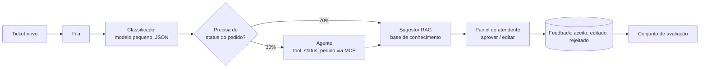

# Solução · Triagem de tickets com IA

## Requisitos e premissas

| Tipo | Requisito / premissa |
|---|---|
| Funcional | Classificar categoria e prioridade (JSON validado por schema) |
| Funcional | Sugerir resposta citando artigos da base de conhecimento; o atendente **aprova ou edita** (human-in-the-loop) |
| Funcional | Em ~30% dos tickets, consultar o status do pedido via tool (servidor MCP do sistema de pedidos, só leitura) |
| Escala | 400 × 60 = 24.000 tickets/dia em 8 h, pico 2,5× (~2,1 tickets/s) |
| Latência | Classificação < 2 s (roteia a fila); sugestão < 8 s, com streaming no painel do atendente |
| Tokens (premissa) | classificar 600 → 30; sugerir 2.100 → 300 (4 trechos de 300); agente 2 × (1.500 → 120) |
| Custo | Preços **ilustrativos** do exemplo 05; reportar custo por ticket |

## Arquitetura

## Trade-offs

| Decisão | Escolha | Alternativa descartada e por quê |
|---|---|---|
| Agente | Só nos 30% que precisam do pedido (roteado pelo classificador) | Agente em 100%: ~3× o custo da etapa e mais latência sem ganho nos 70% |
| Classificação | Modelo pequeno com saída em JSON | Modelo grande: a tarefa é estreita; com volume alto, aqui caberia até fine-tuning de um modelo pequeno |
| Envio | Sugestão aprovada pelo humano | Resposta automática ao cliente: risco de erro visível; reavaliar quando a taxa de aceitação passar de um limite combinado |
| Processamento | Fila assíncrona | Síncrono no webhook: pico do provedor derrubaria a abertura de tickets |
| Otimização | Começar pela etapa "sugerir" (67% do custo) | Otimizar a classificação primeiro: 11% do custo |

## Modos de falha

- Provedor de LLM fora: a fila segura os tickets; classificação cai para regra por palavra-chave; o atendente
  trabalha sem sugestão (degradação, não parada).
- Tool de pedidos lenta: timeout de 3 s e sugestão sem o status, avisando o atendente.
- Prompt injection no corpo do ticket: a tool é só leitura e o envio passa por um humano.
- Qualidade caindo: a taxa de "sugestão aceita sem edição" é a métrica online; edições viram casos de avaliação.
